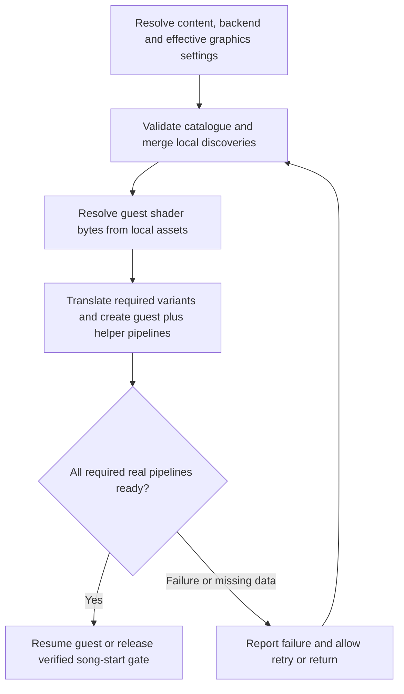

# Shader cache and gameplay stalls: findings and implementation plan

Date: 2026-10-10. Architecture review 2026-10-16; plan finalized 2026-10-17.
Product flow and implementation prompts updated 2026-10-24.
Scope: first-play freezes that become less frequent with further play and do not
recur at the same spot after restarting a song.
Status: delivered 2026-10-25, P0-P9 implemented; moved to `finished/` at the
owner's request. The final catalogue has **209 shader locators** and **421 rtv,
219 rov, 423 fbo, 228 fsi** portable recipes. P8 established D3D12 cold/warm reuse
and combined damage recovery, plus Vulkan cold preparation and the presenter fix.
Its later Vulkan runs showed that dynamic scene/material combinations still add
recipes. The zero-compilation promise was therefore narrowed by those findings:
preparation covers known recipes, with asynchronous runtime discovery for misses.
P9 packages and audits the embedded catalogue/local extractor and preserves user
stores on update. Installed game/UI checks are owner-driven and **pending**;
the remaining release/runtime gates are tracked in
[shader-cache.md](../../engine/shader-cache.md) parts 8 and 9 and
[the backlog](../../reference/backlog.md). Moving this delivery to finished does
not certify those gates, every song, every configuration or other hardware.

Historical P0 summary (2026-10-24):
On an empty application cache the first song creates 81 guest pipelines and
translates 61 shaders, with four of its eight active-song long frames (worst
306.4 ms) overlapping that work; a same-process replay adds 1/1. A full restart on
the learned records preloads 132 pipelines at boot and then adds 5/4 with no compile
wait. Vulkan/retail is worse in the song: 79 creations and 56 translations plus
336 ms of compile wait on first play, and 7 creations plus a 199 ms wait on replay.
The cause of individual freezes is still not established: four of the eight
empty-cache long frames record no compile work at all. A storage preload now reports
explicit required/succeeded/failed/missing counts on both backends and cannot return
before its required work finished ([P1 record](#p1--make-backend-completion-and-failure-reporting-trustworthy));
since P4 the same work can run as a cancellable generation beside the guest
([P4 record](#p4--add-asynchronous-preparation-without-starving-the-loading-screen)),
and P5/P6 now add native persistence and the post-A guest loading gate.
Invalidation is P7 (implemented 2026-10-24); full route
validation and the cold-versus-warm measurement remain P8, and P6 UI evidence is pending. Evidence:
[shader-cache.md](../../engine/shader-cache.md) (parts 1 and 3) and
`out/shader-cache-p0/runs/`.

The [2026-10-24 prompt plan](#implementation-prompts-2026-10-24) defined the delivered work:
a graphics-preparation phase after the title-screen A press, beside the existing
settings/content loading, with persistent caches for faster subsequent launches.
It supersedes the older before-guest product flow and the optional priority of native
caches; the earlier findings and acceptance requirements remain useful technical context.
The [2026-10-16 implementation plan](#implementation-plan-2026-10-16) extends the
original investigation. It corrects the earlier assumption
that requesting blocking startup preload guarantees completion on D3D12. Historical
measurements below are retained; no new gameplay measurements were taken in this review.

## Assessment

**Shader caching is active. First-use shader translation and pipeline creation are
credible causes of the reported freezes.** The D3D12 renderer has a submission
path that waits for pipeline creation even with asynchronous compilation enabled.
However, improvement on replay also fits asset loading and other resource caches.
Do not treat the shader explanation as confirmed until a stall is correlated with
compilation or a pipeline wait.

The recommended direction is **a game-specific pipeline catalogue, preparation before
playback, and a verified completion barrier**. Repair the existing D3D12 preload
barrier first, then expand coverage to guest and renderer-helper pipelines. Generate
guest shader records locally from the user's installed assets; distribute compatible
pipeline recipes and hashes rather than the game's shader bytes. Add local native
pipeline caching later if preparation time warrants it. Keep investigating stalls
that remain with a warm cache.

## What the repository and local runs establish

| Finding | Evidence |
| --- | --- |
| Persistent shader storage defaults to enabled. | `store_shaders` in [graphics_system.cpp](../../../rexglue-sdk/src/graphics/graphics_system.cpp), including its `InitializeShaderStorage` implementation. |
| Startup requests blocking preparation before the main guest thread starts. | [rex_app.cpp](../../../rexglue-sdk/src/ui/rex_app.cpp):464 calls `InitializeShaderStorage(..., true)` before `main_thread->Resume()`. **Correction, 2026-10-16:** the D3D12 implementation can return with workers still busy; see finding F1 below. |
| The recent local runs use D3D12. | Their startup logs identify a DXGI NVIDIA GeForce GTX 970 adapter and D3D12 pipeline creation. This describes those runs, not every user's backend. |
| The cache actually loads, rather than merely being configured. | Historical `out/build/win-amd64-release/logs/rb_blitz_006.log`, lines 207–209: 186 shader translations in 9 ms, then a report of 356 graphics pipelines in 356 ms. **Correction, 2026-10-16:** D3D12's pipeline counter counts scheduled/attempted entries, not confirmed successful completions; F1 explains why this time is not a reliable readiness measurement. |
| The stored coverage grew through use. | `rb_blitz_002.log`: 171 shader translations and 324 pipelines; subsequent local logs: 186 and 356. These are preload counts, not measured stall counts or proof of completeness. |
| Async compilation defaults to enabled. | `async_shader_compilation` in [command_processor.cpp](../../../rexglue-sdk/src/graphics/command_processor.cpp); D3D12 creation threads default to automatic selection. |
| D3D12 still waits for compilation during submission. | `D3D12CommandProcessor::EndSubmission()` calls `PipelineCache::EndSubmission()`. The latter creates queued pipelines on the processor thread and waits for busy creation workers. |
| The development profile enables render-target readback. | `out/build/win-amd64-release/rb_blitz.toml`: `d3d12_readback_resolve = true`. Readback has GPU synchronization paths and is another profiling target. |
| Earlier pacing tests already recorded an unresolved long stall. | [Known issues](../../reference/known-issues.md) and the frame-pacing close-out in [bringup log](../../history/bringup-log.md): a 1174.9 ms guest `VdSwap` gap and 263.6 ms `XE_SWAP` gap in the vsync-on run. These do not identify the cause of the current report. |
| The installer does not currently ship a prepared shader-cache baseline. | [make_payload.ps1](../../../installer/tools/make_payload.ps1) packages the executable, launcher and runtime dependencies. |

The logs and developer profile above are local, ignored artifacts and may rotate
or be absent in another checkout. Preserve copies in an investigation evidence
folder before further sessions overwrite them. Startup times on this already-used
machine do not predict first-run compilation times on another machine.

### Storage and formats

[RbBlitzApp](../../../src/rb_blitz_app.h) defaults the cache root to
`<user_data_root>/cache`, normally under Windows Documents:

```text
Documents/Rock Band Blitz/cache/shaders/shareable/
    5841122D.xsh
    5841122D.rtv.d3d12.xpso
```

Both files were present during the investigation: 103,484 bytes of shader records
and 25,644 bytes of D3D12 pipeline records. Explicit path overrides can change
their location. This cache is separate from the DLC enumeration cache and player
saves.

- `.xsh` stores guest shader microcode and identifying metadata. It is not a
  collection of final GPU machine-code binaries.
- `.xpso` stores pipeline descriptions. The D3D12 path selects `rtv` or `rov`;
  Vulkan selects `fbo` or `fsi` and uses `.vk.xpso` instead of `.d3d12.xpso`.
- On startup, the renderer uses those records to translate shaders and create
  pipelines for the current host. A shader can have multiple translations and
  participate in multiple pipelines.
- The formats have version checks. Being shareable does not make them compatible
  with every renderer revision, setting or rendering path.

Sources: D3D12 [pipeline cache](../../../rexglue-sdk/src/graphics/d3d12/pipeline_cache.cpp)
and [format definitions](../../../rexglue-sdk/include/rex/graphics/d3d12/pipeline_cache.h);
Vulkan [pipeline cache](../../../rexglue-sdk/src/graphics/vulkan/pipeline_cache.cpp).

### Why static recompilation does not remove this work

The CPU code is statically recompiled, but Xbox 360 graphics commands still go
through ReXGlue's GPU implementation. Guest shaders need host translation, and the
host driver needs graphics pipelines combining shaders with rendering state.
Encountering a new combination during a song can therefore require new work.

The D3D12 async draw path can skip a draw whose pipeline is not ready, yet the
submission path subsequently waits for queued compilation. On Vulkan, shader
translation occurs before the async pipeline decision, placeholder pipeline creation
can be synchronous, and ordinary submissions also drain/wait for pipeline work.
Switching backend or enabling async is not by itself a guarantee of hitch-free gameplay.

## What you should do as the player

**Yes: play different visual situations and use different power-ups. You do not
need to begin by playing every song in the library.** The objective is to encounter
new effects and rendering combinations, not just increase the song count. Songs
can share graphics; two plays of the same song can expose different effects.

### First, provide a small repeatable example

1. Choose a song and power-up loadout where you noticed a freeze. Record the build,
   backend, graphics settings, retail/Ultimate mode and whether it is DLC/custom
   content. Keep these fixed for the comparison.
2. Play it and note approximately where the freeze happens. Note what appeared
   on screen, whether music continued, whether input still seemed responsive, and
   whether visuals disappeared or the whole displayed frame stopped updating.
3. Restart the song immediately with the same loadout and try to repeat the same
   actions. Record whether the freeze repeats at that event.
4. Exit normally, launch the game again and repeat once more. This separates reuse
   within one process from reuse across launches, although it still does not prove
   which cache helped.
5. Give the agent the observations and the corresponding logs. A short video is
   useful if convenient; a song-relative timestamp and event description are enough
   to start. Average FPS alone is not a useful record of a one-second freeze.

Keep your existing caches. Do not delete saves, shader caches or driver caches to
make a clean test; the agent should prepare isolated test runs when needed.

### Then, collect broader coverage with agent feedback

Once the agent can report newly observed pipelines, work through this checklist:

- [ ] Title screen, song library, loading transitions, pause/resume and results.
- [ ] Several songs with visibly different backgrounds, lighting or scenery.
- [ ] Every selectable power-up, actually activated during gameplay.
- [ ] Different power-up combinations where they produce overlapping effects.
- [ ] Track switching, sustained successful play, misses, and score/streak or
      checkpoint transitions that visibly change the scene.
- [ ] A complete song through the ending and results screen.
- [ ] Retail and Ultimate separately if both are supported release modes.
- [ ] Representative bundled, DLC and custom songs with unusual visual behavior.
      **Not required (owner, 2026-10-24): songs and DLC do not vary shader usage.**

The agent should maintain the coverage checklist and tell you which sessions added
pipelines. Stop repeating a route once it adds no new records, unless it is needed
to reproduce a remaining stall. Broaden to other scenes or effects instead.
Saturation on this checklist is evidence of useful coverage, not proof that every
possible pipeline has been discovered.

You should supply gameplay judgment and confirm that notes, effects, audio and
input remain correct. The agent should handle paths, logs, cache comparisons and
technical measurements. You should not need to inspect binary cache files or
guess which shader corresponds to a freeze.

## What an agent should do

The following is the original three-phase outline. The detailed plan below refines
its order and acceptance gates. Creating this document does not implement renderer
changes or perform controlled gameplay runs.

### Phase 1: establish the cause

1. Record the repository/SDK revisions, built binaries, backend, GPU/driver,
   effective settings, game/mod variant and resolved cache path. Check actual
   runtime values rather than assuming defaults or that the binaries match source.
2. Preserve the relevant logs and shader-cache snapshot. Prepare an isolated
   shader cache for controlled runs, leaving player progress and normal caches
   intact. Keep other game data and settings the same.
3. Add focused timing, if implementation is requested, for shader translation,
   pipeline misses/creation, D3D12 submission waits and GPU readback waits. Correlate
   these with frame gaps; include pipeline identity and whether work was preloaded
   or first encountered during gameplay. Avoid logging every draw to disk.
4. Compare the same route with an empty application shader cache, immediate replay,
   and full process restart with populated storage. An empty application cache does
   not imply an empty driver or OS file cache; report those limits explicitly.
5. If a long frame occurs without compilation or its associated wait, investigate
   resource upload/conversion, asset I/O/decompression and CPU/GPU synchronization.
   Do not label every first-use cost as shader compilation.
6. Report individual long-frame durations and correlated work, plus the worst
   frame and counts of frames exceeding useful thresholds such as 50/100/250 ms.
   Check that instrumentation does not itself create the observed freezes.

Deliverable: a short evidence table identifying confirmed causes, unresolved
stalls and the next change justified by the measurements.

### Phase 2: collect and validate portable coverage

1. Give the player a simple launch/capture workflow and the coverage checklist
   above. Preserve each session's configuration and records.
2. Provide a cache inspection tool/report that validates headers and hashes,
   counts unique records and reports additions per session. Preload log counts
   alone are insufficient to attribute new records to a particular gameplay event.
3. Track coverage by backend, rendering path and supported content/configuration.
   Do not assume D3D12 pipeline records also cover Vulkan.
4. Merge compatible records by identity with format validation; do not concatenate
   files or replace a richer user cache with a smaller baseline.
5. Replay the collected baseline on representative machines and verify preload
   success, remaining misses, startup cost and rendering correctness.

Deliverable: a candidate baseline plus a coverage report stating what was exercised
and what remains untested.

### Phase 3: implement preparation and distribution

1. Generate guest shader records from the user's game installation and package a
   versioned catalogue of compatible pipeline recipes. The `.xsh` format contains
   original game shader bytes. Decision D2 below selects local generation to follow
   the project's existing asset-distribution policy.
2. Seed/merge records into the resolved writable cache without discarding existing
   discoveries. Handle missing, incompatible and corrupt records predictably.
3. Repair and reuse the existing blocking startup preload. Add progress reporting and safe
   cancellation if its duration warrants it. Explore song-loading warmup only if
   pipeline requirements can be identified before the song begins.
4. Keep learning new combinations at runtime. Preserve provenance and invalidate
   records when relevant formats or translation assumptions change.
5. If profiling justifies it, improve the D3D12 submission wait behavior. Do not
   simply remove the wait: audit deferred commands, pending shader data, object
   lifetimes and rendering correctness first. Missing notes or incorrect effects
   are not an acceptable trade for a better frame-time graph.

Deliverable: a reviewable change with cold/warm measurements, installer coverage,
and player confirmation of correct gameplay visuals and timing.

## What can be prepared and shared

| Approach | Benefit | Limit or follow-up |
| --- | --- | --- |
| Ship guest shader records and pipeline descriptions. | Moves known first-use work to startup using infrastructure already present. | Requires coverage and compatible backend/path records; host compilation still happens. |
| Extract shaders and build a pipeline catalogue ahead of time. | Could improve coverage beyond manual captures. | Extracting every shader does not enumerate every rendering-state combination. Requires game/asset analysis. |
| Cache translated host shader bytecode. | Could avoid repeated translation work. | New cache design must account for translator revision and relevant host/settings variants. |
| Persist native driver pipeline results locally. | Can reduce repeated host pipeline creation cost. | Hardware/driver compatibility matters. This is not one universal release cache. |
| Compile in the background during startup/loading. | Moves work away from interactive song playback. | Needs early knowledge of requirements and a completion policy before gameplay. |
| Use fallback rendering while compilation finishes. | Can avoid waiting for some missing pipelines. | High correctness risk for notes and gameplay feedback; existing async paths already have limitations. |

D3D12 currently does not store native PSO blobs in this application's shader cache;
the source explicitly describes them as a possible future addition. Vulkan's
graphics pipeline creation currently passes `VK_NULL_HANDLE` for `VkPipelineCache`.
Neither observation rules out caching performed internally by the driver.

Microsoft documents native D3D12 cached PSOs as hardware-, driver- and
machine-specific: [D3D12_CACHED_PIPELINE_STATE](https://learn.microsoft.com/en-us/windows/win32/api/d3d12/ns-d3d12-d3d12_cached_pipeline_state).
Khronos describes native Vulkan pipeline caching and its potential to reduce
creation cost: [Pipeline Cache](https://docs.vulkan.org/guide/latest/pipeline_cache.html).

## Completion criteria

- A captured freeze has a measured cause, or is explicitly left unresolved.
- Known baseline pipelines finish preparation before song playback on tested
  configurations; any misses during the coverage route are reported.
- Immediate replay and full process restart are both tested.
- Startup costs and remaining long frames are reported, not hidden by average FPS.
- Player saves and previously learned cache records survive installation/updates.
- Missing/corrupt/incompatible baseline handling is checked, including fallback.
- The player confirms notes, effects, audio and input remain correct.
- Coverage and machine limits are written down; no claim of universal, complete
  pre-caching is made from a single machine or a handful of songs.

## Implementation plan (2026-10-16)

Status: **planned; implementation not started**. Source review used project `70eb041`
and SDK `c94f5eb`, including the checkout's existing SDK patches. Source line numbers
below refer to that working tree. External API references were checked on 2026-10-16.
No build, game launch, cache deletion, or performance experiment was performed.

### Requirements and recommended scope

During an active song, the supported rendering path should use already-created,
correct pipelines. Preparation may lengthen startup/loading, but must finish before
the song's audio/gameplay clock starts. Notes, hit feedback and render-to-texture
dependencies must remain correct. A smooth frame graph with missing draws fails.

Start with a **global catalogue for each supported content/rendering configuration**,
loaded at startup. This fits the existing preload architecture and avoids depending
on an unproven guest song-loading hook. The historical few-hundred-pipeline counts
make this a sensible first experiment, not a bound on the game's total pipeline set.
Add per-song preparation only if measurements show global preparation or residency
is too expensive, or new content requires additional pipelines.

This is achievable for a measured, bounded catalogue. Neither static CPU recompilation
nor a learned cache proves every future shader/state combination is covered. Unknown
custom content and untested settings remain outside that guarantee until validated.

### Source findings that change the implementation

| ID | Finding and evidence | Required consequence |
| --- | --- | --- |
| F1 | In D3D12 [pipeline_cache.cpp](../../../rexglue-sdk/src/graphics/d3d12/pipeline_cache.cpp):529–541, `creation_thread_needed_count` is computed, but the growth loop compares the current size with `creation_thread_original_count`, initialized to that same size. No temporary workers are added. At 653–684, the blocking worker wait is inside `size > original_count`, so the ordinary path skips it. `CreateQueuedPipelinesOnProcessorThread()` at 3246 only drains the queue; other workers may still be creating PSOs. | Fix worker-count logic **and** put the blocking completion barrier outside temporary-worker cleanup. Even fixing the loop alone leaves the no-growth case uncovered. Reproduce with a deliberately delayed worker; effect on reported song stalls is unmeasured. **Fixed by P1 (2026-10-24): the loop uses the computed count and the barrier is the tracker's, outside the cleanup.** |
| F2 | D3D12 increments `pipelines_created` at 650 regardless of eventual worker success; `IsCreatingPipelines()` at 787 reports queue/busy state, not success. Vulkan [pipeline_cache.cpp](../../../rexglue-sdk/src/graphics/vulkan/pipeline_cache.cpp):624–687 actually joins preload workers and counts successes. However, at 3541–3549 a failed async real pipeline can leave a placeholder with `is_placeholder` cleared. | Define explicit successful/failed completion per required pipeline. Neither a log count, an empty queue, nor a cleared placeholder flag is a sufficient readiness test. **P1 (2026-10-24) implements this rule on both backends.** |
| F3 | [ReXApp::LaunchModule](../../../rexglue-sdk/src/ui/rex_app.cpp):430–469 performs blocking storage initialization inside a deferred UI-thread callback. [GraphicsSystem::InitializeShaderStorage](../../../rexglue-sdk/src/graphics/graphics_system.cpp):342–364 either uses a paused command processor or dispatches to its thread and waits. | Keep the guest start barrier, but expose an asynchronous preparation operation and UI progress. Simply displaying a progress label before the existing call would still freeze event processing. |
| F4 | D3D12 [command_processor.cpp](../../../rexglue-sdk/src/graphics/d3d12/command_processor.cpp):2480–2482 skips an unready pipeline's draw; 3490 waits before deferred commands execute. Vulkan `ConfigurePipeline()` translates first at 1058, may create a placeholder synchronously at 1166, and its ordinary `EndSubmission()` drains/waits at 746–787. | Background compilation is not the playback guarantee on either backend. Preserve submission correctness while moving work before playback. |
| F5 | D3D12 storage obtains needed translation modifications from pipeline descriptions (246–318), then translates those variants (405–425). Its [PipelineDescription](../../../rexglue-sdk/include/rex/graphics/d3d12/pipeline_cache.h):183–222 includes shader hashes/modifications, depth, stencil, blend, topology and render-target state. | Loading every guest shader alone does not prepare all variants or PSOs. Catalogue actual normalized recipes, not a cartesian product of shader pairs. |
| F6 | [D3D12RenderTargetCache](../../../rexglue-sdk/src/graphics/d3d12/render_target_cache.cpp):1777 and 3734/3773 builds transfer shaders/pipelines lazily; `GetOrCreateDumpPipeline` and `GetOrCreateDirectResolvePipeline` are other lazy paths. [VulkanRenderTargetCache](../../../rexglue-sdk/src/graphics/vulkan/render_target_cache.cpp):4509/4531 also creates transfer pipelines. These are separate from guest `.xpso` records. | Inventory and prepare required helper variants too. Instrument the graphics/compute creation helpers as well as the guest pipeline cache. A full guest catalogue alone can still leave first-use compilation. |

F1 is a control-flow defect established by source inspection. Its frequency and
latency impact remain unmeasured. F6 identifies additional possible compilation
sites, not proof that every site executes during a song.

### Decisions

| ID | Decision | Reason |
| --- | --- | --- |
| D1 | Repair preload completion, then prepare a global catalogue before guest execution; keep required pipelines resident through playback. | Smallest useful change builds on the current renderer and protects the first song as well as replays. |
| D2 | Distribute versioned recipes, shader identities and coverage metadata; obtain guest shader bytes locally. | `.xsh` contains game data. [Distributable policy](../../guides/distributable.md) requires the user's game assets and excludes bundled retail/mod payloads. |
| D3 | Treat D3D12 and Vulkan recipes, rendering paths and capability variants independently. | `.d3d12.xpso` and `.vk.xpso` are different formats. A baseline must match the effective backend/path, not merely the requested setting. |
| D4 | Readiness means every required real pipeline succeeded for the current device/configuration generation. | Queue completion and placeholder availability do not establish rendering correctness. |
| D5 | Keep native driver caches local and optional; add them after coverage/readiness works. | They reduce repeated preparation cost, but cannot discover missing recipes or provide portable GPU binaries. |
| D6 | Do not use skipped draws, generic placeholders or mid-song compile waits as the advertised rhythm-safe solution. | All can disrupt playable visuals or timing. Unknown recipes remain a visible coverage failure in validation. |

### Proposed preparation flow



The runtime needs a reusable, bounded preparation API, separate from storage-file
initialization. Suggested operation shape: begin a catalogue/configuration generation,
query `{required, queued, running, succeeded, failed, missing}`, request cancellation,
and obtain a completion result. These are proposed fields, not existing APIs.

Each entry moves through `unresolved -> queued -> running -> ready/failed`; cancellation
is explicit. `ready` requires a successful real pipeline, its dependencies, and a
matching device/configuration generation. Do not publish a successful aggregate result
if any required entry was rejected, failed, or silently skipped for missing shader data.
An empty/missing baseline must not be reported as complete coverage just because its
required count is zero. Compiling known records and validating coverage are separate facts.

Retain shader data, binding layouts, root signatures/render passes and pipeline handles
until workers and in-flight GPU users finish. Keep storage/creation mutation on the
existing owner thread or an explicitly synchronized preparation context; the UI reads
snapshots and must not modify pipeline maps. Avoid waiting while holding a queue lock.
Cancellation stops enqueueing and joins in-flight work safely; a driver compilation
already in progress may not be cancellable. Never terminate its thread.

Keep the UI responsive with host-side preparation progress whose rendering does not
depend on guest command-processor work blocked by preparation. Do not busy-poll on the
UI thread. Show actual completed/required counts and failed entries, with retry/return
on failure. At startup, cancellation exits cleanly before guest execution; later
song-level cancellation requires a verified guest transition. Cap worker concurrency
and measure UI/audio contention instead of assuming more threads are always faster.

### Building the catalogue

1. **Capture exact recipes at their creation sites.** Record shader stage/hash and
   translation modification, the normalized backend pipeline description, and helper
   pipeline keys. Include effect/scene context where known and distinguish lookup misses
   from creation attempts, successful creation and first use. Existing D3D12
   `PROFILE_PIPELINE_CACHE_HIT/MISS` counters help, but omit timing and context and the
   current-pipeline fast path; do not interpret them as complete per-draw telemetry.
2. **Cover reachable visuals.** Exercise the checklist above: loading, notes and track
   switching, all power-ups and overlapping effects, streak/checkpoint changes, pause,
   endings/results, backgrounds and retail/Ultimate. DLC/custom songs are not a
   coverage step: the owner states (2026-10-24) they do not vary shader usage.
   Use a development replay/capture route with isolated saves if automated. Never make
   normal players complete scored songs merely to train the release baseline.
3. **Resolve shaders before rendering.** The game provides `xbox_shaders` and
   `xbox_preinit_shaders`; see [asset layout](../../guides/assets.md). Investigate their
   parser and map records to the renderer's exact microcode hashes. The names alone
   do not prove every runtime shader or permutation is present. Validate extracted
   bytes, stage and byte order against a runtime capture before trusting extraction.
4. **Merge without losing discoveries.** Deduplicate by complete normalized identity,
   compare contents on hash collisions, validate sizes/headers/versions/hashes, and
   keep baseline provenance distinct from user observations. Import from a read-only
   source into writable storage before the SDK opens its append streams. Current
   loaders can truncate invalid tails, so never point them at the only baseline copy.
5. **Improve coverage using guest material/state analysis.** Relate shader families to
   guest rendering-state construction and effects. Enumerate reachable combinations,
   including less common helper transfers. Captures seed this work; saturation across
   a few routes is not proof of completeness. Unknown or dynamically produced shaders
   need a verified discovery route before first playback.

For the first experiment, reuse the developer's existing local `.xsh/.xpso` records.
For a distributable first-run solution, local asset resolution plus the recipe catalogue
is required. If extraction does not cover an entry, mark it unresolved and investigate
guest material initialization or an isolated preparation scene. A recorded previous
song run cannot prepare an unseen first song by itself.

**Static extraction leads, inspected 2026-10-16:** the local archive manifest
`assets/game/360/_ark_main_xbox.json` lists `xbox_preinit_shaders` at 160,557 bytes and
`xbox_shaders` at 5,271,431 bytes. Both extracted files begin with bytes `58 4F 42 58`
(`XOBX`), rather than the SDK cache header. Strings in the existing decrypted image
`out/in-game-settings-research/retail.bin` point to `%s_shaders` at guest `0x8202A668`
and `%s_preinit_shaders` at `0x8202A674`. Generated functions `sub_8224D400` and
`sub_8224D4F0` reference them and dispatch through vtable offset `+88`;
`sub_8224D838` is a candidate stream-opening loader and `sub_8224DC70` a candidate
record parser. These are reverse-engineering leads, not established loader ABIs or
proof of complete coverage. Resolve functions by guest address after regeneration,
never by editing generated code. The files above are ignored local evidence and may
be absent elsewhere. The extraction spike must establish record boundaries, byte order,
stage/permutation identity and correspondence to runtime microcode hashes.

Catalogue metadata should identify title ID, supported game/mod shader-content digest,
schema and translator compatibility versions, backend, EDRAM path, relevant device
feature choices and effective translation/render settings. Carry immutable coverage
provenance and a catalogue checksum. Shader stage, bytecode and modification belong in
entry identity. Changes to AA, resolution/draw scale, binding model or render path must
be audited for pipeline impact; conservatively invalidate readiness until that impact
is known. Retail and Ultimate sharing a title ID is not enough to certify equal coverage.
Use the effective provider selected by [ultimate.cpp](../../../src/hooks/ultimate.cpp):284–311,
including separate versus merged content, rather than relying only on a requested mode.

### Startup first; song loading only at a verified boundary

The first delivery should preload the union of known required entries before
`main_thread->Resume()`. It does not need to know the selected song. Reuse this on every
launch because disk caches do not preserve live GPU objects between processes.

A later per-song stage would prepare the baseline plus dependencies selected by the
song, scene, power-ups and content. It must hold **every** route into active gameplay
before audio and scoring begin while allowing guest loading, UI events and GPU work to
continue. A host pipeline count reaching zero cannot replace the title's asset-load
completion condition. [Loading-cancel findings](../../engine/loading-cancel.md) and
the [Load Guard study](../todo/2026-10-13-load-guard.md) are required context: a safe
loading/return transition cannot be assumed from a visible loading screen alone.

The inspected `loading_screen` has two start routes: `load_finished` either waits for
confirmation or calls `start_game` directly. Gate both, rather than only the A-button
handler. `sub_822C38F8`, called by `sub_822C45A8`, is a completion-analysis lead, not a
proven deferrable callback. Preserve exactly-once completion and verify object lifetimes.
For guest-side observation, share the existing `UIManager::Poll` hook
(`sub_824B2958`) in [native_menu.cpp](../../../src/input/native_menu.cpp); do not add
another strong hook or run guest transitions from compilation workers. Readiness must
not depend on mouse support or host window focus. `game_screen` also contains pause UI,
so its name alone is insufficient to identify active playback.

Do not implement this by suspending the guest arbitrarily, waiting inside a draw hook,
advancing a hidden scored song, or restarting shader storage each time a song is chosen.
Prove the exact completion/confirmation routes and clock ownership first. Until then,
global startup preparation is the supported integration point. Mid-session content or
graphics changes invalidate readiness; reprepare at a verified non-playback boundary
or use the existing restart mechanism where appropriate.

### Unexpected pipeline during a song

There is no general cheap way to render an unseen pipeline correctly without creating
it. A pre-song barrier cannot protect a combination it did not know about.

- In validation, any new translation, guest/helper pipeline creation, compile wait,
  skipped draw or placeholder use during active playback fails the covered route.
  Capture its identity and event, then extend the catalogue or explain the scope gap.
- During development and for unsupported content, preserve the renderer's existing
  recovery behavior and collect bounded miss diagnostics. Such a run is not certified
  free of compilation stalls or missing draws. Do not silently claim preparation
  succeeded for unsupported content.
- A strict product guarantee requires closing coverage, rejecting an unsupported
  configuration before song start, or implementing a proven correct fallback renderer.
  An automatic mid-song pause is itself a gameplay interruption and requires synchronized
  audio, simulation and scoring semantics; it is not part of the initial fix.

Do not remove `EndSubmission()` waits as the first patch. Deferred command handles,
resource lifetimes, translation metadata and failure paths require a separate audit.
With complete preparation these waits have no compilation to wait for; removing them
does not address an incomplete catalogue.

### Optional caches and alternative approaches

| Approach | Assessment for this game |
| --- | --- |
| Global recipe catalogue + verified preload | Recommended first delivery. Reuses the current architecture; costs startup time and resident pipeline memory. Coverage remains explicit. |
| Per-song dependency preparation | Useful if global scope grows too expensive. Requires exact guest start gates and predictive dependencies; waiting for a quiet queue alone is insufficient. |
| Persist translated DXBC/DXIL or SPIR-V | Saves translator work, not final PSO creation. Needs translator/modification/feature keys and all analysis/binding metadata used by the runtime. Historical 9 ms translation versus reported 356 ms pipeline work does not make this the first priority; remeasure after F1. |
| Local native pipeline caches | Reduce repeated driver work during preparation. Add D3D12 cached blobs or a supported pipeline library, and a Vulkan `VkPipelineCache`; neither creates missing recipes. |
| More async workers or backend switching | Both current backends retain synchronous work/waits. More workers may contend with audio and input. No correctness or latency guarantee. |
| Vulkan graphics pipeline libraries/dynamic state | Potential later reduction in pipeline permutations/creation cost. Requires feature detection, backend changes and measurements; does not replace coverage or prepare D3D12. |
| Universal interpreter/ubershader | A separate renderer project. An interpreter for the Xenos shader ISA plus compatible pipeline states would need substantial correctness/performance work; there is no ready fallback in this tree. Poor first choice for one game's bounded workload. |
| Replace the guest renderer with a native game renderer | Could give direct control over materials and dependencies, but needs extensive engine reverse engineering and visual parity validation. Much larger scope than fixing the existing renderer's preparation. |

For D3D12, prototype `GetCachedBlob`/`CachedPSO` around the finalized host description,
or feature-check `ID3D12PipelineLibrary` if shared pipeline data justifies it. Include
host descriptor, shaders, root signature, translator/settings and adapter/driver identity
in invalidation. Retry without a rejected blob during preparation, retaining portable
recipes. Microsoft documents hardware/driver/machine specificity and mismatch errors
for [cached PSOs](https://learn.microsoft.com/en-us/windows/win32/api/d3d12/ns-d3d12-d3d12_cached_pipeline_state).
A [pipeline library](https://learn.microsoft.com/en-us/windows/win32/api/d3d12/nf-d3d12-id3d12device1-createpipelinelibrary)
requires support detection, lifetime retention of its input buffer, and synchronization
of concurrent loads of the same PSO.

For Vulkan, provide a real cache to graphics/compute creation sites, serialize it outside
playback, and validate its header, vendor/device IDs and `pipelineCacheUUID`; also
namespace application translation/settings compatibility. Design cache access/merging
and serialization around the selected Vulkan synchronization rules, rather than sharing
a mutable blob between workers. See the [pipeline cache guide](https://docs.vulkan.org/guide/latest/pipeline_cache.html)
and [header definition](https://docs.vulkan.org/refpages/latest/refpages/source/VkPipelineCacheHeaderVersionOne.html).
Treat invalid/truncated native data as a local cache miss, never as missing game data.
Write atomically, bound disk usage and coordinate concurrent instances; keep artifacts
under the writable cache root, separate from portable recipes and saves.

Khronos' [graphics pipeline library example](https://docs.vulkan.org/samples/latest/samples/extensions/graphics_pipeline_library/README.html)
shows reuse of pipeline parts; linking/optimization can still cost time. Dolphin's
[ubershader account](https://dolphin-emu.org/blog/2017/07/30/ubershaders/) demonstrates
a correct fallback strategy for its GameCube/Wii pipeline. Applying that idea to this
Xenos renderer is an architectural inference, not evidence of an available solution.

### Work packages and completion gates

The packages below refine the original three phases; all are unstarted. Implement
S0–S4 before optional native-cache work. Ship D3D12 first if needed, but report Vulkan
as unvalidated until it passes the same criteria.

| ID | Work and likely files | Deliverable / exit gate |
| --- | --- | --- |
| S0 | Add bounded timing/events at translation, real/helper creation, submission wait, readback and frame/audio/input boundaries. Use existing [diagnostics](../../engine/diagnostics.md) and SDK perf infrastructure. | Preserved reproducible evidence correlates stalls with work; distinguish other stalls and confirm effective backend/settings. |
| S1 | Repair F1 in SDK D3D12 `pipeline_cache.cpp`; add explicit terminal states/results to both backend caches. | A delayed in-flight worker proves blocking preload cannot return early even when no extra worker is needed. A failed PSO or retained placeholder cannot report success. Test zero/one/multiple workers, duplicate requests and cancellation races. |
| S2 | Add catalogue inspector/capture/merge and local shader extraction; include render-target helper recipes. Suggested new project tooling lives under `tools/`; private captures remain under ignored `out/`. | Corrupt/truncated/incompatible records are rejected safely; merging preserves existing discoveries; every required shader resolves from installed content; coverage report identifies remaining gaps. |
| S3 | Add preparation lifecycle/progress to graphics APIs and `ReXApp::LaunchModule`; integrate content/configuration selection through [RbBlitzApp](../../../src/rb_blitz_app.h) and the existing settings service. | Guest execution remains suspended until preparation succeeds, UI stays responsive, cancellation cleans up, and catalogue/device/configuration changes invalidate readiness. Global scope avoids unverified song hooks. |
| S4 | Exercise the full visual matrix, inspect all misses and expand coverage. Add song-start gating only if needed and independently proven. | Zero compilation/placeholder/skipped-draw events during covered songs; audio, input, scoring and visuals remain correct. First-ever application-cache run is included. |
| S5 | Optional local native caches, then translated-bytecode caching only if profiling warrants it. | Reduced preparation time measured separately from gameplay; driver/GPU/SDK changes rebuild safely, with no lost portable records. |
| S6 | Package recipes/manifest via [make_payload.ps1](../../../installer/tools/make_payload.ps1); update payload manifest/audit and installer behavior for any new files. | Fresh install/update prepares from user assets, never ships `.xsh` game bytes, preserves learned entries/saves, and passes packaging plus gameplay validation. |

SDK changes must be reproducible through the project's [patch workflow](../../../patches/README.md),
not only edits inside the submodule. Run patch applicability checks, relevant renderer
builds, focused concurrency/cache-format tests and both backend smoke tests as each
package lands. Update this plan's status and the relevant settings/graphics/diagnostic
documentation when behavior changes. No new user-facing tuning switch is required
merely to expose implementation internals.

### Measurement protocol and acceptance

Use an isolated `--cache_root` under ignored `out/` and preserve the normal cache and
saves. Record binary/revision and SDK patch identity, backend/path, GPU/driver,
effective graphics settings, catalogue/content hashes, selected song/loadout and
audio configuration. Prepare independent runs with:

| Run | What it establishes |
| --- | --- |
| Empty application cache, no baseline | Existing behavior and a reproducible first-use comparison. Driver/OS caches may still be warm. |
| Empty application cache + local-asset catalogue preparation | Whether the first song is protected without any prior user playthrough. |
| Immediate replay, same process | In-memory reuse; insufficient by itself to prove persistence. |
| Full restart with portable records only | Correct preload completion and coverage independent of new native-cache features. |
| Full restart with native cache, if implemented | Additional preparation-time benefit, not a coverage test. |
| Graphics/backend/content change; driver/GPU change where available | Correct invalidation and rebuilding. State clearly which changes were simulated versus tested on hardware. |
| Corrupt/truncated cache, missing shader, failed compile, cancellation | Honest readiness/error handling; no partial success or save/cache loss. |

Measure startup/pre-song preparation time, live pipeline count/memory, runtime misses,
successful/failed creations, worker and command-processor wait durations, skipped draws,
placeholder uses, presented-frame intervals and guest `VdSwap`/host `XE_SWAP` gaps.
Include input-poll gaps and audio underrun/clock-drift evidence where instrumentation
can provide it; an input polling gap alone is not a measured input-to-display latency.
Buffer events and flush outside playback rather than logging every draw synchronously.

At a 60 Hz target the frame budget is about 16.67 ms. Report median, p95, p99, maximum
and counts over 33.3/50/100/250 ms, with causes for outliers and sample counts. These
are reporting thresholds, not permission to introduce a smaller rhythm-disrupting hitch.
The compilation acceptance target is **zero runtime translation, real/helper pipeline
creation, compile-related waits, skipped draws and placeholders during the supported
active-song routes** after preparation. Confirm that preparation's worker activity has
also stopped, not merely moved off the render thread.

Run full songs through their endings, repeat after process restart, and exercise the
power-up/visual matrix on representative NVIDIA/AMD/Intel hardware and each supported
backend/path as available. Record gaps instead of implying untested hardware passed.
Visually compare notes, lanes, feedback and effects; check audio/score timing with an
actual player. Investigate remaining long frames separately, especially render-target
readback, texture conversion/upload, asset loading and synchronization. This plan
removes compilation from tested playback paths; it does not establish that every
possible source of stutter has been eliminated.

### Open questions before implementation can claim full coverage

- What fraction of guest shaders and modifications can the two shader assets resolve,
  and are any shaders constructed or patched dynamically?
- Which helper pipeline keys are reachable for each supported EDRAM path, feature
  set, AA mode and draw scale, and what is their residency cost?
- Do different songs introduce new materials/shaders or mostly reuse common effects?
  Measure additions by route rather than assuming one cache per song or universal reuse.
  **Answered 2026-10-24 by owner judgment (not a measurement): ordinary songs and DLC
  do not vary shader usage, so the song/DLC axis is not a coverage obligation; only a
  package that introduces genuinely new effects could add recipes.**
- Where are all song-start/audio-start transitions, and which can safely defer
  completion? This blocks per-song gating, not startup preparation.
- How much of the user's stutter is compilation versus readback/resource work, and
  how much first-run preparation time is acceptable after the true barrier is fixed?

The first concrete fix to pursue is S1, supported by S0 instrumentation. A release
claim of protected first-song playback additionally needs S2–S4 coverage/readiness
and S6 packaging; a preload barrier alone cannot prepare previously unknown pipelines.

## Implementation prompts (2026-10-24)

Original planning status: **P0–P9 were unstarted when these prompts were authored**.
Implementation updates are recorded below each prompt: **P0–P7 are implemented
(2026-10-24), P8's harness/matrix/acceptance are delivered (2026-10-25) with no row
run yet**, and P9 is unstarted. P6's runtime exit is **not certified** (its
owner-route run passed, the remaining routes are P8's). The planning update inspected project
`a8f0bb5`, SDK `c94f5eb` and the current working-tree sources. No game/UI navigation,
build, cache deletion or new performance measurement was performed. The prompts are
future implementation tasks, not authorization to execute them as part of this edit.

### Feasibility and product behavior

**Yes, startup preparation is feasible on both D3D12 and Vulkan for a known, validated
set of shaders and pipeline recipes.** The difficult part is obtaining that set before
the player's first song, including renderer helpers. An empty cache contains no recipe
list to compile. A loading bar around today's learned cache would prepare previously
seen effects and still leave a first-time player exposed to unknown combinations.
Shader extraction plus a versioned pipeline catalogue is therefore part of the solution,
not a later polish item. Coverage of arbitrary future custom content remains unproven.

The intended experience is:

1. Launch into the title screen using the minimum graphics needed to display it.
2. Press A and follow the existing settings/content loading sequence. After the
   effective content and graphics configuration is known, check graphics preparation
   before releasing the transition to the usable main menu. P0 must establish the
   exact insertion point and every route that can bypass that transition.
3. On a first run, missing cache, changed configuration or incompatible cache, show
   **Preparing graphics** with a loading bar styled like the existing DLC phase.
   Resolve local shader data, prepare every required guest/helper pipeline, save
   reusable results, then continue. Do not run a hidden song or advance scoring.
4. On subsequent launches, validate and reuse saved data and recreate the required
   live pipeline objects. Avoid repeating extraction/catalogue generation and reuse
   native driver results where compatible. Skip a separate visible phase when actual
   preparation finishes quickly enough; otherwise keep progress visible until ready.
5. A backend/driver/GPU/content/settings change rebuilds only affected data where
   compatibility is established. Switching backends retains each backend's cache.
   New content installed during a session invalidates the applicable readiness result.

**Saved does not mean zero work on later boots.** `.xsh` holds guest shader data and
`.xpso` holds recipes; neither preserves live GPU objects between processes. Native
D3D12 PSO data and a Vulkan `VkPipelineCache` can reduce repeated driver work, but
the application still creates pipelines and verifies readiness on each launch.
Microsoft documents [cached PSOs](https://learn.microsoft.com/en-us/windows/win32/api/d3d12/ns-d3d12-d3d12_cached_pipeline_state)
as hardware/driver/machine specific; Khronos describes [pipeline caches](https://docs.vulkan.org/guide/latest/pipeline_cache.html)
as removing some creation costs. These references were rechecked on 2026-10-24.
Do not promise an invisible warm boot until its preparation time has been measured.
This work targets compilation stutters; resource I/O, texture conversion, readback and
other synchronization costs need separate diagnosis if they remain.

### Current integration constraints

- `ReXApp::LaunchModule()` still calls blocking `InitializeShaderStorage(..., true)`
  on the deferred UI-thread launch path before `main_thread->Resume()`. The D3D12
  worker-growth/completion defect F1 is still present (**superseded: P1 replaced the
  D3D12 preload barrier, 2026-10-24; P4 made the call site a switch —
  `shader_storage_async_preparation=true` starts the generation after guest resume,
  and the blocking form stays the default until P6 integrates the guest gate**).
  Vulkan's storage loader joins
  its preload workers even when called with `blocking = false`; flipping that flag
  does not provide the asynchronous loading-screen workflow.
- The DLC bar is title-owned: `src/hooks/content_progress.cpp` drives the connect
  panel's `current_content` / `total_content` via the guest's own progress object.
  Enumeration then hands the bar back to guest mounting/parsing. It is not a generic
  host progress widget; a graphics phase must have explicit ownership and cannot
  reuse a stale DLC object or overwrite its counters while DLC work is active.
- `ui/net/gen/server_connect.dtb` contains the existing connect/loading state machine.
  `src/settings/menu_payload.cpp` and `src/hooks/settings_payload.cpp` provide the
  compiled-record overlay pattern; inspect the effective retail/Ultimate records
  before choosing an edit. Reuse the shared `UIManager::Poll` observation in
  `src/input/native_menu.cpp`, without adding a competing strong hook or making
  progress depend on mouse settings or window focus.
- A title-owned bar needs guest polling and GPU submissions to keep running. Calling
  today's blocking loader from a guest/UI callback would stop that bar. Bulk work
  needs an asynchronous lifecycle that leaves the owner threads able to service UI
  draws; moving the same blocking call to a worker that monopolizes the command
  processor is insufficient. Prepare the loading screen's own dependencies first.
- The title screen itself needs some pipelines before A. Keep that bootstrap small
  and explicit; the requested bulk phase cannot prepare its own first frame retroactively.
  The old before-guest preparation can remain a diagnostic/reference path while the
  new flow is validated, but must not duplicate all bulk work ahead of the A press.

### How to use the prompts

Run these sequentially in separate implementation sessions. Each prompt inherits this
document's coverage, threading and correctness requirements. At the end of each, update
its status, evidence, actual files changed and remaining blockers. Preserve unrelated
working-tree edits. SDK changes must also land as reproducible project patches.

For implementation prompts, run `cmake --build --preset win-amd64-release` before
asking the owner to test. Before any game/UI navigation, ask whether the owner wants
to perform the test and wait for the answer, unless they have explicitly authorized
autonomous testing for that scope. Code inspection, builds and non-UI tests can proceed.
Use isolated caches under ignored `out/`; preserve normal caches and saves. Do not
mark a runtime acceptance gate passed from source inspection or a successful build.

### P0 — Establish the post-A loading gate and baseline measurements

> Implement P0 of this shader-cache plan. Trace the effective title-screen A action,
> settings/save loading, connect-panel DLC enumeration/mounting, and transition into
> the usable main menu for retail and Ultimate. Identify every automatic, offline,
> trial and confirmation route that reaches that menu. Document where content and
> graphics settings become authoritative, who owns the panel and its progress object,
> and the exact completion callback/state that can be deferred without blocking guest
> polling or GPU submission. Inspect the current payload/filter edits so the existing
> offline shortcut cannot bypass graphics preparation. Add bounded timing/counters
> for translation, guest/helper pipeline creation, compile waits and frame gaps, with
> distinct pre-A, post-A loading, menu and active-song phases. Build, then obtain the
> required UI-test authorization before collecting controlled empty/warm-cache traces.
> Preserve the comparison inputs and explain unresolved stalls. Do not implement a
> speculative state number or assume all first-play stutters are compilation.

Exit: a source/evidence map of the post-A gate, lifetime and bypass routes, plus a
repeatable measurement workflow. If the gate is not proven, record that blocker;
P1–P5 can proceed, but P6 must not guess the guest transition.

Implementation update, 2026-10-24:

- Source map, ownership/lifetime analysis and repeatable workflow:
  [shader-cache.md](../../engine/shader-cache.md) (part 1). Read-only archive inspection
  scanned 131 retail and 42 Ultimate DTBs; the inspected Ultimate has no connect-panel
  override. Both use the retail connect machine, with different splash records.
- The candidate continuation is the script pair `splash directory state=main_menu`
  followed by `ui goto_screen splash_screen`. Confirm, Option/skip and R3's automatic
  `update_state` transition each reach it. `0x822CA8E8` dispatches `update_state`
  synchronously before native advance; blocking it would stop UI progress, and
  intercepting its return would miss navigation already requested by R3.
- **Gate blocker:** content/configuration completion at every exit and safe deferred
  scheduling have not been demonstrated at runtime. Option can skip a nonterminal
  state; stable splash identity alone also matches a canceled title screen. P6 must
  validate the predicate/continuation and protect return/refresh/play-current routes.
  No new guest state number or graphics gate was implemented.
- Added the runtime-owned `shader_compile_trace` instrument through SDK patch 0020,
  extending 0019's swap observations. It measures both backends' translation, guest
  PSOs, Vulkan placeholders, helper graphics/compute creation, processor compile
  drains, completion waits and guest/GPU frame gaps. Phase observation shares the
  existing UI poll and enabled-controller boundary, independent of mouse/focus flags.
  Diagnostics default off; details/storage are bounded. No submission wait was removed
  and the P1 completion defect remained unfixed at that point (**superseded** by the
  P1 record below, which replaces the D3D12 preload barrier and moves the two
  instrumentation sites it owned into patch 0021).
- Added `scripts/shader_cache_trace.py`, the production-parser-based
  `rb_blitz_loading_record_inspect` host tool, actual runtime-counter tests and report
  attribution tests. Preparation creates isolated cache/save/settings copies and an
  inert launcher; collection preserves comparisons and reports unresolved gaps.
  Helper identity is currently a call site, and active-song timing is an input-enabled
  controller proxy; neither is a complete P3 catalogue or a validated audio boundary.
- The SDK patch audit now reconstructs exact final files in ignored scratch storage,
  including newly added files; concatenating hunk bodies could not validate disjoint
  instrumentation changes added before earlier patches' edits. The SDK gitlink is
  unchanged. CMake preserves an explicit parent `BUILD_TESTING` request across the SDK's
  dependency configuration, which otherwise forces it off.
- Build and non-UI checks (2026-10-24, release tree configured with
  `-DBUILD_TESTING=ON`): `rb_blitz`, `rb_blitz_loading_record_inspect`,
  `rb_blitz_shader_compile_trace_tests` and every test target build and link. The full
  `ctest` roster runs **50/50 and passes**, including
  `shader_compile_trace_enabled`/`shader_compile_trace_disabled` (the two that run the
  real counters, including the disabled path) and the Python report tests
  (3/3, `python -m unittest tests.shader_cache_trace_tools_tests`). SDK patch audit
  exit 0 after the change. (An earlier run in the same tree reported 16 tests
  `Not Run`; those executables had simply not been built yet — the full build now
  builds them.)
- Runtime evidence, 2026-10-24: after the owner authorized the agent to drive the
  prepared runs, three controlled traces were collected under
  `out/shader-cache-p0/runs/` and are quoted in the evidence map's "Measured runs"
  section. `d3d12-ultimate-empty-r4` is the empty application cache (first play ~30 s,
  pause → Restart → YES, replay ~30 s, normal close); `d3d12-ultimate-warm-r4` is the
  same route after a full process restart with `-r4`'s learned `shaders/shareable`
  records seeded; `vulkan-retail-empty-r2` is Vulkan/retail through the manual offline
  confirmations. First play: 81 guest pipelines / 61 translations (D3D12 empty), 5 / 4
  (D3D12 warm, no compile wait after a 132-pipeline boot preload), 79 / 56 plus 336 ms
  of compile wait (Vulkan). Replay deltas: 1 / 1, 0 / 0, and 7 / 7 with a 199 ms
  Vulkan wait. Long frames with no recorded compile work remain (four of eight empty,
  one of two warm, both ~90–100 ms Vulkan frames), so this does not name the reported
  freeze's cause and no startup/gameplay improvement is claimed.
- Two harness mistakes are kept as superseded probes rather than deleted:
  `d3d12-ultimate-empty-r3` stalled because the loading screen needs a second A press
  on `PRESS (A) TO BEGIN`; `vulkan-retail-empty-final` waited for a power-up screen
  retail does not have. The first empty-cache trace (`d3d12-ultimate-empty-final`)
  reached only one active-song segment and its recorded observation is corrected in
  the evidence map. What remains uncollected: a player's own visual/audio/input
  judgment, Vulkan warm, retail D3D12, other hardware, DLC/custom content and the
  cancel/error/trial/upsell routes.

### P1 — Make backend completion and failure reporting trustworthy

> Implement P1. Fix the D3D12 worker-growth condition and enforce blocking completion
> outside temporary-worker cleanup, including the no-growth case. Track required,
> running, successful, failed and missing work explicitly on both backends; queued
> attempts, an empty queue and Vulkan placeholders cannot count as ready. Preserve
> submission correctness and pipeline/dependency lifetimes. Add focused regression
> tests with a delayed worker, no extra worker needed, synchronous and multiworker
> execution, creation failure, duplicate requests and shutdown. Carry SDK edits through
> the patch workflow and build. Do not remove `EndSubmission()` waits as this fix.

Exit: preload cannot return successful while required work is running, failed or
missing. Tests exercise the actual completion logic, rather than only a copied model.

Implementation update, 2026-10-24:

- New SDK header `include/rex/graphics/pipeline_preload.h` (patch
  `0021-preload-completion-accounting.patch`): `PipelinePreloadTracker` owns one
  explicit state per required entry (`queued -> running -> succeeded | failed`, or
  `missing` when it could never be attempted), the duplicate-request refusal and the
  completion barrier (`WaitUntilFinished`, `UnfinishedCount`, `Read`, `Reset`);
  `PipelinePreloadResult` carries required/queued/running/succeeded/failed/missing/
  duplicates/already-present and `Complete()` = *has work, nothing unfinished, nothing
  failed or missing* (an empty preload is not coverage). `PreloadCreationThreadCount()`
  replaces the inline growth arithmetic.
- D3D12 `PipelineCache`: the growth loop uses the computed needed count (it compared
  the live size against the size it had just read, so it never grew), and the blocking
  barrier is the tracker's, **outside** the temporary-worker cleanup and also reached
  when no worker was added. Each stored description registers one entry; a real
  `ID3D12PipelineState` is the only success, a `nullptr` is `failed`, and an
  already-known description counts as `already_present` only when its state exists.
  `InitializeShaderStorage` now returns the result (both early storage failures return
  "nothing prepared"), and a `Shader storage preload…` line logs the counts - `REXGPU_WARN`
  when required work did not produce every pipeline.
- Vulkan `VulkanPipelineCache`: the same states around the creation loop and workers.
  A placeholder, and a retained placeholder left after a failed real creation (new
  `Pipeline::real_pipeline_failed`), are never ready, and `pipeline failed` is reported
  instead of a success count. The loader already joins its workers, so the counts are
  final for both blocking modes; it returns the same result type.
- `EndSubmission()` waits and the temporary-worker lifetime are unchanged; the change
  is which states are called complete, not when submission waits happen.
- Tests: `tests/pipeline_preload_tests.cpp` → ctest `pipeline_preload`, 174 checks
  against the header both caches include: worker-count growth and the no-growth cases,
  empty ≠ complete, synchronous creation, queued/running not ready, a delayed worker
  (the barrier waits at least 150 ms for a 200 ms creation), four workers over one
  hundred entries, failure and missing entries, duplicate registration and terminal
  finality, and `Reset()` releasing a blocked waiter (shutdown).
- Gates (2026-10-24): release build links `rexruntime.dll`, `rexgpu-xenos.dll` and
  `rb_blitz.exe` with the reworked caches; `ctest` in the release tree **51/51**;
  `apply_sdk_patches.ps1 -Check` exit 0 (20 patches, exact replay audit, 60 patched
  files, 0 unexpected).
- Remaining: no game/UI run was made for P1 (it changes accounting and the D3D12
  barrier, not which pipelines exist), so this makes no claim that in-song compile
  work dropped; that needs P2–P4 and the P8 route matrix. A non-blocking D3D12 preload
  still returns with queued/running entries by design, and reports them as not ready.
  Patch 0020 no longer carries the D3D12 preload drain/wait hunks - the restructuring
  replaces those sites, and a patch whose post-image is rewritten cannot pass the
  audit's `--reverse --check`; `patches/README.md` records the move.

### P2 — Resolve shaders locally before their first draw

> Implement P2. Investigate the installed `xbox_shaders` / `xbox_preinit_shaders` assets
> and the loader leads recorded above. Establish record boundaries, stage, byte order,
> permutations and the exact SDK microcode hashes against captured runtime shaders.
> Build a bounded, versioned resolver/index from the user's effective installed
> retail/Ultimate content, with malformed/truncated-data tests and content fingerprints.
> Resolve the candidate catalogue's shader identities without requiring prior gameplay.
> Never execute untrusted cache lengths unchecked or bundle retail shader bytes.
> Report shaders that cannot be resolved; investigate their initialization path rather
> than substituting arbitrary bytes or marking them ready. Build the affected targets.

Exit: every shader in the candidate supported catalogue resolves locally and matches
runtime identity, or there is an explicit coverage blocker. Existing developer caches
may support experiments but cannot be the release's only first-run shader source.

#### P2 initial investigation, 2026-10-24 (superseded by the implementation below)

Tooling lived in `out/_swap/p2/` (throwaway, ignored): `compare_runtime.py` parses the
runtime store, `parse_container.py` walks the container, `show_func.py` prints one
decompiled function.

Measured against
`out/shader-cache-p0/runs/d3d12-ultimate-empty-r3/inputs/user-data/Saved Games/cache/shaders/shareable/5841122D.xsh`
(181 records, 100,736 bytes, parses to EOF):

- Store format is `'XESH'`, swapped version, then `{u64 hash, u32 (count:31 | type:1)}`
  followed by `count * 4` guest-endian microcode bytes.
- `assets/game/360/xbox_shaders` contains **every runtime pixel shader byte for byte**:
  117 of 117, at 117 distinct offsets. `xbox_preinit_shaders` contains none of them.
- **No runtime vertex shader is in either asset** (0 of 64). Skipping 0/4/8/12/16/20
  leading bytes does not help, and the aligned differences sit in the control-flow
  region: the title rewrites and links vertex microcode at load, so the uploaded
  identity is not the stored bytes.
- Container: `'XOBX'`, u32 version 1, u32 shader count (23 main, 22 preinit). The
  decompiled `sub_8224DC70` reads per shader a length-prefixed name, a variant count,
  then per variant an 8-byte key and two length-prefixed program blocks.
- Entry table measured from the bytes: 21 named entries in `xbox_shaders` (bloom, blur,
  depthvolume, downsample, downsample_4x, downsample_depth, error, fur, line, movie,
  particles, postproc_error, ...), each carrying after the name a `u32 variant_count`,
  a `u32 vs_bytes` and a `u32 ps_bytes`. `vs_bytes` is the **summed** vertex stride:
  `blur` has 5 variants whose vertex version dwords are exactly 112 bytes apart with
  `vs_bytes = 0x230 = 5 * 112`; `bloom` has 1 variant, `vs_bytes = 0xA0`, and its vertex
  version dword sits at program start + 0x28.
- **Unresolved**: the pixel region does not follow the vertex region directly. `bloom`
  stores `ps_bytes = 0x100`, but its pixel version dword is 0x470 bytes past the end of
  the vertex block; `blur` stores `ps_bytes = 0x600` while its five pixel version dwords
  are 976 bytes apart (0x600 is not 5 * 976). No tried offset or header reading
  reconciles the two, and the file cannot be walked end to end with the `sub_8224DC70`
  read order: that walk consumes only 0x112AE9 of 0x506F87 bytes before it loses the
  stream.

Coverage blocker, stated explicitly: pixel identities are recoverable from the asset
(117/117 byte-exact matches) but only once the pixel framing is pinned; vertex
identities are not recoverable from the asset at all, because the uploaded microcode is
a runtime transform of the stored program. P2's exit criterion is therefore not met, and
no resolver code was written - assuming a framing, or hashing the stored vertex bytes,
would publish identities that differ from what the game hashes and would be worse than
reporting them unresolved.

The then-proposed experiment was to dump one small entry (`line`: 1 variant, vs 0x70,
ps 0x40, span 0x574) beside its runtime partner and find the pixel program by searching
for a runtime record stem instead of whole blobs; then model the vertex transform in
`sub_8224DAB0` / `sub_822A4CC8` / `sub_822A4FF0`.

#### P2 first resolver and coverage blocker, 2026-10-24 (superseded below)

- Added `scripts/shader_asset_resolver.py`, the built
  `rb_blitz_shader_microcode_hash` helper and ctest `shader_asset_resolver`.
  The resolver reads effective installed retail/Ultimate ARKs using actual overlay
  and patch/main precedence, fingerprints content, indexes stage/hash/permutation
  source locators, validates runtime evidence and resolves hash-only candidate
  requests. Developer `.xsh` files are comparison evidence only, never its source.
- Corrected the framing: the actual vtable loader is `sub_823EC540`, not the
  base-class `sub_8224DC70`. Each entry has pixel object/code banks, vertex
  object/code banks, then a `{key, four bank-relative offsets}` permutation table.
  Both assets parse to EOF (23/2,098 main entries/permutations, 22/89 preinit).
  Big-endian object metadata points to the exact microcode slice, including a
  nonzero code offset where constants precede it. The helper uses the SDK's own
  `XXH3_64bits` over guest-endian bytes.
- Locally indexed 565 pixel identities and 178 unlinked vertex templates. All
  117 pixels in the original 181-record P2 sample resolve byte for byte, as do all
  120 distinct pixels across ten preserved P0 stores. All 66 vertex identities in
  that broader union remain blocked. Both installed content variants select the
  same shader bytes here; this does not certify other installations or pipelines.
- Located the actual remaining dependency: D3D submission calls `sub_82521908`
  through `sub_82522410` / `sub_82522208` to patch, sort and coalesce fetch
  instructions using the live vertex declaration and stream mappings. The
  initialization functions cited by the initial investigation do not produce the
  final uploaded vertex identity. Reproducing this linker and recovering its input
  declarations from content/initialization remain required for vertex coverage.
- Every missing identity is reported with a reason. Templates cannot satisfy
  runtime vertex requests; an empty request list is not complete. The versioned
  index contains no shader bytes and always says `live_ready=false`. The CLI exits
  2 after writing its explicit coverage-blocker result. No normal caches are changed,
  and the game is not wired to this offline tooling yet (P4 integration remains).
- Validation: release build succeeds; the new twelve-test suite passes, including
  every-byte truncations, malformed metadata/lengths/offsets, hash verification and
  collisions, fingerprint changes, synthetic effective-content precedence and
  bounded decompression and CLI failure/blocker/overwrite behavior. Full ctest is
  52/52 with `TEMP`/`TMP` under writable `out/_swap/p2/test-temp`. The unchanged
  `path_policy` check fails in the default temporary location and passes under
  that workspace location; no path-policy code was changed. No UI run.

This delivers P2's resolver and its **explicit coverage-blocker exit alternative**;
it does not satisfy complete release coverage or remove in-song compilation.
Details, commands, hashes, local evidence paths and the remaining linker work:
[shader-cache.md](../../engine/shader-cache.md) (part 2).

#### P2 completed for the current candidate, 2026-10-24

- Reproduced `sub_82521908` in bounded `scripts/shader_vertex_link.py`: source fetch
  table parsing, declaration matching, component swizzles, stream/offset/format
  fields, sorting, prefetch counts and mini-fetch coalescing. Four static vertex
  declarations come from the supported installed executable. The fifth is FVF 450,
  constructed by `sub_82512730` and selected by fullscreen draw `sub_823EAB58`.
- Located two additional runtime vertex programs byte for byte in the executable,
  at image offsets `0xAA180` / `0xA9D10`. New `shader_xex_source.py` verifies the
  entrypoint fingerprint, quietly decodes its bounded basic-compression blocks,
  and supplies those programs and declarations without a prior run. Keys remain
  owned by the existing SDK; no decoded executable is written by the resolver.
- Committed hash-only `config/shader_resolution_candidate.json` (186 identities)
  and declarative `config/shader_vertex_layouts.json` (five layout recipes and
  bounded source locators). Recipes contain no shader instruction replacements.
  The installed assets/executable remain the only byte sources. Generation is
  bounded and publishes only verified results; it fingerprints both content and
  linkage recipes and refuses reuse across source generations.
- The index now resolves 1,328 unique shaders (565 pixels, 763 reconstructed
  vertices). **All 186/186 candidate identities resolve on retail and Ultimate**
  without a `.xsh` input. A separate comparison of all ten distinct preserved P0
  stores verifies all 120 pixel and 66 vertex programs **byte for byte**, not only
  by hash. The former 66-vertex blocker is closed.
- Release build succeeds. Nineteen hermetic resolver tests and the two optional
  installed-content candidate tests pass; full ctest is 54/54 with workspace
  `TEMP`/`TMP` (the existing default-temp path-policy issue is unchanged). No game
  UI run was required, and the user does not need to train a cache for P2.

P2's resolution exit criterion is met for this candidate. This does not claim
complete P3 pipeline/helper coverage, arbitrary DLC/custom vertex layouts or P4
live GPU preparation. `live_ready` remains false. Evidence, commands and exact
scope: [shader-cache.md](../../engine/shader-cache.md) (part 2).

### P3 — Build the complete candidate pipeline catalogue, including helpers

> Implement P3. Add tools to capture, inspect, validate, deduplicate and merge normalized
> D3D12/Vulkan pipeline recipes and their shader modifications. Inventory lazy graphics
> and compute helpers, including render-target transfer/dump/resolve paths, and capture
> their full creation keys and dependencies. Keep portable recipes and coverage
> metadata separate from game shader bytes and machine-native cache data. Seed from
> compatible local records, then collect the visual/power-up/settings/content matrix
> with authorized testing. Preserve richer user discoveries when merging; handle hash
> collisions, version mismatches and malformed records. Audit reachable state/material
> construction rather than enumerating every possible shader pair. Build and report
> both covered and unresolved combinations for each supported backend/rendering path.

Exit: a versioned candidate catalogue with helper recipes, local shader resolution,
provenance and explicit coverage scope. Capture saturation is useful evidence, not
proof that arbitrary DLC/custom content can never add a pipeline.

Implementation update, 2026-10-24:

- New `scripts/shader_pipeline_catalogue.py` reads the renderer's own
  `*.d3d12.xpso` / `*.vk.xpso` stores, validates the 12-byte header and every record's
  `XXH3_64bits(description)` with the SDK hash helper, decodes both packed
  `PipelineDescription` layouts (64-byte D3D12 / 60-byte Vulkan), deduplicates by
  exact description, merges with per-store provenance, and writes a schema-1
  catalogue. `--merged-store` emits a byte-compatible store for the same backend and
  rendering path; `--resolver-index` or `--game-root` checks every referenced shader
  identity with P2's resolver. Exit 0 = complete declared coverage, 2 = published with
  explicit blockers, 1 = invalid input. Version pins are re-read from the four SDK
  headers by the tests, so a translator/layout change cannot silently reuse a
  catalogue.
- New `config/pipeline_helper_inventory.json` inventories 26 helper creation sites
  across both backends (render-target transfer — including stencil bits and masked
  Vulkan samples — dump, resolve copy, host depth store, ROV/FSI clear, presenters,
  immediate drawers, swap gamma/FXAA, and the shared compute utilities), each with its
  key composition, dependencies, creation timing and trace identity. The tests assert
  every `trace.site` literal still occurs in the SDK source.
- New `tests/shader_pipeline_catalogue_tests.py` → ctest
  `shader_pipeline_catalogue`, seventeen hermetic tests: both decoders, every header/
  API/version rejection, title mismatch, accepted corrupt tail, dedupe/provenance,
  hash collisions, resolver-index and candidate scope, inventory validation, CLI exit
  codes and overwrite refusal, a replayable merged store, a refused mixed-backend
  merge, directory expansion, SDK version pins, the inventory drift guard, and every
  preserved P0 store when the local evidence exists. `CMakeLists.txt` registers the
  test with the existing hash helper.
- Catalogue measurements (preserved P0 stores, outputs under
  `out/shader-cache-p3/`): D3D12 `rtv` 8 stores / 801 records → **175 unique
  recipes**, 41 vertex + 75 pixel shaders, 114 shader pairs, 4 without a pixel
  shader; Vulkan `fbo` 2 stores / 193 records → **144 unique recipes**, 36 + 59
  shaders, 85 pairs, 5 without a pixel shader. All **116/116** recipe-referenced
  shader identities resolve from the installed content (the 186-identity candidate
  also includes translated shaders no stored pipeline references in these sessions).
  The D3D12 warm store is exactly the 132 records P0 measured as a boot preload.
  Merged stores replay to 175 and 144 records (12,612 and 9,804 bytes).
  **Superseded the same day by the coverage sessions below: 412 D3D12 recipes and
  206 identities; the Vulkan 144/95 figures still stand.**
- Explicit remaining gap: the inventory describes 22 of the 26 helper recipes only at
  call-site identity, because `shader_compile_trace` records `key=0` there; the
  catalogue therefore exits 2 even with every shader resolved. Carrying the real
  transfer/dump/clear keys into the trace belongs to the P4 lifecycle or the P8
  measurement pass. Captured recipes are session evidence, not a reachability proof;
  every graphics setting remains unmeasured. Songs and DLC were on this list until the
  owner stated (2026-10-24) that they do not vary shader usage.
- Validation: release build links `rb_blitz` and the hash helper; full release
  `ctest` is **55/55** (with workspace `TEMP`/`TMP`, the pre-existing `path_policy`
  default-temp issue unchanged). No SDK patch and no game/UI navigation were needed;
  P4 remains the first consumer. Details: [shader-cache.md](../../engine/shader-cache.md) (part 3).

#### P3 coverage sessions, 2026-10-24

- After the owner offered to test, two coverage sessions were prepared and launched
  for owner play: `out/shader-cache-p0/runs/d3d12-ultimate-coverage-r1` and `…-r2`,
  both D3D12/Ultimate with isolated cache/saves/profile and the trace enabled. r1
  (options surface, songs, several power-ups) grew the store from 132 to 388 records
  and then ended in a guest access violation the owner assigns to a separate ticket;
  the store still verified to its last record with no unverified tail, so the crash
  cost no captured evidence. r2, seeded from r1's collected snapshot, exercised
  **every power-up** (owner-confirmed) and closed normally: 412 records after a
  388/388 boot preload (0 failed, 0 missing, 367 ms).
- Result: D3D12 catalogue 175 → **412 recipes** (71 vertex, 135 pixel, 272 pairs;
  +237 over the preserved P0 set) and referenced identities 116 → **206** (+30
  vertex, +60 pixel), all resolved from installed content.
  `config/shader_resolution_candidate.json` was extended from 186 to those 206
  identities and still contains hashes only. The combined catalogue (10 D3D12 + 2
  Vulkan stores, 1,794 records) holds 556 unique recipes; the re-sorted
  `out/shader-cache-p3/merged-rtv-coverage.d3d12.xpso` (412 records) replays through
  the same parser. r2's store already contains every recipe of the eight earlier
  D3D12 stores, so the merge adds ordering, provenance and validation there rather
  than new descriptions.
- Still open: the graphics-settings matrix was not varied. Songs and DLC are **not** on
  this list (the owner states they do not vary shader usage), and neither are
  `d3d12/rov` / `vulkan/fsi` or helper key identity — both closed later the same day,
  below. The shader test subset passes 6/6 after each candidate extension. Evidence:
  [shader-cache.md](../../engine/shader-cache.md) (part 3).

#### P3 alternate rendering paths, 2026-10-24

- `d3d12-rov-coverage-r1` ran with `render_target_path_d3d12=rov` and
  `vulkan-fsi-coverage-r1` with `render_target_path_vulkan=fsi` (the device advertises
  both `fragmentShaderSampleInterlock` and `fragmentShaderPixelInterlock`). Each had
  **no store for its own path**, so both measured first play from scratch. The owner
  reported heavy stuttering; the trace agrees — D3D12 ROV created 165 pipelines during
  `active_song` for 61.9 s of cumulative creation (worst single 8.38 s) with 29
  compile waits totalling 11.9 s (23 of them ≥250 ms), and Vulkan FSI created 172
  pipelines plus 172 placeholders for 85.2 s of creation and 13.4 s of waits. Shader
  translation stayed cheap (44 ms and 1.54 s), so the stalls were driver pipeline
  creation on an empty per-path store — the first-play cost P4/P6 exist to remove, not
  a regression from anything in P3.
- Captured **219 `rov` and 228 `fsi` recipes**. They add no new shader identities (206
  and 206, all resolving) and share no recipe with their primary counterpart
  (412 + 219 = 631; 409 + 228 = 637).
- A merged store may not span paths, so each alternate path has its own
  (`merged-rov.d3d12.xpso`, `merged-fsi.vk.xpso`). The combined 15-store catalogue is
  **1,268 recipes / 2,650 verified records**, 208/208 identities resolved, no
  uncaptured path, exit 0.

#### P3 helper key identity, 2026-10-24

- SDK patch `0026-helper-pipeline-key-identity.patch` carries a real key at every
  helper creation site instead of the placeholder `0`: the `HelperKind` enum names the
  creator in the key's upper byte and the caller's own packed key sits below it. The
  shared `ui::d3d12::util::CreateComputePipeline` and both Vulkan overloads gained a
  `trace_key` argument, and every render-target, presenter, swap-chain and texture
  caller now passes one (`TransferShaderKey`, `DumpPipelineKey`, `ResolveCopyShaderIndex`,
  sample counts, paint effect, shader index, and so on). Masked-sample derivatives and
  stencil-bit variants use the trace's `variant` field.
- Inventory: 35 entries — 4 site-unique, **31 key-identified, 0 unresolved**. Each keyed
  entry documents its bit layout in `trace.key_bits`. Eight helper families that were
  missing were added (`texture_load`, `texture_load_scaled` and `resolve_downscale` on
  both backends, plus the Vulkan swap-chain variants and the D3D12 gamma/FXAA compute
  pipelines). Two guards keep it true: the existing trace-site drift check and a new
  check that every `kind N (kName)` matches the value `HelperKind` has in the SDK header.
- Behaviour change: the combined catalogue now exits **0** (complete declared coverage)
  where the byte-identical 13-store revision exited 2 for the helper gap. Recipes,
  records and shader identities are unchanged; this is attribution, not new coverage.
- Validation: release build links both backends; the shader ctest subset passes 6/6
  (including the new schema and enum guards); `apply_sdk_patches.ps1 -Check` replays 25
  patches with 0 failed and 0 unexpected SDK files.

#### P3 Vulkan coverage, 2026-10-24

- `vulkan-ultimate-coverage-r1` ran the same route on the other backend, prepared and
  launched for owner play like the D3D12 sessions. It is the first **Vulkan/Ultimate**
  boot recorded here (P0 covered Vulkan/retail only). It started from the preserved
  144-record retail `fbo` store, exercised every power-up (owner-confirmed) and closed
  normally: 409 records after a `144 required / 144 succeeded / 0 failed / 0 missing`
  preload.
- Vulkan catalogue 144 → **409 recipes** (70 vertex, 130 pixel, 265 pairs) and
  referenced identities 95 → **200** (+35 vertex, +70 pixel), all resolved; the
  committed candidate went 206 → 208 (+2 pixel). The combined 13-store catalogue is
  **821 unique recipes / 2,203 verified records** with 208/208 identities resolved,
  and `out/shader-cache-p3/merged-fbo-coverage.vk.xpso` (409 records) replays through
  the same parser. The Vulkan store subsumes both preserved Vulkan stores, including
  the retail ones, so retail and Ultimate pipelines overlapped completely here.
- The Vulkan session's `active_song` phase still recorded 221 guest pipeline
  creations, 94 translations and **29 compile waits (2.90 s total, worst 168.3 ms)**
  even though its 144 seeded recipes had preloaded. No P4/P6 work exists yet, so this
  is the expected first-play cost, not a regression; it is the clearest measurement so
  far of the work the preparation phase has to remove.

### P4 — Add asynchronous preparation without starving the loading screen

> Implement P4. Separate storage opening/import from a reusable preparation operation.
> Add begin, progress snapshot, completion and cancellation APIs with device/content/
> configuration generation identities. Schedule translation and pipeline work through
> audited owner-thread operations and bounded workers while continuing guest loading-
> screen polling, window events and command-processor submissions. Bootstrap the
> loading screen's real pipelines before bulk work. Keep pipeline-map mutation and
> handle publication synchronized; never call guest transitions from compile workers.
> Progress must reflect completed required work, with unresolved/failed counts; a
> missing catalogue or zero-entry input is not verified coverage. On cancellation or
> exit, stop enqueueing and safely retire in-flight work. Test responsiveness under
> delayed compilation and cancellation/device shutdown races, then build.

Exit: both backends can prepare the catalogue while the intended loading UI animates
and polls; all required real pipelines remain resident after successful completion.
If this cannot be achieved with the current ownership model, document and fix that
architecture before integrating the guest bar. The old blocking API is not the new API.

Implementation update, 2026-10-24:

- New SDK header `include/rex/graphics/graphics_preparation.h` (patch
  `0027-graphics-preparation-lifecycle.patch`): `GraphicsPreparationPhase`
  (`importing → translating → creating → finalizing`, then `succeeded` / `incomplete` /
  `cancelled` / `failed`), `GraphicsPreparationKey` (title id, caller configuration
  epoch, storage-root hash), `GraphicsPreparationProgress` (generation token, phase,
  explicit counts, backend and rendering path, `has_catalogue`, cancelled flag, elapsed
  time, service slices) and `GraphicsPreparationController`, which owns the generation
  token, the phase, the cancellation request and the entry tracker. Rules it encodes:
  one generation at a time with a strictly increasing token; phases move forwards only
  and terminal phases are published by `Finish()`; a zero-entry catalogue finishes
  `incomplete` and can never be `ready`; cancellation moves not-yet-started entries to
  a terminal *cancelled* state (never a success) while in-flight creation reports its
  own result; `Reset()` releases every waiter.
- `pipeline_preload.h` gained that terminal cancelled state, `CancelPending()` and the
  `cancelled` count; `Complete()` excludes cancelled entries.
- **The ownership model was the blocker, and it changed**: preparation never runs on a
  submission path and never uses the gameplay creation queue. The base
  `CommandProcessor` owns the controller, schedules the import on its own thread
  (`CallInThread`) and services one bounded slice per worker-loop iteration and on each
  idle-spin iteration. Each cache has a **separate** preparation creation queue and a
  bounded worker pool (joined at finish/cancel), so D3D12's `EndSubmission()` drain/waits
  and Vulkan's `startup_loading_`/`EndSubmission()` behaviour still apply to gameplay
  pipelines only. Pipeline-map mutation, root-signature lookup and publication stay on
  the command processor thread; workers only touch a published `Pipeline`'s atomics and
  call the driver with pre-resolved arguments; no worker calls a guest function.
- D3D12: `InitializeShaderStorage` is now a wrapper over `Begin`/`Service`; the import
  reads and validates records, loads shaders, registers every stored description as a
  required entry and starts the translation pool, then returns. Slices poll translation,
  enqueue up to 32 descriptions and create up to 4 pipelines on the processor thread per
  slice while the preparation workers create the rest. The permanent `creation_threads_`
  and their completion event are untouched.
- Vulkan: the same split, with translations done **one per slice** (the measured 1.54 s
  translation cost no longer lands in one call), then 16 enqueues and 2 processor-thread
  creations per slice, workers for the rest. `startup_loading_` stays tied to the old
  blocking path.
- Cancellation finishes the generation in the same slice: stop enqueueing, cancel the
  entries that have not started, join in-flight work (its real pipelines stay resident)
  and report `cancelled`. `ShutdownShaderStorage` resets the controller before joining,
  so a waiter can never be left blocking on work nobody finishes.
- App surface: `IGraphicsSystem`/`GraphicsSystem` gained
  `BeginShaderStoragePreparation`, `CancelShaderStoragePreparation`,
  `QueryShaderStoragePreparation` and `WaitForShaderStoragePreparation` (unsupported
  defaults, implemented on top of the command processor). `rex_app.cpp` keeps the old
  blocking call by default; `shader_storage_async_preparation=true` starts the
  generation after `main_thread->Resume()` instead, which is the measurement
  configuration P8 will drive (P6 owns the visible phase and the post-A gate).
- Tests: `tests/graphics_preparation_tests.cpp` → ctest `graphics_preparation`, 141
  checks against the real header with real threads (tokens, terminal finality,
  forwards-only phases, completed-work-only progress, zero-entry catalogue, cancellation
  with a running entry left open, idempotent cancel/reset, a delayed worker the wait
  cannot outrun, reset releasing a waiter, tracker cancellation).
- Gates (2026-10-24): release build links `rexruntime.dll`, `rexgpu-xenos.dll` and
  `rb_blitz.exe`; full release `ctest` **60/60**; `apply_sdk_patches.ps1 -Check` reports
  **26 patches, 0 failed, 74 patched files, 0 unexpected**. No game/UI run was made in
  this pass, so P4 does **not** claim that the loading UI animates yet and makes no
  in-song compile-work claim — the async boot is P8's route, and the visible bar plus
  the post-A continuation remain P6's.
- Remaining for P4's exit in practice: the responsive-loading-screen evidence (the
  switch booted with the trace on) and P6's decision on where the generation starts.
  The import itself is still one slice; only translation and creation are sliced.
  Details: [shader-cache.md](../../engine/shader-cache.md) (part 4).

### P5 — Persist native results for faster subsequent boots on both backends

> Implement P5. Add local D3D12 cached PSO blobs (or a supported pipeline library if
> justified) and a real Vulkan pipeline cache to the covered guest/helper creation
> paths. Include compute paths where the inventory requires them. Key data by full
> pipeline/shader/root-signature or layout identity, translator/schema versions,
> effective feature/settings choices and adapter/driver compatibility; validate Vulkan
> cache headers and UUID. Audit worker synchronization and input-buffer lifetimes.
> Retry a rejected native blob without it during preparation, retain portable recipes,
> and replace unusable local results. Serialize outside active songs using bounded,
> atomic writes and a concurrent-instance policy. Persist completed preparation before
> announcing the reusable result. Build and measure empty-cache versus full-process
> warm restarts independently for D3D12 and Vulkan. Persist translated shader bytecode
> only if profiling shows it is needed and its runtime metadata can be reconstructed.

Exit: both backends reuse native data across processes and recover from corrupted or
incompatible data. Report actual preparation time and disk size; do not call cache-file
existence a performance result. Native reuse is required work for the requested warm-
boot experience; further bytecode-cache layers remain conditional on measurements.

Implementation update, 2026-10-24:

- New SDK header `include/rex/graphics/native_pipeline_cache.h` (patch
  `0028-native-pipeline-caches.patch`): `NativeAdapterIdentity` /
  `NativePipelineCacheIdentity` (backend, title, rendering path, container schema,
  `PipelineDescription::kVersion`, translator version, adapter vendor/device/subsystem/
  revision, driver version, Vulkan `pipelineCacheUUID`) and a header-only
  `NativePipelineCacheStore`. One entry file per key carries a 40-byte header (magic,
  format, identity hash, key, payload hash, payload size) and an opaque payload; wrong
  magic/format/identity/key/size/hash is `rejected`, never handed to a driver. Writes
  are a temp sibling plus one rename, bounded at 64 MiB per entry, 128 MiB / 8192
  entries pending and 1 GiB / 32768 entries per directory; everything refused is counted.
- **D3D12**: `PipelineCache` opens `shaders/local/<TITLEID>.<rtv|rov>.d3d12/` in
  `OpenShaderStorage` and keys blobs by `XXH3_64bits(&PipelineDescription)`.
  `CreateD3D12Pipeline` passes a stored blob as `state_desc.CachedPSO`; when the driver
  rejects it the entry is forgotten, the description is created without the blob and the
  failure is not reported to the caller; a successful creation that did not use a blob
  stages `ID3D12PipelineState::GetCachedBlob()`. Adapter identity comes from
  `GetAdapterLuid` → `IDXGIFactory4::EnumAdapterByLuid` → `DXGI_ADAPTER_DESC1` plus the
  UMD version (`CheckInterfaceSupport`), because the descriptor alone does not change
  across driver updates.
- **Vulkan**: one real `VkPipelineCache` in `shaders/local/<TITLEID>.<fbo|fsi>.vk/`,
  created from the stored bytes after both the container and
  `VkPipelineCacheHeaderVersionOne` (`headerVersion`, `headerSize`, `vendorID`,
  `deviceID`, `pipelineCacheUUID`) agree with the device; a driver refusal forgets the
  entry and starts empty. The handle is published on
  `VulkanDevice::shared_pipeline_cache()` and **every** creation path passes it - guest
  graphics, render-target transfer/resolve, swap-effect gamma/FXAA, presenter, immediate
  drawer and `util::CreateComputePipeline` - so the helper compute recipes the P3
  inventory names are covered without per-site keys. Four Vulkan 1.0 functions
  (`vkCreatePipelineCache`, `vkDestroyPipelineCache`, `vkGetPipelineCacheData`,
  `vkMergePipelineCaches`) joined `functions/device_1_0.inc`.
- **Serialization point**: staging is memory-only; a flush runs when a preparation
  generation finishes and when the storage shuts down, so no song frame does cache I/O.
  Vulkan may not snapshot while a creation is in flight (`IsCreatingPipelines()`), and
  because new gameplay creation is enqueued only by the command processor thread, that
  check is a real quiescence window; the shutdown path runs after the creation threads
  are joined, so it always writes. Concurrent instances are handled by an atomic replace
  per D3D12 entry and by reading the on-disk Vulkan data back and
  `vkMergePipelineCaches`-ing it before serializing.
- New cvar `native_pipeline_cache` (GPU, default **true**, requires restart), declared in
  `include/rex/graphics/flags.h` and defined beside `store_shaders`; it disables only
  this layer. Log lines: `Native pipeline cache: adapter …`, `… byte(s) restored`,
  `D3D12 rejected a stored cached-PSO blob (hr=…)`, `… cached PSO blob(s) written`,
  `serialization deferred …`.
- Tests: `tests/native_pipeline_cache_tests.cpp` → ctest `native_pipeline_cache`, 86
  checks against the real header with a scratch directory (identity coverage, round trip,
  every refusal class, atomic replace, forget, bounds, disabled store).
- Gates (2026-10-24): release build links `rexruntime.dll`, `rexgpu-xenos.dll` and
  `rb_blitz.exe` with both backends; full roster **60/60** in the Vulkan-off test tree;
  `apply_sdk_patches.ps1 -Check` reports **27 patches, 0 failed, 78 patched files, 0
  unexpected**. **No game/UI run was made in this pass**, so P5 claims reuse across
  processes by construction and by the headless tests, not by a measured boot: cold vs
  warm restart timings, disk size and the actual share of driver work removed are P8's.
- Scope limits recorded here rather than hidden: D3D12's helper **compute** pipelines are
  outside this layer (their creation helper does not see the cache's store, and the ones
  created at command-processor initialization run before any storage root exists), while
  Vulkan's device-wide cache covers them; translated shader bytecode is not persisted.
  Invalidation by settings/content/SDK change remains P7. Details:
  [shader-cache.md](../../engine/shader-cache.md) (part 5).

### P6 — Integrate the post-A Preparing graphics phase and native loading bar

> Implement P6 using the proven P0 gate and P4 lifecycle. Add a distinct graphics phase
> beside the existing settings/content loading, after required content/configuration
> resolution and before the usable main menu. Reuse the title's loading-bar appearance
> through a validated panel/state or authored compiled-record extension. Give the phase
> its own counters and lifetime; hand ownership back cleanly and preserve DLC's existing
> enumeration/mounting counters. Show Checking graphics cache / Preparing graphics as
> appropriate, with real completed/total work once the catalogue is known. Continue
> rendering/polling; release the continuation exactly once only for the current ready
> generation. Route automatic/offline/trial/retail/Ultimate transitions through the same
> gate. Restrict pre-A work to the bootstrap and remove duplicate bulk preparation from
> the old pre-guest path. On warm boots, begin validation/restoration promptly within
> the safe loading boundary and omit a separate visible phase if it finishes before
> the normal transition; show progress if it takes longer. Build and verify the phase
> with authorized cold/warm UI runs, including mouse disabled and focus changes.

Exit: pressing A on a fresh installation visibly prepares graphics and then reaches
the menu; a subsequent launch reuses saved data and still verifies live readiness.
Progress remains responsive, and no bypass can start a song while preparation is pending.

Implementation update, 2026-10-24:

- The effective compiled connect record now defers Confirm, Option/skip and R3
  automatic offline through one graphics continuation. Native state-29 content
  completion, after required save/global-options resolution, starts local input
  validation/extraction and the P4 generation. Pre-A bulk loading is removed for
  this title; actual title/loading draws bootstrap on demand.
- The title draws Checking graphics cache / Preparing graphics and real completed /
  required counts in its existing status label and native bar. The graphics phase
  owns its counts separately from DLC enumeration/mounting. Pending Confirm/Option
  cannot leave; Back cancels. A successful current live generation releases once;
  work finishing during normal loading adds no separate visible phase.
- Embedded portable manifest: 1,268 P3 recipes across all four rendering paths and
  208 P2 source locators. Missing shaders are extracted/linked/hashed from local
  mounted assets and the validated executable; existing shader/recipe discoveries
  are merged rather than replaced. No game shader bytes are distributed.
- SDK patches 0029/0030 add application-owned deferral, safe reopening after terminal
  generations, and refusal to launch with a missing required gate payload.
- Release build and headless extraction/record checks pass; full ctest is 64/65
  (unchanged path_policy fails), SDK replay 29/29. Cold/warm native UI, mouse disabled, focus,
  manual/automatic offline, trial/error routes and responsiveness remain unproven.
  P6's runtime exit is **not yet certified**. See [the P6 record](../../engine/shader-cache.md) (part 6).

Owner refinement after two failed manual tests, 2026-10-24:

- Both failures were before GPU compilation: the runtime ARK lookup requested bare
  shader names while their root entries carry `./`. The shared root-shader lookup
  now accepts both spellings; archive-based extraction regression coverage replaces
  reliance on already-extracted inputs at that boundary.
- A failure now offers native **A Try Again / B Ignore**. Retry preserves completed
  settings/DLC loading and restarts only graphics in place. Ignore explicitly enters
  the menu with normal on-demand compilation/cache recording and no readiness claim;
  it bypasses the graphics gate for this session. This owner authorization refines
  the earlier ready-only continuation requirement for this explicit failure choice.
- The failure evidence and recovery validation are recorded in
  [the P6 failure record](../../engine/shader-cache.md#owner-failure-report-and-in-place-recovery-2026-10-24).
  Recovery checks: 9/9 affected ctests, 32 production-record assertions, and all
  208 shaders / 1,268 recipes byte-identical via real ARK extraction. The owner
  continues to drive UI tests; no agent-driven UI run is authorized here.

Owner follow-up, 2026-10-24: the revised loading flow works on the owner's normal
route (`rb_blitz_328.log`: 432/432 prepared, continuation released in 15,240 ms).
The owner also reports more frequent background-music stutters during preparation.
The [menu audio follow-up](../../engine/main-menu.md) part 2 §6 adds decoded reserve,
audio priority and bounded background preparation; audio stability is not yet
certified by a listening run. Trial/error/focus and P8's wider matrix remain open.

### P7 — Handle invalidation, new content and interrupted preparation

> Implement P7. Define separate validity for local shader extraction, portable recipes,
> native data and this process's live readiness. Use manifests/generation checks rather
> than a single cache-exists flag. Cover backend switches, rendering path/features,
> pipeline-affecting graphics settings, SDK/translator updates, retail/Ultimate content,
> driver/GPU changes and successful store/DLC refreshes. Connect mid-session invalidation
> to a proven non-playback gate or the existing restart mechanism; do not reset shader
> storage during a song. Reuse valid layers and prepare affected entries where proven
> safe. Add retry/return behavior for missing shader data or real compilation failure;
> prevent stale/partial completion markers after cancellation, crash or failed writes.
> Treat unwritable persistence separately from live GPU success: explain that a later
> boot may need preparation again. Unsupported coverage must not be advertised as
> protected; keep any existing recovery path explicit. Build and test these transitions
> with isolated fixtures and authorized UI runs where needed.

Exit: stale/corrupt/partial data never bypasses preparation; caches and saves survive
updates and backend switching. A valid native cache does not override a changed recipe
catalogue or an invalid live generation.

Implementation update, 2026-10-24:

- **The ledger.** New SDK-free `src/graphics/preparation_state.{h,cpp}` owns
  `shaders/preparation-state.json` (schema 1): one `PreparationLayer` for the local
  extraction and one per declared rendering path, each recording the inputs it was
  built from and whether it verified end to end, plus the content epoch and the last
  attempt's terminal phase/counts. Validity rules are encoded in the type:
  `ExtractionValid` ignores the translator/schema versions (a translator bump may
  reuse guest shaders) and `RecipesValid` compares that backend's version; an
  incomplete layer is never valid. Native driver data has no field here - a driver
  cache hit can never say "prepared".
- **Repair instead of a failed launch.** `SeedPreparation` now parses `.xsh`/`.xpso`
  without throwing, rebuilds only the layers the ledger does not vouch for (or whose
  file does not parse to its last record, or whose recorded count differs), verifies
  each rewritten file by reading it back, and marks every layer it is about to touch
  incomplete *before* touching it. The old behaviour threw "unsupported local shader
  storage" / "unsupported local recipe storage" and failed the boot gate.
  Unresolvable installed data still throws, and is now classified as `kShaderData`.
  The recipe stores' version word comes from `kD3D12RecipeStorageVersion` /
  `kVulkanRecipeStorageVersion`, which `tests/shader_pipeline_catalogue_tests.py`
  re-reads against the four SDK headers.
- **The epoch.** `CurrentConfiguration()` hashes the embedded manifest, the content
  identity (the ARK indexes actually read, hashed), the validated entrypoint identity,
  both storage versions, a curated table of pipeline-affecting cvars
  (`kSettingNames`, 27 entries with the inclusion rule in its comment) and the content
  epoch. Layers reuse independently of it; the epoch decides whether a *live*
  generation's readiness is reusable.
- **New content.** `NoteContentChanged` is called from `dlc::PublishPendingRefresh`
  (the one point the boot scan, a requested refresh and a store install all pass
  through) after comparing the published package set, so a reordering rescan changes
  nothing. It bumps the epoch and retires readiness; it never touches storage, so it
  is safe during a song. A mid-preparation epoch change now retires that generation
  and re-prepares under the new key instead of failing the attempt.
- **Unwritable persistence.** The cache root is probed once at configure time. A
  failed ledger write after a successful preparation logs "prepared graphics but
  could not save the reusable result" and keeps live readiness; a failed preparation
  under an unwritable root reports `kCacheNotWritable`, not a GPU failure. The
  authored failure row now picks `rbbz_graphics_failed_data` /
  `rbbz_graphics_failed_cache` / `rbbz_graphics_failed` through
  `LoadingQuery("failed_data")`/`("failed_cache")`; Retry/Ignore are unchanged.
- Gates (2026-10-24): release build links `rb_blitz`; full release `ctest` **68/68**
  with workspace `TEMP`/`TMP` (the pre-existing default-temp `path_policy` failure is
  unchanged). New `preparation_state` (72 checks) and four added
  `preparation_assets` cases (33 checks). No SDK patch; `apply_sdk_patches.ps1
  -Check` is unaffected.
- Remaining: no game/UI run, so the reason labels, a live store-install epoch bump and
  a real driver update are unproven; P8 owns that matrix. Details:
  [shader-cache.md](../../engine/shader-cache.md) (part 7).

### P8 — Validate first-song coverage, timing and visual correctness

> Execute P8 after building the current implementation. Ask who will drive the UI unless
> autonomous testing is authorized. Run the measurement matrix above on D3D12 and Vulkan:
> fresh application cache plus shipped catalogue/local assets, immediate replay, full
> restart, changed configuration, invalid native cache, cancellation and failure. Complete
> the visual/power-up matrix through song endings; record retail/Ultimate separately
> (the owner states ordinary songs and DLC do not vary shader usage, so only unexpected
> additions matter). Capture runtime translations, guest/helper creations,
> compile waits, skipped draws/placeholders, frame gaps and audio/input evidence. Any
> compilation event during covered active playback fails that route; extend coverage
> and repeat the affected checks. Measure cold and warm post-A latency, visible-bar
> duration, pipeline memory and cache size. Confirm notes, effects, scoring, audio and
> input with the player, and diagnose remaining non-compilation stalls separately.

Exit: zero compilation-related work or visual fallbacks during validated active-song
routes on each claimed backend/configuration. Report supported scope, untested hardware,
worst frames and measured warm-boot behavior; do not promise universal absence of stutter.

Implementation update, 2026-10-25 (harness delivered; **no row run yet**):

- New `scripts/shader_cache_p8.py` reuses P0's preparation/collection machinery
  (`shader_cache_trace.py`) and adds the matrix, deterministic fixtures and
  acceptance. Commands: `configure`, `plan`, `prepare <row>` / `prepare-next`,
  `collect <row> --observations`, `accept <row>` (writes `acceptance.json`, exits 1
  on FAIL), `summarize` (`out/shader-cache-p8/summary.md` + `.json`). The save and
  profile inputs live in ignored `out/shader-cache-p8/local.json`.
- The matrix has 16 rows in two tiers. Tier 1 (required): D3D12/Ultimate `rtv` and
  Vulkan/Ultimate `fbo`, each cold and warm; damaged portable store; lost/truncated
  ledger; corrupted native driver blob; cancelled preparation; unwritable cache
  root. Tier 2 (recommended scope): the `rov` and `fsi` alternate paths, retail
  cold/warm, and a changed pipeline-affecting setting after a warm cache.
- Acceptance is explicit: during `active_song` the `translation`, `guest_pipeline`,
  `placeholder`, `helper_graphics`, `helper_compute` and `compile_wait` counters
  must all be zero **and** nothing may have failed; per kind, a cold row must have
  rebuilt the extraction layer, a warm row must have reused it and all four recipe
  layers, a damaged row must report `repaired > 0`, the read-only row must log
  `cache_not_writable` and must not hold a non-ignored release, and the cancel row
  must show the cancelled attempt and a later success. The changed-setting row is
  a coverage discovery, never a gate: the shipped catalogue was captured at the
  default draw scale.
- Two evidence gaps were closed in `src/graphics/preparation_loading.cpp`: a failed
  attempt logs its reason (`shader_data` / `cache_not_writable` / `preparation`),
  and a cancelled attempt is recorded in the ledger as `kCancelled` with
  `complete=false` before its generation retires.
- Instrument limits recorded rather than worked around: only frames >= 50 ms are
  logged individually, so there is no median/p95/p99 and no 33.3 ms bucket;
  `active_song` remains an input-enabled controller proxy; skipped draws are not
  instrumented (the placeholder counter is the proxy); pipeline memory is not
  instrumented.
- Tests: new `tests/shader_cache_p8_tools_tests.py` -> ctest `shader_cache_p8_tools`,
  8 cases over synthetic logs (a clean row passes, an in-song translation fails,
  cold-versus-warm layer expectations, damage requiring a recorded repair, the
  read-only row's reason and no-readiness rule, the cancel evidence, the discovery
  row, and `summarize` never reporting an unrun row as passing). Full release
  `ctest` is **69/69** with workspace `TEMP`/`TMP`.
- Next: the owner runs tier 1 (and tier 2 as available). Each row is prepared on
  demand because warm rows need their cold predecessor's collected cache. Nothing
  is claimed as valid until its `acceptance.json` says PASS. Details and the empty
  results table: [shader-cache.md](../../engine/shader-cache.md) (part 8).

First run, 2026-10-25 - **`p8-d3d12-ultimate-rtv-cold` FAILED, and it earned its keep**:

- The gate did its job: 412 pipelines prepared in **2,957 ms** on an empty cache
  (seed 0.4 s, 208 shaders, four stores rebuilt, 0 repaired), ledger complete, the
  menu released once. The post-A window was 58.5 s, but 54.7 s of it is the
  title's own content enumeration (1,777 DLC packages) before the content-ready
  boundary; graphics is 3.4 s of it. GPU frames never exceeded 50 ms.
- The route (bundled song, replayed with different power-up **loadouts** until
  every power-up was used) added **3 translations, 9 guest pipelines and 1 helper
  graphics pipeline** during `active_song`, clustered at song starts. Their keys
  match the run's store exactly: the after-cache held **421** `d3d12/rtv` recipes
  against the shipped **412**, and one pixel identity (`d74837164c7372b0`) was not
  in the candidate. So the gap is **catalogue coverage of loadout combinations**,
  not a missed gate or a stale cache - P3's coverage session played some loadouts,
  not all combinations.
- Seven guest frames were 125-213 ms. Four overlap compilation (causation
  unproven); **two record no compilation or wait at all**, so the song-start hitch
  is only partly explained by shader work and is reported as unresolved.
- Response: the shipped catalogue was regenerated from the same P3 merged stores
  plus this run's store (`d3d12/rtv` 412 -> **421**; the other paths unchanged),
  and `config/shader_resolution_candidate.json` went 208 -> **209**. All 421
  recipes resolve from installed content (catalogue check exit 0). Release build
  and full `ctest` are **69/69** after the change.
- New rows: `p8-d3d12-ultimate-rtv-cold-r2` repeats the same route against the
  extended catalogue (the acceptance gate), and the warm/damage/config rows now
  warm from it because a catalogue change invalidates the layers by design.
- Next: the owner re-runs that route. Until `-cold-r2` reports zero in-song
  compile events, the shipped first-song guarantee is **not** met for this route.

Second run, 2026-10-25 - **`p8-d3d12-ultimate-rtv-cold-r2` is guest-clean**:

- The gate prepared **421 pipelines in 1,155 ms** from 209 shaders, and six
  `active_song` segments recorded **zero translations, zero guest pipelines, zero
  placeholders, zero compile waits**. The catalogue extension closed the gap the
  first row found.
- One **helper first-use** remains: a render-target ownership-transfer pipeline
  (`render_target_cache.cpp:3773`, `kTransfer`, key `0500000000008000`), **once per
  process**, 0.9 ms, 0.2 s into the first song. It is the F6 class and no
  catalogue can pre-create it without enumerating every format combination. P8's
  checker now separates helper creation from guest work and lets a row accept a
  measured first-use only through its explicit `allow_helper_first_use` policy,
  which the acceptance record always annotates. **This is an owner release
  decision** (accept 0.9 ms once per process, or plan an SDK-side pre-creation).
- Six guest frames of 124-213 ms remain, **one per song start**; five contain no
  compilation or wait at all and the longest contains only that 0.9 ms helper.
  GPU frames stayed under 46.7 ms. This is a song-start stall unrelated to shader
  work and is reported unresolved; diagnosing it needs a resource/asset
  instrument, not more preparation.
- Tooling: `scripts/shader_cache_p8.py` now reports guest and helper work as
  separate checks (tests 9/9, ctest `shader_cache_p8_tools` green).

Warm run, 2026-10-25 - **`p8-d3d12-ultimate-rtv-warm` exposed a P7 defect**:

- In-song work was clean again, but the boot **reused nothing**
  (`repaired=5`) from a complete ledger. The ledger's `content` identity was
  XXH3 over the ARK headers as resolved through `game:/`, whose visibility of the
  Ultimate payload overlay varies per boot: **three boots of one installation
  produced three different identities**, so no warm boot could ever reuse a
  layer. This is the first warm boot ever measured (P7 had no UI run).
- Fix (2026-10-25): the content identity is derived from inputs that are stable by
  construction - the provider mode the boot already computed, the installed
  `main_xbox.hdr` / `ultimate/gen/patch_xbox.hdr` sizes from the host game root,
  and the payload's `ark_version`. Extracted bytes and recipes remain verified by
  their own hashes, so a different dump still cannot reuse a store it did not
  produce. One INFO line per boot logs the inputs and the value. The first boot on
  a pre-fix cache rebuilds once by design.
- Release build links; full `ctest` **69/69**; the P8 tooling tests are 10/10.
- Rows added: `-cold-r3` establishes the stable ledger and `-warm-r2` measures
  reuse from it; the damage, native-invalid and config rows now warm from r3.
  The pre-fix warm row is kept as the evidence of the defect.

Run of `-cold-r3`, 2026-10-25 - **unplayable, and invalid as evidence**:

- Preparation was healthy (421 pipelines in 1,182 ms, 209 shaders, layers rebuilt)
  and the song recorded **zero** guest compiles. But every phase was 3-4x slower:
  menu 57 ms/frame vs 17.6, post-A to menu 177.9 s vs 56.5 s, `active_song` GPU
  mean 236.7 ms with 84 frames of 250 ms or more.
- Settings, effective settings, adapter and driver are identical to the smooth
  `-cold-r2` run; the only binary difference is the prep-time content identity,
  which has no per-frame path. No driver event or crash was logged. Machine
  contention/throttling during the run is the leading explanation and was not
  reproducible from the artifacts.
- P8's acceptance gained a **playability gate** (GPU mean <= 33.3 ms, no frame
  >= 250 ms), so an unplayable run can never read as a cache PASS. The row is
  recorded FAIL on that gate. Its cache is valid and is the warm source for
  `-warm-r2`. The owner restarted the PC; the next run was normal, confirming the
  machine. The gate is now rate-based (0.1% of song frames, minimum two) because
  the normal warm run had a single 334 ms frame.

Warm run `-warm-r2`, 2026-10-25 - **PASS, and a new P5 finding**:

- Reuse works: same content identity, `extraction=reused recipes=reused/...`,
  guest work zero, GPU mean 28.6 ms, row passes.
- But preparation took **15,959 ms** against **1,182 ms** on the cold boot that
  wrote the same 421 pipelines. Layers are not the cost (both prepare 421); the
  cold boot had no native driver blobs, the warm one had 398 (22 MB). No blob was
  rejected, so the D3D12 cached-PSO path costs ~38 ms per pipeline against ~2.8 ms
  cold on driver 32.0.15.6614. This also explains P6's 15,240 ms owner run.
- Row `-warm-nonative` (`--native_pipeline_cache=false`) isolates it; if confirmed,
  the title should default that layer off until the driver's cached-PSO path is
  cheaper than creating from scratch.

Scope cut, 2026-10-25 (owner): the campaign ends with two short rows - one song in
`-warm-nonative` (a different bundled song, which also tests song independence) and
a menu-only `-damaged-all` boot that damages the portable store, the ledger and a
native blob together. Vulkan, the `rov` path, retail, the changed-setting row, the
cancel row and the separate damage rows are reported as **unproven scope**, not as
passing. This is a deliberate coverage limit recorded in part 8, not a silent drop.

Both ran the same day and **PASS**; the owner then asked for one Vulkan row
(`-vulkan-ultimate-fbo-cold`, DLC song) as the last planned run:

- `-warm-nonative`: 421 pipelines in **626 ms**, layers reused, a **different song**
  added no in-song work, GPU mean 29.9 ms.
- `-damaged-all`: `repaired=5`, stores rebuilt to 209/421-219-409-228, native layer
  **397 reused, 1 rejected, 1 written**, preparation 666 ms, menu reached, no error.
- **Correction:** the 15,959 ms warm boot was **not** the native blob layer - it was
  the first boot after a reboot (cold driver shader cache). With a warm driver,
  native-on costs 666 ms and native-off 626 ms. No `native_pipeline_cache` default
  change was made.

The last planned run also **PASSed**: `-vulkan-ultimate-fbo-cold`, one DLC song,
409 pipelines prepared in **1,936 ms** with an 11.5 MB `VkPipelineCache` written,
zero in-song guest work, GPU mean 29.46 ms / worst 33.63 ms. It failed the strict
helper check only because Vulkan's presenter rebuilds its guest-output paint
pipeline on every present (`vulkan_presenter.cpp:2653`, one identity, 1,473 calls /
209 ms over an 86.6 s song). That is a **host defect**, now filed in
`reference/backlog.md`, and the acceptance gained an auditable `allow_host_helper`
policy (5 ms per song second, 5 ms per call, no failures, healthy frames) instead
of a silent exception. **P8 is complete for the accepted scope**; the unproven list
is in part 8 ("Still unproven after the campaign"): Vulkan `VkPipelineCache` reuse,
Vulkan `fsi`, D3D12 `rov`, retail, the changed-setting row, the cancel row and the
separate damage rows.

One more run closed the loop on the Vulkan finding, and it earned its keep twice.
`-vulkan-ultimate-fbo-cold-r2` is the first boot on the build with patch 0033: in-song
helper traffic collapsed from **1,473 calls / 209 ms to 1 call / 108 us**, and the owner
- who did not know the backend - called it the smoothest run so far. The row still
**failed on coverage**: that song created **12 new `vulkan/fbo` recipes** and translated
four shaders (worst creation 168 ms, one 180 ms frame). The catalogue was extended the
documented way (run store preserved in `out/_swap/p8/manifest-sources`, regenerated from
the whole set): `vulkan/fbo` **409 -> 421**, every other path unchanged, 209 sources
unchanged, and all twelve trace keys are covered. `-cold-r3` replays the same song to
confirm, and answers why four shaders that were already prepared were translated anyway.

It answered both, and it changed the plan's promise. `p8-vulkan-ultimate-fbo-cold-r3`
(same song, 421 prepared in 2,048 ms) created **none** of the twelve recipes again - the
extension worked - but it created **two more**, `7a090f77ad173f1a` and
`d43893fecfac3a55`: `multimesh` draws pairing a vertex and a pixel shader the catalogue
already had, in a combination it had not seen, one of them with a state block identical to
three existing recipes. The owner's read was right - the song's background is a large
moving 3D scene, `multimesh` is 141 of the 209 prepared shader identities, and its props
pair materials with vertex formats according to what is on screen. So **the finite
catalogue has not reached saturation**: twelve then two misses do not establish that
the next run adds zero, and P9 must not promise zero forever. The 237 ms the
owner felt was a `compile_wait` (230 ms) after a 6 ms placeholder - the runtime builds the
pipeline in the background and then blocks. SDK patch 0034 now removes that explicit
submission wait in async mode on both backends, publishes Vulkan completions safely
at submission boundaries and presents incomplete frames by default. Gameplay evidence
for that fallback is pending; missing effects may span the full compile duration,
and synchronous translation/placeholder costs remain. Development builds now journal
uncovered recipes for organic growth (see `engine/shader-cache.md` part 8).
The two recipes were merged mechanically
(`vulkan/fbo` **423**, every other path and the 209 sources unchanged).

### P9 — Package, document and close the release gates

> Implement P9. Package the versioned recipe/coverage manifest and local extraction
> tooling/runtime support through `installer/tools/make_payload.ps1` and its audit.
> Include no retail `.xsh` bytes or developer GPU-native cache. Verify patch applicability,
> release build, installer fresh-install/update behavior and preservation of local
> discoveries/saves. Test installed cold and warm startup with the user's own assets,
> both backend variants and the approved UI-testing workflow. Update graphics/cache
> documentation, troubleshooting and this plan with the actual preparation flow,
> invalidation rules, measured timings, evidence and coverage limits. Close only the
> gates actually demonstrated; retain unresolved content/hardware/performance work.

Exit: a distributable install protects its first covered song without the user first
training the cache, and subsequent launches reuse compatible saved results. Both the
post-A loading experience and its failure/recovery paths are documented and validated.

Implementation close-out, 2026-10-25:

- The executable embeds the complete schema-1 locator/recipe catalogue and the
  native local extractor. CMake also stages `graphics-preparation.json` for
  review. `make_payload.ps1` verifies the full normalized JSON is embedded in
  the executable, then snapshots both together. `[graphics_preparation]` in the
  payload manifest records its SHA-256, schema and per-path/source counts.
  No standalone Python runtime, retail shader records or native driver cache
  is an installation input.
- The distribution audit now checks that contract, its release identity and
  the payload inventory, and rejects shader/native store extensions and magic.
  Payload provenance includes the catalogue, so an older snapshot is rebuilt.
  Development discovery retains its directory gate without shipping absolute
  developer paths (hashed directory identity, relative journal destination).
- Host checks cover stale/malformed/proprietary-field payload rejection,
  compatible local-recipe retention across catalogue updates, fresh payload
  installation and folder/ZIP updates preserving local discoveries and saves.
  Exact build/audit evidence and results are in part 9 of the engine study.
- Final host results: release build and **74/74 ctest**, installer build/test and
  complete setup build, real folder/ZIP fresh/update checks, **34 patch entries**
  with zero failures/unexpected SDK edits, distribution audit **8/8** with no
  skips. Documentation remains at its existing 40-error baseline. Built setup:
  `installer/out/dist/RockBandBlitzSetup-0.1.0.exe`; the engine study records its
  exact size/hash and the non-frozen local toolchain warning.
- The owner chose to drive installed cold/warm and recovery UI checks. They
  have **not run in P9**. Vulkan native reuse, retail, alternate rendering
  paths, cancellation/focus/trial/error routes, new-recipe visual recovery
  under patch 0034, and other hardware remain open. P8's latest Vulkan route
  failed coverage; a universal first-song/no-stutter claim is not released.

The prompt's original zero-compilation exit above is retained as design history;
the P8 findings and this explicit evidence ledger define the delivered scope.
