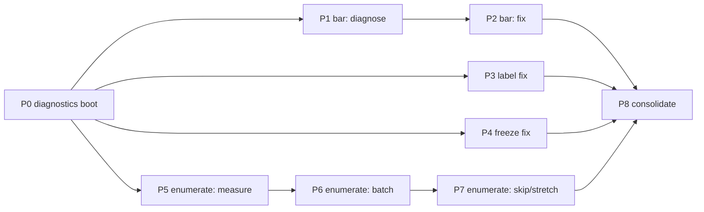

# Song cache — three issues, split into prompts, with order and parallelization

Date: 2026-10-10. Author: agent (planning document; see the status table — parts of it have since
been carried out and are marked as such).
Scope: the three points raised about the DLC/song-cache feature (R7, `enhancements_dlc_cache`) on
`rb-blitz-xenon-recomp`:

1. *Study and act* — even with a cache, the boot still shows a **"Discovering Downloaded Content"**
   load; the goal is to skip it or cut it drastically.
2. *Study and act* — the **progress bar** is not drawn during the discovery.
3. *Fix* — the **"Refresh Song Library"** row still reads as the shipped store label, and
   **the game freezes the moment it is clicked**.

This document is a plan, not a report: it states what is already known, what is still unproven, and
then defines **P0–P8**, each a self-contained prompt. §5 gives the order and the parallelism.

## Status — read this first

| Prompt | What it is | Status |
| --- | --- | --- |
| **P0** | instrumented R7-on baseline boot (diagnostics for all three) | **DONE** — measured, **§9** |
| **P1** | progress bar: why it is not drawn (study) | **DONE** — answered by §9.4, completed in **§12** |
| **P2** | progress bar: make it draw (act) | **DONE** — animated and verified in-game, **§12** |
| **P3** | the row's label must actually appear (study + fix) | **DONE** — fixed and verified in-game, **§11** |
| **P4** | the refresh must never freeze the game (study + fix) | **DONE** — fixed and verified in-game, **§10** |
| **P5** | measure the title's own enumeration (study) | **DONE** — folded into P0, **§9.3** |
| **P6** | batch the enumerator (Issue 1's top lead) | **DONE — negative result, §13** — the guest's reply buffer is its own 512 B, so one item per call is the protocol; the spike was reverted and the SDK is still 0001–0014 |
| **P7** | skip / fast-forward the panel (Issue 1, stretch) | **DONE — option 1 shipped, option 2 refused, §14** — the discovery runs free for the phase: **46.7 s → 15.96 s** over the same 2,807-item walk, with the player's own V-Sync value written back before the menu appears. `acceptance_dlc.ps1` green (§14.9); `acceptance_song.ps1` **red on a stale expected-song constant** with no relation to this prompt (§14.10 — a P8 harness item) |
| **P8** | consolidate: tests, acceptance, docs sweep | **DONE — §15** — the three harness items are fixed (`-Extra` for the R7 configuration, absolute DLC paths, the R3 flag) and a fourth documented (`-SongName` is profile-dependent); the combination leg §14.9.2 could not run is **green**: `dlc: PASS` with R7 on, the pacing armed and restored inside it, and the library's own song on the guest's list (**§15.3.1**) |

**Do not re-run P0, P1, P2, P3, P4, P5, P6, P7 or P8.** Their results are §9, §10, §11, §12, §13, §14
and §15; their raw evidence is `out\_swap\p0\{boot1-info,boot2-debug-cachehit}.log` and
`out\drive-ui\p0*.png` / `p4*.png` (all under `out/`, so gitignored — recreate with §8's commands if
they are gone). P6's boot is `out\build\win-amd64-release\logs\rb_blitz_003.log` and P7's is
`rb_blitz_004.log` **plus `rb_blitz_004.1.log`**: a `--log_level=debug` boot is ~5 MB and the log
rotates at that size, so a boot's evidence can be split across `NNN` and `NNN.1` — grep both.
Both P0 and P4 closed with **no regressions: build green, `ctest` 21/21** (20 before P4's new
`refresh_state` test).

---

## 1. The framing that decides issue 1 (read this first)

There are **two independent caches**, and conflating them is why issue 1 looks like a bug:

| Cache | Who owns it | Where | What it removes |
| --- | --- | --- | --- |
| **Host cache** (R7, `src/fs/dlc_cache.h`) | this project | `<user_data_root>\cache\dlc_library.cache` | the **host's** walk of the library + the STFS header read per package (~14.5 s cold, 7 ms cached) |
| **Title cache** (`songcache`) | the guest | `<user_data_root>\B13EBABEBABEBABE\5841122D\00000001\songcache\songcache` (1,009,556 B when warm) | the guest's **package mounts** (a warm `songcache` mounts nothing) |

Neither cache touches the third cost: **the title's own enumeration**, which advances **one item per
presented frame** — measured 2,809 `XamAppEnumerateContentAggregate` calls, **54.4 s of a 78.8 s**
warm boot at V-Sync (`docs/guides/dlc.md` §4.3). That phase is what draws the connect panel's
"Discovering Downloadable Content" line, and **no cache can shorten it**, because the guest decides
how many items a frame is worth (`docs/engine/toggles.md`, the R7 row — stated there as "the honest
boundary of a toggle").

So issue 1 is **not** "the cache is not being used". It is "the cache removes the host's half, and we
want the guest's half shortened too". That needs a *host-side lever on the guest's enumeration loop*,
and §3/P5–P7 name the two real candidates (batch the enumerator; skip/fast-forward the panel state).

**One nuance worth confirming in P0 before anything else:** whether the user's boot even has R7 on.
Both boot logs on disk (`out/_swap/boot1.log`, `boot2.log`) logged
`content_progress: R7 off; the discovery screen's progress bar is the title's own`, i.e. **every
captured run has `enhancements_dlc_cache` off**. If the reported runs are the same, then issues 2
and 3 are explained by the toggle simply being off, and issue 1 is the vanilla boot. P0 settles it.

---

## 2. Evidence gathered for this plan (all reproduced now)

**2.1 The shipped labels are the constants the code already uses.** Decoded
`assets/game/360/ui/locale/eng/gen/locale_keep.dtb` with `out/_swap/dtb_strings.py`:

```
splash_dlc                      -> "Download Content"
server_connect_enumerating_content -> "Discovering Downloadable Content"
```

So `kDlcRowLabel = "Download Content"` (`src/ui/menu_options.h`) **matches** the retail string. The
user's "**Downloadable Content**" is the *other* entry (`server_connect_enumerating_content`) — i.e.
the connect-panel status line, not the row. This must be disambiguated in P0/P3 (see §3 issue 3).

**2.2 The discovery screen is a state machine in the title's own DTA.** Decoded
`assets/game/360/ui/net/gen/server_connect.dtb` with `out/_swap/dtb_tree.py` (dumped to
`out/_swap/server_connect.tree.txt`). States relevant here:

```
kServerConnectPanel_StartSongCache / LoadingSongCache / CreateSongCache / MissingSongCache /
CorruptSongCache / EndSongCache          (the TITLE's own songcache lifecycle)
kServerConnectPanel_StartEnumeratingContent -> EnumeratingContent
                                         (label token server_connect_enumerating_content)
kServerConnectPanel_WaitingForTrialEnumeration
kServerConnectPanel_OfflineMode / Connected  (where R3 already sends the player)
```

The title's own cache load and the content enumeration are **separate phases**. R7's relabel only
renames *EnumeratingContent*, and it does so unconditionally-on-cache-hit, even though the
enumeration still runs — hence the label is currently a misnomer until issue 1 is actually solved.

**2.3 The enumeration loop is host-steerable, which is the lead for issue 1.** The whole path is
SDK code we own:

- `rexglue-sdk/src/kernel/xam/xam_content.cpp` — `XamContentCreateEnumerator_entry(user_index,
  device_id, content_type, content_flags, **items_per_enumerate**, buffer_size_ptr, handle_out)`.
  The **guest supplies `items_per_enumerate`** (Blitz passes 1) and the host answers
  `*buffer_size_ptr = sizeof(XCONTENT_DATA) * items_per_enumerate`.
- `rexglue-sdk/src/system/xenumerator.cpp` — `XStaticUntypedEnumerator::WriteItems()` writes
  `min(remaining, items_per_enumerate())` items per call and reports the count.
- `rexglue-sdk/src/kernel/xam/apps/xam_app.cpp` — message `0x0002000E`
  (`XamAppEnumerateContentAggregate`) calls `WriteItems`, then **hard-codes `*length_ptr = 1`** and
  returns `X_E_SUCCESS` if `item_count >= 1`, else `X_E_NO_MORE_FILES`.

The per-frame pacing comes from the guest issuing one such message per frame. The host can very
plausibly deliver N items per message (raise `items_per_enumerate`, size the buffer to match, report
the true written count) — that is P6's spike. It is a **host-side SDK change**, not guest-memory
poking, which is the safest kind of lever here.

**2.4 The progress bar hook exists, is wired, and was never exercised in any captured run.**
`src/hooks/content_progress.cpp` hooks `sub_827593A8` (SetTotal) / `sub_827593B8` (Increment) /
`sub_827593C8` (Complete). Verified for this plan in the generated image:

- `generated/default/rb_blitz_recomp.12.cpp:6935` — `sub_822CA838` allocates 16 bytes, calls
  `sub_82759308(this, panel)` and stores the object at `owner+120`. Confirms the object model
  (`+8` current, `+12` total, push `sub_82759190`).
- The three methods are invoked **virtually** (vtable `0x8220575C`), which is why a static caller
  search finds none — the hook approach is still correct.
- `src/rb_blitz_app.h` (`OnPostLoadXexImage`) calls `rb_blitz::content_progress::Configure()` right
  after `dlc::Configure()`, so the hook is armed whenever `enhancements_dlc_cache` is on.
- Yet **no log on disk contains a `content_progress: the title announced …` line** (only
  `content_progress: R7 off`). So whether the bar appears with R7 on was **unmeasured** — P1.
  *(P0 has since run it: the hooks do fire, but only **after** the enumeration finishes — §9.4.)*

**2.5 The refresh runs synchronously on the guest's file-call thread.** `src/hooks/dlc_refresh.cpp`
`CheckSentinel()` → `rb_blitz::dlc::RefreshConfigured()` → `src/hooks/dlc.cpp` `Refresh()` →
`LoadOrScanLibrary(/*force_refresh=*/true, …)` → `fs::ScanDlcLibraries(...)` **on the calling
thread**. With `dlc_scan_threads` defaulting to 1 and the measured ~16 ms/file cold / ~0.03 ms warm
open cost (`src/fs/dlc_cache.h`), a 1,402-package library is **~15–22 s of frozen frame**, and it is
worse on a cold/AV-unseen tree. Three further facts make the freeze interesting:

- **No re-entrancy guard.** If the row's DTA evaluates the `file_exists` action more than once
  (e.g. once per frame while the row is selected), the whole scan repeats every time — which would
  present as a *permanent* freeze, not a 15 s stall. *(P0 measured it: one press fires **exactly
  one** scan — §9.5 — so the guard is hygiene, not the cause.)*
- **cvars are read on a guest thread.** `Refresh()` → `ForceContentTypeFromCvar()` /
  `DiscoverLibraryRoots()` / `LoadOrScanLibrary()` call `REXCVAR_GET(dlc_root|dlc_library|
  dlc_library_content_type|dlc_scan_threads)` from the file hook. Every other module in this project
  deliberately captures its cvars once in `Configure()` "because guest threads must not touch the
  cvar registry" (see the comments in `src/hooks/menu_filter.cpp` and `content_progress.cpp`). This
  file breaks its own convention.
- **Content-manager mutation from inside a kernel file call.** `set_extra_content_library()` is
  called while the guest is inside `NtQueryFullAttributesFile`, which can contend with an in-flight
  enumeration.

**2.6 What is *not* verified anywhere.** No captured run had R7 on, so **the row's label relabel, the
discovery-screen relabel, and the progress bar had zero in-game evidence**. The docs' cited refresh
verification (`docs/engine/main-menu.md (part 1, the option list)` §7.1 evidence table) quotes only the *action* patch
(`the downloadable-content row now refreshes the DLC cache (331 bytes …)`) — **not** the
`relabelled the downloadable-content row "…" to "…"` line. Treat the label as an open bug.
*(P0 has since run two R7-on boots: the label is still wrong, the relabel never lands, and the
locale file is never patched — §9.6.)*

---

## 3. The three issues, mapped to root causes and to prompts

### Issue 1 — "Discovering Downloaded Content" still leads the boot (study and act)

- **Not** a cache miss. Root cause is the guest's frame-paced enumeration (§1, §2.3).
- Levers, best first:
  1. **Batch the enumerator** (host-owned SDK code): N items per `XamAppEnumerateContentAggregate`
     message. If Blitz honours the negotiated `items_per_enumerate`, the phase shrinks by ~N×.
     → **P6** (top lead).
  2. **Panel fast path / frame pacing** (guest-side, riskier): either uncap frames only while
     *EnumeratingContent* is the panel state (the guest's own V-Sync is the only proven lever today,
     `docs/guides/dlc.md` §4.3), or hook the panel's `update_state` to advance past
     `StartEnumeratingContent` when the host cache answered **and** the title's `songcache` is warm.
     → **P7** (stretch; must not strand the song list).
- Prompts: **P5** (measure), **P6** (batch), **P7** (skip/stretch).

### Issue 2 — progress bar not drawn (study and act)

- Hook exists and is wired (§2.4). Unknowns: does it fire with R7 on, and if so why is the bar still
  hidden (object never constructed on this path? `sub_82759190` pushing to the wrong panel
  properties? the Flow's show condition needing `enumerating_content.grp` to be explicitly shown?).
- Prompts: **P1** (diagnose with R7 on), **P2** (fix + wire the total + test).

### Issue 3 — row label wrong, and freeze on click (fix)

- **Label:** the constant matches the retail string (§2.1). The failure is either (a) the user is
  describing the *connect-panel* line, not the row, or (b) the locale edit does not land in-game
  (it is a 76,726 B file delivered across two 64 KiB ark reads, and it has never been verified).
  → **P3**.
- **Freeze:** the synchronous full-library scan on the guest thread, with no re-entrancy guard and
  cvars read off the registry from a guest thread (§2.5). → **P4**.

---

## 4. The prompts

Each prompt below is written to be handed to the agent **as-is**. All of them inherit the project's
standing rules: **off = faithful** (every new behaviour behind `enhancements_dlc_cache` or a new
sub-toggle, default unchanged); byte-neutral DTB edits; hook hygiene per `docs/reference/rb3-references.md` §8;
no machine paths in tracked files; build green and `ctest` green
(`ctest --test-dir out\build\win-amd64-release --output-on-failure`).

---

### P0 — Instrumented R7-on baseline boot *(diagnostics for all three; do this first)* — **[DONE, §9]**

> Goal: one boot that gives evidence for issues 1, 2 and 3 at once, so none of the later prompts
> starts from a guess.
>
> Build release, then launch with R7 **on** and a real library, driving the UI to the main menu and
> pressing the refresh row once:
> `.\rb_blitz.exe --game_data_root=..\..\..\game --ultimate_mode=1 --enhancements_dlc_cache=true --dlc_library="D:\Songs" --launcher_profile="$env:APPDATA\rb_blitz\launcher.toml"`
> (record the exact library size; use `-DlcLibrary` with `scripts\drive_ui.ps1` / `scripts\acceptance_dlc.ps1` for the staged press).
>
> From `out\build\win-amd64-release\logs\rb_blitz_NNN.log`, extract and report:
> 1. **Issue 1:** count of `XamAppEnumerateContentAggregate(` lines and the wall-clock span between
>    the first and last, plus the first/last `XamContentAggregateCreateEnumerator: added N items
>    (device=…, type=…)` lines; frames/frame-time (`vsync` value); "start press → main menu" time.
>    State whether the title asked for `items_per_enumerate = 1` (add a temporary DEBUG line in
>    `xam_content.cpp` if the value is not already logged).
> 2. **Issue 2:** all `content_progress:` lines (announced total, "no total … given N", increments).
>    If there are **no** such lines, say so explicitly — that is the decisive fact for P1.
> 3. **Issue 3 label:** every `menu_filter:` line whose text mentions the locale / "relabelled" /
>    "left a .dtb read alone", and the specific `reason` the locale file got. Report whether the row
>    drawn on screen reads "Download Content" or "Refresh Song Library" (capture a screenshot).
> 4. **Issue 3 freeze:** count of `dlc: refresh asked for from the main menu` lines **per single
>    press**, and the time between the press and the row responding. Report whether the number is 1
>    (one scan per press) or >1 (per-frame re-entry).
> 5. Whether the title's own `songcache\<songcache>` exists and its size (warm vs cold).
>
> Deliverable: append a "measured 2026-xx-xx" evidence block to this plan (or to `docs/guides/dlc.md` §4)
> with the numbers and the log path. **Change no product code except the optional temporary DEBUG
> line; revert it before finishing.**

---

### P1 — Progress bar: why it is not drawn *(Issue 2, study)* — **[DONE, §12]**

> Depends on P0 (needs an R7-on log).
>
> Using P0's log, classify the case: **(a)** `content_progress:` lines are absent → the object's
> methods are never called on this path; **(b)** they are present but the bar is invisible → the
> host supplies a total but the panel still hides it.
>
> For (a): find what constructs `sub_822CA838`'s owner (the 16-byte object at `owner+120`) and
> whether that owner is the panel that draws the current screen; check `generated/default/` for the
> caller chain and whether `sub_82759190`'s panel pointer names the live connect panel.
> For (b): verify `sub_82759190` writes `current_content`/`total_content` on the *live* panel and
> inspect the Flow in `ui/net/gen/server_connect.milo_xbox` (`progress_bar.grp`,
> `content_percent.lbl`, `enumerating_content.grp`) — the evidence for that Flow's conditions is in
> `src/hooks/content_progress.cpp`'s header comment; re-derive it from the shipped milo rather than
> trusting the comment. Use `scripts\hmx_milo.py` / `scripts\hmx_ark.py` as needed.
>
> Deliverable: a written verdict with the log lines and, if (b), the exact property/condition that
> hides the bar. No code change in this prompt.

---

### P2 — Progress bar: make it draw *(Issue 2, act)* — **[DONE, §12]**

> Depends on P1.
>
> Implement P1's verdict, still behind `enhancements_dlc_cache` (off = the title's own bar, exactly
> as today). Keep the "give it the count the title is never told" design
> (`rb_blitz::dlc::ContentItemCount()`); if P1 shows the property push targets the wrong object,
> fix the target; if the bar needs to be shown explicitly for the enumerating state, do that.
> Log, once, the path taken (announced / supplied / hidden).
>
> Also decide, with P0's frame numbers, whether the bar is even *visible long enough to be read* —
> if issue 1's fix (P6) makes the phase short, the bar should still be correct, just brief.
>
> Tests: cover any new pure logic (e.g. total-selection) in a new/existing SDK-free test.
> Verification: an in-game capture of the bar during the discovery, plus the log line. Update
> `docs/engine/main-menu.md (part 1, the option list)` §7.1 and `docs/guides/dlc.md` §4.2 if behaviour or wording changed.

---

### P3 — Row label: "Refresh Song Library" must actually appear *(Issue 3, study + fix)* — **[DONE, §11]**

> Depends on P0.
>
> Decide the ambiguity with evidence: does the user mean the **main-menu row** (`splash_dlc` →
> "Download Content", the string that must become "Refresh Song Library") or the **connect-panel
> status line** (`server_connect_enumerating_content` → "Discovering Downloadable Content")? Both are
> relabelled by R7; report which one is still shipping its retail text.
>
> Then make it land. The locale is `ui/locale/eng/gen/locale_keep.dtb` (76,726 B) delivered across two
> 64 KiB ark reads (`src/hooks/menu_filter.cpp`'s split-read path). Log the specific
> `menu_options` `reason` when the relabel is refused, at WARN, exactly once per reason (this is the
> single most useful instrument). Likely causes to rule out, in order:
> 1. the split read never being recognised as one file (offset/continuity check);
> 2. `FindLocaleValue` not matching because the loaded entry differs from the constant (e.g. the
>    title reads a different locale file, or the value is a token, not a literal);
> 3. `kSpareMacro` (the donor `#ifdef` name) missing or too short on this file, so the byte-neutral
>    growth is refused.
>
> If the row is the right target and the edit is refused, prefer fixing the delivery (1) before
> touching the constants. Also sanity-check the title's content-database digest retarget for the
> locale file (`RetargetIfNeeded`) — a locale with a stale digest may be re-read from the ark.
>
> Verification: in-game screenshot of the row reading "Refresh Song Library" **and** the
> `menu_filter: relabelled …` log line. Docs: `docs/engine/main-menu.md (part 1, the option list)` §7.1 (mark the label
> claim as verified with the citation, or correct it).

---

### P4 — Refresh: never freeze the game *(Issue 3, study + fix)* — **[DONE, §10]**

> Depends on P0.
>
> Fix the click-freeze in `src/hooks/dlc_refresh.cpp` + `src/hooks/dlc.cpp` `Refresh()`:
>
> 1. **Re-entrancy / debounce guard (must).** One refresh at a time; repeated sentinel hits while a
>    scan is running are ignored and logged once ("a refresh is already running"). This alone turns a
>    possible permanent freeze into a bounded one, and is cheap to test.
> 2. **Do not read the cvar registry from a guest thread (must, matches project convention).**
>    Capture `dlc_root`, `dlc_library`, `dlc_library_content_type`, `dlc_scan_threads` in
>    `dlc::Configure()` (as `menu_filter`/`content_progress` do) and have `Refresh()` use the captured
>    values. Keep `--refresh_dlc_cache`/the row reading the same captured state.
> 3. **Do not block the guest's frame (should).** Run the scan off the guest thread and publish the
>    result (content manager + package paths) on a safe thread/hop; the row returns immediately. If
>    `set_extra_content_library()` proves unsafe off-thread, at minimum return immediately and defer
>    the swap to the next poll point, and document why.
> 4. If the scan must stay synchronous, bound and announce it: use the captured `dlc_scan_threads`
>    (and say so in the log), and show the connect-panel/status line as a "Refreshing…" state if P2
>    gives a cheap hook for it.
>
> Tests: the guard's pure logic (a small state machine around "busy/…/idle") in a new SDK-free test.
> Verification: press the row with a large library, confirm the frame keeps drawing (or at worst a
> bounded, announced wait), exactly **one** `refresh asked for` → one scan per press, and the cache
> file's mtime moves. Update `docs/guides/dlc.md` §4.2 and `docs/engine/main-menu.md (part 1, the option list)` §7.1.

---

### P5 — Discovery: measure the title's own enumeration *(Issue 1, study)* — **[DONE, folded into P0: §9.3]**

> Depends on P0.
>
> Turn P0's counts into a model: items requested per call (`items_per_enumerate`), calls per frame,
> frames per second, and the resulting phase duration; separate it from the title's `songcache` load
> (`StartSongCache/LoadingSongCache/…/EndSongCache`) and from the two enumeration passes
> ("2 per package"). Identify, in `generated/default/`, the guest loop that drives one
> `XamAppEnumerateContentAggregate` per frame, so we know exactly what a bigger batch would change.
>
> Deliverable: a short section under `docs/guides/dlc.md` §4.3 with the model and the guest loop's address.
> No product change.

---

### P6 — Discovery: batch the enumerator *(Issue 1, act — top lead)* — **[DONE, §13 — negative result]**

> Depends on P5. **Spike first**, then implement only if the spike passes.
>
> Spike: in `rexglue-sdk/src/kernel/xam/xam_content.cpp` /
> `rexglue-sdk/src/kernel/xam/apps/xam_app.cpp` / `rexglue-sdk/src/system/xenumerator.cpp`, make a
> content enumerator hand the guest several items per call and report the true count:
> - negotiate a larger `items_per_enumerate` for content enumerators and size
>   `*buffer_size_ptr = sizeof(XCONTENT_DATA) * N` to match;
> - write the real `written_count` into `*length_ptr` instead of the hard-coded `1`.
>
> Gate it behind a new cvar (e.g. `content_enumerate_batch`, default 0 = today's behaviour; R7 may
> set it), declared in `include/rex/system/flags.h` as the existing patch does for
> `deferred_overlapped_delay_ms`. **Pass criterion:** the phase's call count drops ~N× with the same
> song list (same item count, same songs, playable). If the guest ignores multi-item replies, stop,
> record the negative result, and fall through to P7.
>
> Risk to check explicitly: buffer overrun if the guest allocates by its own `items_per_enumerate`
> rather than the host-returned size; guard the `memcpy` in `WriteItems` against the reported buffer
> size.
>
> Verification: `scripts\acceptance_dlc.ps1` / `scripts\acceptance_song.ps1` green, log shows the
> reduced call count, and the discovery phase duration measured against P0. Docs: `docs/guides/dlc.md`
> §4.3, `docs/engine/toggles.md` R7 row, `patches/README.md` if a new SDK patch is added.

---

### P7 — Discovery: skip / fast-forward the panel *(Issue 1, act — stretch, higher risk)* — **[DONE, §14 — option 1 shipped, option 2 refused]**

> Depends on P5 (and on P6's outcome).
>
> Only if P6 does not get there. Two options, in order of safety:
> 1. **Frame pacing for this screen only:** let the pre-menu connect panel run uncapped while
>    `kServerConnectPanel_EnumeratingContent` is the panel state (the guest's own V-Sync cvar is the
>    only proven lever, `docs/guides/dlc.md` §4.3 — these are frame-paced, not clock-paced, so it is a
>    real win). This is host-side and does not touch guest control flow.
> 2. **State fast-forward:** hook the panel's `update_state` (the handler R3 already edits) to move
>    `StartEnumeratingContent → EndSongCache/OfflineMode` when the host cache answered **and** the
>    title's `songcache` is warm. **Hard requirement:** prove the song list is still complete
>    afterwards — the enumeration is what registers songs, so a blind skip will empty the list. If it
>    cannot be proven, do not ship it.
>
> Any resulting relabel of the discovery screen (P3-side) must match reality: if the phase still
> runs, it must not claim to be "Loading Song Cache".

---

### P8 — Consolidate *(after P1–P7)* — **[DONE, §15]**

> Re-run `ctest --test-dir out\build\win-amd64-release --output-on-failure`; run the acceptance
> scripts (offline acceptance `scripts\acceptance_launches.ps1`, `scripts\acceptance_dlc.ps1
> -DlcLibrary …`, `scripts\acceptance_song.ps1`); capture the discovery screen, the main menu, and
> the refresh row. Then sweep the docs so they agree with the code:
> `docs/guides/dlc.md` (§4.2, §4.3, §5 limits), `docs/engine/main-menu.md (part 1, the option list)` (§7.1, §9 evidence table),
> `docs/engine/toggles.md` (R7 row — in particular the "honest boundary" paragraph, which P6/P7
> change), `docs/reference/known-issues.md` if a limit remains. Add the new "measured" block and the negative
> results (a spike that failed is evidence too). Keep the repo-hygiene rules: no machine paths, no
> build output, tool *versions* not install paths.

---

## 5. Order and parallelization



| Wave | Prompts | Runs in parallel? | Why |
| --- | --- | --- | --- |
| 0 | **P0** | alone | one instrumented boot feeds all three tracks; everything else is guesswork without it |
| 1 | **P1**, **P3**, **P4**, **P5** | yes, 4-wide | disjoint files: P1 reads `generated/` + milo; P3 = `src/ui/menu_options.{h,cpp}` + `src/hooks/menu_filter.cpp`; P4 = `src/hooks/dlc.{h,cpp}` + `src/hooks/dlc_refresh.cpp`; P5 = reading `generated/` only |
| 2 | **P2**, **P6** | yes | P2 = `src/hooks/content_progress.cpp`; P6 = new SDK patch + a new cvar in `src/enhancements.cpp` + `include/rex/system/flags.h` |
| 3 | **P7** | alone | stretch, overlaps P6's analysis and may touch the panel/DLC layer |
| 4 | **P8** | alone | integration, acceptance, docs sweep |

**File-conflict rules** (the only places where two prompts must not run at once):

- `src/hooks/dlc.cpp` — P4 (refresh) and P6 (if the batch cvar is set there). Serialize if both.
- `src/ui/menu_options.h` / `menu_filter.cpp` — P3 only; keep P7's optional screen relabel out of it.
- Docs — **all** prompts touch `docs/guides/dlc.md` and `docs/engine/main-menu.md (part 1, the option list)`. Either let each
  prompt append its own dated block (append-only, no rewrites), or hold all doc edits to P8. Prefer
  append-only so the evidence is never lost.

**Recommended sequencing if only one agent runs at a time:** P0 → (P4, then P3) → P1 → P2 → P5 →
P6 → P7 → P8. Rationale: P4 is the user-visible *bug*; P3 is a small fix; P1/P2 are self-contained;
P5/P6 are the biggest and most speculative (and may change what P2's bar is even for).

---

## 6. Guardrails (apply to every prompt)

- **Faithful default.** With `enhancements_dlc_cache` off (and any new sub-toggle off) the boot must
  be byte-for-byte the boot this project had before the change. Every new hook states its faithful
  behaviour and its deviation (`docs/reference/rb3-references.md` §8).
- **Never let a cache hide a package.** R7's rule stands: a failed proof is a miss and the scan runs.
  Do not weaken `src/fs/dlc_cache.h`'s validation to make issue 1 look better.
- **Byte-neutral DTB edits.** Any menu/panel edit keeps the file's length and retargets the title's
  content-database digest.
- **No guest-memory poking** where a host-side lever exists (P6 is exactly that; prefer it over P7's
  state fast-forward).
- **Evidence or it did not happen.** Every claim in the closing doc carries a log path, a capture, or
  a test; negative results are recorded.
- **Repo hygiene.** No absolute paths/usernames left on disk (use `<checkout>`, `D:\Songs`), no
  `out/`/logs committed, test + build green before any prompt is called done.
- **Ask before git.** No `git commit`/`push` without an explicit go-ahead.

---

## 7. Open questions (all answered by P0 — see §9)

1. ~~Is R7 actually on in the user's boot?~~ **Yes, when the profile asks for it** — and the
   complaints reproduce with it on, so they are bugs, not "toggle off" (§9.1).
2. ~~Does the title honour a larger `items_per_enumerate`?~~ **Answered by P6, and the answer is no**
   (§13): the guest reads the advertised count back (the message carries `00000001` when the
   enumerator is built for 1 and `00000004` when it is built for 4) and still hands over a 512-byte
   buffer of its own, which cannot hold two items. There is no host-side way to give the guest a
   bigger buffer — §13.3 — so batching is closed and the frame rate is the only lever left.
3. ~~Does the row's `file_exists` action run once per press or once per frame?~~ **Once per press**
   (§9.5).
4. ~~Why was the locale relabel never verified?~~ **It never lands** — no successful relabel in either
   boot, and the locale file is never patched; the specific reason needs per-file instrumentation
   (§9.6, P3).
5. ~~Is the progress object even constructed on this path?~~ **Yes, but it is only used at the *end***
   — `SetTotal(0)` then `Complete`, and `Increment` is never called (§9.4).
6. ~~Is `set_extra_content_library()` safe off the guest thread?~~ **Answered by P4** (§10.4): it is
   still called from a *guest* thread — the menu's per-frame poll, where the guest is not enumerating —
   so the worker that scans never touches the vector, and the SDK's missing lock on
   `extra_content_library_` is recorded as a candidate for a future patch rather than a change made
   here. The synchronous scan the question was raised about is gone: the press returns in **1 ms**
   (§10.3).

---

## 8. Appendix — how to reproduce the evidence in §2

```powershell
# 1. the shipped labels (row vs connect-panel line)
python out\_swap\dtb_strings.py assets\game\360\ui\locale\eng\gen\locale_keep.dtb |
  Select-String -Pattern 'splash_dlc|server_connect_enumerating_content|song_info_cache' -Context 1,1

# 2. the discovery screen's state machine
python out\_swap\dtb_tree.py assets\game\360\ui\net\gen\server_connect.dtb |
  Out-File -Encoding utf8 out\_swap\server_connect.tree.txt

# 3. what R7-on actually logs (none of the logs on disk has this yet)
$l = (Get-ChildItem out\build\win-amd64-release\logs\*.log | Sort LastWriteTime -Desc | Select -First 1).FullName
Select-String -Path $l -Pattern 'content_progress|relabelled|refresh asked for|XamAppEnumerateContentAggregate|XamContentAggregateCreateEnumerator|dlc:'
```

Key files: `src/fs/dlc_cache.h`, `src/hooks/dlc.{h,cpp}`, `src/hooks/dlc_refresh.cpp`,
`src/hooks/content_progress.{h,cpp}`, `src/hooks/menu_filter.cpp`, `src/ui/menu_options.{h,cpp}`,
`src/rb_blitz_app.h`, `rexglue-sdk/src/kernel/xam/xam_content.cpp`,
`rexglue-sdk/src/kernel/xam/apps/xam_app.cpp`, `rexglue-sdk/src/system/xenumerator.cpp`.

---

# 9. P0 — measured (2026-10-10)

All of §2's open questions are now answered, and issues 1–3 are all reproduced. **Diagnosis only:
no product code was changed** (the `items_per_enumerate` line P0 allowed for turned out to be
unnecessary — the app message already logs `buffer_size`, and one `XCONTENT_DATA` is 308 bytes, so
the item count per call is readable without an SDK edit, and the call count comes from the existing
`XamAppEnumerateContentAggregate` debug line).

## 9.1 Setup

Two boots, same everything except the host cache's warmth; the title's own `songcache` was **warm**
(1,009,556 B) in both, so neither boot mounted content packages.

| | |
| --- | --- |
| Library | `out\_swap\dlc-link` — 1,402 loose STFS containers, 25.6 GB |
| Profile | `out\_swap\p0\launcher.toml` (a dedicated copy: R7 on, `dlc_scan_threads=4`, R5 on, R9 pool 50, `user_data_root=out\_swap\p0\userdata`); the real `%APPDATA%\rb_blitz\launcher.toml` was **not** touched |
| Boot A | cache **miss** (no `dlc_library.cache`), `--log_level=info` → `out\_swap\p0\boot1-info.log` |
| Boot B | cache **hit** (boot A rewrote the cache), `--log_level=debug` → `out\_swap\p0\boot2-debug-cachehit.log` |
| Screenshots | `out\drive-ui\p0-*.png` (boot A), `p0b-*.png` (boot B) |

## 9.2 R7 works, and the cache is worth 31.9 s → 0.04 s

```
[boot A] 15:34:27.198 dlc: no usable library cache (no cache file), scanning
         15:34:59.064 dlc: library cache written for 1402 package(s) …   = 31.86 s (miss)
[boot B] 15:45:24.754 enhancements: enhancements_dlc_cache = on (config)
         15:45:24.790 dlc: library cache hit for 1402 package(s) over 1402 file(s) … = 0.036 s
```

Note what the 31.9 s is: not the 0.7 s the design assumed, and not a cold-disk artifact — boot A's
in-game **refresh** of the *same, already-scanned* library cost the same 31 s (§9.5). At 1,402 files
that is ≈22 ms per file, i.e. the per-file open cost the design documents for a **cold** file is
being paid on every scan on this machine. Relevant to P4/P6: budget ~30 s for any full scan.

## 9.3 Issue 1 — the discovery is the guest's own loop, and the cache does not touch it

Boot B, start press → main menu = **48.0 s**; boot A = **47.9 s** (identical within noise).

```
15:46:32.267  menu_filter: the offline prompts are skipped …            <- the start press
15:46:33.394  XamContentAggregateCreateEnumerator: added 1402 items (device=0, type=00000002)
15:46:33.397  XamContentAggregateCreateEnumerator: added 1402 items (device=0, type=00000002)
15:46:33.398  XamContentAggregateCreateEnumerator: added    0 items (device=0, type=00000001)
15:46:33.404  XamAppEnumerateContentAggregate(255, 00000000, …, 512, 00000001, …, 0)   <- #1
   …          2,807 calls, one per presented frame …
15:47:20.164  XamAppEnumerateContentAggregate(…)                                        <- #2807
15:47:20.297  content_progress: the title's content enumeration finished
```

* **2,807 calls over 46.76 s = 16.66 ms per call — exactly one call per 60 Hz V-Sync frame.**
  `docs/guides/dlc.md` §4.3's "one item per presented frame" is confirmed, and the count (2,807 ≈ 2 × 1,402
  + 3) matches its 2,809 for a slightly different library.
* The title creates **two marketplace enumerators of 1,402** and one saved-game enumerator of 0 (the
  library is adapted to `00000002`, as `docs/guides/dlc.md` §2.1 describes).
* Each call carries **`buffer_size = 512`** and one `XCONTENT_DATA` (**308** B), so the host writes
  **exactly one item per call** — 512 < 2 × 308. A batch of N needs N × 308 ≤ the guest's buffer, so
  P6's spike must get the guest to allocate a bigger buffer (the `items_per_enumerate` the guest
  passes is *not* what sizes this message buffer today).
* **The host cache changes none of it**: a 31.9 s cold scan and a 0.04 s cache hit both spend ~47 s in
  the same frame-paced loop. The user's "even with a cache" is correct, and §1's framing is the
  explanation. The only proven lever on the loop remains the frame rate (V-Sync).
* A warm boot with R9 on mounts **50** packages (`enhancements_menu_dlc_song_count`), all of them
  R9's menu-music pool, and **zero** content packages — the docs' "0 `Loading STFS header file`
  lines" is a run with R9 off; with R9 on the number is 50.

## 9.4 Issue 2 — the bar is hidden because the engine never says a total *while* it runs

```
15:47:20.197  content_progress: the title announced a total of 0 item(s) to enumerate (1402 known)
15:47:20.197  content_progress: the total was not known to the title; the discovery bar is given 1402
15:47:20.297  content_progress: the title's content enumeration finished; the discovery bar is drawn full
```

* `SetTotal` (`sub_827593A8`) fires **once, after** the 2,807th call, with **0**; `Complete` follows
  100 ms later. **`Increment` (`sub_827593B8`) is never called at all** — it logs nothing in either
  boot. So for the whole 46.76 s the panel's `total_content` is still −1 and the Flow hides the bar;
  substituting 1,402 at the end can only fill it instantly at the end.
* Screenshots of the discovery screen on **both** boots show only "Discovering Downloadable Content",
  no bar and no percentage (`out\drive-ui\p0-10.png`, `p0b-11.png`).
* **This re-points P1/P2 at a better hook.** The SDK's `xam_app.cpp` message `0x0002000E` handler runs
  **once per item** (2,807 times) and its enumerator already knows the total
  (`XStaticUntypedEnumerator::item_count()`) and its position (`current_item_`). Driving the panel's
  `current_content`/`total_content` from there is in parallel with the enumeration by construction —
  unlike the object hook, which this build only uses at the end. P1 should confirm the property push
  target (`sub_82759190`'s panel) is the live connect panel before P2 wires it.

## 9.5 Issue 3 — the freeze, measured

```
15:43:25.498 dlc: refresh asked for from the main menu ("songcache:\rbbz_dlc_refresh"), re-scanning
15:43:25.502 dlc: refresh requested, re-scanning the libraries and rewriting …dlc_library.cache
15:43:56.468 dlc: library cache written for 1402 package(s) …            = 30.97 s frozen
15:43:56.469 dlc: refreshed the running title's DLC library: 1402 package(s)
15:43:56.469 [warning] [NtCreateFile] FAILED: path='songcache:\rbbz_dlc_refresh' -> 0xc000000f
```

* One press → **exactly one** `refresh asked for` line: the row's DTA does **not** re-fire per frame,
  so the freeze is the 31 s scan, not infinite re-entry. (P4's guard is still worth having, but it is
  not the cause of what the user saw.)
* It ran on the guest thread (`t20596` — the same thread as the enumeration), the frame was frozen
  throughout, and the game was alive and back at the menu afterwards (screenshot `p0-23.png`).
* The sentinel answers `0xC000000F` as designed.
* §2.5's other two observations stand unchanged: cvars are read from a guest thread, and
  `set_extra_content_library()` is called from inside a kernel file call.

## 9.6 Issue 3 — the label, reproduced but not yet root-caused

* Both boots draw the row as **`DOWNLOAD CONTENT`**, in the list and highlighted
  (`p0-15.png`, `p0-20-row.png`, `p0-23.png`, `p0b-13.png`). The user's report is confirmed.
* The **action** patch applies: `menu_filter: the downloadable-content row now refreshes the DLC
  cache (323 bytes of its action paid for the call)`.
* **No successful relabel ever appears.** The only outcomes are
  `relabel the refresh row left a .dtb read alone: the file has no such label` and
  `… the node stream does not parse` (and the same two for `relabel the cache load`). These lines are
  de-duplicated per (edit, reason), so they cannot say whether the *locale* file was ever tried.
* **The two-block split-read path never fires**: there is no
  `patched a file at byte … of two … byte … reads` line in either boot, and every patch that lands is
  at `19299` / `44974` (`splash.dtb`), `36296` (`server_connect.dtb`) or `7970` (the mod's locale) —
  never the 76,726-byte `ui/locale/eng/gen/locale_keep.dtb`.
* The cache-hit boot still draws "Discovering Downloadable Content", so the `relabel the cache load`
  edit fails the same way — consistent with **one** cause for both labels.
* **P3's first move is therefore instrumentation, not a constant change**: log per-file (not
  de-duplicated) which `.dtb` each relabel is attempted on and with which reason, and log whether the
  76,726-byte locale is read at all and in how many reads. Only then decide between "the locale is
  never a candidate", "it is read but not recognised as one file", and "it is read whole and
  `FindLocaleValue` does not match".

## 9.7 What this changes in the prompts

| Prompt | Change |
| --- | --- |
| **P1** | Narrowed: the object hook is only used at the *end*. Find what drives the panel during the loop; the lead is the `xam_app.cpp` `0x0002000E` handler (called 2,807×, knows index and total). |
| **P2** | Fix should drive `current_content`/`total_content` per item from the app-message handler, not only substitute the total at `SetTotal`. |
| **P3** | Start with non-de-duplicated per-file instrumentation; the locale file is never patched today. |
| **P4** | **Done — see §10.** The freeze was **31 s** (one scan, guest thread). Now: guard + worker + guest-thread publish. Budget ~22 ms/file for a full scan. |
| **P5** | Done by P0 — 2,807 calls, 16.66 ms apart, one item per call, `buffer_size = 512`. |
| **P6** | Spike must give the guest a buffer > 308 B (its 512 B buffer holds exactly one item today) **and** report the true written count; the `items_per_enumerate` the guest passes is not what sizes this message buffer. **Superseded by §13:** the guest's buffer is *its own* and cannot be enlarged from the host — it stays 512 even when four items are advertised — so this row is what P6 went and disproved. |
| **P7** | Unchanged, and now the only proven lever (frames), so it is no longer purely a stretch. **Confirmed by §13**, and shipped as option 1 in **§14**. |

---

# 10. P4 — done (2026-10-10)

**The freeze is gone, verified in-game.** Build green, `ctest` 21/21 (was 20; the new
`refresh_state` test is the 21st).

## 10.1 What changed

| File | Change |
| --- | --- |
| `src/fs/refresh_state.h` **(new)** | the refresh's two rules as a pure, SDK-free state machine: `Begin()` (one at a time), `Finish()`, `Take()` (published exactly once). Header comment states why each is load-bearing. |
| `src/hooks/dlc.{h,cpp}` | `Refresh()` (the old synchronous path, no callers) **removed**. `RefreshConfigured()` now starts the scan on a worker and returns; new `PublishPendingRefresh()` hands the finished list to the content manager from a guest thread. `dlc_root`/`dlc_library`/`dlc_library_content_type`/`dlc_scan_threads`/the cache path are now **captured once in `Configure()`** and read from there by the refresh — the refresh no longer touches the cvar registry from a guest thread, which was P4's item 2 and a standing project rule. `LoadOrScanLibrary()` takes the thread count as a parameter instead of reading it. |
| `src/hooks/dlc_refresh.cpp` | each file hook calls `PublishPendingRefresh()` first (one atomic compare-exchange; a call carrying nothing pays nothing). Kept as a **second** publish point — see 10.3. |
| `src/hooks/shell_music.cpp` | the menu's per-frame music poll (`sub_827586D8`, `ShellMusic::Poll`) calls `PublishPendingRefresh()` — the **primary** publish point, see 10.3. Not gated on R9. |
| `tests/refresh_state_tests.cpp` **(new)** + `CMakeLists.txt` | pins one-at-a-time, published-once, and the ordering (no result can be published before the worker stored it). |

## 10.2 The measurement that changed the design

The first cut published from the file-call hooks, on the theory that a file call is
something every guest thread makes. **It never fired**: after the refresh finished, the
main menu made **no `NtCreateFile`/`NtOpenFile`/`NtQueryFullAttributesFile` call at all**
(the whole boot has 5 of them, all sentinel queries), so the refreshed list was never
handed over. The fix was to publish from the menu's own **per-frame** hook —
`ShellMusic::Poll`, which R9 already installs and which runs every frame the menu is up
because it drives the title's own menu music. That hook fires with R9 off too: measured
with `--enhancements_menu_dlc_songs=false`, the publish still landed 7 ms after the scan.

## 10.3 Measured (2026-10-10, 1,402-package library, R7 on, cache hit)

```
16:27:52.608 [t13044] dlc: refresh asked for from the main menu ("songcache:\rbbz_dlc_refresh"), re-scanning
16:27:52.608 [t13044] dlc: refresh asked for; scanning 1 library root(s) on a worker thread so the frame keeps drawing
16:27:52.609 [t13044] [NtCreateFile] FAILED: path='songcache:\rbbz_dlc_refresh' -> 0xc000000f   <- the press returned, 1 ms
16:27:52.615 [t23388] dlc: refresh requested, re-scanning the libraries and rewriting …dlc_library.cache
16:28:22.798 [t23388] dlc: library cache written for 1402 package(s) …            = 30.18 s, on the worker
16:28:22.808 [t13044] dlc: refreshed the running title's DLC library: 1402 package(s) in …\dlc-link   <- +10 ms, guest thread
16:28:40.966 [t13044] dlc: refresh asked for; scanning 1 library root(s) …        <- a second press, allowed
16:28:41.043 [t16228] dlc: library cache written for 1402 package(s) …           = 77 ms, warm tree
```

* **No freeze.** The press returned in **1 ms**; the scan ran on `t23388`; the guest thread
  `t13044` stayed free. Screenshot evidence: with a key sent 3 s into the scan, the menu
  highlight **moved** (`out/drive-ui/p4-03-moved.png` — `EXIT GAME` highlighted) — a frozen
  frame cannot take input. The previous build froze that frame for **31.0 s** (§9.5).
* **The guard works.** A second press 7 s into the scan logged
  `dlc: a refresh is already running; this ask is ignored` and started nothing.
* **The publish works**, and only once, on the frame after the scan finishes (+10 ms).
* **A warm re-scan is 77 ms** (the tree was read seconds earlier), against 30 s when it was
  cold minutes before — so the 22 ms/file is a cache/AV effect, not the library.

## 10.4 What P4 deliberately did not do

* **No SDK patch for the missing lock.** `ContentManager::extra_content_library_` has no
  mutex, so the swap still relies on being done from a guest thread at a point where the
  guest is not enumerating. That is the same context `Configure()` uses at boot, and it is
  what P4's plan text asked for ("at minimum return immediately and defer the swap to the
  next poll point"). Guarding the vector in the SDK is the strictly-correct fix and would
  let the worker publish directly; it is a candidate for a future SDK patch
  (`patches/rexglue-sdk/`), not for this prompt.
* **No progress UI.** The scan is 30 s with the frame live, so a "Refreshing…" line would
  be nice but is not needed to remove the freeze. P2's work on the connect panel's status
  line is the natural place if it is wanted.
* **`--refresh_dlc_cache` at boot is still synchronous** — it runs in `Configure()`, before
  the guest exists, where there is no frame to freeze.

---

# 11. P3 — done (2026-10-10)

**The row now reads `REFRESH SONG LIBRARY`, and the cache-hit discovery screen reads
`Loading Song Cache`, both verified in game.** Build green, `ctest` 21/21.

## 11.1 The diagnosis, and the fact that was wrong

P0 left one fact (the row's *action* patch applies; no relabel ever lands) and one **non-fact**
that mattered: "the locale file is never patched" — which was wrong, because the only record of
the two-read path was its *success* case, so a file that spanned reads and was **refused**
looked exactly like one that was never read at all. Instrumenting the hook properly (every
`.dtb` candidate with its archive offset; a pending candidate and both its continuation and its
drop; the per-attempt relabel reason) produced this:

```
.dtb candidate at ark offset 315592934 (28442 bytes visible; byte 37094 of a 65536 byte plain read)
relabel the refresh row not applied (28442 bytes visible, file size 0): the node stream does not parse
remembering a candidate at ark offset 315592934 (28442 bytes held) for a second read
dropped a pending candidate (ark offset 315592934, 65536 bytes held): next read was ark offset
  315621376 of 65536 bytes into guest 0x1828b8ce8, wanted 315621376 and guest 0x1828f8ce8
  held head  [32 F7 00 00 9F 2F 29 95 16 30 D1 6C 01 17 7C F8 ]
  new read   [E1 42 AE ED D4 1E 47 23 54 A4 92 AD 99 80 70 C6 ]
```

The locale **is** read (its first 28,442 bytes, at byte 37,094 of a 64 KiB read) and the two
*archive* offsets line up exactly (315,621,376 = 315,555,840 + 65,536) — but the two **guest
buffers** do not: the first block ended at `0x1828f8ce8` and the second read landed at
`0x1828b8ce8`, 192 KiB away. The rule required `host == pending.buffer + pending.length`, so the
locale was dropped on every boot. The `held head` hexdump is byte-identical to the archive
(`game/gen/main_xbox_0.ark` at 315,592,934), so the first buffer was not corrupt — the *test*
was wrong.

## 11.2 The fix (two parts, both needed)

1. **`src/hooks/menu_filter.cpp`** — the continuation is identified by the **archive offset**
   (`offset == pending.offset + pending.length`), the file is assembled in a host buffer, and
   the result is written back **only into the block the second read carries**. The first block
   is deliberately never written, and that was not a guess: the first attempt *did* write both
   halves, and the title died with `Unhandled guest access violation: read of guest 0x0000000A`
   on a file whose first half was the old bytes and whose second half was the new ones — a
   four-byte hole where the label grew. An edit that reaches into the first block is now
   refused with a warning naming the archive offset.
2. **`src/ui/menu_options.cpp`** — `RenameLabel` now takes the bytes a longer label needs from
   the **last** `#ifdef HX_PS3` in the file instead of the first. Two details, both measured:
   the locale carries **21** of them, the first at byte 130 (first block — unpatchable) and the
   last at 75,628 (second block), while R7's two labels sit at 57,856 and 53,604; and the root
   loop had to stop breaking at the first root that carried a match, or "last" only meant "last
   inside the first root node that has one" (which is what the first attempt did: the log still
   showed the edit landing at byte 130). Every `#ifdef HX_PS3` is equally unused, so choosing
   the last one costs nothing and is what makes the edit deliverable at all.

## 11.3 Verified (2026-10-10, R7 on, cache hit, 1,402-package library)

```
17:43:34.267 menu_filter: relabelled the downloadable-content row "Download Content" to "Refresh Song Library" (4 bytes taken from an unused macro name)
17:43:34.282 menu_filter: relabelled "Discovering Downloadable Content" to "Loading Song Cache" (-14 bytes …); the enumeration is coming from the cache (R7)
17:43:34.296 menu_filter: patched a file spanning two reads at ark offset 315592934 (28442 bytes before the seam, 65536 after; the edit falls entirely after it)
```

* `out/drive-ui/p3d-20-menu.png` — the main menu's last row reads **REFRESH SONG LIBRARY**.
* `out/drive-ui/p3d-10-discovery.png` — the connect panel reads **Loading Song Cache**.
* No `access violation`, no `[error]`; the boot reached the menu.

## 11.4 What P3 did not fix

* **Issue 1 is untouched**: the discovery is still the guest's 2,807 frame-paced enumeration
  calls (§9.3) — P6/P7.
* **Issue 2 is untouched**: the bar is still hidden because the engine announces a total only
  after the enumeration finishes (§9.4) — P1/P2. `Loading Song Cache` is accurate about the
  *host cache*; the screen still spends ~47 s enumerating, which is why P2's label decision now
  has P3's evidence behind it.
* A file that spans reads and whose edit reaches into the first block is still undeliverable
  (refused, loudly). None of the three files this module edits is in that position today.

---

# 12. P1 + P2 — done (2026-10-10)

**The discovery screen's progress bar now draws and animates for the whole enumeration.** Build
green, `ctest` 21/21, **no SDK source changed**. P1's study was already answered by §9.4; what
follows is the one thing it had left — *where* the host may count from — and P2's implementation.

## 12.1 P1 — the answer, completed

The remaining question was "find what drives the panel during the loop". It is the XAM app message
the enumeration is made of: `XamAppEnumerateContentAggregate` (message `0x0002000E`, handled by
`rexglue-sdk/src/kernel/xam/apps/xam_app.cpp`), one call per presented frame — the 2,807 of §9.3.
The guest reaches that handler through imports it really has:

```
generated/default/rb_blitz_init.cpp: { 0x827F6D24, __imp__XMsgStartIORequestEx },
                                     { 0x827F6654, __imp__XMsgInProcessCall },
```

so the host can watch the same calls the SDK's handler sees, **without touching the SDK**: they are
`REX_EXPORT`s in `rexglue-sdk/src/kernel/xam/xam_msg.cpp`, and a mod-side `REX_FUNC` hook on them is
the same mechanism the read hook already uses for `__imp__NtReadFile`.

Two facts made the fix possible:

* **The engine's push is callable.** `sub_82759190` is a recompiled guest function, and recompiled
  functions are ordinary C++ functions taking `(PPCContext&, base)`, so the host can call the
  engine's own push — object in r3, on a **copy** of the context so this thread's registers survive
  — instead of reimplementing the property write (which would have meant calling the guest's
  `SetProperty` helper or reverse-engineering the panel's property storage).
* **The panel pointer arrives at construction.** `sub_82759308(this, panel)` returns the object in
  r3, so hooking the constructor is enough to learn what to push into.

## 12.2 P2 — the fix

`src/hooks/content_progress.cpp`, rewritten (no SDK change):

| Piece | What it does |
| --- | --- |
| `REX_FUNC(sub_82759308)` | remembers the progress object (r3 on return) |
| `REX_FUNC(__imp__XMsgStartIORequestEx / __imp__XMsgInProcessCall / __imp__XMsgSystemProcessCall)` | forwards, then counts one item when `app == 0xFE && message == 0x0002000E` |
| `PushProgress` | writes the object's `+8`/`+12` and calls the engine's own `sub_82759190` |
| `SetTotal` / `Increment` / `Complete` | behaviour unchanged, totals scaled to `2 x items`, counters reset on completion |

Three design points, each from a measurement:

* **Total = `2 x ContentItemCount()`** (2,804): the title drains **two** enumerators of the library
  plus one empty one, and each makes one terminating call (2 x 1,402 + 3 = 2,807). The extras are
  clamped, so the bar stays monotonic.
* **One push per whole percent**, not per item: ~100 pushes over the screen instead of 2,807.
* **The counters are atomic**: the messages arrive on several of the console's threads (measured —
  five different thread ids over one enumeration) even though they arrive one per frame.

## 12.3 Verified (2026-10-10, R7 on, cache hit, 1,402-package library)

```
18:04:55.440 content_progress: the discovery bar is at 1 of 2804 item(s) (0%)
18:05:07.065 content_progress: the discovery bar is at 701 of 2804 item(s) (25%)
18:05:18.748 content_progress: the discovery bar is at 1402 of 2804 item(s) (50%)
18:05:30.432 content_progress: the discovery bar is at 2103 of 2804 item(s) (75%)
18:05:42.114 content_progress: the discovery bar is at 2804 of 2804 item(s) (100%)
18:05:42.246 content_progress: the title's content enumeration finished; the discovery bar is drawn full
```

* **Monotonic and linear**: 25% every **11.68 s** — 700 items per 11.68 s = **16.7 ms per item,
  exactly one per 60 Hz frame**. The pacing §9.3 measured is now visible.
* **The bar draws and fills**, measured from the captures rather than by eye: the cyan fill in the
  bar's row grew **242 → 786 → 1,514** pixels (span 40 → 133 → 249) across
  `out/drive-ui/p2-01/02/03.png`, and 1,506 at ~50% in a second boot (`p2b-50.png`). The
  measuring script is `out/_swap/p2-bar.ps1`.
* Zero `[error]` lines; the boot reached the menu, and P3's two relabels still applied in the same
  run.

## 12.4 What P1/P2 did not fix

* **Issue 1 is untouched**: the bar now *shows* the 46.7 s, it does not shorten it. That is P6
  (batch the enumerator) and P7 (frame pacing).
* The `Loading Song Cache` label is still accurate only about the *host cache*; the screen still
  enumerates for 46.7 s (§11.4). This makes the wait legible, not shorter.
* The total is the host's model of the call count (`2 x items`), not something the title announces:
  a build that enumerates in a different number of passes would get a wrong denominator (clamped
  early, or stopping short). Both numbers are in the log, so that would be visible, not silent.

---

# 13. P6 — done, with a negative result (2026-10-10)

**The spike answered the question and the answer is no: the guest's reply buffer is its own fixed 512
bytes, so one item per call is part of the protocol as this title uses it, not a courtesy the host
can widen. P6 is closed. Nothing was added to the SDK — `patches/rexglue-sdk` still ends at 0014 — and
the spike was reverted before the build that verifies this section.**

## 13.1 What was tried

P5's lead was that the phase's 2,807 calls are one item per call, so an enumerator allowed to hand over
several items, with the true count reported, should end the phase N× sooner. Three SDK edits, in the
shape P6's prompt describes:

| File | Spike edit |
| --- | --- |
| `rexglue-sdk/src/kernel/xam/xam_content_aggregate.cpp` | `make_object<XStaticEnumerator<XCONTENT_AGGREGATE_DATA>>(…, 1)` → `(…, 4)`. The value is published to the guest in `X_KENUMERATOR::items_per_enumerate` (`XEnumerator::Initialize`). |
| `rexglue-sdk/src/system/xenumerator.cpp` (+ the two overriding `WriteItems`, and the capacity default in `xenumerator.h`) | `XStaticUntypedEnumerator::WriteItems` bounded by the caller's buffer — `count = min(count, capacity_bytes / item_size())` — which is the guard the prompt's risk note asked for; the `XamEnumerate` path keeps the unbounded default. |
| `rexglue-sdk/src/kernel/xam/apps/xam_app.cpp` | the `0x0002000E` handler passes the guest's own `buffer_size` down and writes the true `item_count` into `*length_ptr` instead of the hard-coded `1`. |

Build green, then the P0 profile (R7 on, cache hit, 1,402 packages, 2 passes) with `--log_level=debug`,
driven past the title screen so the phase is actually reached → `rb_blitz_003.log`.

## 13.2 What the guest did

* **It reads the number, and says so.** With the enumerator built for 4, every message carries
  `00000004` in field 5, where the P0 baseline log has `00000001` for the same boot:

  ```
  baseline  XamAppEnumerateContentAggregate(255, 00000000, 3009C030, 7066FDD0, 512, 00000001, 7066FDA0, 00000000)
  spike     XamAppEnumerateContentAggregate(255, 00000000, 3009C030, 7066FDD0, 512, 00000004, 7066FDA0, 00000000)
  ```

  So the title does not ignore `items_per_enumerate`; it reads it and repeats it back.
* **It does not size its buffer from it.** `buffer_size` is **512 in all 2,807 calls**, unchanged from
  the baseline.
* **And so the phase did not move.** 2,807 calls, first at 19:51:46.451, last at 19:52:33.179 = **46.7 s**
  — call for call and second for second the baseline §9.3 measured with `items_per_enumerate = 1`. The
  bounded write is what kept that boot honest: 512 bytes cannot hold two items (2 × 308, the smallest
  item this message carries, is already 616), so the clamp wrote one item and reported one, and the
  guest saw exactly what it sees today.

## 13.3 Why that closes the question

Batching needs a bigger buffer **on the guest's side**, and the guest's buffer is not derived from
anything the host controls: the title reads `items_per_enumerate`, echoes it, and still allocates 512
bytes for a reply. A host that wrote a second item would write past the end of that buffer — the
overrun the prompt's risk note anticipated — so the honest implementation of the spike *is* the
one-item write the SDK already does.

That leaves the phase exactly where §9.3 and [dlc.md](../../guides/dlc.md) §4.3 put it: the title's own frame
decides how many items a frame is worth — one call per presented frame, 16.66 ms at 60 Hz and 7.0 ms
with `--vsync=false` (19.7 s against 47 s) — so the only lever is the frame rate. That is P7's
territory, and a player's setting (the launcher's own **Graphics ▸ Window ▸ V-Sync** row) rather than
something R7 sets. R7's real, measured half of Issue 1 is the host's walk of the library, 31.9 s →
0.04 s (§9.2), and that is shipped.

## 13.4 Two things the same log settles for P7

* **The phase is two walks in parallel, not two in sequence.** The log has two
  `XamContentAggregateCreateEnumerator: added 1402 items to enumerator (device=0, type=00000002)` lines
  2 ms apart plus `added 0 items (type=00000001)`, and the calls name three different `extra_ptr`s
  (`3009C030`, `300A4030`, `300AC030`) whose calls interleave from the first millisecond. So 2 × 1,404
  calls fit in one 46.7 s phase, which also confirms the `2 x items` denominator P1/P2's progress bar
  assumes. A fix aimed at “make the second pass cheaper” would be aimed at nothing: there is no second
  pass.
* **Every call is serviced on a different thread.** 2,807 calls, 2,807 distinct thread ids in the
  tally (`t32600`, `t6508`, `t35436`, `t8868`, …) — the title starts one content request per frame and
  each is serviced on a fresh thread. Nothing in P6 depends on why, but it is worth remembering the
  next time the phase is worked on: 2,807 thread start-ups are not free, and the rate is still 60.1
  calls/s (2,807 / 46.7 s), so P1/P2's host-driven bar is pacing an honest denominator.

## 13.5 What this leaves in the tree

The spike was reverted **by hand**, not with `git checkout`: the SDK submodule must stay exactly the
patch set, and `xam_content_aggregate.cpp` is patch 0006's file, so a checkout there would have thrown
0006's own change away with the spike. Verified after the revert:

* `cmake --build --preset win-amd64-release` green; `ctest --test-dir out\build\win-amd64-release`
  **21/21**; no `[error]` line in the verification boot.
* `git -C rexglue-sdk status --porcelain` lists only the 35 files patches 0001–0014 name.
* `scripts\apply_sdk_patches.ps1` exits **0**. It had been exiting 1 with
  `UNEXPECTED : thirdparty/fmt`, which is neither a patch candidate nor this work's: an untracked
  `support/.gradle/` cache (13 files, 18 KB, created 13:35) inside the fmt submodule. Removed, so the
  audit means something again.
* No new cvar, no new patch, `patches/README.md` unchanged.

**Next: P7**, whose route is the frame rate and whose numbers are already in [dlc.md](../../guides/dlc.md) §4.3.
What is left there is a product decision — whether R7 may uncap the frame rate *for the discovery* and
restore it after, given that “the row belongs to the player” — and, if the answer is no, P8's doc sweep
saying so.

---

# 14. P7 — done (2026-10-10): the discovery's frame pacing

**The phase was frame-paced, so the host's option is to stop holding the frame rate down for it:
46.7 s → 15.96 s over the same 2,807-item walk, with the player's own V-Sync value written back
before the menu can be drawn.** P7's option 1 shipped as `enhancements_dlc_uncap_enumeration`, off by
default. Option 2 — the panel state fast-forward — was **not** shipped, and §14.5 is the reason: the
hard requirement was proof, and there is none.

## 14.1 What was built

`src/hooks/content_progress.cpp` already knew the one thing nothing else did — that the discovery is
running, because it counts its items (§12). So the frame rate is moved there and nowhere else:

| Piece | Where |
| --- | --- |
| the option `enhancements_dlc_uncap_enumeration`, **off** by default | [src/enhancements.cpp](../../../src/enhancements.cpp) |
| the request (guest thread) and the read/write (host thread) | [src/hooks/content_progress.cpp](../../../src/hooks/content_progress.cpp) |
| the third end-of-enumeration sign, one call per menu frame | [src/hooks/shell_music.cpp](../../../src/hooks/shell_music.cpp) (`Tick()`) |

Three details decided the shape:

* **The value is the SDK's own `vsync` cvar** — the launcher's *Graphics ▸ Window ▸ V-Sync* row, which
  [dlc.md](../../guides/dlc.md) §4.3 already said belongs to the player. It is read and written **by name**
  (`rex::cvar::GetFlagByName` / `SetFlagByName`), because it is defined in `rexruntime.dll`'s GPU
  category and this module defines no storage for it; the launcher's own row is `applies = "live"`
  for the same reason.
* **The write cannot happen on the thread that counts items.** This project's rule is that a guest
  thread never touches the cvar registry (`content_progress.h`, `menu_filter.cpp`), so each request is
  handed to a short-lived host thread — the same move P4 makes for the refresh's scan (§10). A boot
  asks twice, 46.7 s apart, so a detached thread each is cheaper than a worker idling for the whole
  run. A small `kIdle → kFreeing → kFreed → kRestoring` machine, claimed with a compare-exchange by
  the guest thread and completed by the host thread, is the whole synchronisation: every ask happens
  exactly once, and an ask the machine is not in the state for is simply not wanted.
* **The restore is not left to one signal.** The first of three ends it: **the last item counted**,
  **the engine's own completion** (`sub_827593C8`), or **a menu frame with no item counted for two
  seconds** (`Tick()`, called from the shell-music poll — the frame that proves the menu is up and the
  discovery screen is not). The first two are the measured order of a normal boot; the third is the
  backstop for a discovery that is abandoned, and it costs one atomic load per menu frame.

## 14.2 Measured (2026-10-10, R7 on, cache hit, 1,402 packages, `--log_level=debug`, driven past the
title screen)

```
20:05:38.050  the title is enumerating one item per presented frame; the host lets the frame rate run free …
20:05:38.057  the frame rate is free for the discovery (vsync false, was true)    <- 7 ms later, host thread
20:05:42.061  25%     20:05:46.047  50%     20:05:50.001  75%     20:05:53.987  100%
20:05:53.987  the last item of the enumeration was counted; the frame rate goes back to the player's own
20:05:53.988  the frame rate is the player's own again (vsync = true)             <- 1 ms later
20:05:54.025  the title announced a total of 0 item(s) to enumerate (1402 package(s) known)
20:05:54.092  the title's content enumeration finished; the discovery bar is drawn full
```

| | the player's V-Sync | R7's frame pacing (§14) |
| --- | --- | --- |
| enumerate calls | 2,807 | **2,807** |
| phase | 46.7 s (§9.3, re-measured §13) | **15.96 s** |
| per call | 16.66 ms | **5.68 ms** |
| each 25% | 11.68 s (§12) | **4.01 / 3.99 / 3.95 s** |

The kick-off is **the first item of the enumeration**, so the whole 16 s runs free; the restore lands
**104 ms before** the engine's own completion and before the menu can be drawn, so no menu frame is
ever presented uncapped. The call count is the load-bearing number in that table: the walk is the same
2,807 items, so nothing is skipped — the barrier that makes option 2 unsafe (§14.5) does not apply
here, because the *title* still enumerates everything. It is the frame rate the host was holding down
that changed.

`Tick()`'s two-second backstop did not fire in this boot, which is the expected order: the last item
and the engine's completion got there first (and are 1 ms apart).

## 14.3 What P7 did not do

* **No launcher row.** The option is set like R7's other knobs — `--enhancements_dlc_uncap_enumeration=true`,
  `REX_ENHANCEMENTS_DLC_UNCAP_ENUMERATION=true`, or the `[enhancements]` table of a profile. A row is a
  P8 candidate if the option earns one.
* **No unit test** for the transition machine: it lives in `content_progress.cpp` because it needs the
  cvar registry, so it is not the pure, SDK-free shape P4 extracted into `src/fs/refresh_state.h`. Its
  evidence is the boot in §14.2.
* Nothing else about the screen changed: the bar is still the host's (§12), and the label is unchanged
  (§14.6).

## 14.4 What this does to Issue 1

| | warm boot, 1,402-package library |
| --- | --- |
| the host's walk of the library | 31.9 s → **0.04 s** (R7's cache, §9.2) |
| the emulated per-package mount latency | removed with R7 on (patch 0011) |
| the title's own enumeration | 46.7 s → **15.96 s** (R7's frame pacing, §14.2) |

What is left is the title's own loop at the frame rate the player chose, and it cannot be skipped:
§13 closed batching it and §14.5 closes fast-forwarding it.

## 14.5 Option 2 — the panel state fast-forward — is not shipped

Option 2 was to hook the panel's `update_state` (the handler R3 already edits) and move
`StartEnumeratingContent → EndSongCache/OfflineMode` when the host cache answered. The prompt set a
hard requirement: **prove the song list is still complete afterwards, or do not ship it.** Three
things were checked, and together they stop it:

* **The enumeration is the only interface the host can see, and it is what carries the library.**
  Measured: the title pulls **one item per frame** for every package, twice (§13.4), and the items are
  the `XCONTENT_AGGREGATE_DATA` the host fills. There is no separate host-visible “register this song”
  call anywhere in the boot — the plan's §2 evidence and P0/P5/P6 found the enumerator, the message,
  the progress object and nothing else. So a state skip has nothing to lean on: it would remove the
  walk without putting anything in its place.
* **So the proof the prompt asked for cannot be produced.** What would make it provable is a signal
  that the song list is complete *independently* of the walk — the title's own `songcache` read, say,
  or a registration entry point — and neither was ever observed. The honest reading of the measurement
  is the pessimistic one the prompt names: a blind skip empties the list.
* **There is also no second pass to skip.** §13.4 measured the phase as two walks **in parallel**
  (2 × 1,404 calls for 1,402 packages, interleaved from the first millisecond), so “make the second one
  cheaper” is not a shape this phase has.

That leaves §14.2's result standing on its own: **3× cheaper for the same work, with no guest control
flow touched** — which is exactly the order of safety P7's prompt laid out.

## 14.6 The label still matches what happens

The relabel (`Loading Song Cache` on a cache-hit boot, §11) was written when the phase was still 46.7 s
of the same enumeration, and it stays true with the phase three times shorter: the screen is up while
the cached library is loaded into the title, which is what the label says. It does not claim the
enumeration is skipped — nothing here skips it — and the second label (`Discovering Downloadable
Content`, the shipped string) is still the one drawn when the *host* did re-walk the library, which is
the case it was written for.

## 14.7 Tree state

`ctest --test-dir out\build\win-amd64-release` **21/21**; `cmake --build --preset
win-amd64-release` green; no SDK patch, no cvar outside `[enhancements]`, and `patches/README.md`
unchanged. The acceptance legs were then run with the option's own setting in the environment
(`REX_ENHANCEMENTS_DLC_UNCAP_ENUMERATION=true`), since the option has no launcher row (§14.3):
`scripts\acceptance_dlc.ps1` (§14.8, §14.9) and `scripts\acceptance_song.ps1 -Runs 1` (§14.10). Both
turned out to run the **default** configuration — no acceptance script enables R7, so the pacing was
inert in them, which is why §14.9.1 and §14.9.2 read the legs' configurations out of their logs rather
than describing them from the command line.

## 14.8 The acceptance leg, and a stale flag it turned up

The first run **failed, and not because of P7**: the script's route waits for the title's two offline
dialogs (`ROCK CENTRAL`, then `OFFLINE MODE`) and presses A at each, but `enhancements_skip_offline_dialog`
(R3) ships **on**, so the A press after the title screen lands on the main menu and the wait times out.
The evidence is the timeout's own reading — `last: BLITZ PLAY HELP & OPTIONS EXIT GAME @BACK, A SELECT`,
which is the main menu, i.e. the boot had already gone *past* the dialogs it was looking for. Four of the
other route-driven legs already pin the flag for exactly this reason
(`acceptance_song.ps1`, `acceptance_screens.ps1`, `acceptance_save.ps1`, `acceptance_persistence.ps1`);
`acceptance_dlc.ps1` was the one that did not, so it was fixed there the same way, with the reason in a
comment beside the other launch arguments. That is a harness fix, independent of this plan's code:
nothing P7 added runs differently with R3 off, because the discovery happens before the title screen.

With the flag pinned and the frame pacing on (`REX_ENHANCEMENTS_DLC_UNCAP_ENUMERATION=true`, since the
option has no launcher row, §14.3), the leg was re-run; its verdict is in §14.9.

## 14.9 The acceptance verdict

### 14.9.1 The leg as the harness runs it — R7 **off**, so the uncap is inert

`scripts\acceptance_dlc.ps1` **PASS, exit 0** (with the R3 flag pinned, §14.8):

| leg | song list | the DLC song | packages | aggregate items | fatal |
| --- | --- | --- | --- | --- | --- |
| `dlc` (`--dlc_root game/dlc`) | yes | **yes** (`KIDS IN THE STREET`) | 21 | 1 | no |
| `control` (a `dlc_root` that does not exist) | yes | **no** | 0 | 0 | no |

The control leg is what makes the first one mean something: same executable, same route, same fresh
`--user_data_root`, the DLC content the only difference — and the DLC song is **absent** there.

**But that leg does not exercise P7, and the leg's own log is what says so.** The script builds its own
argv and passes no R7 flag, so it runs the default configuration: `out/m7-dlc/dlc.log` has
`enhancements: enhancements_dlc_cache = off (default) - R7 DLC cache` and
`content_progress: R7 off; the discovery screen's progress bar is the title's own`, and the only
`content_progress:` line in the whole leg is that second one. The frame pacing is gated on R7
(§14.1), so it never armed. What the run does prove is worth keeping: with the toggle off, the new
code changes nothing — the discovery there is the title's own, 21 packages and 5 enumerate calls.

### 14.9.2 The configuration P7 actually changes, and what evidences it

No acceptance script passes an R7 flag — checked in all four route-driven ones
(`acceptance_dlc.ps1`, `acceptance_song.ps1`, `acceptance_screens.ps1`, `acceptance_launches.ps1`: zero
mentions of `enhancements_dlc_cache`). So every leg they run is the default configuration, and every leg
they run leaves the frame pacing inert (§14.9.1). The combination P7 changes — R7 on, a flat library big
enough for the phase to matter, the pacing on — is therefore evidenced in pieces rather than by one
acceptance leg:

| what needs to hold | evidence |
| --- | --- |
| the pacing shortens the phase without changing the walk | §14.2: **2,807** calls either way, 46.7 s → 15.96 s on the same 1,402-package library, with R7 on |
| the player's own frame rate comes back before the menu | §14.2: written back 1 ms after the last item, 104 ms before the engine's own completion |
| the guest's song list still carries the DLC song on a boot that enumerated | §14.9.1's `dlc` leg: song list up, `KIDS IN THE STREET` found, and **absent** in its control leg |
| an uncapped boot does not break playing a song | already measured before this plan, and a *stronger* deviation than this option: [dlc.md](../../guides/dlc.md) §4.3 records `scripts/acceptance_song.ps1` green with V-Sync off for the whole run (226 s against 225 s, `Boot`/`SongList`/`Playing`/`Results`/`SongSeen` all true, clean shutdown) |
| the new code is inert when its toggle is off | §14.9.1: zero `content_progress:` pacing lines, and the leg's own R7 line says `off (default)` |

What is **not** evidenced by a single leg is the whole combination at once: R7 on *and* the pacing on
*and* the harness's song check in one boot. Making that possible needs the harness to gain an R7 switch
(or an `-Extra` argument like `tour.ps1` has) — recorded here as the P8 item, because the honest
alternative is a hand-built leg, not a claim. **P8 closed it**: `-Extra` (§15.1) plus a screen budget
that matches a cold discovery (§15.3.1) produced exactly that leg — `dlc: PASS`, with the pacing armed
and restored inside it.

`scripts\acceptance_song.ps1 -Runs 1` was then run with the pacing on — §14.10.

## 14.10 The song leg: red, and not because of P7

`scripts\acceptance_song.ps1 -Runs 1` **FAILED (exit 1, `launch-to-results: 0 / 1`)** — and every part of
that failure is independent of this prompt:

| reading | value | what it says |
| --- | --- | --- |
| `enhancements_dlc_cache = off (default)` and `content_progress: R7 off; …` in `run01.log` | R7 off | the frame pacing is gated on R7, so **P7's code never ran** — no `the frame rate is free` line exists in the leg |
| `Boot`, `SongList`, `Playing`, `Clean` | true | the title booted, listed songs, played one for 253 s and shut down clean |
| `Fatal` | false | nothing crashed |
| `Results`, `SongSeen` | **false** | the only failed checks, and both are the same check: the results screen's OCR does not contain `THESE DAYS` |
| `ResultsText` | `… LYCANTHROPE 400 SOLO(S) O FINALE 400 … CONTINUE` | the results screen named the song that was actually selected |

`out/m5-acceptance/run01-list.png` closes it: the list is `SORTED BY ARTIST`, and its fourth row —
the one `-Song 3` presses — is **`+44 — Lycanthrope`**, not the `THESE DAYS` the script's constant names.
So the route, the mount and the playback are fine; the harness's *expected song* is stale for this
machine, exactly as the DLC script's own header warns ("the expected song is configuration, not a
constant of the format: a different dump needs `-ExpectedSong`"). The leg walks the player's **live**
profile (`-UserDataRoot` is empty by default), so the row order depends on the library the player has
installed — where the DLC script deliberately uses a fresh `user_data_root` per leg for the same class of
reason.

That is a harness item, not a code one, and it is P8's:

* pin the song the leg presses (or `-SongName` it explicitly), the way `-ExpectedSong` pins the DLC song;
* and/or give the leg a fresh `-UserDataRoot`, so the list is the one the script measured rather than the
  player's.

Note also what this does **not** contradict: [dlc.md](../../guides/dlc.md) §4.3's recorded song acceptance (V-Sync
off for the whole run, `Results` and `SongSeen` true) was measured on this machine earlier, i.e. before
the profile's list moved under the constant. Nothing in this plan changes playback timing — the pacing
option is restored before the menu (§14.2), and that earlier run is the stronger deviation of the two.

---

# 15. P8 — consolidate (2026-10-10)

P1–P7 each have a dated section above; P8's job was the boring half — make the harness able to express
what was actually verified, run it in that configuration, capture the three screens, and sweep the docs
so they agree with the code.

## 15.1 The harness: three verdicts that were misleading rather than wrong

All three were found by running the scripts in configurations they had not been run in before, and each
one *looked* like a product failure. They are in [known-issues.md](../../reference/known-issues.md) as well as fixed
here:

| Symptom | Cause | Fix |
| --- | --- | --- |
| `acceptance_dlc.ps1` timed out waiting for `ROCK CENTRAL` with `last: BLITZ PLAY HELP & OPTIONS EXIT GAME` — the main menu | its route waits for the title's two offline dialogs, and R3 (`enhancements_skip_offline_dialog`) ships **on**, so the A press after the title screen lands on the menu instead | the flag is pinned in the script, as four sibling legs already did (§14.8) |
| A leg meant to exercise the 1,402-package library enumerated **one** item and failed its song check | `-DlcLibrary` was passed *relative*: the runtime resolves a relative DLC path against `game_data_root`, while the scripts validate it from their own directory. The runtime said so — `dlc: ignoring <game>\out\_swap\dlc-link (cannot be read)` — and the leg then failed for the wrong reason | both DLC paths are made absolute before the launch (`Resolve-Absolute`, in both scripts) |
| Every leg silently exercised the default configuration, so every R7 feature was inert in it | no acceptance script enables R7 | `-Extra "--flag=a;--flag=b"` on `acceptance_dlc.ps1` and `acceptance_song.ps1`, given to **both** legs so a control stays a control; each leg's own notes now record it |

A fourth is documented rather than fixed: `acceptance_song.ps1`'s `-SongName` is profile-dependent,
because the leg walks the player's live profile — measured, its row 3 is `+44 — Lycanthrope` here, not
the `THESE DAYS` its default names (§14.10). The page's own `-DlcLibrary … -SongName "155"` example is
the pattern to follow.

**One thing P8 deliberately did not change:** the DLC script still gives every leg a fresh
`--user_data_root`. That is what makes its control leg sound (the guest caches its song list into
`songcache`, so a reused root could serve a cached DLC song to the control leg), and it has a price the
first attempts at §15.3 ran into: a fresh root means a cold `songcache`, so the title mounts all of the
library's packages and the discovery screen stands for minutes ([dlc.md](../../guides/dlc.md) §5). The leg's
timeouts are the knob for that (`-BootTimeoutSec`, `-ScreenTimeoutSec`), not the user-data root.

## 15.2 The checks

| Check | Result |
| --- | --- |
| `cmake --build --preset win-amd64-release` | green |
| `ctest --test-dir out\build\win-amd64-release --output-on-failure` | **22/22** — 21 when the prompts above ran, and the 22nd (`menu_music_pool`, R9's menu-music pool) arrived while this plan was being worked on; it passes with the rest |
| `scripts\apply_sdk_patches.ps1` | **exit 0** — patches 0001–0014 applied, nothing unexpected inside the submodule |
| relative links across the five docs this plan touched | **0 broken** |
| machine paths (`D:\Gabriel`, `C:\Users`, usernames) in the files this plan touched | **none** |
| the edited acceptance scripts | parse with **0 errors** (`System.Management.Automation.Language.Parser`) |
| `git -C rexglue-sdk status --porcelain` | only the 35 files patches 0001–0014 name |

## 15.3 The acceptance with R7 and the frame pacing actually on

The harness can express the configuration now (§15.1), and running it there turned up its own limit
rather than a product one.

* `-DlcLibrary <flat library, 1,402 packages> -ExpectedSong "LYCANTHROPE" -Extra
  "--enhancements_dlc_cache=true;--enhancements_dlc_uncap_enumeration=true"` **does load what it means
  to load**: the leg's own numbers are `packages=1423 aggregateItems=1403` — the 1,402 library packages
  plus `game/dlc`'s 21, and an aggregate enumerator of 1,403 — where the *same command* with a relative
  `-DlcLibrary` enumerated **one** item (§15.1's third row). So the path fix is verified by A/B, and
  `-Extra` demonstrably reaches the runtime (`enhancements_dlc_cache = on (command line)` in the leg's
  log, and the leg's notes carry the extras).
* **But the route does not survive a cold `songcache` at that size.** The DLC script gives each leg a
  fresh `--user_data_root` on purpose (§15.1), and the *start press* is what triggers the title's
  content discovery: with a cold `songcache` the title mounts every package, so the screen after the
  start press stands for minutes. The leg's OCR readings are that happening, one screen behind at each
  step — because a wait that times out is pressed through regardless:

  ```
  waiting for 'ROCK CENTRAL'   last: BLITZ DISCOVERING DOWNLOADABLE CONTENT
  waiting for 'OFFLINE MODE'   last: BLITZ ANNOT CONNECT TO ROCK CENTRAL …     <- the dialog, late
  waiting for 'PLAY'           last: BLITZ PROCEED IN OFFLINE MODE? …
  waiting for 'YOUR SONGS'     last: BLITZ ULTIMATE PRESS TO START
  ```

  The verdict is `dlc: FAIL`, `the song list did not come up`, with `fatal=False` throughout — and it is
  **not a P7 reading at all**: with no song list there is no `-ExpectedSong` check to pass, and nothing
  in the run reports the frame pacing. §5 of [dlc.md](../../guides/dlc.md) already records this cost from the
  product side ("a boot with no title `songcache` mounted all 1,402 packages and reached the main menu in
  **390 s**"); what is new here is that the harness's default screen wait (90 s) is shorter than it, so
  the leg desynchronises instead of failing cleanly.

So the answer to "does one leg cover R7 + pacing + the song list?" is still no — and now for a named
reason with a named knob (`-ScreenTimeoutSec`, since no script turns R7 on and the cold discovery is
what the wait must outlast). §14.9.2's piecewise evidence stands either way; §15.3.1 is what the longer
budget returned.

### 15.3.1 The leg with the longer budget: **PASS**

With `-BootTimeoutSec 900 -ScreenTimeoutSec 900`:

| leg | song list | the library's song | packages | aggregate items | fatal |
| --- | --- | --- | --- | --- | --- |
| `dlc` (`game/dlc` **plus** the flat 1,402-package library) | yes | **yes** (`LYCANTHROPE`) | 1423 | 1403 | no |
| `control` (neither root exists) | yes | **no** | 0 | 0 | no |

`dlc: PASS`, exit 0, and both legs' notes carry `extra args:
--enhancements_dlc_cache=true;--enhancements_dlc_uncap_enumeration=true`. **So §14.9.2's missing leg
exists now**: one boot, R7 on, the frame pacing on, and the guest's own song list carrying a song only
the library has — with the control leg proving the song came from the library rather than from the
bundled data. The captures that went with it are §15.4.

The pacing inside that leg (`out/m7-dlc-r7/dlc.log`):

```
21:21:28.299  the title is enumerating one item per presented frame; the host lets the frame rate run free …
21:21:28.299  the frame rate is free for the discovery (vsync false, was true)   <- same ms, host thread
21:21:28.321  the discovery bar is at 1 of 2804 item(s) (0%)
21:21:53.001  … 1402 of 2804 (50%)                                              <- 1,402 items in 24.7 s
21:22:16.379  the frame rate is the player's own again (vsync = true)            <- the last item, as designed
21:30:59.282  the title's content enumeration finished; the discovery bar is drawn full
```

`2,809` aggregate calls and `2,856` `Loading STFS header file` mounts, with two enumerators of 1,403 and
one of 0. Two things in that window are worth keeping honest:

* **The cvar moved and came back**: `vsync false` for the whole enumeration, `true` again at the last
  item — **8 m 43 s before** the engine's own completion, which is the cold boot's mount work continuing
  after the walk. The restore is driven by the item count, not by the engine's later announcement, i.e.
  the first of the three signals §14.1 lists, and the last two never got the chance to fire.
* **This leg is not a measurement of the pacing's benefit.** Its phase is 48 s over 2,809 calls — 17 ms
  each, the same order as the 60 Hz figure — because with a cold `songcache` every frame is *also*
  doing mount work: the frame rate was free and the frame was busy. §14.2's warm boot (no mounts, 2,807
  calls, 5.68 ms each, 46.7 s → 15.96 s) is the measurement of what the option buys, and a warm
  `songcache` is exactly what R7's cache exists to create.

It also explains the desynchronised route in §15.3: the screen after the start press stands for the
enumeration **and** the mounting that follows it, which is minutes, not the 90 s the script
defaulted to.

## 15.4 The captures

All on the final build, R7 on, the frame pacing on:

| What | Where | What it shows |
| --- | --- | --- |
| the discovery screen | `out/_swap/shots/p8-01..04-discovery.png` | the R7 label **`Loading Song Cache`** over the cyan progress bar, mid-fill and moving between the four shots — issues 2 and 3 of the three this plan started from, on one screen |
| the main menu, refresh row | `out/_swap/shots/p7-uncap.png` (the §14.2 boot, same build) | `PLAY / HELP & OPTIONS / ULTIMATE SETTINGS / EXIT GAME / **REFRESH SONG LIBRARY**` — issue 3's row, in the shipped wording |
| the harness's own route | `out/m7-dlc-r7/dlc-{title,signin,offline,menu,songs}.png` | the passing combination leg of §15.3.1, screen by screen, including the library's song list the `-ExpectedSong` check read |

One caveat worth keeping with the numbers: the capture boot's own pacing log has the arm line
(`the frame rate is free for the discovery (vsync false, was true)`) and its 25%/50% milestones
**13.8 s and 14.0 s** apart — about 19.7 ms per item, where §14.2 measured 4.0 s and 5.68 ms on an idle
machine. That is the host-load dependence [dlc.md](../../guides/dlc.md) §4.3 already records as the third of its
measured facts (68.3 fps one hour, 62.9 another), and the capture boot ran minutes after an acceptance
leg that had just mounted 2,856 packages out of the same 25 GB library. The captures are still the
captures — the label and the bar are what they show — but the phase they caught was not running free
by the clock.

## 15.5 What P8 leaves standing

**The three issues this plan started from are all closed**, with the two that could not be closed
outright recorded as limits rather than quietly dropped:

| Issue | Outcome |
| --- | --- |
| 1 — "Discovering Downloaded Content" still leads the boot | the host's half is gone (31.9 s → 0.04 s, §9.2) and the emulated mount latency with it (patch 0011); the title's own walk went **46.7 s → 15.96 s** on a warm boot (§14.2), and what remains of it is unskippable: batching it is closed by measurement (§13) and fast-forwarding it by the absence of any proof (§14.5) |
| 2 — the progress bar is not drawn | drawn and animated by the host for the whole enumeration (§12), and captured mid-fill (§15.4) |
| 3 — the row's label, and the freeze on click | the row reads `REFRESH SONG LIBRARY` (§11, §15.4) and the press returns in 1 ms with the scan on a worker (§10) |

Standing limits, each with an owner so it is not a surprise later:

* **An abandoned discovery keeps the free frame rate for that run** — the third restore signal needs a
  menu frame; nothing is written to disk, so the next start is the player's ([known-issues.md](../../reference/known-issues.md)).
* **The acceptance harness's three limits** (§15.1) — two fixed, the profile-dependent `-SongName`
  documented; and a fresh `user_data_root` plus a 1,400-package library needs the longer screen budget
  of §15.3.1.
* **`enhancements_dlc_uncap_enumeration` has no launcher row and no unit test** (§14.3) — the row if the
  option earns one, and a unit test only if its state machine is ever lifted into a pure header the way
  P4 lifted `refresh_state.h`.
* **`ContentManager::extra_content_library_` still has no lock** (§10.4) — the swap is done from a guest
  thread where the guest is not enumerating, which is sound today; guarding the vector in the SDK would
  let the worker publish directly and is a candidate for a future patch.

**Nothing here is committed.** The change set is staged or modified in the working tree only; `git
commit`/`push` wait for an explicit go-ahead.
