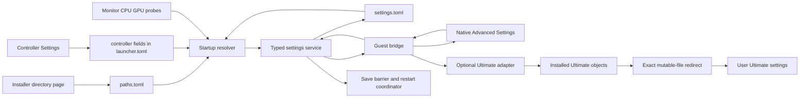
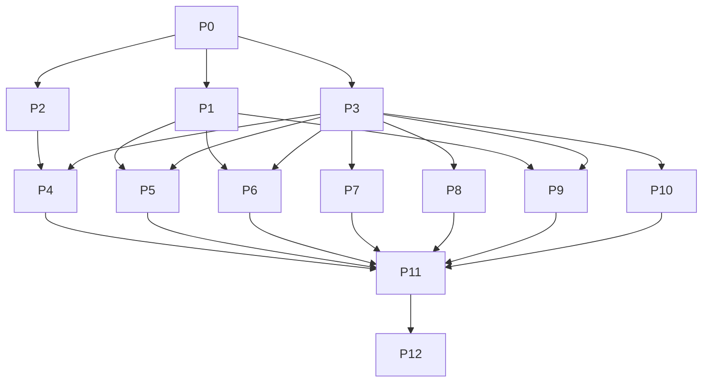

# In-game Advanced Settings and Controller Settings

Status: investigated implementation plan; no feature implementation or new runtime validation in this planning pass.

Research date: 2026-10-10. Baseline: `fd4b436`, **plus the staged song-cache work already in this checkout**. Source files take precedence over older plans. This document supersedes the launcher plan where the two disagree about settings ownership, launcher scope, resolution, or installer defaults.

Execution starting point: read sections 1–2, freeze the contracts in P0, then run P1 (native engine), P2 (render resolution), and P3 (storage) in parallel. Section 3 is the product specification; sections 4–9 define implementation contracts; section 10 assigns ownership; section 11 contains copy-ready prompts; section 12 defines completion.

## 1. Outcome and confirmed requirements

The game owns an **Advanced Settings** entry in its native main menu. It works with retail assets alone. An optional Ultimate adapter adds the Ultimate settings to the requested categories without copying, distributing, or editing Ultimate's source or installed archives.

The former launcher becomes **Controller Settings**. The user confirmed this name and confirmed that **Resolution means actual rendered resolution**, including 1920x1080. Merely resizing the window, changing the reported Xbox video mode, or changing a label does not satisfy this requirement.

The installer asks for installation, DLC, and save locations on the **same directory page**, including reinstalls. DLC/save locations move to a separate hand-editable file and have no settings UI after installation. Shortcut checkboxes start unchecked. The interactive finish-page default is **Play the game**. Silent installs continue launching nothing unless explicitly requested.

The user clarified the missing legends:

- **L** means a setting originating in our launcher, available in-game independently of Ultimate.
- **U** means a setting originating in Ultimate, absent when Ultimate is not installed.
- Interaction types are boolean, horizontal select, submenu, and boolean with submenu. Ultimate's Force Skybox is the reference for the last type; HUD is a submenu and Gems is a horizontal select.

These letters never appear in product labels. Do not implement a compound row as a web-style expanding form by assumption. Match the observed game interaction: show its enabled state, enter a choice submenu with A, and select Off/default or an enabled choice there. AA and Main Menu use this model, with details specified below.

Version one saves changes and offers **A: Restart now / B: Close**. B dismisses the restart message, keeps the game running, and retains the saved changes for the next launch. Applying every setting live is explicitly outside this version's requirements.

## 2. Important conclusions from investigation

| Finding | Consequence |
| --- | --- |
| Existing menu changes rewrite encrypted DTBs in read buffers without changing their length. | They are useful precedents, but not a general mechanism for adding a large menu tree. Build a native menu through the guest object/script layer; retain narrow file transforms only where proven. |
| Ultimate uses the retail pause MILO, but supplies a custom list resource and script functions. | The base game has usable screen primitives, but it does **not** have Ultimate's complete settings UI. We must supply independently authored behavior and configure retail resources in memory. |
| Existing render resolution is an integer multiple of 1280x720. | Exact 1080p is a separate graphics project and a release gate, not a schema change. |
| The game applies the old profile's `[settings]`, but does not translate its saved `launch.target`. | Move target translation into the game; otherwise installer launches, shortcuts, and restarts disagree with the menu. |
| `guide` exists as a remap source/target and capture input, in addition to `guide_button`. | Removing one checkbox is insufficient. Exclude Guide throughout the project's input path, including old profiles. |
| Ultimate saves to `GAME:/ulti_settings.dta`; the overlay preserves the game root's read-only state. | Verify and redirect this exact mutable file to user storage. Do not make the whole game mount writable. |
| Ultimate's `unlockall` defaults true but is absent from its saved variable list. | A relocated toggle cannot promise persistence by merely calling the existing save function. It needs an explicit compatibility persistence rule. |
| SDK `ReXApp::OnClosing` calls `std::_Exit(0)`. | Destructors and `OnShutdown` are not a dependable restart/save hook. Commit and acknowledge writes before requesting close. |
| Current `SaveProfile` truncates the destination and uses an old in-memory document. | Reuse its preservation/parser knowledge, not its write durability or concurrent-writer assumptions. |
| The staged cache feature reuses `splash_dlc` as Refresh Song Library. | Generalize Hide Main Menu without accidentally hiding the working refresh action or regressing the asynchronous scan. |

### 2.1 Evidence map

Evidence labels used here: **source** = inspected implementation; **decoded** = inspected local game data; **static** = traced generated guest code; **proposal** = not implemented or runtime-proven. Previously documented gameplay observations are not new test results from this pass.

| Area | Read these locations first | What is established |
| --- | --- | --- |
| Launcher rows | [settings.toml](../../launcher/config/settings.toml), [schema_view.cpp](../../launcher/src/schema_view.cpp), [shell.cpp](../../launcher/src/shell.cpp) | Schema generates rows; controller remapping and navigation also have bespoke UI outside the schema. |
| Direct launch | [profile_apply.cpp](../../src/launcher/profile_apply.cpp), [rb_blitz_app.h](../../src/rb_blitz_app.h), [game_launch.cpp](../../launcher/src/game_launch.cpp) | Profile application occurs in `OnConfigurePaths`; target translation currently happens in `BuildLaunchCommand`. |
| Config precedence | [0013 SDK patch](../../patches/rexglue-sdk/0013-cvar-config-source.patch), [cvar.h](../../rexglue-sdk/include/rex/cvar.h), [rex_app.cpp](../../rexglue-sdk/src/ui/rex_app.cpp) | Defaults < config < environment < CLI < runtime. Later equal-rank config writes win. Profile loads before `rb_blitz.toml`. |
| Profile storage | [profile.h](../../src/launcher/profile.h), [profile.cpp](../../src/launcher/profile.cpp), [profile_path.cpp](../../src/launcher/profile_path.cpp) | Preserves comments/unknown fields; refuses malformed files; supports explicit file, environment, settings-directory pointer, portable marker, app-data fallback. Writer is not atomic. |
| Installer | [setup.iss](../../installer/setup.iss), [commands.cpp](../../installer/src/commands.cpp), [install.cpp](../../installer/src/install.cpp), [embed_config.cpp](../../installer/tools/embed_config.cpp) | `wpSelectDir`, finish radios, shortcut tasks, helper commands, manifests, and generated shortcut terminology all need coordinated changes. |
| Retail menu transforms | [menu_options.cpp](../../src/ui/menu_options.cpp), [menu_filter.cpp](../../src/hooks/menu_filter.cpp), [main-menu-flow.md](../engine/main-menu-flow.md) | Grammar, byte-neutral edits, conditional-node handling, split reads, and retail checksum correction already exist. |
| Guest-to-host precedent | [dlc_refresh.cpp](../../src/hooks/dlc_refresh.cpp), [shell_music.cpp](../../src/hooks/shell_music.cpp) | `songcache:/rbbz_dlc_refresh` reaches host file imports; `d:/` queries may be answered entirely inside the ARK layer. Publication happens on a guest menu frame. |
| Ultimate activation | [ultimate.cpp](../../src/hooks/ultimate.cpp), [ultimate_plan.h](../../src/hooks/ultimate_plan.h), [payload_overlay.cpp](../../src/fs/payload_overlay.cpp) | Auto/off/force modes, separate or merged payloads, read-only overlay, three compatibility patch bits. Header existence alone is not sufficient proof of working settings objects. |
| Input | [controller_tab.cpp](../../launcher/src/controller_tab.cpp), [remap.cpp](../../src/launcher/remap.cpp), [input/remap.cpp](../../src/input/remap.cpp), [pad_nav.cpp](../../launcher/src/pad_nav.cpp) | Guide is in the 17-target vocabulary and capture path. Controller functionality cannot be inventoried solely from schema rows. |
| Graphics | [texture/cache.cpp](../../rexglue-sdk/src/graphics/pipeline/texture/cache.cpp), [video_mode_util.h](../../rexglue-sdk/include/rex/graphics/video_mode_util.h), [window_sdl.cpp](../../rexglue-sdk/src/ui/window_sdl.cpp), [graphics_system.cpp](../../rexglue-sdk/src/graphics/graphics_system.cpp) | Integer scaling, guest mode vs window size, borderless fullscreen, backend selection, native MSAA, and FXAA are separate mechanisms. |
| Save/restart | [local_save.cpp](../../src/hooks/local_save.cpp), [fs/local_save.h](../../src/fs/local_save.h), [rex_app.cpp](../../rexglue-sdk/src/ui/rex_app.cpp) | Existing guest serialization and durable-file techniques are useful; normal window close hard-exits. |

No applicable project `AGENTS.md` was found in the repository or inspected ancestors. Preserve pre-existing staged changes; do not reset the checkout to the baseline commit.

### 2.2 Local Ultimate observations

Read-only inspection used the local Xbox 360 extracted payload and both ARK indexes. Private decoded research lives in ignored `out/in-game-settings-research/`. Those dumps and the decrypted image are **not** deliverables to commit or distribute. The durable output is the behavioral inventory and symbol leads in this plan.

The local fingerprint manifest identifies the supported payload as 2.11; this is not a claim about the latest upstream release. The [upstream repository](https://github.com/ultimate-mods-rb/blitz-ultimate) was also inspected on the research date. Its feature list is consistent with the customization targets, and its root listing has no license file. Follow the user's knowledge-only integration constraint; do not infer permission to reuse its implementation.

The five inspected `ulti/gen` definitions below were compared byte-for-byte with their entries in the currently installed patch ARK and matched. The retail XEX SHA-256 and Ultimate header SHA-256 also matched the repository fingerprint manifests, so the static addresses and decoded observations are tied to the intended local baseline.

| Local entry | Size | Observation |
| --- | ---: | --- |
| `ulti/gen/mod_settings.dtb` | 11,956 | Panel/screen declarations and row descriptors; 15 root nodes. SHA-256 `0bcc94db7ca66046292af5197f04d4ef04e8f9c12de3d8c506bf8125c58d6f24`. |
| `ulti/gen/mod_settings_rw.dtb` | 2,218 | Save/load object, persisted variable inventory, old-file migration. SHA-256 `cfa1e36472877e2fda527ceb4c841b7e17546f0e401f1fff2c8e95ef0abfab25`. |
| `ulti/gen/ulti_macros.dtb` | 1,660 | Four row kinds; Xbox settings path; panel references retail `ui/pause/pause.milo`, `pause.lst`, `pause.lbl`. |
| `ulti/gen/ulti_funcs.dtb` | 20,336 | List formatting, selection, horizontal editing, cancel-to-previous-value, help-bar behavior. |
| `ulti/gen/ulti_init.dtb` | 1,777 | Defaults, including `unlockall=true`, camera 0, letterbox false, gems default, speed 1.0. |
| `ui/resource/lists/gen/list_mod_settings.milo_xbox` | 5,352 | Ultimate-only list presentation resource; absent from the retail ARK. |
| Retail `ui/pause/gen/pause.milo_xbox` | 34,215 | Reusable native panel asset already in the base game. |
| Retail `ui/resource/lists/gen/list_options_main.milo_xbox` | 91,189 | Candidate retail list resource to configure/clone in memory. Appearance parity still requires a spike. |
| Retail `ui/error/gen/error_general.milo_xbox` | 731,429 | Native error/restart-dialog visual primitive; Ultimate uses this for its warning. |

Ultimate's horizontal editor has a focused editing state: A enters/confirms; B cancels the pending value; directions change it. Its warning currently exits on Confirm and is not an actual process restart. A submenu's original back destination points to the old Ultimate grouping; reuse requires explicit routing back to the new parent.

### 2.3 Guest engine leads discovered during this pass

These are **static candidates on the pinned retail image**, not newly validated runtime hooks. Do not transplant RB3 addresses or promote inferred function names into the symbol map without a trace.

The initializer `sub_82420658`, in generated partition 36 at this baseline, interns builtin names using `sub_8245C878`, gets map entries using `sub_8231B478`, and stores corresponding guest callback addresses. The callback store belongs to the **preceding** interned name; associating it with the next string produces an off-by-one mapping.

| Builtin / lead | Name string VA | Callback / function VA | Next investigation |
| --- | --- | --- | --- |
| `run` | `0x82080E0C` | `0x8241DC28` | Loads and executes an authored script; calls `sub_824193A8`, then `sub_823FC2D0`. |
| `read_file` | `0x82080E00` | `0x8241DD48` | Calls `sub_824193A8`, wraps its returned array in a DataNode, adjusts ownership. |
| `write_file` | `0x82080DF4` | `0x8241DE48` | Trace serialization, failure result, and file routing for Ultimate persistence. |
| `file_exists` | `0x82080DD0` | `0x8241DFB0` | Trace a read-only namespaced query; simpler proof than a new generic guest function. |
| `func` | `0x82081060` | `0x824198D0` | Inspect how script-defined helpers are registered; do not assume this registers C++ callbacks. |
| File-to-array loader | — | `0x824193A8` | Trace `.dta`/`.dtb` choice, cache, archive lookup, ownership, and a virtual authored resource. |
| Node-to-string helper | — | `0x823F9538` | Called on the first argument node by the three I/O builtins; validate accepted tags and bounds. |

In the inspected `file_exists` wrapper, `r3` is a result-storage pointer and `r4` is the input array; argument zero starts at the array's node pointer plus 8. It writes an eight-byte result with value at +0 and type at +4. **Returning a boolean only in `r3` would corrupt this ABI.** Validate the hidden result pointer, node layouts, refcounts, stack alignment, saved registers, and thread context dynamically before writing any bridge result. Serialized DTB nodes and in-memory DataNodes are different formats.

Generated partition numbers may change. Recover the owning file through `generated/default/codegen.partition.json`; never edit `generated/default/*.cpp` as the implementation.

## 3. Exact menu and setting inventory

The root main-menu label is **Advanced Settings**. Its children, in order, are General, Graphics, Interface, Gameplay. Remove empty Ultimate-only groups when Ultimate is absent. No settings screen depends on Guide.

Ultimate visibility uses three facts, not a directory boolean: payload installed, adapter compatible, and provider active in this boot. Without installation, omit U rows. When a compatible payload is installed but the current target is base, U rows may remain visible but disabled with a concise "Requires Ultimate target" explanation; they must never invoke unloaded objects. With an unrecognized payload, preserve the original mod menu as a compatibility fallback, show a concise integration-unavailable notice, and keep our native rows functional. Do not pretend a supported adapter exists.

### 3.1 General

| Row | Interaction | Ownership / implementation |
| --- | --- | --- |
| Target | Submenu | Native setting: Rock Band Blitz / Rock Band Blitz Ultimate when installed / existing Trial target subject to the trial gate below. Maps to `ultimate_mode` and `license_mask` inside the game, before Ultimate configuration. |
| Downloadable Content | Submenu | Always present. |
| ↳ Cache DLC Library | Boolean | `enhancements_dlc_cache`; current default false. Preserve refresh functionality. |
| ↳ DLC scan threads | Horizontal select | `dlc_scan_threads`; default 1; choices 1 through `min(32, max(1, usable_logical_processors))`. Match the existing UI concept of logical processors, not physical-core count. |
| ↳ DLC menu songs | Boolean | `enhancements_menu_dlc_songs`; current default false; sample pool fixed to 50, bounded by valid available songs. |
| Achievements & Unlocks | Submenu | Ultimate provider only. |
| ↳ Unlock All | Boolean | Ultimate `unlockall`; existing row is a reboot-tagged boolean, **not** the earn-achievements command. Investigate actual consumers and supply persistence missing from the original saved-vars list. |
| ↳ Unlock Online Only Achievements | Action | Invoke the existing accomplishment action once after a confirmation. It is not a stored boolean. Test with disposable save data. |

Target details:

- Preserve the stored vocabulary `common`, `demo`, `ultimate` through migration; labels need not expose those words.
- A common target must set retail behavior even when Ultimate files exist. A return from Trial must reset the effective license to the purchased policy unless an explicit developer override wins.
- On a fresh profile, retain today's automatic target outcome: Ultimate when a complete supported payload is available, otherwise base. A missing payload on first boot is not an invalid manual selection and should not produce a correction warning.
- Existing documentation records Trial crashing before menu entry. Reproduce separately. Until repaired, show an unavailable Trial choice with a reason or omit it from runnable choices; do not silently ship a new route into that known failure. Restoring Trial is not a prerequisite for base and Ultimate settings, but its disposition must be recorded.
- Ultimate installation remains an installer operation. Target selection does not download software or edit archives.

### 3.2 Graphics

| Row | Interaction | Mapping |
| --- | --- | --- |
| Resolution | Horizontal select | Full `WIDTHxHEIGHT` labels from primary-monitor modes intersected with modes the implemented render path supports. Exact render dimensions are required. See section 7. |
| V-Sync | Boolean | `vsync`; retain 60 Hz guest timing policy. |
| Renderer | Horizontal select | Built backends intersected with runtime usable backends. Stable values such as `d3d12`, `vulkan`; never persist list positions. |
| Anti-aliasing | Boolean with submenu | None / Native (2x when proven for this backend/title) / FXAA / FXAA Extreme. Parent displays Off for None and On for another choice. |
| A. Filtering | Horizontal select | Native, None, 1x, 2x, 4x, 8x, 16x, limited to backend/device capability. |

AA is a single native enum, not two separately editable flags. Proposed translation, to be verified on both backends:

| Choice | `native_2x_msaa` | `swap_post_effect` |
| --- | --- | --- |
| None | false | `none` |
| Native (2x) | true | `none` |
| FXAA | false | `fxaa` |
| FXAA Extreme | false | `fxaa_extreme` |

`native_2x_msaa` controls the backend's handling of the title's MSAA. Prove that the disabled path actually meets the visible None/FXAA semantics; do not assume changing this cvar removes every source of multisampling. If it does not, fix the render path before claiming these exclusive modes work. The native sample-count label comes from verified title/backend behavior, not the display or the device's maximum supported sample count.

Filtering translation is established in SDK source: Native = -1, None = 0, 1x = 1, 2x = 2, 4x = 3, 8x = 4, 16x = 5. Apply only the eligible-texture semantics the renderer supports; a label of 16x must not be written as cvar value 16.

### 3.3 Interface

| Row | Interaction | Ownership / implementation |
| --- | --- | --- |
| 4:3 Letterboxing | Boolean | Ultimate `letterbox`. This is separate from the removed SDK Presentation category's `present_letterbox`. |
| HUD | Submenu | Ultimate provider. Preserve all original HUD rows listed below. |
| Hide Items | Submenu | Always present. |
| ↳ Offline Mode Prompts | Boolean | `enhancements_skip_offline_dialog`; true means hide; default true. |
| ↳ Main Menu | Boolean with submenu | Native hide master plus a complete per-row list. Replace the free-form CSV editor. |

HUD inventory: Hide HUD (`hide_hud`), gold-star progress (`goldprogress`), song progress bar (`progressbar`), timer (`show_timer`), personal-best progress (`show_pb`), note streak (`show_steak`, **original spelling**), and input viewer (`input_viewer`). Use the provider's localized labels where available; do not reduce HUD to one toggle.

Main Menu details:

- List all actual rows by stable token and current localized name: `splash_start`, `splash_leaderboard`, `splash_achievements`, `splash_options`, `splash_upgrade` when applicable, `splash_dlc`, `splash_exit`, the new Advanced Settings entry, and compatible mod-added rows. Identify rows from the actual effective menu, including conditional availability, rather than hardcoding a list of only online options.
- Old Ultimate `mod_settings` is replaced/routed to Advanced Settings on a supported integration; do not leave two settings entry points with conflicting ownership. Unsupported-mod fallback is an explicit exception.
- Preserve current non-graphics defaults: hide master false; its default selected list contains the old offline rows. Turning the master on uses that list. The user's "leave as default the ones offline" is implemented as the default checked selection, not an unrequested change to the master default.
- Show **Advanced Settings** in the list but keep it visible and non-hideable in version one, with a brief explanation. This is a deliberate recovery constraint on "list everything"; users must not remove their sole configuration entry. Ensure an OS close path remains usable if Exit Game is hidden.
- Off disables filtering while preserving checked choices. On with an empty selected list hides nothing. Existing `HideRows` treats an empty CSV as the default list; add an explicit empty-selection representation so it cannot unexpectedly hide rows.
- `splash_dlc` means Refresh Song Library while the cache feature is active. Default offline filtering must leave that useful action visible. An explicit user choice may hide it; give refresh an alternate native action under Downloadable Content if hidden. Do not create a second cache-refresh implementation.

### 3.4 Gameplay

This category is Ultimate-only in the requested tree and disappears when it has no available rows.

| Row | Interaction | Observed provider binding |
| --- | --- | --- |
| Precision Mode | Boolean | `freq_ms` |
| Disable Random Track Wiggles | Boolean | `disable_random_wiggles` |
| Camera Angle | Horizontal select | `camera_angle`: 0 Default, 1 High, 2 Low |
| Game Speed | Horizontal select | `speedmod`: 1.00 to 1.50 in 0.05 increments in this payload; show 100%–150%. Avoid floating-point step accumulation. |
| Disable Depth of Field | Boolean | `disable_dof` |
| Plots & Skyboxes | Submenu | New parent group. |
| ↳ Disable Plots | Boolean | `disable_plots`, restart-tagged by provider |
| ↳ Force Plot | Boolean with submenu | `forceplot`, false/off or a plot symbol; obtain choices from the installed compatible provider; restart-tagged |
| ↳ Force Skybox | Boolean with submenu | `which_skybox`: default, none, or installed custom skybox choice; restart-tagged |
| Gems | Horizontal select | `gems`: observed `default`, `freq`, `amp2003`, `amp2016`, `monkey`, `ulti`, `x`, `bolt`; provider inventory remains authoritative |

Do not infer that selecting "No skybox" means the forcing feature is off: the observed provider uses index 0 as default/off and another index to force no skybox. Likewise, disabling plots and selecting a forced plot need a defined precedence: keep the selected plot but make it inactive while Disable Plots is true; test actual provider behavior before adding a different rule.

### 3.5 Retired interface and Controller Settings

| Old surface | New disposition |
| --- | --- |
| Rename Mod Settings | Remove row and normal-user toggle behavior. The integrated entry has one fixed label: Advanced Settings. Retire R10's competing rename on supported integration. |
| Menu DLC song pool size | Remove row; runtime constant 50, capped by successfully usable songs. Old profile values must not re-enable configurability. Verify package-handle lifetime and fallback on small/broken libraries. |
| Separate native-MSAA control | Absorbed into the AA enum; no second user control. |
| Presentation category | No new menu rows. Keep internal SDK knobs for diagnostics where needed; do not conflate them with Ultimate 4:3 Letterboxing. |
| Audio category | No launcher/Advanced Settings rows. Existing game calibration/audio behavior remains functional. |
| Force monitor | No user UI. Use the primary display on ordinary boot; explicit developer flags may remain. Do not import an old forced-monitor profile value. |
| Guide pass-through | Remove checkbox, remap target/source, capture, and project hotkey behavior. Ignore legacy Guide bindings with a migration diagnostic; enforce no Guide delivery even after remapping. |
| Fullscreen row, absent from requested menu | Keep normal fullscreen default and existing window hotkeys; no extra menu category. Preserve a valid user's prior window preference if supported by the internal setting. |

Controller Settings keeps the **entire existing controller functionality** except Guide: mouse support, input backend if available in this build, pad/keyboard/mouse bindings, triggers, resets/presets, navigation rebinding, safe-mode recovery, device navigation, and help. Inventory actual UI code before deleting schema groups. Preserve functionality even if an older README calls it unbuilt.

Only controller settings are editable in this application. Save, Reset, Close, and an optional Play Game convenience action are compatible with that role; the game must never require opening it. Keep the executable filename `rb_blitz_launcher.exe` for this release to avoid breaking existing shortcuts, while updating titles, shortcut labels, installer text, resource descriptions, logs shown to users, and documentation to Controller Settings.

The old Update and Install Ultimate workflows must not disappear accidentally during UI deletion. Move their user-facing entry points to the existing installer/updater workflow and document it. Version one does not add an in-game downloader or a new launcher General tab. Reuse existing helpers without requiring Controller Settings to run before the game.

## 4. Storage, migration, and boot contracts

The following are proposed contracts to freeze in milestone M0. Names are intentional so execution agents do not invent separate formats.

### 4.1 File ownership

| File | Location | Writer / reader |
| --- | --- | --- |
| `paths.toml` | Next to the installed `rb_blitz.exe`; per installation | Installer writes initial/reinstall choices. User may edit it manually. Game reads it before configuring paths. No in-game or Controller Settings editor. |
| `settings.toml` | In the existing resolved profile directory, normally `%APPDATA%\rb_blitz` | Native settings service owns game preferences, provenance, migration version, and the exceptional persisted Ultimate override described below. |
| `launcher.toml` | Existing resolved profile path | Retained filename for controller bindings, controller-only cvars, navigation, utility geometry, and legacy preservation. Controller Settings writes only its owned fields. Runtime stops blanket-applying its retired game-settings keys after migration. |
| `rb_blitz.toml` | Existing game config beside executable | Explicit developer/manual cvar overrides; no longer the destination of user UI writes. |
| `ulti_settings.dta` | Proposed `<user_data_root>/ultimate/ulti_settings.dta` | Ultimate's original serializer/loader, through an exact-path host redirect and durable completion handling. Our adapter operates on the provider, not on a second competing set of U defaults. |

`paths.toml` is beside the executable so its discovery never depends on the save directory it selects. A custom installation under Program Files may require elevated manual edits; the installer already has the necessary installation write context. Ordinary per-user installations remain user-editable. Do not relocate the file secretly when a write fails.

Example path file, using TOML literal strings so Windows backslashes need no escaping:

```toml
schema_version = 1

[paths]
dlc_root = 'D:\Rock Band DLC'
user_data_root = 'D:\Rock Band Saves'
```

Empty DLC path means `<game_data_root>/dlc`; empty save path means the project's existing platform Documents/Rock Band Blitz default. If a manual file contains relative paths, resolve them against the **directory containing `paths.toml`**, not the process working directory. Persist full paths from installer pickers. Missing DLC is allowed as an empty library with a diagnostic; never copy a library into the installation. An inaccessible existing save location is not equivalent to a new empty save: explain the failure and avoid silently writing a divergent save elsewhere.

Native settings example, illustrative rather than a new set of defaults:

```toml
schema_version = 1

[general]
target = 'common'
cache_dlc_library = false
dlc_scan_threads = 1
dlc_menu_songs = false

[graphics]
resolution = [1920, 1080]
renderer = 'd3d12'
anti_aliasing = 'native'
filtering = 'native'
vsync = true

[interface]
hide_offline_prompts = true
hide_main_menu = false
hidden_main_menu = ['splash_leaderboard', 'splash_achievements', 'splash_dlc']

[provenance]
'graphics.resolution' = 'manual'
'graphics.renderer' = 'automatic'
'graphics.anti_aliasing' = 'automatic'

[automatic]
policy_version = 1

[ultimate_overrides]
# Only fields the provider does not persist; populated when needed.
# unlock_all = true
```

Do not write a file full of guessed machine defaults during installation. The runtime must choose graphics after inspecting the machine. User preference provenance is per setting, not a single global "configured" bit. Capability lists, detected CPU count, translated strings, and transient error state are not preferences and are not authoritative on disk.

Resolve the settings directory by adapting the existing profile locator. Honor existing explicit `--launcher_profile`, `RBBLITZ_LAUNCHER_PROFILE`, `settings_dir.txt`, and portable marker for migration/compatibility. A nonstandard legacy profile basename maps to a distinct native-settings sibling (for example `<stem>.game-settings.toml`) to avoid collisions between explicit profiles in one directory; the ordinary `launcher.toml` maps to `settings.toml`. Freeze and test this mapping once. Do not start reading preferences from the save folder just because `user_data_root` changes.

The existing user-scoped preference behavior is retained; two installed copies may share general/controller preferences, but each has its own `paths.toml`. Portable and explicitly selected profiles remain isolated. Include two-installation tests so migrating one install's old path fields cannot redirect the other install.

### 4.2 Precedence and initialization order

For native settings: compiled defaults / first-run automatic recommendations < migrated/current `settings.toml` < explicit `rb_blitz.toml` < environment < CLI. Current runtime overrides remain diagnostic state, not a reason to rewrite user preferences. Controller settings follow the existing profile/config precedence. Paths: path-file values replace legacy path fields; explicit developer config/environment/CLI overrides still win. Old launcher-generated command lines are a migration case, not the new normal.

The UI receives **requested**, **effective**, **pending**, **source**, and **restart-needed** separately. A value overridden by explicit CLI/environment/developer config should show its actual effective value and a brief override explanation; disable editing that row rather than saving a change that can never take effect. Ordinary launches should pass roots/profile identity only, not every setting as a CLI flag.

Actual SDK order matters:

1. `SetupEnvironment` calls our `OnConfigurePaths`, then loads `rb_blitz.toml`, then initializes logging and calls `OnPostInitLogging`.
2. `SetupPresentation` calls `OnPreSetup`; backend choice, graphics presentation, and the window are established here.
3. `OnFinalizePaths` runs **after presentation** but before `ConstructRuntime`.
4. `OnPostLoadXexImage` configures game hooks and Ultimate; `OnPreLaunchModule` calls `FinalizeInit`.

Recommended integration:

- `OnConfigurePaths`: resolve config identities, read/migrate preferences and `paths.toml`, apply config-rank inputs, and supply initial roots. Queue diagnostics until logging exists.
- Before backend/window allocation, in the `OnPreSetup` path: reconcile winning graphics values against capabilities and apply the startup graphics decision. `OnFinalizePaths` is too late for this work. Check when SDL video is initialized; enumerate on the SDL/UI thread at a proven lifecycle point.
- `OnFinalizePaths`: recompute and validate roots using the **final** cvar sources after `rb_blitz.toml`, so old pre-config path snapshots cannot win. No directory picker is added here.
- Before `ultimate::Configure`: translate the effective target and license policy. Publish installation/activation state after this function returns. `menu_filter::Configure` currently runs before Ultimate; reorganize dependencies explicitly if integration needs the final provider state.
- After the engine's script/object registration is ready: install the independent menu, snapshot bridge, and optional provider adapter. This is a guest lifecycle hook, not `OnPostLoadXexImage` blindly calling uninitialized script functions.
- Before `FinalizeInit`: finish all init-only settings decisions. Menu edits thereafter change persisted desired state and pending state, not init-only cvars.

Keep cvar source provenance accurate. `SetFlagFromConfig` returning true can mean a higher-priority value was left unchanged; it does not prove our value won. Avoid using `SetFlagByName` at runtime rank to overpower explicit overrides. If normalization requires an SDK API that preserves the winning source while recording a corrected effective value, specify it as a small tracked SDK patch with tests.

### 4.3 Migration rules

Migration is idempotent, staged, backed up, and owns only known fields. It must be testable without booting the game.

1. Resolve the old profile using its real path rules. Preserve a byte-identical backup before any migration write; malformed or unsupported-version files are reported and left intact.
2. Existing valid new-format files win. Import only missing fields. If an older migration was interrupted, finish missing outputs without erasing user edits or declaring a false first boot.
3. Import `launch.target` and supported native preferences. Import paths from `[settings] user_data_root/dlc_root`, falling back to legacy `[launch] user_data_dir/dlc_dir`; the current parser already knows this precedence. Match the old game root/install identity before applying path fields to an unrelated installation.
4. Keep remap/nav/controller state in the old profile. Runtime applies only the controller allowlist from this file once migration is complete. Old native fields may remain as inert preservation data; do not let their presence create two active sources of truth.
5. Translate old `resolution_scale=n` to requested `[1280*n, 720*n]` and then reconcile with supported monitor/render modes. Never translate 2 to 1920x1080; its old meaning was 2560x1440.
6. Translate filtering exactly as section 3.2. For legacy AA combinations, off+none → None; on+none → Native; any FXAA setting → that FXAA choice under the new exclusive contract. Record the intentional loss of simultaneous native+FXAA behavior in migration diagnostics; do not invent an unrequested fifth choice.
7. Do not import removed presentation/audio/monitor UI overrides as new preferences. Leave explicit hand-edited developer cvars usable except for the project-wide Guide prohibition and fixed menu-song pool. Retire rename behavior. Drop old pool-size values from active inputs and use 50. Exclude Guide remaps and pass-through even if true in a legacy file.
8. Preserve opaque unknown tables, comments, and future keys. Version markers commit only after all required outputs are durable. Cross-file writes are not magically atomic: keep enough migration state to recover if `paths.toml` succeeds and `settings.toml` fails, or vice versa.
9. Preserve existing valid choices as manual. A missing field uses its default/recommendation. A field equal to the historical default is not reliable evidence that the user never chose it; avoid resetting it solely on value equality.

Normal configuration errors must not turn into permanent boot loops. Retain a last-known-good graphics record and an explicit development/recovery startup option that can bypass a bad graphics preference without deleting files. Document the manual recovery route because the external graphics launcher is going away.

### 4.4 Durable saves and concurrent writers

Use a shared SDK-free storage module for the game and installer where their ownership overlaps. Reuse existing parser/preservation logic as appropriate, but strengthen the write path:

- Reread the document under a per-file cross-process lock or equivalent version check. Merge only owned changed keys; reject a conflict on a key changed concurrently by another writer. Do not save a stale whole-document model over a hand edit.
- Write a temporary sibling, flush/close it, then atomically replace the destination using the platform's supported replace primitive; keep the old file on failure. Preserve unknown fields and the user's comments.
- Validate full data before write. Bound sizes/counts and reject unknown schema versions for mutation. Treat enums as stable values, not localized strings or selection indexes.
- Return explicit success/failure plus the persisted revision. The game displays "saved; restart required" only after durable success. A failed save keeps the edited menu state visible and the previous file intact.
- Paths are a separate file owned by installer/manual editing, so Controller Settings and the game never overwrite them as a side effect of Save/Reset/exit.

For controller vs native settings, separate files avoid routine contention. Migration and manual external edits still require the conflict rules. Ultimate save acknowledgement must be connected to actual host I/O completion, not merely its script's success log.

## 5. Native menu and host/guest bridge

### 5.1 Architecture

"Host/client" here means the C++ runtime and emulated guest engine within one process. No network server, IPC service, or running launcher is needed.



Suggested new modules, with public names frozen before parallel implementation:

| Module | Responsibility |
| --- | --- |
| `src/settings/model.*`, `schema.*` | Stable IDs, typed values, descriptors, categories, sources, validation, pending changes. SDK-free. |
| `src/settings/store.*`, `migration.*`, `paths.*` | Native settings persistence, conflict handling, legacy translation, path-file format/locator. |
| `src/settings/capabilities.*`, `reconcile.*` | Machine snapshot, backend/display eligibility, first-run policy, manual-invalid adjustment. Pure reconciliation separated from platform probes. |
| `src/settings/service.*` | Boot/current/desired state, transactions, commit results, subscriptions, restart-required aggregation. |
| `src/hooks/settings_bridge.*` | Guest ABI, object/array ownership, typed marshalling, bounded messages, guest-thread callbacks. |
| `src/ui/advanced_settings.*` | Independently authored menu model, native navigation, labels, focus/back stack, confirmation/restart dialogs. |
| `src/settings/ultimate_adapter.*` | Version/capability detection, calls to installed provider, save barrier, submenu return routing. |
| `src/fs/settings_overlay.*` | Exact virtual authored resources and narrowly redirected mutable settings file; only if the spike chooses this route. |
| `src/platform/game_restart.*` | Structured process launch context, wait-for-parent bootstrap, exactly-once restart request. |

Do not put all behavior in `rb_blitz_app.h`, copy the launcher's ImGui shell into a guest overlay, or make gameplay hooks depend on ImGui. The requested UI is native and follows Ultimate's layout.

### 5.2 How to add a menu without shipping mod/game content

Preferred route: use the game's own script/object machinery to register project-authored screen/panel definitions and populate native lists. Reuse retail assets at runtime, configuring an independent list resource from available retail primitives. For a compatible active Ultimate installation, its existing resource can be referenced at runtime, but the no-Ultimate path must already work.

The native-menu spike must prove all of the following before broad UI implementation:

1. Identify a safe guest point after data builtins and required UI types are initialized, before or when splash builds its list.
2. Load one **authored** minimal definition through a recognized virtual resource or verified engine loader. The module must not be carved out of unused bytes in an Ultimate file or copied from its script functions.
3. Insert one stable Advanced Settings token into the live main-menu provider and route its selection to the new screen; add its localization through a verified native lookup/provider path.
4. Show one boolean, one horizontal choice, one nested submenu, and one compound row using only retail assets. Prove selection, back, focus restoration, scroll, and repeated enter/leave with a controller and keyboard.
5. Verify a base-only boot with the Ultimate folder physically unavailable. `--ultimate_mode=0` with extracted Ultimate resources still accidentally mounted is not sufficient evidence.

Fallback decision order: object/script registration first; a narrowly scoped native loader interception for project-owned virtual files second. A small byte-neutral bootstrap edit is acceptable only if it has an independently proven budget in both supported splash variants and correct checksum handling. Do not shrink/delete unrelated menus to make room for the entire feature. Do not bypass all retail checksum checking. A host overlay is a diagnostic prototype, not completion of the requested layout.

Current `menu_filter` scans read buffers and already owns split-read/checksum behavior. Adding another `NtReadFile` or `NtCreateFile` implementation in a second translation unit can duplicate strong symbols or bypass another feature. Centralize dispatch or extend the existing owner; every unrecognized request must call the original exactly once.

### 5.3 Bridge contract

The high-level API is independent of the eventual transport:

```text
GetSnapshot() -> Snapshot(schema_version, revision, capability_revision,
                         active_target, provider_state, descriptors, values)
BeginEdit(base_revision) -> transaction_id
Set(transaction_id, setting_id, typed_value, capability_revision) -> validation_result
CancelField(transaction_id, setting_id) -> value
Commit(transaction_id) -> CommitResult(saved_revision, restart_required, errors)
Cancel(transaction_id)
Invoke(action_id, request_id) -> ActionResult
RequestRestart(saved_revision, request_id) -> RestartResult
```

`Snapshot` includes logical-processor ceiling, primary-display identity/modes, usable renderers, supported render resolutions, verified native AA label/sample count, filtering ceiling, provider installation/activation/compatibility, and each row's source/visibility/enabled state. Boot builds the initial snapshot; opening the menu gets a fresh snapshot. Revalidate before commit if a display/device changed.

Native code owns validation and storage; guest content cannot set arbitrary cvars, open arbitrary host paths, or execute arbitrary host commands. Requests use an allowlisted operation and setting ID with bounded values. Lists are count-bounded; guest address plus size arithmetic must be checked against mapped guest memory, not just a non-null pointer. Strings require deliberate encoding and escaping.

All guest object access, construction, reference counting, and callbacks run on the owning guest/UI thread. Host workers may probe or write immutable request data, then queue a completion back. They must not hold raw guest pointers across frames or mutate the cvar registry while the renderer consumes it.

Transport choice is an M0 gate:

- First prove the existing builtin route with the static candidates in section 2.3. A namespaced `read_file`/`write_file` or function-dispatch hook can carry serialized data and an acknowledged request without adding a network or a new service process.
- Prefer a project-namespaced builtin/callback once registration and PPC invocation are understood. Use a valid guest-callable thunk registered with the recompiler/runtime. Never store a 64-bit host function pointer in a 32-bit guest callback table.
- If using a virtual resource transport, intercept at the validated guest data-loader boundary or a dedicated VFS device. Do not assume an arbitrary `d:/...` path will reach kernel file hooks. Only project-owned definitions may execute as scripts; capability/preference payloads are data, never arbitrary `eval` input.
- Do not generalize the current substring-matched DLC sentinel into a settings command parser. Exact namespace/operation matching, idempotent request IDs, structured status, and a durable-save acknowledgement are required.

### 5.4 Edit behavior

Begin a session from effective values plus stored desired values. Horizontal A enters editing; directions adjust; A accepts the field; B restores that field's previous value. Backing out of a submenu restores focus and scroll to the parent row. Backing out of the Advanced Settings root commits the accepted changes, then shows one restart message if the desired state differs from the applied boot state.

No changes means no disk write and no restart prompt. Change-then-revert also means no restart prompt. A save failure shows a native error with retry/back, leaves the old file intact, and must not restart. Returning later in the same process displays both the pending desired setting and a clear restart indication rather than pretending it is already applied.

For version one, all native rows are restart-scoped even when a cvar is tagged hot-reloadable. Existing Ultimate setters may already have visible live effects; preserve their established behavior where necessary, but do not promise universal live application. Restart acknowledgement and provider persistence still follow the shared contract.

## 6. Ultimate adapter and persistence

### 6.1 Integration boundary

Implement independent native categories and row definitions. The optional adapter discovers the installed mod's objects, checks their expected shape, reads their state, invokes their existing actions, and routes supported submenus into our navigation stack. It does not replace Ultimate with a vendored implementation.

Allowed project outputs: original C++/authored menu definitions, documented observations, symbolic names, hashes, and compatibility logic. Do not commit decoded Ultimate scripts, copied helper bodies, MILOs, patched mod DTBs, ARKs, or a rebuilt Ultimate distribution. Installed input file hashes must remain unchanged after using settings. A hash mismatch is diagnostic evidence to inspect compatibility, not permission to modify the payload.

Compatibility detection has two levels: known fingerprints provide a reproducible tested baseline; runtime shape checks verify the objects/rows/variable types needed by each integration. Unknown releases must not crash the game. If shape checks fail, disable the affected integration and retain access to the original mod's settings path rather than hiding it and leaving no working UI.

When reusing an existing HUD/plot/skybox panel, the adapter must handle original `back` destinations, focus, stored row position, and its reference to `mod_settings_panel.should_warn`. Prefer a temporary call/return wrapper that restores the original state on exit. If a narrowly scoped runtime message/property hook is necessary, record the exact object, lifetime, and shape guard. Never make persistent edits to the mod's files.

### 6.2 Save ownership and path redirect

The mod's saved list, decoded locally, contains:

```text
freq_ms, disable_dof, which_skybox, disable_random_wiggles, disable_plots,
forceplot, server_url, server_ssl, p9dlc, hide_hud, goldprogress,
progressbar, show_timer, show_pb, show_steak, input_viewer,
controller_mapping, camera_angle, letterbox, gems, speedmod
```

Preserve the full provider file, including values not exposed on Xbox or in the new menu. The adapter must not rewrite it from just the visible subset. `controller_mapping` belongs to the game's own control scheme and is distinct from host button remapping.

Proposed path adapter:

1. Intercept the exact normalized `game:\ulti_settings.dta` read/write path for the active compatible Ultimate provider, including the actual `d:` alias if the engine canonicalizes to it. Direct it to `<user_data_root>/ultimate/ulti_settings.dta`. Confirm all query/open/create/read/write/rename forms used by the provider; handle relative paths and file-handle paths consistently.
2. Prefer an existing native file/device abstraction with exact routing. If intercepting a builtin instead, prove success/error propagation and reference ownership. Do not enable `allow_game_relative_writes` globally.
3. If an old user-supplied file exists in the game root, import it once into the new writable location, preserve the old file, and use the new one thereafter. Preserve the provider's `ulti_settings.ini` migration route as a read-only legacy source when appropriate. Do not treat missing files as corruption.
4. Do not redirect `GAME:` wholesale. ARKs, screenshots, scores, and unrelated guest files must not suddenly move with this feature. Audit interactions with local score saving, but change only settings persistence unless a proven dependency requires more.
5. Call the installed `mod_settings_rw` save/load behavior on the proper guest thread. A log saying "saved" is insufficient: verify durable bytes and readback on restart.

`unlockall` is the exception: store the user's explicit choice under native `[ultimate_overrides] unlock_all`, then apply it after Ultimate initializes/loads its settings and before its first relevant consumers. Investigate its consumer timing; simply setting it on menu entry may be too late. Do not invent a value when no user override exists: honor the provider's default. Do not add this variable to the mod's source file or assume the existing writer will include it.

### 6.3 Combined commit and actions

A menu session may contain native and Ultimate changes. Validate both before writing. Use a commit journal or equivalent recovery record for the native file plus the staged Ultimate file; cross-file replacement is not atomic. Acknowledge completion only when both durable outputs are consistent. On partial failure, report the actual state, retain retry/recovery data, and block Restart now. Do not display a blanket "nothing was saved" if one replacement already succeeded.

Achievement granting is a separate immediate action with an explicit confirmation and one request ID. It cannot be undone by canceling the rest of a settings session. Invoke the provider's existing accomplishment path; do not manipulate score/save bytes or expose a native imitation when Ultimate is absent. Check persistence using a disposable profile and keep the user's real progress untouched during acceptance.

## 7. Resolution, capability discovery, and automatic adjustment

### 7.1 Exact-resolution gate

The current `resolution_scale` cvar is an integer, and backend internals use integer draw scales for tiled memory, textures, shaders, and resolves. `video_mode_width`, `video_mode_height`, and the `resolution` preset can change the window/reported mode without changing the actual picture. This was also recorded in [launcher-plan.md](launcher-plan.md), D12's 2026-10-08 amendment. The user's confirmed requirement supersedes the earlier decision to offer only integer scales.

The graphics owner must investigate these routes in order and select **one** with evidence:

1. **Guest render-dimension hooks:** find where Blitz chooses render-target allocations, active viewport/scissor, projection/aspect constants, and presentation source rectangles. Make them agree on a chosen size before allocation while keeping guest timing unchanged. Determine whether the title already has a resolution-aware path disabled by a fixed native constant. This is the preferred spike because it may avoid changing the SDK's integer-scaled emulated-memory model.
2. **Backend arbitrary-size rendering:** if guest hooks are insufficient, specify the SDK work needed for a non-integer scale or a separate arbitrary-size render target path. Audit EDRAM/tile assumptions, pitch, sample positions, scaled resolves, texture copies, shader constants, readback, half-pixel offsets, and both backend caches. A float cvar substituted for an integer is not a design.
3. **Unacceptable completion substitutes:** a 1920x1080 window with 720p rendering; 1440p supersampled and then downscaled to 1080p; only changing Xbox video-mode reporting. These may help compare experiments but fail the confirmed exact-render requirement.

The spike's acceptance proof is actual render-target/viewport/resolve instrumentation or a GPU capture for 1280x720, **1920x1080**, 2560x1440, and 3840x2160 on supported hardware. Pitch/tile padding is allowed; the active image must match the selected dimensions. Validate menus, a song, depth-of-field on/off, native AA and FXAA, aspect preservation, UI/mouse-coordinate mapping, DLC transitions, and restart. A screenshot's output dimensions alone are insufficient evidence.

Default to primary-display presentation. SDK `monitor=0` currently means system default, not a verified primary-monitor guarantee; explicitly use the platform's primary display when positioning the ordinary game window before fullscreen. Honor explicit developer monitor overrides only as diagnostic behavior, excluded from the normal persisted preference path.

Enumerate actual fullscreen display modes on the SDL/UI thread (`SDL_GetPrimaryDisplay`, `SDL_GetFullscreenDisplayModes`, desktop mode), expressed in physical pixels. Deduplicate width/height across refresh variants; do not add a refresh-rate picker or change guest `video_mode_refresh_rate`. Filter out unsupported render dimensions, including aspect ratios not yet proven. Do not fabricate a fixed universal resolution list. A monitor mode being advertised does not prove the renderer supports it, and a supported render size does not prove the monitor advertises it.

Preserve the game's aspect ratio without stretching. Ultrawide/4:3 presentation must document any letterboxing and distinguish host presentation from Ultimate's gameplay letterbox setting. Do not claim full ultrawide gameplay support from a window-size change. If a valid monitor has no mode accepted by the current render implementation, enter a recoverable safe window with an explanation and log the unfulfilled mode support; do not populate a lying selector.

### 7.2 Runtime renderer and feature probing

The existing `choices_from = gpu_backends` covers compiled availability only. The current Vulkan check proves loader usability, not complete device/presentation support. The new snapshot must distinguish built, detected, usable, and active states.

- Probe required adapter/device/format/sample/feature support for each compiled backend. Use a bounded probe with clean temporary resources, or a short-lived probe process if backend initialization cannot be safely undone. Never initialize two full game renderers just to populate a row.
- Record the actual selected backend after fallback. If the preferred backend cannot create presentation after preflight, recover to a working backend with a bounded, recorded fallback attempt. Repeated failure must produce a useful error instead of an infinite relaunch loop.
- AA options and filtering limits belong to each backend/device capability record. A pending renderer change revalidates its dependent choices as one group; do not accept an AA mode from the previous renderer's list without checking.
- Reuse the build's backend enumeration in both schema generation and runtime discovery. Do not maintain an unrelated hardcoded `d3d12/vulkan` list in the guest.
- A single available choice remains understandable in the menu but does not need left/right affordances. If enumeration is temporarily unavailable, use the known working current setting and retry; do not erase a valid preference.

### 7.3 First boot vs a previously manual choice

Treat these as separate paths:

| Condition | Required policy |
| --- | --- |
| No preference for a non-graphics field | Use the existing compiled/project default, not a new optimization heuristic. |
| No graphics preference | Run the versioned first-run recommendation policy from real capabilities and measured performance data. Mark selected fields automatic. |
| Manual value is still valid | Keep it, even if a newer recommendation would choose something else. |
| Manual value becomes invalid | Select a valid closest equivalent; if none exists use the field's safe default. Show/log the effective correction and reason. |
| Automatic value and materially changed hardware/policy | Recompute automatic fields, preserving manual ones. |
| Temporary discovery failure | Keep a working last-known-good choice or safe fallback; do not classify every manual value as permanently invalid. |

Examples and deterministic rules:

- 3840x2160 on a newly connected 1920x1080 primary display: choose the largest supported advertised mode no larger than the old dimensions, preferring the same aspect ratio. Here that is 1920x1080 if rendering it is supported. If no sensible match exists, use the safe recommended mode.
- 16 scan threads on a machine now exposing 8 usable logical processors: clamp to 8. Invalid/nonpositive user UI values return to default 1. Preserve the developer-only legacy meaning of zero (automatic, capped at 8) in the developer config path; do not accidentally introduce it into the UI selector.
- Missing renderer: use a proven usable backend, then reconcile AA/filtering/resolution against it. Never clamp an enum by index.
- Unsupported native-AA path: choose the tested default for that backend, then a universally supported None fallback if necessary. Never display Native (2x) when it is unavailable.
- Removed Ultimate payload: boot base safely; keep dormant U preferences intact, hide U rows, and make the effective target visible. Reinstalling the mod must not destroy its saved choices.

Retain requested preferences separately from effective corrections so a temporarily disconnected monitor does not erase a valid manual 4K preference forever. Display the effective setting and a concise adjustment notice, and record corrections against the capability revision. If the user explicitly chooses a replacement in the menu, that becomes the new manual preference. Do not announce the same correction on every frame.

### 7.4 What "optimized on first boot" must actually mean

Do not select 4K merely because the monitor supports it, use CPU count as a proxy for GPU speed, or call a static maximum-quality default "optimized". A versioned recommendation policy must be supported by repeatable measurements.

Implement a bounded preflight/recommendation stage before committing expensive render resources. Establish measured GPU/backend performance tiers using representative rendering tests, with capability constraints and a conservative unknown-hardware fallback. If the selected design uses a startup calibration workload, it must be brief, cancellable/time-bounded, and independent of loading the user's large DLC library. Benchmark results must include backend, device, driver, dimensions, AA, filtering, and frame-time budget. Do not optimize based on cached shader compilation stalls or V-Sync-limited averages.

Policy objective: choose the highest **verified sustainable** candidate within the primary display's supported render modes, keeping the title's 60 Hz pacing intact; choose AA/filtering from that candidate's measured budget. Unknown devices receive a conservative supported recommendation, marked automatic. Document that this is an evidence-based heuristic, not a guarantee of the mathematical optimum. The first-run feature is unfinished if it only writes universal defaults and defers all real policy work.

Use the working renderer's safe settings when measurement fails. Keep a last-known-good boot configuration and one bounded recovery attempt; invalid graphics must not trap a user outside the only settings UI. Persist a successful graphics-boot marker after a known good menu frame, not merely after process creation. Crash recovery must distinguish failed graphics startup from an ordinary later gameplay crash before downgrading settings.

## 8. Restart design

The visual prompt uses independently authored behavior on native retail error/confirmation resources, matching the game's style. It says changes are saved and require a restart, with **A Restart now** and **B Close** plus keyboard equivalents. A held confirm input must not trigger both save and restart twice.

State machine:

```text
editing -> validating -> committing -> saved_pending_restart
                         | failure -> editing_with_error
saved_pending_restart --B--> running_with_pending_changes
saved_pending_restart --A--> draining_saves -> spawn_waiting_child -> request_close
```

Required restart sequence:

1. Verify the acknowledged native/provider settings revision still matches the pending state. Drain game-save activity required for a safe menu exit, plus any settings journal. Coordinate with an in-flight DLC refresh; cancel/join or wait through its existing ownership mechanism rather than racing its publication or file writes.
2. Prepare a structured launch context: executable, absolute game-data root, working directory, selected profile identity, explicit developer arguments that should survive, and the newly persisted desired target. Rebuild arguments using the existing quoting lessons in `game_launch.cpp`; do not replay old launcher-generated setting flags that override the new file.
3. Launch a waiting child/bootstrap, passing only validated restart state. It must wait for the old process to exit **before** initializing the SDK, mounting saves, opening the audio/GPU device, or starting the title. Bind the wait to a process handle/verified identity, not an unverified PID susceptible to reuse. Use a timeout and a clear error path.
4. If creating the child fails, keep the original game running and report failure. Only after child creation/handshake succeeds request close on the UI thread.
5. Let the existing title termination path run; do not depend on `OnShutdown` or destructors after `_Exit`. The child then starts the game directly, once, reading the new files. It never opens Controller Settings.

Prefer a tiny early mode in the existing game executable if `REX_DEFINE_APP` initialization can be bypassed safely before SDK startup. Otherwise add a minimal restart bootstrap executable to the payload with explicit packaging tests. This is a spike decision; do not attach game restart to an installer helper that may be absent in a portable distribution. A handoff ticket must be private, versioned, bounded, consumed once, and incapable of launching an arbitrary executable supplied by guest data.

Preserve explicit CLI overrides by displaying those rows as overridden. Do not quietly drop debugging flags; do not preserve a transient `--refresh_dlc_cache` or previous restart token forever. Write down the allowlist/one-shot policy and test quoting, Unicode, spaces, direct launches, portable builds, and target switches.

## 9. Installer and Controller Settings changes

### 9.1 Installer directory page

Extend the existing `wpSelectDir` content so installation directory, DLC directory, and save directory are visible and editable together. Do not put the paths on the subsequent game-source page (`MethodPage`). Use appropriate vertical layout at 100–300% DPI; browse controls, keyboard order, and validation messages must fit.

Resolution order for prefill: explicit unattended parameters > valid `paths.toml` in the selected installation > matching legacy profile path settings > defaults. On installation-directory changes, load that installation's existing paths if the user has not already edited the corresponding field; do not repeatedly overwrite a typed value when they browse the install folder. Reinstall displays both paths even when reusing existing game data. The updater may skip the directory page but must preserve the file.

Resolve legacy per-user prefill in the intended player's context. An installer elevated as a different administrator must not import that administrator's unrelated launcher profile or create the player's preferences in the wrong app-data directory. `paths.toml` remains installation-scoped and does not require this ambiguity for discovery.

Validation shares `src/fs/path_policy.h` and the existing DLC layout policy, updated for installer use:

- Refuse writable saves inside the read-only game-data tree, including equivalent/canonical paths and applicable symlink/junction cases.
- Accept flat CON/LIVE libraries and structured DLC layouts; an empty/new DLC directory is a legitimate initial selection. Avoid opening every package just to leave the directory page.
- Save directories may be created; a missing save directory is not a reason to reject a valid new location. Validate access without leaving destructive probes in user folders.
- Choosing another save directory changes the configured location; it does not automatically move or delete old saves. Tell the user where existing saves remain if applicable.
- Validate selected paths again in the helper and at runtime, including silent installs. Do not trust UI-only validation.

Add explicit unattended path parameters (proposed `/DLCDIR` and `/SAVEDIR`) and helper arguments. Define omitted = preserve existing/default, explicitly empty = reset to default. Serialize with a proper TOML writer; avoid assembling path file lines with unescaped user input. Commit the path file only after successful installation/finalization; cancellation or a failed install must not replace a working configuration.

Keep settings, saves, DLC, and hand-edited path information on uninstall by default. Since the path file lives next to the executable, audit broad payload-cleanup rules so it is not swept up as a generated payload file. It must not be in the embedded payload template where updates would overwrite it.

### 9.2 Shortcuts and finish page

- Add `Flags: unchecked` to shortcut task declarations, including Controller Settings tasks, and prevent previous-task restoration from silently rechecking them on an ordinary fresh/reinstall page. Existing code unchecks interactive tasks, but most silent defaults still come from checked declarations; test both paths.
- Keep explicit `/TASKS`/equivalent selections effective. Add modern Controller Settings parameter spellings if needed and accept existing launcher spellings as deprecated compatibility aliases. Do not create shortcuts during an update that previously created none.
- Rename descriptions and generated `LauncherShortcutName` text to Controller Settings. Remove/update existing legacy-labeled shortcuts only when they are known to belong to this installation; never delete user-created shortcuts by a loose filename match.
- `ResolveRunAtEnd`, its initial state, finish radio ordering/captions, and updater defaults need review. Interactive default: game. Silent default: none. An explicit request for Controller Settings still works. `/RUNATEND=launcher` can remain an alias for backward compatibility, but visible text uses the new name.
- Keep the game's shortcut and finish action passing the proper `--game_data_root`. They must work without launching Controller Settings or emitting settings as command-line overrides.
- Update the ready-page summary and install report with the two selected paths. Reinstall/repair/updater tests must prove preferences and external folders survive.

### 9.3 Controller Settings reduction

Build a single controller-focused screen, reusing the current editing, navigation, capture, and remap modules. Remove the General/Interface/Audio–Video settings surfaces and their dead UI plumbing only after the game equivalents pass acceptance. Keep migration/read compatibility separately from deleted UI code.

Guide filtering needs defense at both ends: do not offer/capture it, reject/ignore old `pad:guide` and target `guide` mappings, and clear the Guide bit in the final state delivered to the guest. Inspect the no-profile/malformed-profile paths too; a guard that only runs when a profile loads is incomplete. Do not intercept the OS's own Guide behavior globally.

Controller Settings must reread/merge its own profile on save rather than overwriting a document snapshot created before the game changed related metadata. Launch Game, if retained, starts the game with identity/roots only. Remove the old schema's role as a command-line generator for graphics/general settings.

Update README/build/distribution docs and packaging names where user-visible. Retaining the historical executable and profile filenames for compatibility is intentional, not unfinished terminology cleanup.

## 10. Milestones, gates, and parallelization

Do not estimate this as "move launcher settings into a menu." The native guest screen/ABI, exact render dimensions, and safe persistence/restart are separate engineering efforts. Exact arbitrary resolution is the highest-uncertainty lane; use the spike result to size it before promising a release date. Relative sizes below describe scope, not elapsed-time guarantees.

### 10.1 Work packages

| ID | Package | Dependencies | Scope | Completion evidence |
| --- | --- | --- | --- | --- |
| P0 | Baseline and contracts | This plan | Small | Current baseline recorded; interfaces, file ownership, and feature-gate policy frozen. |
| P1 | Retail screen + bridge feasibility | P0 | Large investigation | Base-only screen, round-trip value, safe ABI, ownership trace, chosen loading/transport mechanism. |
| P2 | Exact render-resolution feasibility | P0 | Extra-large investigation | Actual 1920x1080 rendering demonstrated, or precise blocking architecture findings; selected implementation route documented. |
| P3 | Store, paths, migration, settings service | P0 | Large | SDK-free tests for durability, precedence, provenance, migration, conflicts; ready shared APIs. |
| P4 | Graphics capabilities, exact modes, recommendations | P2 passed; P3 contracts | Extra-large | Production render path, runtime eligibility, first-run policy, hardware-change recovery, backend evidence. |
| P5 | Full native Advanced Settings | P1 passed; P3; P4 snapshot contract | Large | All native rows, categories, focus/back/edit behavior, commit/restart message using mocks where needed then real service. |
| P6 | Ultimate adapter and saved settings | P1 passed; P3; P5 navigation contract | Large | Reorganized U rows, provider save/readback, unlock-all persistence, inactive/absent/version handling. |
| P7 | Installer paths and terminology | P3 path/migration APIs | Medium | Same-page locations, reinstall/silent/update cases, unchecked shortcuts, default Play action. |
| P8 | Controller Settings reduction and Guide removal | P3; native replacement gates before cutover | Medium | All prior non-Guide controls work; no Guide reaches guest; old shortcuts/profile compatible. |
| P9 | Restart coordinator | P1 bridge contract; P3 save service; P6 completion contract | Large | One child, save barrier, parent-exit wait, direct target-correct restart, failure recovery. |
| P10 | Existing menu/cache compatibility cleanup | P3; P5 menu descriptor contract | Medium | Complete hide list, explicit empty selection, refresh interaction, pool 50, obsolete toggles retired. |
| P11 | Integration and default cutover | P4–P10 | Large | New path is default; old full launcher UI removed; consistent boot/settings/installer behavior. |
| P12 | Release acceptance and documentation | P11 | Medium–large | Evidence matrix complete, regression checks pass, distributions contain no copied content. |

### 10.2 Dependency graph and bounded concurrency



Some edges above are contract dependencies rather than a requirement to wait for all implementation. P5/P6/P9 may use frozen mock interfaces while their providers are developed, but no package passes integration using mocks. Actual execution is limited to **three workers plus one coordinator/reviewer**:

| Wave | Worker A | Worker B | Worker C | Coordinator |
| --- | --- | --- | --- | --- |
| 0 | — | — | — | P0; record contracts and baseline. |
| 1 | P1 guest screen/ABI | P2 exact-resolution spike | P3 storage/service | Review evidence, own build wiring, resolve contract changes. |
| 2 | P5 native menu after P1 | P4 graphics after P2 | P7 installer after P3 | Integrate storage boot path; freeze provider/restart navigation interfaces. |
| 3 | P6 Ultimate after native shell contract | Finish P4, then P9 restart | P10 menu/cache compatibility, then P8 Controller Settings | Integrate hooks in agreed order; run shared smoke checks. |
| 4 | P12 base/menu matrix | P12 graphics/restart matrix | P12 installer/controller/Ultimate matrix | P11 cutover first, then final P12 evidence/release review. |

If P2 finds that true 1080p requires substantial SDK work, the storage/installer/menu lanes can continue, but the user-requested feature remains incomplete until P4 passes. Do not resolve that delay by changing Resolution to an output-size selector or deleting the requested option. If P1 fails, retain the current UI while continuing independent storage/graphics investigation; do not ship an inaccessible settings system.

### 10.3 Shared-file ownership and merge rules

| Files / seam | Sole owner while a wave runs |
| --- | --- |
| Root `CMakeLists.txt`, `src/rb_blitz_app.h`, `src/main.cpp`, `config/functions.toml`, packaging integration | Coordinator. Workers provide exact proposed additions or a small integration patch. |
| `src/settings/model.*`, `schema.*`, `store.*`, `migration.*`, `paths.*`, `service.*` | P3; API changes reviewed by coordinator and communicated before consumers change. |
| `src/hooks/settings_bridge.*`, authored virtual resource bootstrap | P1, then P5 after explicit handoff. |
| Existing `Nt*` import hooks / dispatch ownership | Coordinator with P1 and P10 input; one strong definition per import. |
| Graphics SDK modifications and `patches/rexglue-sdk` graphics entries | P2 then P4, sequentially. Other workers request SDK changes through coordinator. |
| New native menu code and schema | P5. P6 uses provider extension points, not edits to P5's menu file in parallel. |
| Ultimate adapter and exact-file routing | P6; coordinate VFS dispatch hooks centrally. |
| `installer/setup.iss`, installer helper, pins/template labels, installer tests | P7. P9 must not repurpose installer helpers without agreement. |
| `launcher/`, `src/input/remap.*`, controller parts of `src/launcher/` | P8 after P3 has finished migration/profile changes. |
| `src/ui/menu_options.*`, `src/hooks/menu_filter.*`, `src/hooks/shell_music.*`, relevant enhancements | P10, respecting the pre-existing staged song-cache implementation. |
| New restart code | P9; early executable bootstrap wired by coordinator. |

Use isolated worktrees or branches rooted in a baseline that includes the existing staged work. If the staged work is not committed, the coordinator must arrange an explicit preserved integration baseline; workers must not quietly fork from `HEAD` and lose those changes. Do not have multiple builds/codegen jobs mutate the same output directory. Share no mutable game/save test installation between workers.

Every handoff includes: owned files changed, contract version, behavior implemented, commands executed, pass/fail results, remaining unknowns, and evidence paths. A source build is not proof of guest UI behavior. A screenshot is not proof of persistence or true render resolution. Resolve conflicts semantically; do not choose ours/theirs wholesale for shared hooks or CMake lists.

### 10.4 Gate definitions

| Gate | Must be true before proceeding |
| --- | --- |
| G0 contracts | Stable IDs/types, config locations, migration mapping, value-source semantics, bridge requests, provider save acknowledgement, and ownership are recorded. |
| G1 native feasibility | Base-only runtime opens the independent native screen; all four row kinds navigate; one edit round-trips without leaks/crashes; installed files unchanged. |
| G2 graphics feasibility | Actual 1920x1080 render path proven with target/viewport/resolve evidence; selected route and remaining backend work are explicit. |
| G3 persistence | Direct boot consumes the same target/settings as UI boot; atomic writes, malformed files, interrupted migration, and concurrent edits pass host tests and a real save/relaunch check. |
| G4 integration | Both supported targets pass full menu/save/restart flow; installer and Controller Settings work without the old settings UI. |
| G5 release | Acceptance matrix below complete; graphics recovery and real-mode rendering pass; no copied payload/script/assets in distributable; user docs updated. |

## 11. Copy-ready execution prompts

Use the common prefix plus exactly one package prompt. Do not give an execution agent the whole feature as a single "implement this plan" task.

### Common prefix

```text
Read docs/plans/in-game-settings-plan.md, especially the requirements, evidence
map, your dependency gates, and shared-file ownership. Implement only package
<ID>. Use current source over stale descriptions in older plans. The baseline
contains pre-existing song-cache work; preserve it and all unrelated changes.

Before editing, report your inputs, owned files, dependency versions, and any
missing prerequisite. Use the frozen shared interfaces. Do not invent addresses,
row APIs, save success, or capability support. Label static findings separately
from runtime proof. Never edit generated recompilation output as a solution.

Do not copy Ultimate code/assets or modify installed retail/Ultimate archives.
Use original code, runtime hooks, and exact shape guards. Keep base-game support
independent. No Guide feature. Exact rendered resolution is required, including
1920x1080. Restart must save first and start the game directly.

Add meaningful host tests for state/serialization/validation invariants and run
the relevant existing tests. For guest behavior, capture actual runtime evidence
using disposable config/save directories. Give exact build/test commands and
results, explain limitations, and stop at your handoff boundary. If a spike fails,
deliver the evidence and narrowed next experiment; do not call a substitute UI
or output-size change completion. Ask the coordinator for shared-file wiring.
```

### P0 — Freeze contracts and baseline

```text
Act as the integration owner. Record the current commit plus staged/unstaged
work without resetting or committing unrelated work. Inventory actual controller
UI outside settings.toml. Recheck the source map and current build/test commands.

Freeze small SDK-free interfaces for SettingId/Value/Descriptor, requested vs
effective vs pending state, Snapshot/CapabilitySnapshot, CommitResult, path-file
parsing, migration, Ultimate provider readiness/save completion, and restart
requests. Define immutable snapshot ownership and revision/conflict rules.
Freeze paths.toml placement, native settings sibling mapping, stable enum values,
empty hidden-row selection, and per-field provenance. Record a controller cvar
allowlist so migration cannot leave old native fields active.

Create docs/plans/in-game-settings-contracts.md with the actual declarations or
links and versions. Keep transport-specific PPC details pending P1; do not freeze
a guessed ABI. Reserve shared files and independent output/test directories.
Define an internal development gate retaining the current launcher until G4.
Hand out P1/P2/P3 only after their contracts are sufficient for independent work.
Done: G0 and a concrete integration/ownership record, not production cutover.
```

### P1 — Prove a retail native screen and a typed bridge

```text
Own src/hooks/settings_bridge.* and a minimal original native menu prototype.
Read plan sections 2.2, 2.3, and 5, menu_options/menu_filter, and the SDK's actual
hook.h. Use the pinned retail image. Candidate builtins are run 0x8241DC28,
read_file 0x8241DD48, write_file 0x8241DE48, file_exists 0x8241DFB0; the initializer
is 0x82420658 and the file-to-array loader candidate is 0x824193A8.

Trace existing calls first. Verify r3 hidden result storage, r4 input array,
in-memory node tags/stride, bounds, ownership/refcounts, stack/register rules,
and when script/UI registration completes. Do not edit function names into the
symbol map on inference alone. Compare the original call with a no-op forwarded
hook before implementing namespaced behavior.

Prove loading a project-authored definition, registering an original screen on
retail pause/error/list resources, inserting Advanced Settings, and handling its
selection. Implement one boolean, horizontal editor, nested submenu, compound
row, and one typed read/edit/ack round trip to a stub host service. Prove repeated
entry, cancel, and back routing with keyboard and pad. Physically exclude Ultimate.

Record selected transport, allocator/ownership API, guest lifecycle entry point,
checksum implications, and original forwarding behavior. Use exact namespace
matching; do not create duplicate Nt* hook definitions. Document any resource
formatting gap. Done: G1 with captures and traces; hand the bridge/shell to P5.
```

### P2 — Prove exact 1080p rendering

```text
Own an isolated graphics investigation branch and build output. Read section 7,
the SDK integer draw-scale/cache/resolve paths, video_mode_util.h, and the old
launcher plan's 2026-10-08 resolution finding. Establish 720p render-target,
viewport, resolve, and output measurements before changing anything.

Find Blitz render allocation/viewport/projection/presentation call sites and
test whether consistent guest render-dimension hooks can produce true 1920x1080
without changing timing. If that fails, map the exact SDK assumptions preventing
fractional/arbitrary-size rendering and define a coherent backend design. Do not
replace integer types mechanically or use output scaling as proof.

For the successful route, capture active target and resolve dimensions plus a
menu and song at 1080p. Compare 720p and an existing integer-scale mode. Investigate
AA/depth/texture/UI correctness on D3D12 and Vulkan; clearly identify which backend
is unproven. Keep guest timing at 60 Hz. No mode labels or installer edits here.

Write docs/plans/in-game-settings-resolution-findings.md with verified addresses,
instrumentation, screenshots/captures, negative experiments, chosen architecture,
SDK patch scope, and remaining risks. G2 needs real 1080p proof, not a promise.
Hand the chosen route and specific unfinished backend work to P4.
```

### P3 — Implement storage, migration, and the native settings service

```text
Own src/settings/{model,schema,store,migration,paths,service} and associated tests.
Implement section 4 and the frozen P0 API. Adapt profile preservation logic, but
replace stale truncating saves with reread/merge, conflict detection, flushed
temporary sibling writes, and atomic replacement. Keep unknown text intact.

Implement paths.toml and native settings location discovery without depending on
user_data_root. Migrate target, paths, supported settings, AA/filtering/scaling,
and per-field origin using the explicit rules. Keep controller fields in the
legacy profile and provide the runtime controller-only allowlist. Cover legacy
path forms, explicit custom profile basenames, portable/pointer modes, two installs,
malformed versions, interruption between files, and old Guide/pool/monitor values.

Implement requested/effective/pending state and revisioned edit/commit results.
Keep capability reconciliation behind P0's pure interface. Provide coordinated
provider commit hooks/journal support; do not fake successful Ultimate saves.
Prepare target-to-cvar translation and config-source reporting for the coordinator,
including common after demo/Ultimate and explicit override precedence.

Done: host tests and a small service exercise prove durable read/edit/reload,
failed writes preserve bytes, and concurrent disjoint edits survive. Submit boot
wiring recommendations using the actual SDK ordering in section 4.2; coordinator
owns rb_blitz_app.h and root CMake. Supply contracts ready for P4–P10.
```

### P4 — Implement graphics eligibility, real modes, and first-run policy

```text
Requires successful P2 and P3 contracts. Own capabilities/reconcile and the chosen
graphics implementation/SDK patches. Finish P2's render path on every offered
backend. Publish built/detected/usable/active renderer states, primary physical
display modes, supported active render dimensions, native-AA sample semantics,
and filtering ceilings. Respect SDL thread and initialization ordering.

Implement the AA enum translation, explicit filtering map, primary display
placement, and supported-mode intersection. Test all dimensions offered, including
1080p, with actual render instrumentation. A changed guest video mode is not enough.
Do not change the title's timing or introduce a refresh-rate setting.

Implement per-field first-run recommendations based on recorded measurements and
capabilities, a bounded conservative failure route, and last-known-good graphics
startup recovery. Reconcile invalid manual values deterministically while retaining
valid manual choices. Cover 4K to 1080p, CPU-count reduction, disappearing backend,
AA/filter limit changes, renderer changes inside an edit, missing enumeration,
and removal/reconnection of displays. Do not re-optimize manual settings on boot.

Done: pure reconciliation tests plus measured runtime evidence for available
backends, first-run policy, and failure recovery. Hand the final capability schema
and selector choices to P5. Record untested hardware honestly; do not list unusable
backends just because their DLL or Vulkan loader is present.
```

### P5 — Build the complete native menu

```text
Requires P1's proven shell/bridge and P3 APIs; consume P4's frozen capability schema.
Own src/ui/advanced_settings.* and its original menu schema. Implement section 3's
exact order and native rows: General/Target/DLC, Graphics, Interface/Hide Items,
with provider extension points for U rows and automatic omission of empty groups.

Implement all four row interactions using native panels/lists, localized labels,
proper selected/focused state, scrolling, help prompts, back stack, and restoration
of the parent position. Sliders stage values, A confirms, B cancels the field.
Compound rows mirror the observed Force Skybox navigation and contain an explicit
Off/default choice. No L/U markers, host cvar jargon, or opaque numeric IDs in UI.

Use revisioned typed transactions, current capabilities, override source state,
and effective/pending distinction. Leaving the root saves once; no-op/reverted
edits do not write or prompt. Show native failure/retry and restart messages.
Wire A/B outcomes to P9's interface; do not terminate/relaunch from this UI code.
Protect the Advanced Settings entry from its own hide list and expose all actual
main-menu rows through the P10 descriptor seam.

Done: full base-only menu passes navigation/read/edit/reload and failed-write tests,
including long resolution lists and changed capabilities. Hand the provider routing
interface to P6. Do not delete the full launcher until the coordinator approves G4.
```

### P6 — Integrate Ultimate without modifying its distribution

```text
Own ultimate_adapter and exact settings-file routing. Read section 6 and inspect
the user's installed payload read-only. Verify fingerprints and runtime object/row
shapes; do not copy its script functions into the project. Use P1's verified ABI.

Provide the complete U inventory in section 3, preserving HUD's eight fields,
camera and speed choices, installed plot/skybox/gem choices, and one-shot achievement
semantics. Route reused submenus back into the new parent and restore original
focus/state. Suppress the old mod-settings main-menu entry only when the integration
is working; retain it on unsupported-mod fallback. Test absent, inactive, partial,
known-compatible, and unknown-shaped payload states.

Trace mod_settings_rw save/load through the real file path. Implement a narrow,
durable redirect for ulti_settings.dta into user storage, legacy-file import,
and an acknowledged provider save barrier; do not make GAME: writable. Preserve
unexposed fields and controller_mapping. Investigate unlockall consumption and
persist an explicit host override after provider initialization at the right time.

Test U edit -> leave -> file write -> restart -> same U value and gameplay behavior.
Use disposable saves for achievement actions. Verify installed ARK/DTB/MILO hashes
are unchanged and no copied payload enters git. Done: provider integration and
persistence evidence, including refusal/fallback cases and partial commit recovery.
```

### P7 — Move locations to the installer

```text
Requires P3's finalized path-file and migration APIs. Own installer/setup.iss,
helper commands/install/report logic, generated terminology, and installer tests.
Implement section 9.1 on wpSelectDir itself: install, DLC, and save paths together,
prefilled from explicit parameters/current file/matching legacy profile/defaults.
Reinstall must show both locations; updates preserve them. Respect edited fields
when the install directory changes. Validate Unicode, spaces, empty/new directories,
save access, and forbidden game-root nesting without scanning all DLC packages.

Add documented unattended path arguments and corresponding helper validation.
Write paths.toml transactionally at successful finalization, not while browsing.
Preserve the file on failure, update, and normal uninstall; never delete external
saves/DLC. Do not seed graphics preferences on installation.

Rename visible launcher text to Controller Settings. Set every ordinary shortcut
task default unchecked while honoring explicit task choices. Interactive finish
default is Play the game; silent default remains none. Preserve legacy CLI aliases
and direct game-root arguments. Audit updater and legacy shortcut handling.

Done: helper tests and real wizard evidence for fresh/reinstall/update/silent,
100–300% DPI, paths with Unicode/spaces, cancellation, and permission failure.
Update installer docs and reports. Supply packaging changes to the coordinator.
```

### P8 — Reduce the launcher to Controller Settings

```text
Requires P3 migration completion and coordinator permission for final cutover after
replacement acceptance. Own launcher UI/controller code and project remap filtering.
Inventory real controller functionality in bespoke widgets as well as settings.toml.
Keep all of it except Guide. Preserve keyboard/pad navigation, capture, mouse and
trigger bindings, presets/resets, nav rebind and safe-mode behavior, and help text.

Remove non-controller editable tabs/rows and their unused UI wiring. Keep filenames
compatible, rename visible application/resource/help text, and route updates/Ultimate
installation to the documented installer workflow. A retained Play action must
start the game using roots/profile identity only, with no native-setting flags.

Exclude Guide as a source, target, capture input, and pass-through setting. Migrate
old Guide entries to inert/ignored data with a clear diagnostic. Clear Guide from
the final guest state on every input path, including no profile, malformed profile,
and explicit legacy cvars. Do not disable unrelated triggers or OS Guide behavior.

Done: existing non-Guide controller tests and real capture/relaunch tests pass;
legacy profiles/shortcuts remain usable; the utility does not overwrite native
settings or paths. Until G4, keep the reduced shell behind the development gate.
```

### P9 — Save and restart the game

```text
Requires the P1/P3/P6 save and request contracts. Own game_restart module and tests;
coordinate src/main.cpp/bootstrap/payload wiring with the integration owner.
Read section 8 and SDK ReXApp::OnClosing: it calls std::_Exit. Never put required
saving or child launch only in OnShutdown or destructors.

Implement exactly-once restart requests after native/provider/game saves drain.
Handle active DLC refresh using its real lifecycle. Rebuild a structured launch
context preserving root/profile/dev identity, excluding old generated setting flags
and consumed one-shot arguments. Prove Windows quoting and Unicode handling.

Choose and implement a bootstrap that waits for the parent's verified process
identity before any SDK/game initialization. Prefer an early self-executable mode
if safe; otherwise package a tiny dedicated helper. Child creation failure keeps
the parent running. Parent close follows a child-ready handshake. Bound waits and
prevent loops/duplicate children. B only dismisses the restart prompt and leaves
saved pending settings for later.

Done: tests plus process-level evidence for direct/installer/portable launches,
target switch, failed save, failed spawn, slow parent exit, repeated A/held input,
and close-later boot. Prove the second process reads the acknowledged revision
and no simultaneous title instances write the same saves during handoff.
```

### P10 — Reconcile menu hiding, refresh, and retired settings

```text
Own the existing menu_options/menu_filter/enhancements/shell_music seams after
agreement with the coordinator. Preserve staged cache refresh and progress work.
Use P5's menu descriptor IDs; enumerate all actual menu entries with localized
names and conditional availability. Implement the hide master plus explicit
selected-row set. Off retains choices; On with [] hides nothing. Keep Advanced
Settings reachable. Default offline rows must not hide Refresh Song Library when
splash_dlc has that job; provide the agreed alternate refresh action when explicitly
hidden. Reuse the existing asynchronous request/publication path.

Replace the menu-song count input with a fixed 50-song maximum selection, bounded
by valid library contents. Check package handles, teardown, invalid/short libraries,
and refresh while music plays. Retire the normal-user rename toggle without letting
its old locale transform overwrite Advanced Settings. Remove old schema behavior
for deleted categories without removing internal SDK diagnostics unnecessarily.

Do not add competing strong Nt* definitions or bypass the existing checksum/split-
read rules. Submit dispatch wiring to the coordinator. Done: host fixtures cover
all/none/custom/conditional hide cases, both menu variants, protected settings row,
and refresh interaction; runtime proves refresh still animates/responds and the
50-song pool policy takes effect despite legacy saved values.
```

### P11 — Integrate and cut over

```text
Act as integration owner. Merge only completed packages on the preserved baseline.
Own boot ordering, central import dispatch, root CMake, symbol registrations,
schema generation, SDK patch application, and packaging. Reconcile final config
roots after rb_blitz.toml, graphics before presentation, target before Ultimate,
provider discovery after guest initialization, and cvar locking before launch.

Run base-only and Ultimate flows before deleting the old launcher settings path.
Verify direct game startup consumes target and preferences with no launcher flags;
renderer fallback/current values match menu values; save failures never restart;
all U settings persist where promised; no orphaned submenu/back routes remain.
Check old audio/presentation/Guide/monitor/pool settings cannot reappear through
blanket profile application. Ensure development SDK settings overlays are not
advertised as a second product settings surface.

Only after G4 make Advanced Settings and Controller Settings the defaults and remove
the obsolete full launcher UI. Build clean patched SDK/game/controller/installer
payloads, run focused regression tests once per relevant change, and hand a fixed
candidate plus test identities to P12. Do not call this complete with open G2/P4
resolution or first-run optimization work.
```

### P12 — Execute acceptance and finalize evidence

```text
Use the fixed P11 candidate and section 12 matrix. Split independent test areas
across separate config/save/install directories. Use existing observe_ui/drive_ui
and launcher/installer harnesses where appropriate; add assertions for actual
menu state, file contents, process identity, and renderer dimensions, not OCR alone.

Run targeted host regressions, fresh/migrated/direct/portable boots, native editing,
Ultimate absent/inactive/present, Unicode/reinstall/unattended installer paths,
all supported renderer/AA modes, 1080p and hardware-change recovery, Guide filtering,
and A-restart/B-close/failure paths. Use disposable progress for achievements.

Record command, build identity, config identity, expected/actual result, and evidence
path for each matrix item. Distinguish unavailable hardware from tested passes.
Audit distributed files and git diff for copied scripts/assets/generated research.
Update product docs and mark old plans superseded where relevant. Report unresolved
release blockers explicitly; no "all done" while a required row, actual 1080p,
provider persistence, or safe restart remains unverified.
```

## 12. Acceptance matrix and completion criteria

No items in this section are marked passed by this planning pass. These are execution requirements. Use scratch installations and save/config roots; never earn achievements in the user's real profile as a test.

### 12.1 Required host checks

| Area | Meaningful checks |
| --- | --- |
| Schema/model | Stable IDs and typed values; every requested row has an owner, default/source policy, widget kind, availability rule, and restart policy; category tree contains no orphan/duplicate settings. |
| Migration | Missing/valid/malformed/unknown-version legacy files; old path forms; custom profile names; portable and pointer modes; conflicting old/new files; rerun and interruption recovery; unrelated install identity; unknown comments/tables preserved. |
| Durability | Inject permission/short-write/replace failures; old bytes survive; two writers merge disjoint keys or report same-key conflict; no-op leaves mtime unchanged; combined native/U commit recovery is truthful. |
| Precedence | Direct launch and utility launch agree; CLI/environment/manual config override has correct effective source; saved target works in direct boot; common after demo resets license policy; removed legacy keys stay inert. |
| Reconciliation | 4K→1080p, CPU 32→8→1/unknown, missing renderer, reduced AA/AF support, stale capability revision, automatic vs manual fields, display enumeration failure, unchanged manual value retained. |
| Menu model | Empty hide selection means none; complete list and conditional rows; protected Advanced Settings entry; refresh alias versus offline defaults; pending/revert/no-op behavior. |
| Bridge | Unknown operation/setting, invalid enum/type, oversized string/list, out-of-range guest memory including wraparound, duplicate action/restart ID, stale transaction, malformed result, and unhandled request forwarding. |
| Controller | Guide cannot be sourced or produced; defaults/remaps preserve all other digital buttons and analog triggers; no-profile and malformed-profile cases; safe-mode/nav recovery remains usable. |
| Restart | Structured argv quoting/round-trip, one-shot flags, root/profile retention, acknowledged revision check, child handshake/failure, verified parent identity/timeout, duplicate input, and no initialization before parent exit. |

Use synthetic fixtures for CI. Do not add retail or Ultimate assets to tests. Local integration may use a user's installation, with paths supplied explicitly and results stored under ignored `out/`.

Existing command starting points, run in the correct working directory and with the normal toolchain environment:

```powershell
# Repository root; coordinator's integration build, not concurrent worker outputs.
cmake --preset win-amd64-release
cmake --build --preset win-amd64-release
ctest --test-dir out/build/win-amd64-release --output-on-failure -R 'launcher|menu_options|ultimate_plan|path_policy|payload_overlay|local_save|dlc|refresh_state|ui_nav'

# Add the new settings/bridge/restart tests to CMake and run their actual names.
# List first; do not count a regex matching zero tests as a pass.
ctest --test-dir out/build/win-amd64-release -N

# From installer/; these are the currently declared installer presets.
cmake --preset installer-release
cmake --build --preset installer-release
ctest --preset installer-release
```

New SDK modifications must have reproducible entries in `patches/rexglue-sdk`, verified by the repository patch workflow on a clean SDK checkout. Do not leave essential changes only in a dirty submodule. Use the documented codegen/build process, including its first-build second pass where applicable.

### 12.2 Required runtime and installation checks

| Scenario | Required evidence |
| --- | --- |
| Retail only, no Ultimate assets available | Advanced Settings renders; General/Graphics/Interface work; U rows/empty Gameplay absent; no mod resource lookups required. |
| Supported Ultimate active | One integrated main-menu entry; requested category order; every U row including HUD children and achievements reachable; back/focus correct. |
| Ultimate installed but base selected | Base behavior remains active; no calls to uninitialized provider; visible-disabled U policy behaves as documented. |
| Missing/partial/incompatible Ultimate | Base/native settings remain usable; unsafe integration refused; original mod path retained where compatible fallback is possible; useful diagnostics. |
| Fresh boot | Non-graphics defaults unchanged; graphics automatic policy records actual capability/measurement inputs and valid choices; no installer-created guessed graphics file. |
| Existing profile | Target/paths/remaps/supportable preferences preserved; AA/filtering/render-scale migration follows defined mapping; old pool/Guide/monitor rows cannot regain control. |
| Native editing | All row kinds, A/B edit cancel, long list scrolling, repeated enter/leave, category back path, dirty/revert behavior, held inputs, pad reconnect, keyboard equivalents. |
| Hide Main Menu | Every row listed under its current label; explicit empty list works; Settings remains reachable; default offline selection and refresh behavior correct with master on/off. |
| DLC/menu music | Cache cold/warm paths, manual refresh, input responsiveness during scan, progress/status labels, no DLC, few valid songs, invalid songs, fixed maximum pool 50, refresh while music is playing. |
| Exact graphics | Actual 720p/1080p/1440p/4K dimensions where hardware allows; all offered backend/AA/AF choices; menus and song visual checks; stable guest pacing and no aspect stretch. |
| Changed hardware | Primary monitor change/disconnect, 4K setting on 1080p, CPU affinity/count reduction, backend/device failure; valid manual fields retained and invalid effective choices corrected visibly. |
| Ultimate persistence | Each persistent U field survives save/exit/relaunch; unlock-all exception verified; other provider file fields preserved; old settings import works; read-only game directory remains read-only. |
| Restart A | One child, parent save/drain/exit before child initialization, new setting/target effective, correct root/profile, no Controller Settings window, no dropped pending changes. |
| Restart B | Dialog closes, game continues, settings stay pending, next ordinary launch applies them. |
| Failure injection | Unwritable settings/save location, interrupted combined commit, failed child spawn, stalled parent, bad renderer; recoverable UI or clear safe-start path, no corruption/relaunch loop. |
| Installer fresh/reinstall/repair | Three directories on one page, both old paths visible on reinstall, cancellation preserves files, paths with spaces/Unicode, access failures and empty/new library accepted appropriately. |
| Installer silent/update/uninstall | No default shortcuts, explicit tasks honored, silent launch only when requested, update preserves preferences and creates no surprise shortcuts, uninstall preserves external data and path file. |
| Controller Settings | Full former controller category excluding Guide; keyboard/pad/mouse capture and resets work; no general/graphics/path UI; old executable shortcuts still work; no native-setting argv shadowing. |
| Portable and alternate profile | Same target/settings semantics without installed helper or registry; correct native settings sibling; no writes to unrelated user config. |
| Integrity/distribution | Input retail and Ultimate files unchanged; payload contains only original code/resources and approved dependencies; decoded dumps/private captures stay out of git/package. |

Extend `scripts/ui_states.ps1`, `scripts/observe_ui.ps1`, and `scripts/drive_ui.ps1` for named Advanced Settings states rather than scattering brittle menu-index sequences. The existing `acceptance_launcher.ps1` assumes settings are emitted as argv; change those expectations to file ownership plus direct-boot behavior. Reuse `acceptance_ultimate.ps1`, launch, song, and persistence harnesses with isolated roots and the new save evidence.

Capture at least one complete base and one Ultimate edit→save→restart→play-song route. For rendering, report active render dimensions and timings alongside captures. For persistence, report before/after configuration bytes/revisions and the effective boot log. For process behavior, report parent/child identities and ordering. OCR alone proves none of those three contracts.

### 12.3 Done means all of the following

- The player launches the game directly, reaches Advanced Settings, edits every applicable requested setting, saves, and restarts or defers restart successfully.
- The same native menu works without Ultimate; supported Ultimate rows are reorganized and persistent without shipping or altering its distribution.
- Resolution is the actual rendered size, including 1920x1080; the menu offers only monitor/render/backend-compatible choices. First-run recommendations and later invalid-manual-value adjustments are distinct and tested.
- Controller Settings contains the complete non-Guide controller functionality. No ordinary setting, legacy remap, or utility input path delivers Guide to the guest.
- Installer and reinstall show DLC/save choices on the directory page, preserve a manual path file, default shortcuts off, and default the interactive final action to Play the game.
- Removed interface rows are gone, the music pool is fixed to 50, existing offline/save/cache behavior still works, and configuration or restart failures do not lose user data or trap the game in a loop.
- Required checks and source/distribution review pass. Any unsupported backend, Trial restriction, locale limitation, or unavailable test hardware is recorded honestly with the resulting product behavior.

## 13. Open engineering questions and next decision points

These are deliberately bounded investigations, not questions the execution agent should answer by guessing.

| Question | Current evidence | Owner / decision point |
| --- | --- | --- |
| Can a project-authored screen enter the retail object graph without a modified archive? | Script builtins and retail resources identified; runtime registration/lifetime not yet traced. | P1 / G1: choose object registration or a narrow loader intercept and prove it. |
| Can retail list resources reproduce Ultimate's visual layout without its custom MILO? | Retail pause panel exists; mod list resource does not. | P1 / G1: runtime resource configuration, spacing/help/arrow proof, independent resource construction if necessary. |
| Which transport yields typed request/reply with safe ownership? | Static builtin callbacks and hidden result ABI identified; DLC sentinel proves only a narrower one-way signal. | P1 / G1: verify arrays/refcounts/result handling; freeze actual ABI contract. |
| Can Blitz allocate native 1080p targets without invasive fractional scaling? | SDK scales are integer; video mode alone is insufficient. | P2 / G2: determine engine hook route or explicit backend project. No scope substitution. |
| What first-run graphics choices sustain gameplay? | Capability information exists, but no validated recommendation policy was found. | P4: measured policy and conservative unknown-hardware behavior. |
| Does native-MSAA off implement the requested exclusive AA semantics? | Cvar used in both render-target backends; visual meaning not measured in this pass. | P2/P4: capture and correct implementation before exposing labels. |
| Where must `unlockall` be applied to persist correctly? | Default true, not in provider's persisted-vars list. | P6: trace consumers and load ordering; host exception only where needed. |
| How does the mod writer expose durable failure? | It calls `write_file` and prints success; game mount normally read-only. | P6: exact redirect plus real write/commit acknowledgement. |
| Can the game executable implement a pre-SDK wait mode? | Existing entry uses `REX_DEFINE_APP`; close path hard-exits. | P9: prove early bootstrap or package a minimal helper. |
| Is Trial still broken on the execution baseline? | Prior docs report a pre-menu fault; acceptance scripts also contain a trial leg. | P0/P11: reproduce, record, and either repair separately or keep unavailable. |
| Which locales are verified? | Existing locale transforms are English-specific. | P5/P12: provide project-owned text keys and English fallback; test supported locales, no missing-token crashes. |

The planning pass performed source inspection, ARK inventory and byte comparisons, DTB decoding, static guest builtin tracing, and upstream repository inspection. It did **not** boot a modified screen, verify live setting changes, implement a renderer, or run feature acceptance. Those boundaries are why G1/G2 exist and why the prompts require concrete evidence before production cutover.
