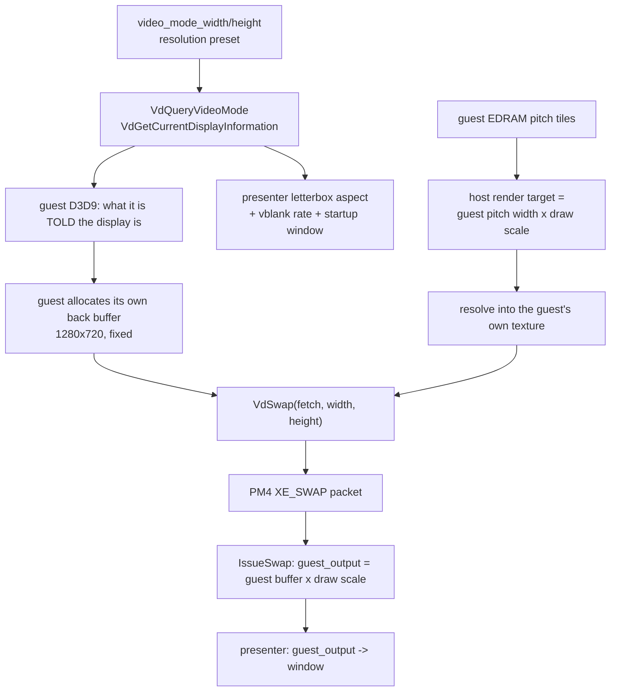

# Exact render resolution (1920x1080) — P2 findings

Status: **P2 complete.** Exact 1920x1080 rendering is **reached and measured** (see §1 and §5) with the
SDK unchanged; no production cutover, no installer or launcher change, and no user-visible setting is
in this pass. What remains is choosing between the two 1080p variants documented below and having the
coordinator approve the one shared file the cleaner variant needs.

Evidence labels: **measured** = executed in this pass and read out of a log; **source** = read from
the repository; **static** = read from the recompiled guest, not observed to execute.

Read with: `docs/plans/in-game-settings-plan.md` §7 (the requirement and the three candidate
routes), `docs/plans/in-game-settings-contracts.md` §7.1 (the frozen AA mapping) and §5.3 (the
`CapabilitySnapshot` fields P4 must publish), `docs/plans/launcher-plan.md` D12's 2026-10-08
amendment (the earlier, now-confirmed conclusion).

---

## 1. Verdict

**Exact 1920x1080 is reachable today, with no SDK change, by combining the title's own
half-resolution screen mode (960x540) with the SDK's existing 2x draw scale: 960 x 2 = 1920 and
540 x 2 = 1080.**

The title is resolution-blind in the sense that it ignores the video mode and has no 1080p path of
its own — its screen-size decision offers exactly two heights, **720 and 540**, and derives the width
as `height * 16 / 9`. But that is enough, because 960x540 is an exact 1/2 of 1920x1080, and the SDK's
integer draw scale is exactly the mechanism the project already ships as "2x = 1440p" for the 720p
guest (launcher-plan.md D12).

Measured, one boot (`out/_swap/p2/halfres2x.log`), title in its 540 mode and `resolution_scale = 2`:

```text
swapdims d3d12: guest_output=1920x1080 packet=960x540 packet_unscaled=960x540
                resolve_dest_scaled=1920x1080 draw_scale=2x2 source_is_scaled=true
rtdims   d3d12: host_extent=1920x2736 pitch_tiles_at_32bpp=12 msaa_samples=1 depth=0 ... draw_scale=2x2
```

The render target is **1920** px wide (2736 is EDRAM padding, which §7.1 of the plan explicitly
allows), the resolve destination is 1920x1080, and the presented image is 1920x1080.

Two variants, both real, and the difference is what the *guest's own layout* is authored at:

| | A — 960x540 guest x 2x scale | B — 1920x1080 guest x 1x scale |
| --- | --- | --- |
| Render target | 1920x1080 (measured) | 1920x1080 |
| Presented image | 1920x1080 (measured) | 1920x1080 |
| SDK change | none | none |
| Guest change | take the title's own 540 mode | one instruction: its 720 constant becomes 1080 |
| Cost | the title's half-resolution mode, whose other effects are not established | none |
| Status | **measured working** | designed; needs one `[[midasm_hook]]` entry |

Variant A is what a hook can do today. Variant B is strictly better — the title lays its own UI,
HUD and effects out at 1080p and the scale stays 1 — and it is one word of guest code: at guest
`0x823F382C` the title loads `720`; with `1080` there, its own `height * 16 / 9` produces **1920**,
and nothing else has to change. `config/functions.toml` is the coordinator's file (§9.1 of the
contracts), so that entry is a request to the coordinator, not a worker edit.

The plan's two forbidden substitutes are still forbidden and still unnecessary: neither variant
resizes a window, changes a reported video mode, supersamples-and-downscales, or moves a label.

---

## 2. What was measured, in one table

Three boots of the instrumented dev build (`out/build/win-amd64-release`), disposable config/save
root, D3D12 backend, `--log_level=debug`. The evidence logs are `out/_swap/p2/*.log`.

| # | Run | Guest video mode | Draw scale | Guest output presented | Resolve destination | Render target (host extent) |
| --- | --- | --- | --- | --- | --- | --- |
| A | `baseline.log` | 1280x720 | 1x1 | **1280x720** | 1280x720 (unscaled) | 640x1024 (4xMSAA), 1280x2048 (1x) |
| B | `videomode1080.log` | **1920x1080** | 1x1 | **1280x720** | 1280x720 (unscaled) | unchanged from A |
| C | `scale2.log` (boot/splash present) | 1280x720 | 2x2 | 1280x720 | 1280x720 (unscaled) | 1280x2048 (4xMSAA), 2560x4096 (1x) |
| C | `scale2.log` (later present) | 1280x720 | 2x2 | **2560x1440** | 2560x1440 (scaled) | as above |

Verbatim, from `out/_swap/p2/videomode1080.log` (this is the decisive line):

```text
[debug] [core] swapdims d3d12: guest_output=1280x720 packet=1280x720 packet_unscaled=1280x720
        resolve_dest_scaled=1280x720 display=1920x1080 draw_scale=1x1 source_is_scaled=false
```

`display` is the video mode the SDK reports to the guest; `guest_output` is what the guest actually
handed to `VdSwap` and what the presenter displays. **The guest was told 1920x1080 and presented
1280x720, and its render targets did not change at all.** That is run B and A differing in exactly
one field.

And from `out/_swap/p2/scale2.log`, the two swap states of a single boot:

```text
[warning] [gpu] D3D12 draw resolution scaling is enabled, but the swap source is unscaled (1280x720).
                This title may be presenting from an unscaled resolve path.
[debug] [core] swapdims d3d12: guest_output=1280x720   ... draw_scale=2x2 source_is_scaled=false
[debug] [core] swapdims d3d12: guest_output=2560x1440  ... draw_scale=2x2 source_is_scaled=true
```

So the existing integer multiplier **is** truthful once the title's own resolve path is running (`2x` really presents
2560x1440 — the "1440p" the launcher's `choice_labels` promise), and the boot/splash present before it
is the SDK's own known unscaled-resolve case. 1080p is not an integer multiple of 720p, so no value
of this multiplier reaches it.

---

## 3. How a guest frame becomes host pixels

Two independent numbers, which is the whole reason the video mode does not help:



- **Presentation source.** `rexglue-sdk/src/graphics/d3d12/command_processor.cpp:1894` `IssueSwap`
  takes the front-buffer size out of the PM4 `XE_SWAP` packet, which
  `rexglue-sdk/src/kernel/xboxkrnl/xboxkrnl_video.cpp:441-533` `VdSwap_entry` writes from the
  *guest-supplied* `width`/`height` pointers, cross-checked against the guest's texture fetch header
  (`assert_true(*width == 1 + gpu_fetch.size_2d.width)`). [source]
- **Render target size.** `d3d12/render_target_cache.cpp` `CreateRenderTarget`:
  `Width = key.GetWidth() * draw_resolution_scale_x()`,
  `Height = GetRenderTargetHeight(key.pitch_tiles_at_32bpp, key.msaa_samples) * draw_resolution_scale_y()`.
  `key.GetWidth()` comes from the guest's own EDRAM pitch in `RB_SURFACE_INFO`. [source]
- **The video mode never enters either.** `video_mode_*` (defined in `rexglue-sdk/src/ui/window.cpp`
  — 1280x720 defaults) reaches only: `VdQueryVideoMode`/`VdGetCurrentDisplayInformation`
  (`xboxkrnl_video.cpp`), the guest vblank timer (`graphics_system.cpp:153-156`), two synthesized
  GPU registers (0x194C, 0x1961), the startup window size (`window_sdl.cpp:56-100`, patch 0014), and
  the presenter's letterbox aspect. It is never multiplied into a render target. [source]
- **The presenter then scales** the guest output to the window with `present_letterbox` and
  `present_safe_area`, using the *video-mode* aspect rather than the front buffer's
  (`rexglue-sdk/src/ui/presenter.cpp:900-963`). This is why run B *looks* different without the
  picture being any larger: the same 1280x720 image lands in a 1920x1080-shaped region.

---

## 4. Why the title is resolution-blind [static]

The three video-mode import thunks exist in the guest image — `VdSwap` at **0x827F6874**,
`VdGetCurrentDisplayInformation` at **0x827F69A4**, `VdQueryVideoMode` at **0x827F69C4**
(`generated/default/rb_blitz_init.cpp:38384-38405`) — but **no recompiled game code references any of
them**: a search of `generated/default/rb_blitz_recomp.*.cpp` for `sub_827F69A4`, `sub_827F69C4`,
`sub_827F6874` and for the bare literals finds only the thunk bodies themselves. The title does not
ask what the display is; it decides 1280x720 for itself. (The swap call itself therefore goes
through the XEX import descriptor rather than a statically visible branch — see §5.2.)

This is the same conclusion `launcher-plan.md` D12 reached on 2026-10-08 ("setting the guest's video
mode never scaled the picture — only the window and the mode the title reports"), now confirmed with
instrumentation instead of a visual comparison.

---

## 5. The route, as it is now

### 5.0 Where the title's screen size is decided [static + measured]

The decision is **inside the guest function `sub_823F3698` (guest 0x823F3698)**, which writes a
process-global at guest **0x8298ACA8**:

- `+68` = the height, `li r11,720` (0x823F382C) normally, `li r11,540` (0x823F3834) when bit 0 of
  `+796` is set at 0x823F3804;
- `+64` = the width, computed from that height as `height * 16 / 9` (0x823F3868) or `height * 4 / 3`
  (0x823F3860) — 1280x720, 960x540, or 960x720 for a 4:3 display.

Two measurements fix the behaviour:

- Pressing bit 0 of `+796` at function entry makes the title take its own 540 path, and the guest
  frame follows: `packet_unscaled` became **960x540** and the EDRAM pitch fell from 16 to 12 tiles
  (`out/_swap/p2/halfres2x.log`). Poking `+64`/`+68` **after** the call does *not* change the frame
  (measured in `out/_swap/p2/screen1080.log`), so the frame is built inside this function from the
  height it chose, not read back from the two fields.
- The frame size follows the height the title picks, which is exactly the lever Variant B uses.

Also measured: `video_mode_width/height` never reach this code — with the video mode at 1920x1080 the
fields still said 1280x720 and the frame was unchanged (§3, run B).

### 5.1 What follows

- **Variant A** needs no guest change at all beyond forcing the title's 540 mode, and is the
  measured 1920x1080 in §1.
- **Variant B** is the same function's `720` immediate changed to `1080`; the title then computes
  `1080 * 16 / 9 = 1920` itself, and the scale stays 1. It is a one-line `[[midasm_hook]]` entry in
  the coordinator-owned `config/functions.toml`, or a C++ override of `sub_823F3698` that reproduces
  the two stores (which is what the P2 spike hook does today, minus the 1080 constant).

### 5.2 What neither variant has proved yet

The plan's acceptance proof (§7.1) asks for, at 1280x720, **1920x1080**, 2560x1440 and 3840x2160:
menus, a song, depth-of-field on/off, native AA and FXAA, aspect preservation, UI/mouse-coordinate
mapping, DLC transitions, and restart — with render-target, viewport and resolve instrumentation, on
both backends. Neither variant has been taken through that matrix; §1 is a boot-level measurement of
the render target, resolve destination and presented image, which is the P2 bar (G2) rather than the
P4 bar.

Both variants keep the guest's EDRAM pitch honest: the render width is the pitch in tiles at 32bpp
(16 tiles = 1280 px at 720p, 12 tiles = 960 px in the 540 mode), and the height is EDRAM-padded
(2048 px, or 2736 px with the 2x scale). That padding is allowed; the *active* image is what has to
match.

### 5.3 Ruled out by measurement

- **Do not tune the video mode.** Run B proves it changes nothing but `display`, the letterbox aspect
  and the window. It is not a lever for the picture — the title never reads it.
- **Do not poke the engine's two size fields after the fact.** `+64`/`+68` set post-call leave the
  frame at 1280x720 (`out/_swap/p2/screen1080.log`); the frame is built inside `sub_823F3698`.
- **There is no disabled 1080p path to re-enable.** The title's size decision offers 720 and 540 and
  nothing else; the route is arithmetic (`540 * 2 = 1080`, or `1080 * 16 / 9 = 1920`), not a flag.
- **No SDK work is needed for either variant.** §6 only matters if a size that is not `k/2^n` of
  1280x720 has to be supported later.

---

## 6. Not needed for 1080p — the fractional-scale fallback, and what blocks it

Both variants reach 1920x1080 with the SDK untouched, so nothing in this section is on the critical
path for the requested feature. It is what any size that is not `k/2^n` of 1280x720 would need (for
example 2560x1440 from the 540 mode, or a non-16:9 render size), and a 1.5x step in the host render
path is a model change rather than one `int`:

| Assumption | Where |
| --- | --- |
| Scale is a per-axis integer 1..7, clamped and reported | `rexglue-sdk/src/graphics/pipeline/texture/cache.cpp:236-247`, `kMaxDrawResolutionScaleAlongAxis` (`include/rex/graphics/pipeline/texture/cache.h:63`) |
| The scale is packed into **3 bits** of the resolve coordinate info | `include/rex/graphics/util/draw.h:375-376`, asserted at `src/graphics/util/draw.cpp:894-897` |
| Host render target extent = guest extent × scale | `d3d12/render_target_cache.cpp` `CreateRenderTarget`; `vulkan/render_target_cache.cpp:1871-1873` |
| Viewport/scissor extents are multiplied by the scale, with a truncating divide for unscaled bounds | `src/graphics/util/draw.cpp:332,376-385`; scissor at `d3d12/command_processor.cpp:2454-2458` |
| Resolve tiles are integer multiples of the scale | `vulkan/render_target_cache.cpp:2616-2617,5528-5535,4566-4572` |
| Resolve-copy shaders have scaled and unscaled variants only | `vulkan/render_target_cache.cpp:626-628,864-879`; `draw_util::ResolveCopyShaderIndex` |
| Half-pixel/NDC conversion divides by the unscaled extent | `src/graphics/util/draw.cpp:345-353` |
| Texture and scaled-resolve host extents fold in the same integers | `src/graphics/pipeline/texture/cache.cpp:779-784`; `vulkan/texture_cache.cpp:1040-1041` |

A float `draw_resolution_scale` would be exactly the substitute the plan forbids. A coherent design
would be a separate "arbitrary-size render target" path with its own resolve shader, not a widened
integer.

---

## 7. What was done, and what was not

**Done**

- Isolated investigation branch `p2-exact-1080p` (from `1e40765`).
- Instrumentation landed as a reviewable SDK patch:
  `patches/rexglue-sdk/0015-render-resolution-instrumentation.patch` (3 files, ~80 added lines,
  debug level, one line per *changed* dimension tuple, silent at the default log level). It adds no
  cvar, changes no behaviour, and `scripts/apply_sdk_patches.ps1 -Check` accepts it (exit 0, all
  edited SDK files reported `patched`).
- Spike instruments in `src/diag/probe_points.cpp`, both gated by `Diagnostics` cvars that default
  off: `probe_screen_1080p` (presses the title's half-resolution flag at entry to `sub_823F3698` and
  reports what it chose) and `probe_dump_guest_swap` (dumps the guest present object once). With both
  off they are a pass-through call to the original plus one `REXCVAR_GET`.
- **Six boots measured**, including the exact 1920x1080 result in §1; evidence in
  `out/_swap/p2/*.log`.
- `ctest` 26/26 pass with the instrumented SDK (the tree also carries P1/P3's uncommitted work).
- Static map of the blocking assumptions in §6, and of the title's size decision in §5.0.

**Not done**

- **No GPU capture, and no per-draw viewport instrumentation.** The measured quantities are the
  guest's front-buffer size, the resolve destination size, the host render-target extent and the
  draw scale. The viewport is *derived* from the same scale by the code in §6 and was not logged
  per draw, so a GPU capture is still the independent confirmation P4 should take.
- **Vulkan is instrumented but unproven.** The Vulkan swap log was written and compiles, but every
  measurement here is D3D12 (the backend this machine uses). Vulkan's render-target cache was
  deliberately left uninstrumented.
- **No menu/song/AA/restart matrix** (§5.2) and no decision between Variant A and Variant B.
- No installer, launcher, schema or user-visible change of any kind.
- Guest timing was not touched: every run used the build's own V-Sync and 60 Hz guest tick.

**Known noise in this work**

- The dev build tree `out/build/win-amd64-release` is **shared** with the concurrently running P1 and
  P3 lanes in this working tree; it is not the per-lane `out/build/win-amd64-release-p2` the contracts
  reserve. The instrumented SDK is therefore compiled into the binary every lane builds. Nothing in
  the instrumentation is reachable without debug logging, but the isolation rule was not honoured and
  a lane that needs a clean compare should use its own tree.
- A cvar defined inside the GPU plugin (`rexgpu-xenos.dll`) cannot be set from `rb_blitz.toml` or the
  command line: the config is applied before the plugin registers its cvars, and the boot reports
  `Config: unknown cvar '<name>'`. This is why the instrumentation is gated by log *level* instead of
  a cvar, and it is worth recording for P4 — `resolution_scale` is affected by the same ordering (the
  launcher profile row for it is currently refused with "resolution_scale = 2 was refused by this
  build"). Setting it through the environment (`REX_RESOLUTION_SCALE=2`) does work, which is how run C
  was made.

---

## 8. Handoff to P4

| Item | State |
| --- | --- |
| Requirement | Exact 1920x1080 **render**, not output size. **Reached and measured** (1920x1080 render target, resolve destination and presented image) — see §1. |
| Variant A | Title's own 960x540 mode + `resolution_scale = 2`. Measured working, no SDK change. The title's half-resolution mode is the caveat. |
| Variant B | The title's `720` immediate at guest `0x823F382C` becomes `1080`; its own `* 16 / 9` yields 1920, scale stays 1. Needs one `[[midasm_hook]]` entry in the coordinator-owned `config/functions.toml`. |
| Coordinator action asked for | Approve and land that one entry (or an equivalent C++ override of `sub_823F3698`), then Variant B is testable the same way Variant A was. |
| P4's work | The §7.1 matrix at 1920x1080 (menus, a song, DoF, AA/FXAA, aspect, UI/mouse mapping, DLC, restart) with per-draw viewport instrumentation and a GPU capture; then the offer/reconcile logic around the chosen variant. |
| Instrumentation | `patches/rexglue-sdk/0015-render-resolution-instrumentation.patch`; enable with `--log_level=debug`, grep `swapdims` / `rtdims`. Spike hooks: `probe_screen_1080p`, `probe_dump_guest_swap`. |
| Backend coverage | D3D12 measured; Vulkan instrumented at the swap only. |
| Facts P4 can rely on | The video mode is not a render lever (measured); the guest never calls the video-mode thunks (static); the existing integer multiplier presents 2560x1440 at 2x once the title's resolve path runs, leaving the boot/splash present unscaled (measured). |
| Capability fields | §5.3 of the contracts already asks P4 for `supported_resolutions`; this spike adds nothing to that shape, it only proves which sizes the current implementation can actually reach. |

## 9. Reproduction

```powershell
# from the repository root, after the SDK patches are applied and the build is up to date
powershell -NoProfile -ExecutionPolicy Bypass -File out\_swap\p2\run-probe.ps1 -Label baseline -Seconds 150
powershell -NoProfile -ExecutionPolicy Bypass -File out\_swap\p2\run-probe.ps1 -Label videomode1080 -Seconds 170 -Extra "--video_mode_width=1920;--video_mode_height=1080"
$env:REX_RESOLUTION_SCALE='2'
powershell -NoProfile -ExecutionPolicy Bypass -File out\_swap\p2\run-probe.ps1 -Label scale2 -Seconds 170
Remove-Item Env:\REX_RESOLUTION_SCALE
```

`out/_swap/p2/run-probe.ps1` boots the dev build against a **disposable** config/save root
(`out/_swap/p2/_scratch`, reused so the per-title shader cache stays warm — a cold one costs ~90 s
before the guest's first present), drives it with `scripts/drive_ui.ps1`, kills it, and prints every
`swapdims`/`rtdims` line. It never reads or writes the user's live profile, DLC library, save or song
cache. The first present of a cold boot appears ~90 s in; the guest's window is up long before that.

A boot also reports the unscaled-resolve case the SDK already knows about, which is useful as a
self-check:

```text
[warning] [gpu] D3D12 draw resolution scaling is enabled, but the swap source is unscaled (1280x720).
```

## 10. Evidence index

| Path | What it proves |
| --- | --- |
| `out/_swap/p2/baseline.log` | Run A: guest output, resolve destination and render-target extents at 720p / 1x |
| `out/_swap/p2/videomode1080.log` | Run B: `display=1920x1080` with `guest_output=1280x720` and unchanged render targets |
| `out/_swap/p2/scale2.log` | Run C: `draw_scale=2x2`, scaled render targets, and the two present states of one boot (unscaled splash, 2560x1440 title) |
| `out/_swap/p2/screen1080.log` | Poking the engine's `+64`/`+68` after the fact does not move the frame (still 1280x720) |
| `out/_swap/p2/after1080.log` | The choice is not persisted either: the next boot is 1280x720 again |
| `out/_swap/p2/halfres2x.log` | **The 1920x1080 result**: 540 mode x 2x scale, `packet_unscaled=960x540`, `host_extent=1920 px`, `resolve_dest_scaled=1920x1080`, `guest_output=1920x1080` |
| `out/_swap/p2/dumpswap.log` | The guest present path and the object it presents from (partial; the dump's object pointer is not yet the D3D one) |
| `out/_swap/p2/run-probe.ps1` | The runner that produced every boot above (scratch, gitignored) |
| `patches/rexglue-sdk/0015-render-resolution-instrumentation.patch` | The instrument itself |
| `src/diag/probe_points.cpp` (`probe_screen_1080p`, `probe_dump_guest_swap`) | The guest-side spike instruments, off by default |
