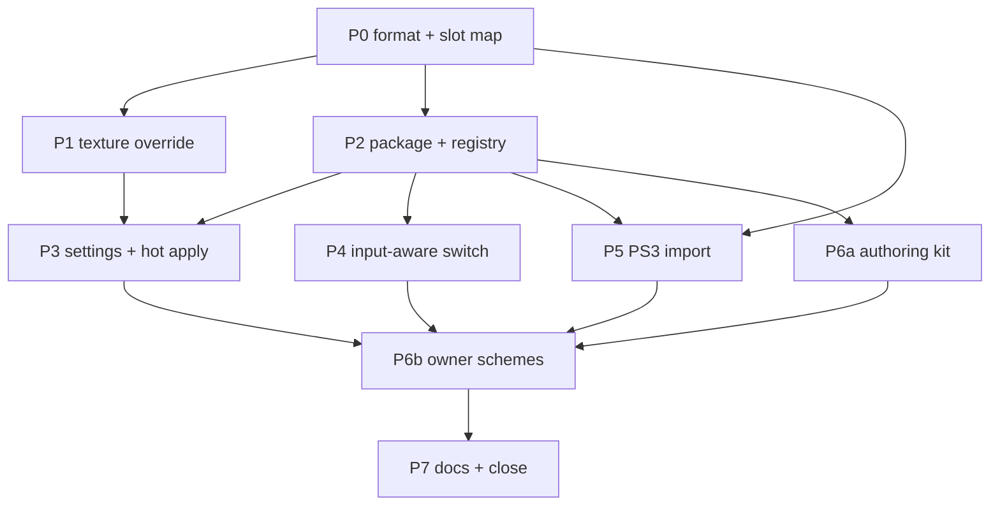

# Button layout hot-swapping — button glyphs and controller art

**Status: planning, 2026-10-19. No code has been changed by this document.** The format measurement
in §2.3 was made today and its decoded evidence is in
`out/button-schemes/format-2026-10-19/`; everything else marked `[tree]` is read from the current
tree, and everything marked **unproven** is not yet measured in a boot.

This plan makes the button glyphs and the controller-layout art **replaceable per scheme**, lets the
player choose a controller scheme in Help & Options, hot-swaps it without a restart, and switches
automatically between controller and keyboard/mouse art based on the last real input. It also adds
an **optional installer flow** that extracts the one platform-specific asset from the user's own
Rock Band Blitz PS3 package, and a **tracked authoring structure** under `assets/controller/`.

## 1. Request, normalized

| Id | Requirement |
| --- | --- |
| R1 | Replace the **button glyphs** (A/B/X/Y, LB/RB, LT/RT, Start/Back, LS/RS, D-pad, and the other slots the sheet carries) and the **controller-layout art** shown on the retail Control Preset page — everywhere the title draws them, not only on that page. |
| R2 | The installer offers an **optional Rock Band Blitz PS3 `.pkg`** and extracts exactly the assets this feature needs. If the user supplies it, a **PS3 layout** appears in the in-game list. |
| R3 | A tracked structure under `assets/controller/` where the owner leaves PNGs (and a small manifest) to build a **custom scheme package**. |
| R4 | A **keyboard layout** is the default when keyboard/mouse input is active. The game watches real input and **hot-switches** to the controller art on controller movement, and to the keyboard art on keyboard or mouse input. |
| R5 | On Help & Options the player can select among the **available controller layouts**; choosing one **hot-swaps without restarting the game**. |
| R6 | The owner will author **Xbox Series**, **PS5**, **Nintendo Switch** and **Keyboard**. PS3 is generated from the user's own package. Custom packages are discoverable. |
| R7 | With no scheme installed the title draws **retail art**, exactly as today. A player who never opens the page sees no change. |
| R8 | No game art is committed, bundled or downloaded. PS3-extracted art lives only in the user's install or user-data folder and is never redistributed. |
| R9 | R4's existing `enhancements_icon_schemes` toggle and the settings program's contracts are honoured; the feature is documented in `engine/toggles.md` and the settings documents. |
| R10 | Tests, a live acceptance harness and the documents named in §10 are part of the change. |

## 2. What exists today

### 2.1 The R4 toggle and the art locations

R4 already exists as an enhancement toggle, off by default and explicitly **not implemented**:

- `src/enhancements.cpp:62` — `enhancements_icon_schemes`, described as "let the button glyphs and
  controller-layout art be replaced per scheme. Faithful: the art the title ships. Not implemented."
- `docs/engine/toggles.md` — the R4 row names the old A1/A2 research prompts.

The art the feature must replace is **scene-embedded**, not standalone archive entries:

| Slot | Scene | Builder-side record | Size | Role |
| --- | --- | --- | --- | --- |
| Button glyphs | `ui/resource/fonts/gen/buttons.milo_xbox` | `../image/icons_buttons_xbox_nomip.bmp` | 512×512, 8 bpp | every A/B/… prompt, drawn through a `Glyph` table |
| Extra icons | `ui/resource/fonts/gen/blitz_icons.milo_xbox` | `../image/blitz_icons_xbox_nomip.bmp` | 1024×512, 8 bpp | the additional icon sheet (optional in v1) |
| Pad art | `ui/controller_config/gen/controller_config.milo_xbox` | `img/xbox_0..3.png`, `img/ps_0..3.png` | 1024×1024, 8 bpp each | the four controller-layout images per family; both families ship in both builds |
| Calibration prompts | `ui/calibration/gen/cal_auto.milo_xbox` | `button_a_calibrate_icon0001/2.bmp`, `button_press_ps30001/2.bmp` | 256×256 | calibration-specific icons; **out of scope in v1** |

The settings screen already routes the **Default Presets** row to retail's `controller_config_screen`
(`src/ui/settings_screen.cpp`, the `settings_default_presets` RouteGatedRow). Swapping the pad art
must therefore reach that routed screen, not a new screen of ours.

### 2.2 The settings and input machinery the feature plugs into

`[tree]` The settings surface is data in `src/ui/settings_screen.cpp`:

- `Kind::kSelect` is the horizontal-select row; its choices are `Row::choices`, stable tokens plus
  labels, never indices (`docs/settings/plan.md` §3.3).
- `MenuConfiguration` (`src/ui/settings_screen.h`) already carries `choices` — a map from a setting
  symbol to `(token, label)` pairs — and `AllPanels()` reads it. The boot fills it before the menu
  is generated. A dynamic scheme list can use this existing seam instead of inventing one.
- `SettingsBoot` materializes descriptors; `Descriptor::choices_source` already models
  `"renderers"`, `"resolutions"`, `"provider"` and `"menu_rows"` (`src/settings/schema.cpp`).
- `HotApplier` (`src/settings/hot_apply.h`) is the live-apply seam; a row is `kHot` only with
  `strategy_evidence` naming a measured live effect. `interface.settings_labels` is the precedent.

`[tree]` The input layer already exposes the physical devices without the SDK's synthetic
keyboard-to-pad emulation:

- `src/input/source_gates.h` — `PhysicalInput` (raw pad, key state, mouse buttons, focus) and
  `SourceHeld`; `src/input/title_input.h` — `SamplePhysicalPad` reads the physical drivers only.
- `src/profile/remap.h` — the 16 targets and the compiled defaults. The default keyboard mapping
  is relevant to the keyboard sheet: `Return`/`A`=A, `Escape`/`B`=B, `X`=X, `Y`=Y, `W/A/S/D` or
  the arrow keys=D-pad, `Space`=Start, `Backspace`=Back; LB/RB/LS/RS are pad-only and the triggers have
  no keyboard default. The keys are interface-oriented because Gameplay Mapping's Keyboard + Mouse
  table is on by default (2026-10-19).
- There is **no last-device tracker** yet; the source gates decide whether a device may act, not
  which device last acted.

`[tree]` The SDK's texture path is a common base plus two backends:

- `rexglue-sdk/include/rex/graphics/pipeline/texture/cache.h` — `TextureCache`, `TextureKey`
  (guest page, dimensions, tiled, format, endianness, mip count), `Texture::MakeUpToDateAndWatch`,
  `ClearCache`.
- `rexglue-sdk/src/graphics/{vulkan,d3d12}/texture_cache.cpp` — the per-backend
  `LoadTextureDataFromResidentMemoryImpl`.
- There is **no texture-override or replacement hook** today.

`[tree]` The installer is a separate, Windows-only C++ helper (`installer/src/`) driven by Inno
Setup (`installer/setup.iss`). Its commands are deliberately small (`probe-folder`, `probe-package`,
`import-game`, …); the helper already links a few SDK-free project modules from the emulator tree so
the installer and the game cannot drift. It has no PKG parser and no AES, and there is no optional
PS3 page today.

### 2.3 The scene texture format — measured 2026-10-19

The prior record in `docs/guides/assets.md` said a UI texture could not yet be swapped because the
pixel buffer's format and offset inside a `.milo` chunk were unpinned. **That is now measured** for
the two scenes this feature needs. A `.milo` chunk carries a **23-byte texture record** immediately
before the DXT5 payload:

```
record (23 bytes):  <4-byte per-file id> 08 00 00 00 18 00 02 00 02 00 02 00 00 00 00 00 00 00 00
payload:            512 × 512 × 8 bits = 262,144 bytes, DXT5, 16-bit words stored in console order
```

For `buttons.milo_xbox` the record starts at **stream offset 0x5C9** and the payload at **0x5E0**;
decoding the payload after `hmx_tex.unswap()` gives a recognizable 6×6 glyph sheet with **29 occupied
cells**. The PS3 `buttons.milo_ps3` is the same size and record shape (only the 4-byte id differs)
and decodes at the same offset to a **different** sheet — the PlayStation symbols — on the same 6×6
scene grid. Its art has more internal components, so a component count is **not** the layout check;
P0 compares the two scenes' `Glyph` tables. The controller scene's eight pad images decode the same
way at **record + 23** as 1024×1024 DXT5 in the texture chunks (chunk 6 carries two of them); the
two scroll arrows are the small chunks.

Evidence (gitignored):

- `out/button-schemes/format-2026-10-19/buttons-360.png`
- `out/button-schemes/format-2026-10-19/buttons-ps3.png`
- `out/button-schemes/format-2026-10-19/buttons-grid.png` (6×6 grid overlay)
- `out/button-schemes/format-2026-10-19/pads-contact.png` (the decoded pad chunks)
- `out/button-schemes/format-2026-10-19/measurements.txt` (the commands and offsets)

What this settles for the plan:

1. **The PS3 import has a concrete route.** The only platform-specific art is the button sheet; the
   pad families (`ps_0..3` and `xbox_0..3`) already ship in the 360 scene, so the PS3 layout's pad
   art does not have to come out of the PS3 package at all.
2. **Custom schemes do not have to re-encode DXT5.** The runtime override can take RGBA PNGs from
   the host; the guest's own DXT5 payload is never rewritten.
3. **The slot map is a real grid.** The sheet is 6×6 (about 85×84 px per cell); the exact slot
   rectangles come from the scene's `Glyph` table, which P0 reads.

The `[unproven]` part is the **boot-time texture identity**: which loaded guest texture is the
button sheet and which is each pad. §3 D1 makes that P1's measurement.

## 3. Decisions

| Id | Decision |
| --- | --- |
| **D1** | **Hot swap is a host texture override, not a file swap.** The SDK texture cache gains a generic override provider; the project supplies replacement RGBA for a slot, keyed by a measured fingerprint of the guest texture (dimensions + content hash, with the scene-read order as the fallback). The guest scene, DTB and archive are never edited at runtime. A scene-reload route (VFS overlay + forced resource reload) is the fallback only if P1 proves the override cannot be made safe. |
| **D2** | **A scheme is a folder with one manifest.** `scheme.toml` names the id, display name and kind; `buttons.png` is the 512×512 glyph sheet; `pad.png` is the 1024×1024 controller art (with optional per-slot `pads/pad_0..3.png`); `icons.png` is the optional 1024×512 extra sheet. No DXT5, no scene, no archive surgery for custom schemes. |
| **D3** | **Discovery is a boot scan, not a hot-add.** The game scans `<install>/assets/controller/schemes/` (shipped) and `<user_data_root>/controller_schemes/` (user packages; a user package with the same id shadows a built-in with a log line). Newly dropped packages are read at the next boot; the page says so in its caption. There is no Rescan row in v1. |
| **D4** | **The controller scheme is selectable; the keyboard scheme is implicit.** The page lists `Retail` plus every valid controller scheme. The keyboard scheme is the reserved id `keyboard`, used automatically when the last real input was keyboard or mouse. **The boot starts on the keyboard scheme**; the first real pad event switches to the selected controller scheme. The selected controller scheme does not change when the keyboard is used; it is the art the controller gets back on the next pad input. |
| **D5** | **PS3 import extracts one asset.** From a `.pkg` (plus the matching `.rap` if needed) or an extracted PS3 game folder, the installer extracts `ui/resource/fonts/gen/buttons.milo_ps3`, decodes its DXT5 sheet, and builds the PS3 scheme. The `ps_*` pad art comes from the user's 360 `controller_config.milo_xbox` via the same decoder. Nothing from the package is copied wholesale; the full ~350 MB ARK is never laid down. |
| **D6** | **One native setting: `controller.scheme`.** It is a stable token (`retail`, `xbox-series`, `ps5`, `nintendo-switch`, `ps3`, a custom id). It lives in `settings.toml` through the main settings service, not in the controller profile's `input.*` binding store. Its row is `Controls → Button Icons`, a `kSelect` drawn as `Layout: <short name>`, with a help caption for the automatic keyboard switch. |
| **D7** | **`enhancements_icon_schemes` becomes the master gate and defaults on**, with `Retail` as the compiled default. The row is the visible control; with the gate off the `Button Icons` page is omitted (no dead rows), and the faithful retail art is what a fresh profile gets. This changes the "off by default" line in `src/enhancements.cpp`; the toggle table records it. |
| **D8** | **Fallback chain, no dead ends.** Selected controller scheme → `Retail` art. Keyboard input → `keyboard` scheme if present → selected controller scheme → `Retail`. A missing/corrupt package is skipped with a log line and never listed. |
| **D9** | **Art is authored on a fixed grid, in white/alpha.** `buttons.png` must use the 6×6 slot grid; the game's material tints the glyph, so the sheet should be white/grey with straight alpha (colored art is allowed but is multiplied by the tint). `pad.png` is transparent-background RGBA. The loader converts to the guest's format; the art author never handles DXT5. |
| **D10** | **No retail/game art in the repository or the release.** The four owner-authored schemes are original art and may be committed; the PS3 scheme is generated in the user's install from their own data and is gitignored/audited like `game/` and `assets/game/`. |
| **D11** | **The retail pad page's eight pad slots all receive the selected scheme's art.** `xbox_i` and `ps_i` both map to `pad_i` (or `pad.png` for all four), so whichever family/preset index retail draws, it shows the selected scheme. |
| **D12** | **The keyboard sheet is static.** It represents the compiled default keyboard mapping in `src/profile/remap.cpp`. If the player rebinds General Mapping, the keyboard glyphs do not follow; this is recorded as a known limitation, not silently pretended. A future runtime keycap renderer is out of scope. |

## 4. The asset contract — what to draw

### 4.1 Files and restrictions

| File | Required | Size | Format | Rules |
| --- | --- | --- | --- | --- |
| `scheme.toml` | yes | — | TOML | `schema_version = 1`; id, name, kind; file paths relative to the scheme folder |
| `buttons.png` | yes | **512×512** | PNG, 8-bit RGBA | straight alpha; sRGB; transparent background; white/grey art (tinted by the game); **do not move or resize the 6×6 slots**; no drop shadows that cross a slot boundary |
| `pad.png` | yes for a controller scheme | **1024×1024** | PNG, 8-bit RGBA | transparent background; the controller centered as in the retail image; used for all four pad slots unless per-slot files exist |
| `pads/pad_0.png` … `pad_3.png` | no | **1024×1024** each | PNG, 8-bit RGBA | optional per-slot override; if present, all four must be present |
| `icons.png` | no | **1024×512** | PNG, 8-bit RGBA | optional `blitz_icons` sheet; if absent, the retail sheet is used |
| anything else | no | — | — | the loader ignores it; the validator reports it |

Provisional limits (P2 may tighten, never loosen without a measurement): ≤ 8 MB per image, ≤ 32
files per scheme, no symlinks, id `[a-z0-9][a-z0-9-]{0,31}`, display name ≤ 20 characters (the
settings row's text budget: `Layout: ` is 8 characters, leaving 20 for the value within the measured
28-character line).

Reserved ids: `retail` (the virtual no-override scheme; it has no folder), `keyboard` (the keyboard
sheet), and the built-in ids `xbox-series`, `ps5`, `nintendo-switch`, `ps3`. A custom package may not
claim a reserved id.

### 4.2 The slot map

The retail sheet is a **6×6 grid**. The 360 sheet has 29 occupied cells; the PS3 sheet decodes on
the same 6×6 scene grid with different art. P0 reads both scenes' `Glyph` tables and publishes the
exact rectangles; the two tables must agree before the PS3 sheet is used as a slot-for-slot
replacement. Until then, the measured grid is:

| Row (y) | Occupied columns (x) |
| --- | --- |
| 0 (≈0–84) | 0, 1, 2, 3 (four; columns 4–5 empty) |
| 1 (≈85–169) | 0–5 |
| 2 (≈170–254) | 0, 1, 2, 3, 5 (column 4 empty) |
| 3 (≈255–339) | 0–5 |
| 4 (≈340–424) | 0–5 |
| 5 (≈425–511) | 0, 1 (columns 2–5 empty) |

The slot IDs are **actions, not letters**, so the keyboard sheet can paint a different key in the
same cell. P0 assigns them from the glyph table; the expected set is:

`confirm_a`, `back_b`, `x`, `y`, `lb`, `rb`, `lt`, `rt`, `start`, `back`, `ls`, `rs`,
`dpad_up`, `dpad_down`, `dpad_left`, `dpad_right`, plus the remaining occupied cells (the retail
sheet's extra icons). The template draws each slot's rectangle and label so a paint program can be
used without guessing.

The replacement is the **glyph sheet**. Locale strings that spell a button name as text (if any are
found in the title) are not rewritten in v1; the inline `<alt1>…</alt1>` prompts are the subject.

For the **keyboard** sheet (`schemes/keyboard/buttons.png`), paint the compiled default keys:

| Slot | Key to draw | Slot | Key to draw |
| --- | --- | --- | --- |
| `confirm_a` | `Enter` / `A` | `back_b` | `Esc` / `B` |
| `x` | `X` | `y` | `Y` |
| `lb` | (pad only) | `rb` | (pad only) |
| `ls` | (pad only) | `rs` | (pad only) |
| `start` | `Space` | `back` | `Backspace` |
| `dpad_up` | `W` / `↑` | `dpad_down` | `S` / `↓` |
| `dpad_left` | `A` / `←` | `dpad_right` | `D` / `→` |
| `lt` | (unbound by default) | `rt` | (unbound by default) |

`lt`/`rt` have no compiled keyboard default; paint a neutral trigger icon or a short label, and let
the player's General Mapping decide. A two-key slot (`confirm_a`, `back_b` and the four D-pad
slots) draws both spellings separated by `/`; the compact forms above fit the 85 px cell.
LB/RB/LS/RS are pad-only defaults, so their cells show the pad control rather than a key. D12
records that a rebind does not update the sheet.

### 4.3 `scheme.toml`

```toml
schema_version = 1
id = "xbox-series"
name = "Xbox Series"      # ≤ 20 characters; this is the row's value
kind = "controller"       # controller | keyboard

[buttons]
file = "buttons.png"

[controller]
file = "pad.png"
# Optional: per-slot overrides, all four or none.
# slots = ["pads/pad_0.png", "pads/pad_1.png", "pads/pad_2.png", "pads/pad_3.png"]

[icons]
file = "icons.png"        # optional
```

A keyboard scheme has `kind = "keyboard"` and usually only `[buttons]`; its pad entry is ignored.
A controller scheme must have `pad.png` or all four per-slot files.

### 4.4 The authoring kit (P6a, not blocked on the owner's art)

- `assets/controller/README.md` — this contract in task form.
- `assets/controller/template/buttons.png` — a blank 6×6 grid with the slot rectangles and labels,
  generated by the P0 tool. It contains **no retail art** and may be committed.
- `assets/controller/template/pad.png` — a blank 1024×1024 guide with the safe area marked.
- `assets/controller/slots.toml` — the tracked slot registry (id, rectangle, row/column, label).
- `assets/controller/schemes/<id>/` — the owner's schemes; the four built-ins live here when P6b
  runs.
- `scripts/controller_schemes.ps1 -Validate -Pack` — validates every scheme (size, mode, required
  files, slot coverage, id rules, duplicate ids) and copies the valid ones into the install layout.
- A generated **`test-markers`** scheme (not shipped) with a unique solid color per slot, used by
  P1–P4 before real art exists.

### 4.5 Where packages live at runtime

| Root | Contents | Who writes it |
| --- | --- | --- |
| `<install>/assets/controller/schemes/<id>/` | the four built-in schemes copied by the installer | the installer/build |
| `<user_data_root>/controller_schemes/<id>/` | user packages, including a scheme the player drops in | the player |

`<user_data_root>` is the same root the game already uses for saves and `settings.toml`
(`src/rb_blitz_app.h`). A user package with a duplicate id shadows the built-in one and logs
`button_schemes: <id> shadowed by <path>`; a package that fails validation is skipped and logged with
the reason.

## 5. The flows

### 5.1 Installer — optional PS3 import

The wizard gains one optional page after the Xbox 360 game-data page, **Controller Icons (optional)**:

1. `Skip PlayStation 3 art` (default).
2. `Use a PlayStation 3 package (.pkg)` — a path box and Browse, plus an optional `.rap` box shown
   when the package needs a licence file.
3. `Use an extracted PlayStation 3 game folder` — a path box and Browse (the folder that contains
   `gen/main_ps3.hdr`).

On Next the helper runs `probe-ps3` (read-only) so a wrong source fails on the page, not halfway
through the install. During the Progress stage `install-ps3-scheme` writes
`<install>/assets/controller/schemes/ps3/` with `scheme.toml`, `buttons.png` and `pad_0..3.png`,
and records the source in `install-manifest.toml` (`[controller_scheme]` table: id, source,
content id, files, bytes, sha256).

The extraction, exactly:

1. **Probe** the PKG header. The file supplied on 2026-10-19 measures 364,734,448 bytes with magic
   `7F 50 4B 47` and content id `UP8802-NPUB30749_00-RBBLITZ0000TRIAL` at `0x30`. The same folder
   has `UP8802-NPUB30749_00-RBBLITZ00000FULL.rap`; the trial package and the full-licence RAP do not
   share a content id, so P5 must either pair the matching RAP or use the folder route. This is
   **unproven** until P5 runs; the page must say which of the two it is doing.
2. **Decrypt** the PKG with Windows CNG (`BCryptDecrypt`, AES-CBC) using only key material derived
   from the user's own package and licence file (the `.rap`); no key is compiled into the helper.
   The extracted-folder route bypasses this step entirely.
3. **Read the PS3 ARK index** (`gen/main_ps3.hdr`) and extract only
   `ui/resource/fonts/gen/buttons.milo_ps3` from `gen/main_ps3_0.ark` by its offset and size. The
   full 350 MB ARK is never written.
4. **Decode** the milo chunk: find the 23-byte record, take the 512×512 DXT5 payload, `unswap` the
   16-bit words, decode to RGBA, write `buttons.png`.
5. **Extract the pad art from the 360 scene** (`ui/controller_config/gen/controller_config.milo_xbox`,
   already installed): decode the four `ps_*` 1024×1024 DXT5 images and write `pad_0..3.png`. The
   `ps_*` family is already in the 360 dump, which the project already measured
   ([assets.md](../../guides/assets.md)); the PS3 package is not the source of the pad art.
6. **Validate** the generated scheme with the same validator the custom-package flow uses, then
   write it.

If the package cannot be decrypted, if the content id is not Rock Band Blitz, or if the sheet does
not decode, the helper refuses with a one-line reason and the wizard tells the player to use the
extracted-folder route. The PS3 scheme is **never** written into the repository or the release.

### 5.2 Custom package flow

1. The player drops `<user_data_root>/controller_schemes/<id>/` with `scheme.toml`, `buttons.png`
   and `pad.png` (or the optional files).
2. The next boot scans both roots, validates each package, logs one line per accepted/rejected
   scheme, and publishes the list to the settings screen.
3. The page lists the accepted controller schemes. Selecting one writes `controller.scheme` and
   applies it live.

New packages are not discovered mid-session; the caption says "Layouts are read at the next start."
The installer's built-ins are present before the first boot.

### 5.3 In-game selection and hot swap

The Controls page gains one submenu row (`Button Icons`, 4 rows total, inside the six-row budget):

```
Controls
  Input Types
  General Mapping
  Gameplay Mapping
  Button Icons          <- new
```

`Button Icons` has two rows:

| Row | Kind | Setting | Drawn line | Help caption |
| --- | --- | --- | --- | --- |
| `Layout` | `kSelect` | `controller.scheme` | `Layout: Xbox Series` | "The controller art used for button hints and the preset page. Changes apply immediately." |
| `Keyboard` | `kInfo` | — | `Keyboard: Automatic` | "Keyboard and mouse input switch the button hints to the keyboard sheet automatically." |

The `Layout` choices are built from the boot's registry and inserted through
`MenuConfiguration.choices`; `Retail` is always present and is the compiled default. A custom
scheme's `name` is the value, capped at 20 characters.

Hot apply:

- The setting is a native descriptor with `ApplicationStrategy::kHot` **only after its own live
  measurement in P3**; until then the plan does not let the row claim a live effect. The final
  acceptance requires the hot classification with evidence (`strategy_evidence` names the capture
  and log).
- `HotApplier::Apply(kButtonScheme)` publishes the new active controller scheme to the scheme
  runtime and asks the texture override provider to refresh the affected slots. The invalidation is
  queued to the GPU/UI thread, not performed on the guest thread.
- The row commits without a restart prompt; leaving the page and returning shows the new selection.
- The retail **Default Presets** page redraws with the selected pad art the next time it is opened.
- If the selected package becomes invalid between boots, the boot falls back to `Retail`, logs
  `button_schemes: saved scheme <id> is missing, using retail`, and the row shows `Retail`.

### 5.4 Input-aware automatic switching

A small **last-device tracker** watches the raw input that the source gates already read:

- **Controller activity**: a button press, a trigger past its threshold, or a stick past
  `kStickThreshold`, from `SamplePhysicalPad` — never from the SDK's synthetic keyboard-to-pad bits.
- **Keyboard/mouse activity**: a real key-down event, a mouse button, or cumulative mouse motion
  past a small threshold (to ignore a bumped desk), while the window has focus. Mouse motion is
  observed on the existing window/UI event path, not inferred from a synthesized pad.
- A switch is published when the device changes; a short debounce (target 50–150 ms; measured in P4)
  absorbs pad noise. The tracker does not switch on focus loss, and a switch does not change the
  selected controller scheme.
- The active button page is `keyboard` when the last device is keyboard/mouse, else the selected
  controller scheme. It starts on `keyboard` and switches on the first real pad event. The active
  **pad** page is always the selected controller scheme.
- Every switch logs `button_schemes: active <id> (device controller|keyboard)`, which is the
  acceptance hook.

## 6. Architecture

### 6.1 Modules and owners

| Area | File(s) | Responsibility |
| --- | --- | --- |
| Scheme registry / manifest / images | `src/controller_schemes/{registry,manifest,image,slots}.{h,cpp}` | SDK-free parsing, validation, RGBA loading, slot table; testable without a boot. The installer compiles the same manifest/slot code where it overlaps. |
| Slot map / template tool | `scripts/hmx_milo.py` extension + `scripts/controller_schemes.ps1` | P0/P2 tooling: decode a named sheet, emit rectangles, validate a package, build the template. |
| Active scheme runtime | `src/hooks/button_schemes.{h,cpp}` | Holds the selected controller scheme and the active input scheme; publishes an atomic snapshot; logs; owns the registry instance. |
| Last-device tracker | `src/input/last_device.{h,cpp}` | Raw pad/keyboard/mouse activity, debounce, atomic `LastDevice`; called from the existing poll/event seams. |
| Texture override provider | `src/assets/texture_override.{h,cpp}` + `patches/00xx-texture-override.patch` | Registers a provider with the SDK cache; maps a guest texture fingerprint to a slot; supplies RGBA; invalidates affected textures on a generation bump. |
| Settings | `src/settings/model.h`, `schema.cpp`, `boot.cpp`, `hot_apply_runtime.cpp`, `cvars.cpp` | `SettingId::kButtonScheme`, the descriptor, the boot catalog, the `kHot` applier. |
| Screen | `src/ui/settings_screen.{h,cpp}` | The `Button Icons` page, the `Layout` select, the `Keyboard` info row, help text; `MenuConfiguration.choices` drives the list. |
| Tests | `tests/button_scheme_tests.cpp`, `tests/settings_screen_tests.cpp`, `tests/settings_hot_apply_tests.cpp`, `tests/settings_schema_tests.cpp`, `tests/settings_service_tests.cpp`, `tests/source_gates_tests.cpp` (or a new input tracker test) | The invariants in §8. |
| Installer | `installer/src/{pkg,ark,milo_tex}.{h,cpp}`, `commands.cpp`, `setup.iss`, `install.cpp`, `config.h` | The optional page, probe/install commands, manifest table, refusal messages. |
| Assets | `assets/controller/**` | The contract, template, slot registry, owner schemes; built-ins copied by the installer. |
| Acceptance | `scripts/acceptance_button_schemes.ps1`, `scripts/acceptance_ps3_import.ps1` | §8. |

### 6.2 The SDK texture override (the one SDK patch)

The patch is deliberately **generic and upstreamable**: "a host provider may replace the data of a
guest texture at load time". It does not know about Rock Band Blitz.

Sketch (the exact naming is P1's):

```cpp
namespace rex::graphics {

struct TextureOverrideRequest {
  // The cache's own key: guest page, width/height, format, tiling, mip count.
  // The provider may also ask for the loaded base data to fingerprint it.
};

class TextureOverrideProvider {
 public:
  // Returns true and fills `rgba8` (top level, width * height * 4) when this texture
  // has a replacement for the current generation. Called on the GPU thread.
  virtual bool GetOverride(const TextureOverrideRequest& request,
                           const uint8_t* guest_data, size_t guest_data_size,
                           std::vector<uint8_t>* rgba8) = 0;
};

// The provider is process-global because the cache is created by the GPU plugin.
void SetTextureOverrideProvider(TextureOverrideProvider* provider);
// Bumps the generation; the cache drops/reloads the textures whose overrides changed.
void InvalidateTextureOverrides();

}  // namespace rex::graphics
```

Why this works for both backends: the base `TextureCache` owns the load path; the backend-specific
`LoadTextureDataFromResidentMemoryImpl` converts guest data to host data. The patch asks the provider
before conversion and feeds it the provider's RGBA. The backends do not each need a project-specific
hook.

Identification in P1, in order of preference:

1. **Content fingerprint**: hash the guest base data (or a stable 4 KB sample) and match a table of
   measured fingerprints for the button sheet and the eight pad images. The table is recorded by
   the P1 trace, not embedded in source as game data; it is a fingerprint file under
   `config/` or a small generated header, like the existing game fingerprints.
2. **Scene-read order**: hook the VFS read of `buttons.milo_xbox` / `controller_config.milo_xbox`,
   set a one-shot expectation, and match the next texture load with the expected dimensions. This
   handles a future build whose pixels differ.
3. **Descriptor match**: hook the guest texture-load function where the 23-byte record and the
   source path are still in guest memory; this is the most precise but the most invasive, and is
   only chosen if 1 and 2 both fail.

Invalidation: a generation counter on the provider. On a scheme change, bump the generation and
call `ClearCache()` **or** drop only the textures whose keys are in the override table; P1 measures
the cost. The button sheet is 512×512 (1 MB RGBA), the pads are 1024×1024 (4 MB each); a full cache
clear on every keyboard/controller switch would be wrong, so the plan requires the narrow invalidation
or a per-slot re-upload. The acceptance measures the switch's frame cost.

Fallback if the patch is rejected: a VFS overlay can serve a scheme-specific
`buttons.milo_xbox`/`controller_config.milo_xbox`, and the host can force the UI resource to reload.
That is a worse user experience (a scene reload, and the font/glyph cache may persist); it is a
fallback, not the plan.

### 6.3 Threading

- The active scheme is an immutable snapshot published by the settings commit / input tracker and
  read by the GPU thread. No lock is held across a draw.
- The registry and image decoding are host-thread work; the decoded RGBA is uploaded on the GPU
  thread through the provider.
- The settings commit follows the existing rule: a guest thread never touches the cvar registry;
  the hot applier schedules the host write.
- The override invalidation is a queued GPU/UI-thread action, not a call from the guest thread.

## 7. Packages and prompts

Dependency graph:



> **The only package blocked on the owner's manual art is P6b.** P0–P5 and P6a run with the retail
> scenes, the user's PS3 package and generated marker schemes. **Do not start P6b until the four
> scheme folders contain the real art.** P6a produces the template and the validator; P0 produces
> the slot map the template is drawn from. The PS3 scheme (P5) is generated from the user's own
> package and is not part of P6b.

### P0 — Scene texture decode, slot map and template

**Goal.** Turn the 2026-10-19 format measurement into a repeatable tool and the authoring contract.

**Deliverable.**
- Extend `scripts/hmx_milo.py` with a `texture`/`export` command that finds a scene's 23-byte
  record, identifies the DXT5 payload, `unswap`s it and writes a PNG; the same code handles the
  512×512 sheet and the 1024×1024 pads.
- Read the `Glyph` table (the object records around the texture) and emit
  `assets/controller/slots.toml` with every slot id and rectangle; generate the blank
  `assets/controller/template/buttons.png` and `pad.png` guides.
- Add the measured format record to `docs/guides/assets.md` (a new section, dated 2026-10-19),
  mark the old "Can a UI texture be swapped today? **No**" claim as superseded, and name this plan
  as the successor. Move the format item in `docs/reference/backlog.md` to resolved/superseded.
- Copy the evidence into `out/button-schemes/format-2026-10-19/` (already done) and cite it.
- **Already landed, reuse it instead of starting over (2026-10-21):** `src/assets/texture_codec.h`
  is the same format in C++ - the 32-byte platform envelope (parser and writer), DXT1/DXT5 decode
  **and** encode, the 16-bit word swap and a box-filtered resampler, all SDK-free and pinned by
  `tests/store_art_tests.cpp`. It arrived with the store's album art
  (`src/store/album_art_service.cpp` decodes a cover with WIC and encodes a `.png_xbox` at runtime),
  and it is exactly what P5's installer needs for the PS3 sheet (`DecodeDxt5` on the milo payload,
  `BuildPlatformTexture` for the output) and what a host-side slot tool needs instead of a second
  codec. The Python command above still matters for the *scene* half (finding the 23-byte record
  and the `Glyph` table), which no C++ module reads yet.
- **Encode DXT1 wherever alpha is not needed (measured 2026-10-21).** A DXT5 this codec produces is
  a valid BC3 - it decodes to its source to within 0.8 levels per channel offline - but the engine
  draws it as noise, while a DXT1 from the same code goes through the same serving path correctly
  (`docs/guides/assets.md`, "which formats this build actually draws"). The button and slot sheets
  are opaque, so `BuildPlatformTexture(..., TextureFormat::kDxt1, ...)` is both correct and half
  the bytes; decod*ing* the retail PS3 DXT5 sheet stays DXT5, since that is what the file is.

**Verify.** Re-running the command on the 360 and PS3 `buttons.milo_*` reproduces the two decoded
sheets at the same 6×6 grid (the 360 sheet's 29 occupied cells and the PS3 sheet's own art); the two
scenes' `Glyph` tables are compared and either match slot for slot or the mismatch is recorded as a
finding; the pad command reproduces the eight pad images; every slot rectangle lies inside 512×512
and does not overlap; the template has no retail art.

**Don't.** Do not commit the decoded retail/PS3 art. Do not generalize the 23-byte record to every
scene without testing `blitz_icons` and `controller_config`. Do not claim the DXT5 hypothesis is
proven for a scene that was not decoded.

### P1 — Texture override seam (SDK patch) and marker spike

**Goal.** Prove a host texture can replace the button sheet and one pad slot in a live boot without
touching the guest scene, and measure the cost of switching it.

**Deliverable.**
- The SDK patch under `patches/` (with `patches/README.md`), applied by
  `scripts/apply_sdk_patches.ps1`; a generic `TextureOverrideProvider` as in §6.2; both D3D12 and
  Vulkan backends compile.
- `src/assets/texture_override.{h,cpp}`: the project provider, fingerprint table and generation
  invalidation.
- A spike that replaces the button sheet with the generated `test-markers` sheet and one pad image
  with a solid marker; it is enabled by an internal cvar/env (not the final settings row) so the
  spike can be run before P3.
- A trace that identifies the slot textures (dimensions + fingerprints + scene-read order) and
  records the switch cost.

**Verify.** A boot on the menu shows the marker glyphs on the prompt band and the marker pad on the
retail Default Presets page; a second boot without the spike shows retail art. A scheme change
replaces both within one frame after the generation bump; the frame cost is measured and recorded.
The untouched textures are unchanged (hash/screens). At least one backend is measured; the other is
recorded as unproven if it cannot be run.

**Don't.** Do not read or write game pixels from the repo. Do not hardcode guest addresses. Do not
fall back to editing the guest scene and call it a hot swap.

### P2 — Scheme package, registry and validator

**Goal.** Make a scheme a folder the game can validate and load, before any UI exists.

**Deliverable.**
- `src/controller_schemes/`: manifest parsing, id/name validation, image loading to RGBA8, the
  slot table, discovery from the two roots, duplicate/shadow rules, fallback ordering, and a
  `Summary()` for the boot log.
- `scripts/controller_schemes.ps1 -Validate -Pack`: validates the owner tree and copies built-ins
  into the install layout; accepts a `-Scheme <dir>` for one package.
- Tests: valid/invalid manifests, reserved ids, duplicate ids, missing/extra files, wrong
  dimensions, alpha requirement, slot coverage, fallback ordering, user-shadows-builtin.
- The generated `test-markers` scheme and a deliberately invalid fixture for the tests.

**Verify.** `ctest -R button_scheme` green; the boot log lists the schemes and the rejected
packages; a package with a wrong-size PNG is not listed and says why.

**Don't.** Do not let the registry depend on SDL, the GPU or the guest; it is a host-only module and
the installer compiles its pure parts.

### P3 — In-game page, persistence and hot apply

**Goal.** The player can choose a controller layout in Help & Options and see it without a restart.

**Deliverable.**
- `SettingId::kButtonScheme` (`controller.scheme`, value kind enum/string token) with a descriptor,
  the boot's scheme catalog, and `MenuConfiguration.choices["controller.scheme"]` from the same
  catalog.
- The `Button Icons` submenu on Controls; the `Layout` select (`Retail` + valid controller schemes)
  and the `Keyboard: Automatic` info row; labels/help within the settings skill's budgets; the
  in-song twin.
- The `kHot` applier that publishes the active controller scheme and invalidates the overrides,
  with `strategy_evidence` filled from P3's own live measurement. Until that measurement exists, the
  row is not allowed to claim `kHot`.
- Persistence through `settings.toml`; a missing/invalid saved token falls back to `Retail` with a
  log line.
- Tests: generated menu shape/row order/back targets, label uniqueness, help coverage, descriptor
  choices, commit and restart classification, the hot applier called once.

**Verify.** With the `test-markers` scheme, selecting it on the page changes the prompt band and the
Default Presets pad on the next frame; leaving the page shows no restart prompt; a new boot shows the
saved selection; selecting `Retail` restores retail art. The boot log names the active scheme.

**Don't.** Do not add a dead row when no scheme is installed (`Retail` is always valid). Do not
persist a list index or a label; the token is the wire value. Do not mark the row `kHot` before the
live effect is measured.

### P4 — Input-aware automatic switching

**Goal.** Controller movement selects the controller art; keyboard/mouse input selects the keyboard
art; the switch is immediate, stable and logged.

**Deliverable.**
- `src/input/last_device.{h,cpp}`: raw activity detection, thresholds, debounce, focus handling,
  no synthetic pad bits.
- Integration with `src/hooks/button_schemes.cpp`: the active button page becomes `keyboard` or the
  selected controller scheme; the active pad page stays the selected controller scheme.
- The `keyboard` reserved scheme; the fallback chain in D8.
- Tests: the boot's initial keyboard state, key event, mouse button, mouse motion threshold, pad
  button/trigger/stick, focus loss, no switch on the SDK's synthesized pad bits, no flapping across
  alternating inputs, and a switch that does not change the selected controller scheme.
- Boot/acceptance log lines.

**Verify.** In a live boot, press a key → the prompt band changes to the keyboard sheet; move/press
the pad → it changes back; alternating inputs does not flicker; the controller page still shows the
selected controller pad; the log names each active scheme. A physical pad arm is recorded manually
if the harness has no virtual pad.

**Don't.** Do not use the merged guest pad state or a `key_down` that includes synthesized input.
Do not switch on focus loss or on a single mouse-motion pixel. Do not call the texture cache from
the guest thread.

### P5 — Optional PS3 import in the installer

**Goal.** A player who owns the PS3 package gets a PS3 layout in the list, generated locally, with
only the needed art extracted.

**Deliverable.**
- The **Controller Icons (optional)** wizard page with Skip / `.pkg` (+ optional `.rap`) / extracted
  PS3 folder, and a read-only probe on Next.
- Helper commands `probe-ps3` and `install-ps3-scheme`; PKG header/probe, AES-CBC via Windows CNG,
  the PS3 ARK index reader, the single `buttons.milo_ps3` extraction, the DXT5 decoder, the 360
  `ps_*` pad extraction, and the scheme writer. The validator from P2 is reused.
- Installer manifest `[controller_scheme]` table; report lines; refusal messages for a wrong
  content id, a missing licence, a decryption failure and a decode failure.
- Tests: PKG header/content id parser, AES test vector, ARK entry extraction, DXT5 decode of a tiny
  synthetic fixture, the folder route, a wrong package refused, no full-ARK output.
- An acceptance run against the user's package and the extracted `assets/game/ps3` reference.

**Verify.** The generated `ps3/buttons.png` matches the PS3 reference sheet (same grid, PlayStation
symbols); its `Glyph` table matches the 360 sheet's slot rectangles (a mismatch stops the package as
a finding, because the host override maps by slot); `ps3/pad_0..3.png` match the 360 `ps_*` art; the
install contains no game archive and no key; the PS3 scheme appears in the page and hot-swaps like
the others. The folder route passes even when the PKG decryption route cannot be exercised.

**Don't.** Do not bundle, download or log a Sony key. Do not copy the whole PS3 ARK. Do not write
the generated scheme into the repository. Do not accept a package whose content id is not a Rock
Band Blitz PS3 id without an explicit, logged override.

### P6a — Authoring kit and built-in scheme pipeline (not blocked)

**Goal.** Everything the owner needs to paint and drop a scheme, plus the installer plumbing for the
four tracked built-ins.

**Deliverable.**
- The final `assets/controller/README.md`, template, `slots.toml`, validator, and an example scheme
  folder (the `test-markers` scheme is a generated example, not a shipped one).
- The installer `[Files]` entry and build step that copy `assets/controller/schemes/` into
  `<install>/assets/controller/schemes/`; the audit rule that the folder contains only original art.
- A blank-scheme test: a scheme with the retail slots and a solid pattern in one slot is accepted
  by the validator and loaded by the registry.

**Verify.** `controller_schemes.ps1 -Validate` passes on the template/example and rejects a wrong
size; an install copies exactly the scheme files; the audit reports no game data under
`assets/controller/`.

**Don't.** Do not start from a decoded retail sheet as committed art. Do not ship a scheme the owner
has not authored or licensed.

### P6b — The owner's four schemes and visual acceptance (**blocked on the manual art**)

**Start condition.** `assets/controller/schemes/xbox-series/`, `ps5/`, `nintendo-switch/` and
`keyboard/` exist with the real `scheme.toml`, `buttons.png` and (for the controller schemes)
`pad.png`; the owner has confirmed the slot map is the one they painted. **This prompt cannot be
run before those files exist.** P0–P6a do not need them.

**Goal.** Integrate the owner's Xbox Series, PS5, Nintendo Switch and Keyboard art as the shipped
built-ins and accept them visually and functionally.

**Deliverable.** The four validated schemes in `assets/controller/schemes/`, copied by the
installer; the PS3 scheme from P5 (user data, not committed); a final visual pass on every screen
that uses prompts (menu, Help & Options, gameplay HUD, pause, results) and on the retail Default
Presets page; the keyboard sheet's default-key check (D12); the real-art acceptance captures.

**Verify.** Each scheme draws its own glyphs and pad, the keyboard auto-switch matches the art, the
selected controller scheme persists, and no screen falls back to retail unintentionally. The
acceptance captures are under `out/button-schemes/p6b/`.

**Don't.** Do not infer a scheme's art from a screenshot; use the owner's files. Do not edit the
owner's art in the integration; report a bad slot to the owner. Do not commit the PS3-extracted art.

### P7 — Documents, audit and close

**Goal.** The change is recorded where the project looks for it.

**Deliverable.**
- `docs/engine/toggles.md`: the R4 row says implemented, names the modules and the `Button Icons`
  page, and states the on-by-default decision (D7).
- `docs/settings/plan.md` §3: the `Button Icons` page and the `controller.scheme` row; the page's
  row count; the hot classification and its evidence.
- `docs/settings/menu.md`: the Controls page's fourth row and the retail Default Presets route.
- `docs/settings/status.md`: the live state and any open items.
- `docs/guides/assets.md`: the 2026-10-19 format section (P0) and the PS3 button-sheet route.
- `docs/reference/backlog.md`: the old "pin the sheet format" item is resolved by P0; any remaining
  work is named.
- `docs/reference/known-issues.md`: the keyboard sheet's static default mapping (D12), the PS3
  trial/full RAP caveat, and any backend left unproven.
- `docs/guides/distributable.md` and `scripts/audit_distributable.ps1`: no PS3 art and no game art
  in the payload.
- `patches/README.md`: the texture override patch.
- `docs/README.md`: the plan row already added when this plan was filed; move the plan to
  `finished/` only when P6b and P7 pass.
- Run `python .github/skills/documentation/scripts/check_docs.py` (exit 0) and `git diff --check`.

## 8. Validation matrix

| Check | Proves | Evidence |
| --- | --- | --- |
| `hmx_milo.py texture` on 360/PS3 `buttons` | the record, DXT5, unswap and grid are reproducible | decoded PNGs, 29 occupied cells |
| `controller_config` decode | the eight pad images and the per-slot mapping | `pads-contact.png` |
| Marker sheet on the menu prompt band | the host override reaches the glyph draw | capture + pixel/OCR |
| Marker pad on Default Presets | the pad slots are overridden, not only the glyphs | capture |
| Select `test-markers` on the page | the row writes `controller.scheme` and applies live | log + capture |
| Leave the page / return | no restart prompt, selection persists | capture + `settings.toml` |
| New boot | the saved selection is the active scheme | log |
| Key/mouse event | the keyboard sheet is active | log + capture |
| Pad button/stick | the selected controller scheme is active | log + capture |
| Alternating inputs | no flapping beyond the debounce | log |
| `Retail` selected | the retail art returns | capture |
| Missing/corrupt package | skipped with a reason; the page is not dead | boot log |
| PS3 `.pkg` | content id, decryption, one-entry extraction | helper log + `install-manifest.toml` |
| PS3 folder | the same scheme from `gen/main_ps3.hdr` | helper log |
| PS3 generated art | matches the reference grid/art | `ps3/buttons.png` vs the PS3 reference |
| No game art in the repo/release | the audit rule | `audit_distributable.ps1` |
| Switch cost | the frame does not stutter on a scheme change | measured frame times |

## 9. Risks and open questions

1. **The SDK patch is the highest risk.** A generic texture override touches both backends and the
   cache's invalidation rules. P1 must stop and write findings if it cannot be made safe; the plan
   does not accept a fake hot swap. The fallback is a scene reload, which is a worse experience and
   must be recorded as such.
2. **PKG decryption is unproven.** The supplied file is a **TRIAL** content id; the folder has a
   **FULL** `.rap`. The trial package may need a different licence, or the folder route may be the
   only working one. P5 must report exactly which route worked. The extracted
   `assets/game/ps3` tree is a reference, not a substitute for the installer flow.
3. **The 23-byte record and the slot rectangles may not be identical in every scene.** P0 tests
   `buttons`, `blitz_icons` and `controller_config`; it also compares the 360 and PS3 `Glyph`
   tables. A scene or table that differs is a finding, not a silent fallback.
4. **Auto-switch can feel noisy.** The thresholds and debounce are measured in P4; the plan does not
   invent a final number. A mouse bump must not switch the art.
5. **Keyboard glyphs are static (D12).** A General Mapping rebind does not change the keyboard
   sheet. This is a known limitation; an in-game keycap renderer is out of scope.
6. **Custom scheme names and the row budget.** Names over 20 characters lose the value on the row;
   the validator enforces the cap. The page's label is `Layout`, not `Controller Layout`, to keep
   the line inside the measured 28-character budget.
7. **The retail pad page's four images.** The plan maps all eight slots to the selected scheme; if
   the four images turn out to be four distinct presets that must not be collapsed, the per-slot
   `pad_0..3.png` override exists. P0/P5 confirms which it is.
8. **Memory and load time.** Four controller schemes × (1 MB sheet + 4 MB pad) is ~20 MB of RGBA
   if every image is decoded eagerly. P2 may decode lazily; the acceptance measures the boot and
   switch cost. The slot images are small enough that the simplest implementation is acceptable
   unless the measurement says otherwise.
9. **Security.** The validator clamps file sizes/dimensions, rejects symlinks and path traversal,
   and never trusts a manifest's file paths outside its folder. A malformed PNG is a rejection, not
   a crash.

## 10. Documents this change owes

| When | Document | What changes |
| --- | --- | --- |
| Plan filed | [`docs/README.md`](../../README.md) | one row in the Plans table |
| P0 | [`docs/guides/assets.md`](../../guides/assets.md) | the 23-byte record, DXT5 offset, unswap, the 6×6 grid, the pad decode; the old "No" is marked superseded |
| P0 | [`docs/reference/backlog.md`](../../reference/backlog.md) | the "pin the sheet format" item is resolved; the successor is this plan |
| P1 | [`patches/README.md`](../../../patches/README.md) | the texture-override patch and why it is generic |
| P3 | [`docs/engine/toggles.md`](../../engine/toggles.md) | R4 is implemented; the gate's default and the page |
| P3 | [`docs/settings/plan.md`](../../settings/plan.md), [`menu.md`](../../settings/menu.md), [`status.md`](../../settings/status.md) | the Button Icons page, the row, the hot evidence, the live state |
| P4/P5/P6b | [`docs/reference/known-issues.md`](../../reference/known-issues.md) | the static keyboard sheet, the RAP/trial caveat, any unproven backend |
| P5/P6a | [`docs/guides/distributable.md`](../../guides/distributable.md) | no PS3/game art in the payload; the audit rule |
| P7 | this plan | status moved to `finished/` when P6b and P7 pass |

## 11. Reproducing the 2026-10-19 measurement

```powershell
python scripts\hmx_milo.py dump assets\game\360\ui\resource\fonts\gen\buttons.milo_xbox `
    --chunk 0 --out out\button-schemes\format-2026-10-19\buttons_chunk0.bin

# Record at 0x5C9 (23 bytes), DXT5 at 0x5E0, 512x512:
python -c "import sys; sys.path.insert(0,'scripts'); import hmx_tex; from PIL import Image; b=open(r'out/button-schemes/format-2026-10-19/buttons_chunk0.bin','rb').read(); d=b[0x5E0:0x5E0+262144]; rgba=hmx_tex.decode_mip(hmx_tex.unswap(d),0,512,512,16); Image.frombytes('RGBA',(512,512),rgba).save('out/button-schemes/format-2026-10-19/buttons-360.png')"
```

The same block runs on `assets\game\ps3\ui\resource\fonts\gen\buttons.milo_ps3` (the PS3 sheet
differs, the offset is the same). The pad chunks are dumped the same way and decoded at record+23 as
1024×1024 DXT5.
