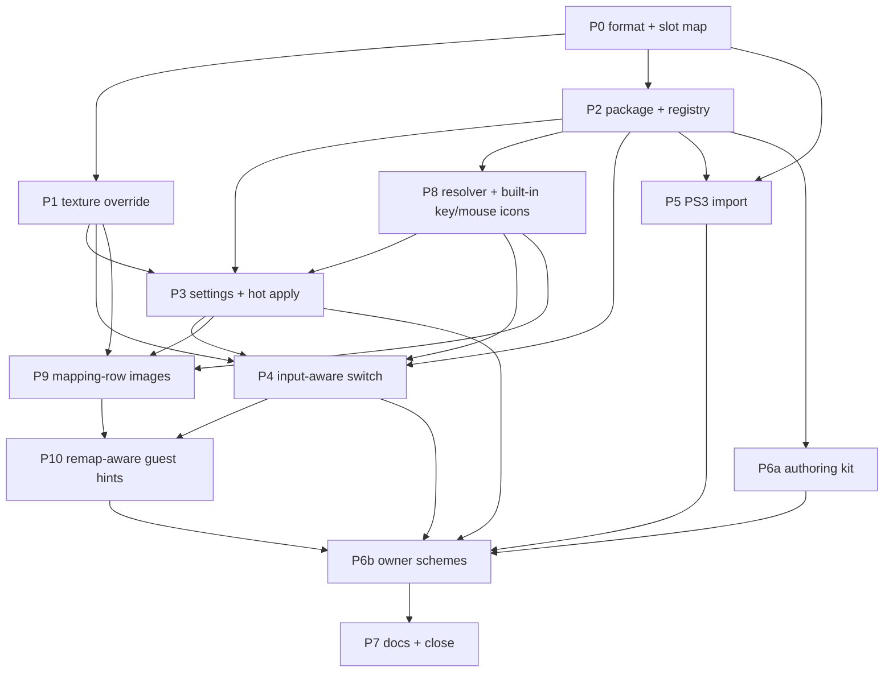

# Button layout hot-swapping — button glyphs and controller art

**Status: planning, created 2026-10-19; scope revised 2026-10-26. No implementation is delivered by
this revision.** The format measurement in §2.3 was made on 2026-10-19 and its decoded evidence is in
`out/button-schemes/format-2026-10-19/`; everything else marked `[tree]` is read from the current
tree, and everything marked **unproven** is not yet measured in a boot.

This plan makes the button glyphs and the controller-layout art **replaceable per scheme**, lets the
player choose a controller scheme in Help & Options, hot-swaps it without a restart, and switches
automatically between controller and keyboard/mouse art based on the last real input. It also adds
an **optional installer flow** that extracts the one platform-specific asset from the user's own
Rock Band Blitz PS3 package, and a **tracked authoring structure** under `assets/controller/`.
Both mapping screens display bound inputs as images, and the game's action hints follow the
effective bindings. Keyboard/mouse icons are built in and always available; only controller art
is selectable.

The 2026-10-26 revision supersedes the static-keyboard limitation formerly in D12, renames the
setting to **Controller Layout**, expands the controller catalog to seven families, and adds
**P8–P10** for input-icon resolution, mapping-row images, and remap-aware guest hints. Existing
prompt ids are retained; the dependency graph defines execution order. Live behavior remains
**unproven** until the corresponding implementation and acceptance prompts pass.

## 1. Request, normalized

| Id | Requirement |
| --- | --- |
| R1 | Replace the **button glyphs** (A/B/X/Y, LB/RB, LT/RT, Start/Back, LS/RS, D-pad, and the other slots the sheet carries) and the **controller-layout art** shown on the retail Control Preset page — everywhere the title draws them, not only on that page. |
| R2 | The installer offers an **optional Rock Band Blitz PS3 `.pkg`** and extracts exactly the assets this feature needs. If the user supplies it, a **PS3 layout** appears in the in-game list. |
| R3 | A tracked structure under `assets/controller/` where the owner leaves PNGs (and a small manifest) to build a **custom scheme package**. |
| R4 | **Keyboard/mouse icons are built in, always available, and not selectable or replaceable by controller packages.** Real keyboard/mouse input switches ordinary action hints to their effective key/mouse icons; real controller input switches back to the selected controller family. |
| R5 | Help & Options calls the setting **Controller Layout**. Each accepted click/selection applies immediately and visibly previews the new controller icons, including when selected with keyboard/mouse; no Apply, screen exit, restart, or subsequent controller input is needed. |
| R6 | Seven controller families: **Xbox 360** (default, base-game art), **PlayStation 3** (local import), **Xbox Series**, **PlayStation Series**, **Nintendo Switch**, **Steam Controller**, and **Steam Deck**. The latter five use owner-authored art; custom controller packages remain discoverable. |
| R7 | With no custom controller scheme installed, controller art falls back to **Xbox 360** from the base game. Built-in keyboard/mouse icons and binding-aware hints remain available while the feature is enabled. |
| R8 | No game art is committed, bundled or downloaded. PS3-extracted art lives only in the user's install or user-data folder and is never redistributed. |
| R9 | R4's existing `enhancements_icon_schemes` toggle and the settings program's contracts are honoured; the feature is documented in `engine/toggles.md` and the settings documents. |
| R10 | Tests, a live acceptance harness and the documents named in §10 are part of the change. |
| R11 | **Interface Mapping and Gameplay Mapping** render bound inputs as button/key/mouse images side by side, in saved binding order, instead of textual input names. For example, `Confirm: [A icon] [Enter keycap]` contains two images; the action label remains text. Mapping rows show all bindings; overflowing rows use the guest's layout/scrolling with no silent omission. |
| R12 | The **effective Interface Mapping dictates every interface footer and action hint**: mapping physical Y to Confirm draws Y in the selected controller family wherever Confirm is offered. For multiple controller or keyboard/mouse bindings, ordinary hints show the **first mapped source in the active device family**. Rebinding, reset, and profile changes refresh visible hints live. Gameplay hints use the effective Gameplay Mapping/preset for their context. |

### 1.1 Scope cross-check, 2026-10-26

| Owner request | Earlier coverage | Revised delivery |
| --- | --- | --- |
| Images in both mapping screens | Missing; existing scope replaced sheets only | R11, D13, P8/P9 |
| Setting called Controller Layout | Used `Button Icons` / `Layout` | R5, D6, P3 |
| Keyboard/mouse always present with live switching | Switching planned, keyboard depended on an authored package | R4, D4/D8, P4/P8 |
| Bindings dictate footer and game hints; first source per family | Explicitly excluded by static D12 | R12, rewritten D12, P8/P10 |
| Immediate preview on selection | Hot apply planned, keyboard-driven preview unspecified | R5, D14, P3/P4 |
| Seven controller families | Xbox Series, PS5, Switch and an authored Keyboard package | R6, §4.6, P2/P6a/P6b |

## 2. What exists today

### 2.1 The R4 toggle and the art locations

R4 already exists as an enhancement toggle, off by default and explicitly **not implemented**:

- `src/enhancements.cpp:62` — `enhancements_icon_schemes`, described as "let the button glyphs and
  controller-layout art be replaced per scheme. Faithful: the art the title ships. Not implemented."
- `docs/engine/toggles.md` — the R4 row names the old A1/A2 research prompts.

The art the feature must replace is **scene-embedded**, not standalone archive entries:

| Slot | Scene | Builder-side record | Size | Role |
| --- | --- | --- | --- | --- |
| Button glyphs | `ui/resource/fonts/gen/buttons.milo_xbox` | `../image/icons_buttons_xbox_nomip.bmp` | 512×512, 8 bpp | every A/B/… prompt, drawn through a `Glyph` table |
| Extra icons | `ui/resource/fonts/gen/blitz_icons.milo_xbox` | `../image/blitz_icons_xbox_nomip.bmp` | 1024×512, 8 bpp | the additional icon sheet (optional in v1) |
| Pad art | `ui/controller_config/gen/controller_config.milo_xbox` | `img/xbox_0..3.png`, `img/ps_0..3.png` | 1024×1024, 8 bpp each | the four controller-layout images per family; both families ship in both builds |
| Calibration prompts | `ui/calibration/gen/cal_auto.milo_xbox` | `button_a_calibrate_icon0001/2.bmp`, `button_press_ps30001/2.bmp` | 256×256 | calibration-specific icons; **out of scope in v1** |

The settings screen already routes the **Default Presets** row to retail's `controller_config_screen`
(`src/ui/settings_screen.cpp`, the `settings_default_presets` RouteGatedRow). Swapping the pad art
must therefore reach that routed screen, not a new screen of ours.

### 2.2 The settings and input machinery the feature plugs into

`[tree]` The settings surface is data in `src/ui/settings_screen.cpp`:

- `Kind::kSelect` is the horizontal-select row; its choices are `Row::choices`, stable tokens plus
  labels, never indices (`docs/settings/plan.md` §3.3).
- `MenuConfiguration` (`src/ui/settings_screen.h`) already carries `choices` — a map from a setting
  symbol to `(token, label)` pairs — and `AllPanels()` reads it. The boot fills it before the menu
  is generated. A dynamic scheme list can use this existing seam instead of inventing one.
- `SettingsBoot` materializes descriptors; `Descriptor::choices_source` already models
  `"renderers"`, `"resolutions"`, `"provider"` and `"menu_rows"` (`src/settings/schema.cpp`).
- `HotApplier` (`src/settings/hot_apply.h`) is the live-apply seam; a row is `kHot` only with
  `strategy_evidence` naming a measured live effect. `interface.settings_labels` is the precedent.

The following input notes are the **2026-10-19 snapshot**; current mapping surfaces are called
Interface Mapping and Gameplay Mapping. P8 must inspect their effective binding APIs rather than
derive a new icon table from the old default-key list.

`[tree]` The input layer already exposes the physical devices without the SDK's synthetic
keyboard-to-pad emulation:

- `src/input/source_gates.h` — `PhysicalInput` (raw pad, key state, mouse buttons, focus) and
  `SourceHeld`; `src/input/title_input.h` — `SamplePhysicalPad` reads the physical drivers only.
- `src/profile/remap.h` — the 16 targets and the compiled defaults. The default keyboard mapping
  is relevant to the keyboard sheet: `Return`/`A`=A, `Escape`/`B`=B, `X`=X, `Y`=Y, `W/A/S/D` or
  the arrow keys=D-pad, `Space`=Start, `Backspace`=Back; LB/RB/LS/RS are pad-only and the triggers have
  no keyboard default. The keys are interface-oriented because Gameplay Mapping's Keyboard + Mouse
  table is on by default (2026-10-19).
- There is **no last-device tracker** yet; the source gates decide whether a device may act, not
  which device last acted.

`[tree, inspected 2026-10-26]` `src/profile/input_rows.{h,cpp}` owns `BindingRowLabel` and
`InterfaceTargetLabel`; `src/ui/settings_screen.cpp` has `LiveBindingRows` and separate Interface
Mapping / Gameplay Mapping pages. These are inspection starting points for P8/P9, not evidence
that either image rows or remap-aware guest hints already work.

`[tree]` The SDK's texture path is a common base plus two backends:

- `rexglue-sdk/include/rex/graphics/pipeline/texture/cache.h` — `TextureCache`, `TextureKey`
  (guest page, dimensions, tiled, format, endianness, mip count), `Texture::MakeUpToDateAndWatch`,
  `ClearCache`.
- `rexglue-sdk/src/graphics/{vulkan,d3d12}/texture_cache.cpp` — the per-backend
  `LoadTextureDataFromResidentMemoryImpl`.
- There is **no texture-override or replacement hook** today.

`[tree]` The installer is a separate, Windows-only C++ helper (`installer/src/`) driven by Inno
Setup (`installer/setup.iss`). Its commands are deliberately small (`probe-folder`, `probe-package`,
`import-game`, …); the helper already links a few SDK-free project modules from the emulator tree so
the installer and the game cannot drift. It has no PKG parser and no AES, and there is no optional
PS3 page today.

### 2.3 The scene texture format — measured 2026-10-19

The prior record in `docs/guides/assets.md` said a UI texture could not yet be swapped because the
pixel buffer's format and offset inside a `.milo` chunk were unpinned. **That is now measured** for
the two scenes this feature needs. A `.milo` chunk carries a **23-byte texture record** immediately
before the DXT5 payload:

```
record (23 bytes):  <4-byte per-file id> 08 00 00 00 18 00 02 00 02 00 02 00 00 00 00 00 00 00 00
payload:            512 × 512 × 8 bits = 262,144 bytes, DXT5, 16-bit words stored in console order
```

For `buttons.milo_xbox` the record starts at **stream offset 0x5C9** and the payload at **0x5E0**;
decoding the payload after `hmx_tex.unswap()` gives a recognizable 6×6 glyph sheet with **29 occupied
cells**. The PS3 `buttons.milo_ps3` is the same size and record shape (only the 4-byte id differs)
and decodes at the same offset to a **different** sheet — the PlayStation symbols — on the same 6×6
scene grid. Its art has more internal components, so a component count is **not** the layout check;
P0 compares the two scenes' `Glyph` tables. The controller scene's eight pad images decode the same
way at **record + 23** as 1024×1024 DXT5 in the texture chunks (chunk 6 carries two of them); the
two scroll arrows are the small chunks.

Evidence (gitignored):

- `out/button-schemes/format-2026-10-19/buttons-360.png`
- `out/button-schemes/format-2026-10-19/buttons-ps3.png`
- `out/button-schemes/format-2026-10-19/buttons-grid.png` (6×6 grid overlay)
- `out/button-schemes/format-2026-10-19/pads-contact.png` (the decoded pad chunks)
- `out/button-schemes/format-2026-10-19/measurements.txt` (the commands and offsets)

What this settles for the plan:

1. **The PS3 import has a concrete route.** The only platform-specific art is the button sheet; the
   pad families (`ps_0..3` and `xbox_0..3`) already ship in the 360 scene, so the PS3 layout's pad
   art does not have to come out of the PS3 package at all.
2. **Custom schemes do not have to re-encode DXT5.** The runtime override can take RGBA PNGs from
   the host; the guest's own DXT5 payload is never rewritten.
3. **The slot map is a real grid.** The sheet is 6×6 (about 85×84 px per cell); the exact slot
   rectangles come from the scene's `Glyph` table, which P0 reads.

The `[unproven]` part is the **boot-time texture identity**: which loaded guest texture is the
button sheet and which is each pad. §3 D1 makes that P1's measurement.

## 3. Decisions

| Id | Decision |
| --- | --- |
| **D1** | **Controller-art hot swap uses a host texture override.** The SDK texture cache gains a generic override provider; the project supplies replacement RGBA for a slot, keyed by a measured fingerprint of the guest texture (dimensions + content hash, with the scene-read order as the fallback). P9/P10 may also change authored guest UI and served labels/records to express input icons and action identity; a texture swap alone cannot describe every binding. A scene-reload route is a fallback only if P1 proves live replacement unsafe, and does not satisfy R5 without a revised design. |
| **D2** | **A scheme is a folder with one manifest.** `scheme.toml` names the id, display name and kind; `buttons.png` is the 512×512 glyph sheet; `pad.png` is the 1024×1024 controller art (with optional per-slot `pads/pad_0..3.png`); `icons.png` is the optional 1024×512 extra sheet. No DXT5, no scene, no archive surgery for custom schemes. |
| **D3** | **Discovery is a boot scan, not a hot-add.** The game scans `<install>/assets/controller/schemes/` and `<user_data_root>/controller_schemes/`. For non-reserved custom ids, a user package shadows an install-root package with a log line; reserved families follow §4.1. Newly dropped packages are read at the next boot; the page says so in its caption. There is no Rescan row in v1. |
| **D4** | **Only the controller layout is selectable.** The page lists `Xbox 360` plus every available valid controller scheme. Keyboard/mouse icons are a built-in provider, never an authored/discoverable layout or a list choice. Boot starts in keyboard/mouse hint mode; the first real pad event selects controller hint mode. Device switching never changes the saved controller selection. The selection page's explicit controller preview is independent of ordinary last-device hints (D14). |
| **D5** | **PS3 import extracts one asset.** From a `.pkg` (plus the matching `.rap` if needed) or an extracted PS3 game folder, the installer extracts `ui/resource/fonts/gen/buttons.milo_ps3`, decodes its DXT5 sheet, and builds the PS3 scheme. The `ps_*` pad art comes from the user's 360 `controller_config.milo_xbox` via the same decoder. Nothing from the package is copied wholesale; the full ~350 MB ARK is never laid down. |
| **D6** | **One native setting: `controller.scheme`, displayed as Controller Layout.** Stable tokens are `retail`, `ps3`, `xbox-series`, `playstation-series`, `nintendo-switch`, `steam-controller`, `steam-deck`, or a custom id. It lives in `settings.toml` through the main settings service, not in the profile's binding store. The route is `Controls → Controller Layout`; the setting label also uses the full name. `retail` is displayed as `Xbox 360`. Label/value layout must accommodate the name instead of shortening it to `Layout`. |
| **D7** | **`enhancements_icon_schemes` becomes the master gate and defaults on**, with `Xbox 360` (`retail`) as the compiled default. With the gate off the Controller Layout page is omitted and faithful retail art is used. This changes the off-by-default line in `src/enhancements.cpp`; the toggle table records it. R4/R11/R12 describe enabled behavior. |
| **D8** | **Fallbacks preserve the device family.** Missing/invalid selected controller package → Xbox 360 art, logged and reflected in the setting. Keyboard/mouse → built-in keycap/mouse provider, with a built-in neutral image for an unsupported source or no binding; never controller art because a keyboard package is absent. Invalid controller packages are skipped and never listed. |
| **D9** | **Art is authored on a fixed grid, in white/alpha.** `buttons.png` must use the 6×6 slot grid; the game's material tints the glyph, so the sheet should be white/grey with straight alpha (colored art is allowed but is multiplied by the tint). `pad.png` is transparent-background RGBA. The loader converts to the guest's format; the art author never handles DXT5. |
| **D10** | **No retail/game art in the repository or the release.** The five owner-authored controller schemes and built-in keyboard/mouse art must be original or appropriately licensed. Xbox 360 art stays in the user's base game; the PS3 scheme is generated locally and is gitignored/audited like `game/` and `assets/game/`. |
| **D11** | **The retail pad page's eight pad slots all receive the selected scheme's art.** `xbox_i` and `ps_i` both map to `pad_i` (or `pad.png` for all four), so whichever family/preset index retail draws, it shows the selected scheme. |
| **D12** | **Effective bindings are the source of truth for icons.** A shared resolver maps `(action, interface/gameplay context, device family, effective profile/preset)` to ordered physical sources, then their icons. Mapping rows render every source; ordinary action hints render the first source in the active family. Controller glyphs use the selected family; keyboard/mouse glyphs use the built-in provider. No static default-key sheet after rebinding. Profile/preset changes, assigning, removing, reordering and resetting invalidate the relevant views. |
| **D13** | **Draw icons through the guest's UI.** Mapping rows keep their text action labels and render adjacent input images; guest footers, widgets, labels and served records carry the resolved hints. A shared 6×6 texture cannot express arbitrary simultaneous row contents or context-specific actions on its own. P9/P10 prove guest draw/label routes; no new host overlay is authorized by this plan. |
| **D14** | **Selection has an immediate controller preview.** Each accepted choice refreshes controller icons and pad art on the next presented frame. A guest-authored preview on the Controller Layout page always shows the selected controller family, even when a mouse click or keyboard key chose it. Ordinary hints still follow real last-device activity. The preview neither fakes controller input nor changes the saved device state, and does not wait for leaving the page. |

## 4. The asset contract — what to draw

### 4.1 Files and restrictions

| File | Required | Size | Format | Rules |
| --- | --- | --- | --- | --- |
| `scheme.toml` | yes | — | TOML | `schema_version = 1`; id, name, kind; file paths relative to the scheme folder |
| `buttons.png` | yes | **512×512** | PNG, 8-bit RGBA | straight alpha; sRGB; transparent background; white/grey art (tinted by the game); **do not move or resize the 6×6 slots**; no drop shadows that cross a slot boundary |
| `pad.png` | yes for a controller scheme | **1024×1024** | PNG, 8-bit RGBA | transparent background; the controller centered as in the retail image; used for all four pad slots unless per-slot files exist |
| `pads/pad_0.png` … `pad_3.png` | no | **1024×1024** each | PNG, 8-bit RGBA | optional per-slot override; if present, all four must be present |
| `icons.png` | no | **1024×512** | PNG, 8-bit RGBA | optional `blitz_icons` sheet; if absent, the retail sheet is used |
| anything else | no | — | — | the loader ignores it; the validator reports it |

Provisional limits (P2 may tighten, never loosen without a measurement): ≤ 8 MB per image, ≤ 32
files per scheme, no symlinks, id `[a-z0-9][a-z0-9-]{0,31}`, display name ≤ 20 characters.
The earlier 28-character single-line budget does not fit `Controller Layout: <name>`; P3 must
measure separate guest label/value placement or wrapping while retaining the full setting name.
The 20-character value cap remains provisional until that measurement.

Reserved ids: `retail` (base-game Xbox 360; no folder), `keyboard` (internal built-in provider,
not a package), and `ps3`, `xbox-series`, `playstation-series`, `nintendo-switch`,
`steam-controller`, `steam-deck`. Only the trusted built-in/import pipeline may supply reserved
controller packages; user custom packages cannot replace them or the keyboard/mouse provider.

### 4.2 The slot map

The retail sheet is a **6×6 grid**. The 360 sheet has 29 occupied cells; the PS3 sheet decodes on
the same 6×6 scene grid with different art. P0 reads both scenes' `Glyph` tables and publishes the
exact rectangles; the two tables must agree before the PS3 sheet is used as a slot-for-slot
replacement. Until then, the measured grid is:

| Row (y) | Occupied columns (x) |
| --- | --- |
| 0 (≈0–84) | 0, 1, 2, 3 (four; columns 4–5 empty) |
| 1 (≈85–169) | 0–5 |
| 2 (≈170–254) | 0, 1, 2, 3, 5 (column 4 empty) |
| 3 (≈255–339) | 0–5 |
| 4 (≈340–424) | 0–5 |
| 5 (≈425–511) | 0, 1 (columns 2–5 empty) |

The retail slot IDs identify the guest's logical prompts, **not the physical sources currently
bound to those prompts**. P0 assigns them from the glyph table; the expected set is:

`confirm_a`, `back_b`, `x`, `y`, `lb`, `rb`, `lt`, `rt`, `start`, `back`, `ls`, `rs`,
`dpad_up`, `dpad_down`, `dpad_left`, `dpad_right`, plus the remaining occupied cells (the retail
sheet's extra icons). The template draws each slot's rectangle and label so a paint program can be
used without guessing.

P8 separates this **logical action-slot map** from a **physical-source icon catalog**. A selected
controller sheet supplies physical controller icons; the resolver can draw Y for logical Confirm
without changing what Confirm does. P10 may compose action-slot textures for compatible guest
paths, but per-widget/context resolution is required wherever one shared sheet is ambiguous.

Keyboard/mouse icons are a built-in catalog or keycap renderer, not
`schemes/keyboard/buttons.png`. It covers every key, mouse button, wheel direction and other
source the current binding system accepts. Keycap legends such as `Enter` are inside rendered
images; plain binding-name strings are not the visual replacement. Unknown/unbound sources get
explicit neutral images and diagnostics, not misleading controller defaults.

P10 audits inline `<alt1>…</alt1>` prompts, footers, graphical hints, and locale strings that spell
an actionable button name. The earlier exclusion of textual button hints is superseded: all
actionable hints must resolve through the effective context, with any unmeasured route recorded
as open rather than declared complete. Decorative controller art is not an action hint.

### 4.3 `scheme.toml`

```toml
schema_version = 1
id = "xbox-series"
name = "Xbox Series"      # ≤ 20 characters; this is the row's value
kind = "controller"       # the only discoverable package kind

[buttons]
file = "buttons.png"

[controller]
file = "pad.png"
# Optional: per-slot overrides, all four or none.
# slots = ["pads/pad_0.png", "pads/pad_1.png", "pads/pad_2.png", "pads/pad_3.png"]

[icons]
file = "icons.png"        # optional
```

A controller scheme must have `pad.png` or all four per-slot files. `kind = "keyboard"` is
rejected for packages; keyboard/mouse resources are built with the application independently.

### 4.4 The authoring kit (P6a, not blocked on the owner's art)

- `assets/controller/README.md` — this contract in task form.
- `assets/controller/template/buttons.png` — a blank 6×6 grid with the slot rectangles and labels,
  generated by the P0 tool. It contains **no retail art** and may be committed.
- `assets/controller/template/pad.png` — a blank 1024×1024 guide with the safe area marked.
- `assets/controller/slots.toml` — the tracked slot registry (id, rectangle, row/column, label).
- `assets/controller/schemes/<id>/` — the owner's schemes; the five authored controller families live here when P6b
  runs.
- `scripts/controller_schemes.ps1 -Validate -Pack` — validates every scheme (size, mode, required
  files, slot coverage, id rules, duplicate ids) and copies the valid ones into the install layout.
- A generated **`test-markers`** scheme (not shipped) with a unique solid color per slot, used by
  P1–P4 before real art exists.

### 4.5 Where packages live at runtime

| Root | Contents | Who writes it |
| --- | --- | --- |
| `<install>/assets/controller/schemes/<id>/` | five authored controller schemes plus locally imported PS3, when available | the installer/build |
| `<user_data_root>/controller_schemes/<id>/` | user packages, including a scheme the player drops in | the player |

`<user_data_root>` is the same root the game already uses for saves and `settings.toml`
(`src/rb_blitz_app.h`). For non-reserved custom ids, a user package shadows an install-root package and logs
`button_schemes: <id> shadowed by <path>`; a package that fails validation is skipped and logged with
the reason.

### 4.6 Controller catalog

| Display name | Stable token | Source / availability |
| --- | --- | --- |
| Xbox 360 | `retail` | Always available; default, original base-game art, no copied package |
| PlayStation 3 | `ps3` | Available after local PS3 import (P5); never bundled |
| Xbox Series | `xbox-series` | Owner-authored controller package |
| PlayStation Series | `playstation-series` | Owner-authored controller package; replaces the earlier planned `PS5` name/token |
| Nintendo Switch | `nintendo-switch` | Owner-authored controller package |
| Steam Controller | `steam-controller` | Owner-authored controller package |
| Steam Deck | `steam-deck` | Owner-authored controller package |

These seven are the target catalog, not evidence that art exists today. P6b requires the five
authored controller packages; PS3 remains conditional on import. Keyboard/mouse is never a choice.
P8 records coverage for each physical source supported by the mapper, including Steam/Deck
controls: art availability does not imply new input-driver support. A control the input layer
cannot bind is recorded separately from a missing icon.

## 5. The flows

### 5.1 Installer — optional PS3 import

The wizard gains one optional page after the Xbox 360 game-data page, **Controller Icons (optional)**:

1. `Skip PlayStation 3 art` (default).
2. `Use a PlayStation 3 package (.pkg)` — a path box and Browse, plus an optional `.rap` box shown
   when the package needs a licence file.
3. `Use an extracted PlayStation 3 game folder` — a path box and Browse (the folder that contains
   `gen/main_ps3.hdr`).

On Next the helper runs `probe-ps3` (read-only) so a wrong source fails on the page, not halfway
through the install. During the Progress stage `install-ps3-scheme` writes
`<install>/assets/controller/schemes/ps3/` with `scheme.toml`, `buttons.png` and `pad_0..3.png`,
and records the source in `install-manifest.toml` (`[controller_scheme]` table: id, source,
content id, files, bytes, sha256).

The extraction, exactly:

1. **Probe** the PKG header. The file supplied on 2026-10-19 measures 364,734,448 bytes with magic
   `7F 50 4B 47` and content id `UP8802-NPUB30749_00-RBBLITZ0000TRIAL` at `0x30`. The same folder
   has `UP8802-NPUB30749_00-RBBLITZ00000FULL.rap`; the trial package and the full-licence RAP do not
   share a content id, so P5 must either pair the matching RAP or use the folder route. This is
   **unproven** until P5 runs; the page must say which of the two it is doing.
2. **Decrypt** the PKG with Windows CNG (`BCryptDecrypt`, AES-CBC) using only key material derived
   from the user's own package and licence file (the `.rap`); no key is compiled into the helper.
   The extracted-folder route bypasses this step entirely.
3. **Read the PS3 ARK index** (`gen/main_ps3.hdr`) and extract only
   `ui/resource/fonts/gen/buttons.milo_ps3` from `gen/main_ps3_0.ark` by its offset and size. The
   full 350 MB ARK is never written.
4. **Decode** the milo chunk: find the 23-byte record, take the 512×512 DXT5 payload, `unswap` the
   16-bit words, decode to RGBA, write `buttons.png`.
5. **Extract the pad art from the 360 scene** (`ui/controller_config/gen/controller_config.milo_xbox`,
   already installed): decode the four `ps_*` 1024×1024 DXT5 images and write `pad_0..3.png`. The
   `ps_*` family is already in the 360 dump, which the project already measured
   ([assets.md](../../guides/assets.md)); the PS3 package is not the source of the pad art.
6. **Validate** the generated scheme with the same validator the custom-package flow uses, then
   write it.

If the package cannot be decrypted, if the content id is not Rock Band Blitz, or if the sheet does
not decode, the helper refuses with a one-line reason and the wizard tells the player to use the
extracted-folder route. The PS3 scheme is **never** written into the repository or the release.

### 5.2 Custom package flow

1. The player drops `<user_data_root>/controller_schemes/<id>/` with `scheme.toml`, `buttons.png`
   and `pad.png` (or the optional files).
2. The next boot scans both roots, validates each package, logs one line per accepted/rejected
   scheme, and publishes the list to the settings screen.
3. The page lists the accepted controller schemes. Selecting one writes `controller.scheme` and
   applies it live.

New packages are not discovered mid-session; the caption says "Layouts are read at the next start."
The installer's built-ins are present before the first boot.

### 5.3 In-game selection and hot swap

The Controls page gains one submenu row (`Controller Layout`, 4 rows total, inside the six-row budget):

```
Controls
  Input Types
  Interface Mapping
  Gameplay Mapping
  Controller Layout     <- new
```

`Controller Layout` has these guest-drawn elements:

| Row | Kind | Setting | Drawn line | Help caption |
| --- | --- | --- | --- | --- |
| `Controller Layout` | `kSelect` | `controller.scheme` | Full label plus `Xbox Series` in measured separate value space or a wrapped line | "Choose controller icons and preset art. Each selection applies immediately." |
| `Keyboard & Mouse` | `kInfo` | — | `Keyboard & Mouse: Automatic` | "Built-in key and mouse icons follow your bindings and appear automatically when you use them." |
| Controller preview | guest image widgets | — | Representative button images and pad art from the selected controller family | Visible immediately, including on keyboard/mouse selection; never an overlay. |

The `Controller Layout` choices are built from the boot's registry and inserted through
`MenuConfiguration.choices`; `Xbox 360` (`retail`) is always present and is the compiled default. A custom
scheme's `name` is the value, capped at 20 characters.

Hot apply:

- The setting is a native descriptor with `ApplicationStrategy::kHot` **only after its own live
  measurement in P3**; until then the plan does not let the row claim a live effect. The final
  acceptance requires the hot classification with evidence (`strategy_evidence` names the capture
  and log).
- `HotApplier::Apply(kButtonScheme)` publishes the new active controller scheme to the scheme
  runtime and asks the texture override provider to refresh the affected slots. The invalidation is
  queued to the GPU/UI thread, not performed on the guest thread.
- Each click or accepted selector change commits and refreshes the on-page controller preview
  on the next presented frame. Rapid selections resolve to the latest committed choice. Keyboard
  or mouse activity cannot mask that preview by switching ordinary hints to keyboard/mouse.
- The row commits without a restart prompt; leaving the page and returning shows the new selection.
- The retail **Default Presets** page uses the selected pad art whenever visible; the selection
  page itself already demonstrates both changed icons and pad art without navigation.
- If the selected package becomes invalid between boots, the boot falls back to `retail`, logs
  `button_schemes: saved scheme <id> is missing, using retail`, and the row shows `Xbox 360`.

### 5.4 Input-aware automatic switching

A small **last-device tracker** watches the raw input that the source gates already read:

- **Controller activity**: a button press, a trigger past its threshold, or a stick past
  `kStickThreshold`, from `SamplePhysicalPad` — never from the SDK's synthetic keyboard-to-pad bits.
- **Keyboard/mouse activity**: a real key-down event, a mouse button, or cumulative mouse motion
  past a small threshold (to ignore a bumped desk), while the window has focus. Mouse motion is
  observed on the existing window/UI event path, not inferred from a synthesized pad.
- A switch is published when the device changes; a short debounce (target 50–150 ms; measured in P4)
  absorbs pad noise. The tracker does not switch on focus loss, and a switch does not change the
  selected controller scheme.
- Ordinary action hints use the built-in keyboard/mouse provider when that is the last active
  family, otherwise the selected controller family, resolving current bindings in either case.
  They start in keyboard/mouse mode. The active **pad** art and explicit Controller Layout preview
  always show the selected controller scheme. There is no timer that forces controller hints
  over keyboard/mouse after selecting a layout.
- Every switch logs `button_schemes: active <id> (device controller|keyboard)`, which is the
  acceptance hook.

### 5.5 Mapping rows and action hints

1. On either mapping surface, retain the action label and draw **all effective bound sources** as
   adjacent images in their stored order, including mixed controller/key sources on interface
   rows. Gameplay's device-specific pages show that page's sources. The row's device scope, not
   last input, determines which bindings are listed. Bound key/mouse icons stay built in when
   the controller layout changes.
2. In ordinary interface hints, filter the effective Interface Mapping to the active family and
   draw its first bound source. Example: controller `[Y, A]`, keyboard/mouse `[Enter, Space]` for
   Confirm draws Y on controller input and Enter on keyboard/mouse input. The mapping row still
   exposes every binding. Preserve stored order; do not sort by display name or button number.
3. Treat keyboard and mouse as one hint family: their combined binding order decides which icon
   is first. If that family has no binding, use an explicit unbound image instead of advertising
   an input that will not perform the action.
4. Interface Mapping controls menus, footers and pause interface hints. Gameplay Mapping and the
   active retail preset control in-song action hints. P8/P10 inspect the existing context rules;
   a gameplay A icon and an interface Confirm icon must not accidentally share a remapped value.
5. Assign, remove, reorder, reset, or switch profile/preset → publish a new effective-binding
   snapshot → refresh visible rows and action hints on the next presented frame. Never feed
   resolved icon identities back into input dispatch.

### 5.6 Acceptance authorization

These are future implementation/acceptance steps, not authorization to drive the game now.
Before any manual or automated game/UI navigation, ask whether the owner wants to perform the
test themselves and wait for the answer, unless they already authorized autonomous UI testing
for that scope. Build with `cmake --build --preset win-amd64-release` before requesting a test
unless the current binary is known to contain the latest changes. Code inspection, host-only
tests, and builds can proceed independently. New host overlays need explicit owner approval;
guest-authored rows, preview widgets and labels follow the authorized guest route.

## 6. Architecture

### 6.1 Modules and owners

| Area | File(s) | Responsibility |
| --- | --- | --- |
| Scheme registry / manifest / images | `src/controller_schemes/{registry,manifest,image,slots}.{h,cpp}` | SDK-free parsing, validation, RGBA loading, slot table; testable without a boot. The installer compiles the same manifest/slot code where it overlaps. |
| Slot map / template tool | `scripts/hmx_milo.py` extension + `scripts/controller_schemes.ps1` | P0/P2 tooling: decode a named sheet, emit rectangles, validate a package, build the template. |
| Active scheme runtime | `src/hooks/button_schemes.{h,cpp}` | Holds selected controller layout, last input family, explicit preview state and binding generation; publishes immutable snapshots; logs; owns the registry instance. |
| Input-icon resolver | proposed `src/input/input_icons.{h,cpp}` + existing `src/profile/input_rows.{h,cpp}` / effective binding APIs | P8: ordered physical-source icons for interface/gameplay contexts, first source per hint family, preset inheritance, unbound behavior; built-in keyboard/mouse provider independent of controller packages. |
| Last-device tracker | `src/input/last_device.{h,cpp}` | Raw pad/keyboard/mouse activity, debounce, atomic `LastDevice`; called from the existing poll/event seams. |
| Texture override provider | `src/assets/texture_override.{h,cpp}` + `patches/00xx-texture-override.patch` | Registers a provider with the SDK cache; maps a guest texture fingerprint to a slot; supplies RGBA; invalidates affected textures on a generation bump. |
| Settings | `src/settings/model.h`, `schema.cpp`, `boot.cpp`, `hot_apply_runtime.cpp`, `cvars.cpp` | `SettingId::kButtonScheme`, the descriptor, the boot catalog, the `kHot` applier. |
| Screen | `src/ui/settings_screen.{h,cpp}` | Controller Layout label/select, automatic keyboard/mouse info and guest controller preview; P9 image binding rows; `MenuConfiguration.choices` drives the list. |
| Guest action hints | P10-measured guest draw/label hooks and served UI records (paths to be pinned by P10) | Contextual action identity, remap-aware footers/visual hints and refresh on binding/device/layout changes; no host overlay. |
| Tests | `tests/button_scheme_tests.cpp`, `tests/settings_screen_tests.cpp`, `tests/settings_hot_apply_tests.cpp`, `tests/settings_schema_tests.cpp`, `tests/settings_service_tests.cpp`, `tests/source_gates_tests.cpp` (or a new input tracker test) | The invariants in §8. |
| Installer | `installer/src/{pkg,ark,milo_tex}.{h,cpp}`, `commands.cpp`, `setup.iss`, `install.cpp`, `config.h` | The optional page, probe/install commands, manifest table, refusal messages. |
| Assets | `assets/controller/**` | The contract, template, slot registry, owner schemes; built-ins copied by the installer. |
| Acceptance | `scripts/acceptance_button_schemes.ps1`, `scripts/acceptance_ps3_import.ps1` | §8. |

### 6.2 The SDK texture override (the one SDK patch)

The patch is deliberately **generic and upstreamable**: "a host provider may replace the data of a
guest texture at load time". It does not know about Rock Band Blitz.

Sketch (the exact naming is P1's):

```cpp
namespace rex::graphics {

struct TextureOverrideRequest {
  // The cache's own key: guest page, width/height, format, tiling, mip count.
  // The provider may also ask for the loaded base data to fingerprint it.
};

class TextureOverrideProvider {
 public:
  // Returns true and fills `rgba8` (top level, width * height * 4) when this texture
  // has a replacement for the current generation. Called on the GPU thread.
  virtual bool GetOverride(const TextureOverrideRequest& request,
                           const uint8_t* guest_data, size_t guest_data_size,
                           std::vector<uint8_t>* rgba8) = 0;
};

// The provider is process-global because the cache is created by the GPU plugin.
void SetTextureOverrideProvider(TextureOverrideProvider* provider);
// Bumps the generation; the cache drops/reloads the textures whose overrides changed.
void InvalidateTextureOverrides();

}  // namespace rex::graphics
```

Why this works for both backends: the base `TextureCache` owns the load path; the backend-specific
`LoadTextureDataFromResidentMemoryImpl` converts guest data to host data. The patch asks the provider
before conversion and feeds it the provider's RGBA. The backends do not each need a project-specific
hook.

Identification in P1, in order of preference:

1. **Content fingerprint**: hash the guest base data (or a stable 4 KB sample) and match a table of
   measured fingerprints for the button sheet and the eight pad images. The table is recorded by
   the P1 trace, not embedded in source as game data; it is a fingerprint file under
   `config/` or a small generated header, like the existing game fingerprints.
2. **Scene-read order**: hook the VFS read of `buttons.milo_xbox` / `controller_config.milo_xbox`,
   set a one-shot expectation, and match the next texture load with the expected dimensions. This
   handles a future build whose pixels differ.
3. **Descriptor match**: hook the guest texture-load function where the 23-byte record and the
   source path are still in guest memory; this is the most precise but the most invasive, and is
   only chosen if 1 and 2 both fail.

Invalidation: a generation counter on the provider. On a scheme change, bump the generation and
call `ClearCache()` **or** drop only the textures whose keys are in the override table; P1 measures
the cost. The button sheet is 512×512 (1 MB RGBA), the pads are 1024×1024 (4 MB each); a full cache
clear on every keyboard/controller switch would be wrong, so the plan requires the narrow invalidation
or a per-slot re-upload. The acceptance measures the switch's frame cost.

Fallback if the patch is rejected: a VFS overlay can serve a scheme-specific
`buttons.milo_xbox`/`controller_config.milo_xbox`, and the host can force the UI resource to reload.
That is a worse user experience (a scene reload, and the font/glyph cache may persist); it is a
fallback, not the plan.

### 6.3 Threading

- The active scheme is an immutable snapshot published by the settings commit / input tracker and
  read by the GPU thread. No lock is held across a draw.
- Effective bindings, context and controller layout share a versioned icon snapshot. Mapping rows,
  ordinary hints and the controller preview must not combine stale bindings with a new layout.
- The registry and image decoding are host-thread work; the decoded RGBA is uploaded on the GPU
  thread through the provider.
- The settings commit follows the existing rule: a guest thread never touches the cvar registry;
  the hot applier schedules the host write.
- The override invalidation is a queued GPU/UI-thread action, not a call from the guest thread.

## 7. Packages and prompts

Dependency graph (P8–P10 are new scope; ids are appended rather than renumbered):



> **The only package blocked on the owner's manual controller art is P6b.** P0–P5, P6a and P8–P10
> use retail scenes, generated controller markers, built-in key/mouse icons and synthetic bindings;
> P5 separately requires the owner's PS3 input files. **Do not start P6b until all five authored
> controller folders contain real art.** P6a produces the template and validator; P0 produces
> the slot map the template is drawn from. The PS3 scheme (P5) is generated from the user's own
> package and is not part of P6b.

Suggested execution: P0 → P1/P2 → P8 → P3 → P4/P9 → P10 → P6b → P7, with P5 and P6a
following their own dependencies. P7 closes only after the new prompts and real-art acceptance
pass; no static keyboard-sheet exception survives as an accepted limitation.

### P0 — Scene texture decode, slot map and template

**Goal.** Turn the 2026-10-19 format measurement into a repeatable tool and the authoring contract.

**Deliverable.**
- Extend `scripts/hmx_milo.py` with a `texture`/`export` command that finds a scene's 23-byte
  record, identifies the DXT5 payload, `unswap`s it and writes a PNG; the same code handles the
  512×512 sheet and the 1024×1024 pads.
- Read the `Glyph` table (the object records around the texture) and emit
  `assets/controller/slots.toml` with every slot id and rectangle; generate the blank
  `assets/controller/template/buttons.png` and `pad.png` guides.
- Add the measured format record to `docs/guides/assets.md` (a new section, dated 2026-10-19),
  mark the old "Can a UI texture be swapped today? **No**" claim as superseded, and name this plan
  as the successor. Move the format item in `docs/reference/backlog.md` to resolved/superseded.
- Copy the evidence into `out/button-schemes/format-2026-10-19/` (already done) and cite it.
- **Already landed, reuse it instead of starting over (2026-10-21):** `src/assets/texture_codec.h`
  is the same format in C++ - the 32-byte platform envelope (parser and writer), DXT1/DXT5 decode
  **and** encode, the 16-bit word swap and a box-filtered resampler, all SDK-free and pinned by
  `tests/store_art_tests.cpp`. It arrived with the store's album art
  (`src/store/album_art_service.cpp` decodes a cover with WIC and encodes a `.png_xbox` at runtime),
  and it is exactly what P5's installer needs for the PS3 sheet (`DecodeDxt5` on the milo payload,
  `BuildPlatformTexture` for the output) and what a host-side slot tool needs instead of a second
  codec. The Python command above still matters for the *scene* half (finding the 23-byte record
  and the `Glyph` table), which no C++ module reads yet.
- **Encode DXT1 wherever alpha is not needed (measured 2026-10-21).** A DXT5 this codec produces is
  a valid BC3 - it decodes to its source to within 0.8 levels per channel offline - but the engine
  draws it as noise, while a DXT1 from the same code goes through the same serving path correctly
  (`docs/guides/assets.md`, "which formats this build actually draws"). The button and slot sheets
  are opaque, so `BuildPlatformTexture(..., TextureFormat::kDxt1, ...)` is both correct and half
  the bytes; decod*ing* the retail PS3 DXT5 sheet stays DXT5, since that is what the file is.

**Verify.** Re-running the command on the 360 and PS3 `buttons.milo_*` reproduces the two decoded
sheets at the same 6×6 grid (the 360 sheet's 29 occupied cells and the PS3 sheet's own art); the two
scenes' `Glyph` tables are compared and either match slot for slot or the mismatch is recorded as a
finding; the pad command reproduces the eight pad images; every slot rectangle lies inside 512×512
and does not overlap; the template has no retail art.

**Don't.** Do not commit the decoded retail/PS3 art. Do not generalize the 23-byte record to every
scene without testing `blitz_icons` and `controller_config`. Do not claim the DXT5 hypothesis is
proven for a scene that was not decoded.

### P1 — Texture override seam (SDK patch) and marker spike

**Goal.** Prove a host texture can replace the button sheet and one pad slot in a live boot without
touching the guest scene, and measure the cost of switching it.

**Deliverable.**
- The SDK patch under `patches/` (with `patches/README.md`), applied by
  `scripts/apply_sdk_patches.ps1`; a generic `TextureOverrideProvider` as in §6.2; both D3D12 and
  Vulkan backends compile.
- `src/assets/texture_override.{h,cpp}`: the project provider, fingerprint table and generation
  invalidation.
- A spike that replaces the button sheet with the generated `test-markers` sheet and one pad image
  with a solid marker; it is enabled by an internal cvar/env (not the final settings row) so the
  spike can be run before P3.
- A trace that identifies the slot textures (dimensions + fingerprints + scene-read order) and
  records the switch cost.

**Verify.** A boot on the menu shows the marker glyphs on the prompt band and the marker pad on the
retail Default Presets page; a second boot without the spike shows retail art. A scheme change
replaces both within one frame after the generation bump; the frame cost is measured and recorded.
The untouched textures are unchanged (hash/screens). At least one backend is measured; the other is
recorded as unproven if it cannot be run.

**Don't.** Do not read or write game pixels from the repo. Do not hardcode guest addresses. Do not
fall back to editing the guest scene and call it a hot swap.

### P2 — Scheme package, registry and validator

**Goal.** Make a scheme a folder the game can validate and load, before any UI exists.

**Deliverable.**
- `src/controller_schemes/`: manifest parsing, id/name validation, image loading to RGBA8, the
  slot table, discovery from the two roots, duplicate/shadow rules, fallback ordering, and a
  `Summary()` for the boot log.
- The seven controller identities from §4.6, with Xbox 360 always present, PS3 gated on local
  import, and the five authored families listed only when valid. Keyboard/mouse is a separate
  built-in dependency, never a scheme choice or user-shadowable package.
- `scripts/controller_schemes.ps1 -Validate -Pack`: validates the owner tree and copies built-ins
  into the install layout; accepts a `-Scheme <dir>` for one package.
- Tests: valid/invalid manifests, reserved ids, duplicate ids, missing/extra files, wrong
  dimensions, alpha requirement, slot coverage, fallback ordering, custom-id user shadowing,
  reserved-family protection, and rejection of `kind = "keyboard"`.
- The generated `test-markers` scheme and a deliberately invalid fixture for the tests.

**Verify.** `ctest -R button_scheme` green; the boot log lists the schemes and the rejected
packages; a package with a wrong-size PNG is not listed and says why.

**Don't.** Do not let the registry depend on SDL, the GPU or the guest; it is a host-only module and
the installer compiles its pure parts.

### P3 — In-game page, persistence and hot apply

**Goal.** The player can choose a controller layout in Help & Options and see it without a restart.

**Deliverable.**
- `SettingId::kButtonScheme` (`controller.scheme`, value kind enum/string token) with a descriptor,
  the boot's scheme catalog, and `MenuConfiguration.choices["controller.scheme"]` from the same
  catalog.
- The Controller Layout submenu and full setting label (`Xbox 360` + valid controller schemes),
  built-in automatic keyboard/mouse info, and a guest-authored controller icon/pad preview; the
  in-song twin. Measure label/value placement without abbreviating the setting name (§4.1).
- The `kHot` applier that publishes the active controller scheme and invalidates the overrides,
  with `strategy_evidence` filled from P3's own live measurement. Until that measurement exists, the
  row is not allowed to claim `kHot`.
- Persistence through `settings.toml`; a missing/invalid saved token falls back to `retail` with a
  log line.
- Tests: generated menu shape/row order/back targets, label uniqueness, help coverage, descriptor
  choices, commit and restart classification, the hot applier called once per accepted choice,
  preview independent of last-device state, and rapid choices applying the latest selection.

**Verify.** With `test-markers`, each selection changes the on-page controller icons and pad preview
on the next presented frame, including a mouse click or keyboard selection while ordinary hints
remain in keyboard/mouse mode. Repeat with controller selection and rapid changes. No Apply,
page exit, or later pad input is needed. Default Presets uses the selected art; leaving shows no
restart prompt; a new boot restores the saved selection. Choosing Xbox 360 restores base-game
controller art. The boot log names the active scheme.

**Don't.** Do not add a dead row when no scheme is installed (`Xbox 360` is always valid). Do not
persist a list index or a label; the token is the wire value. Do not mark the row `kHot` before the
live effect is measured.

### P4 — Input-aware automatic switching

**Goal.** Controller movement selects the controller art; keyboard/mouse input selects the keyboard
art; the switch is immediate, stable and logged.

**Deliverable.**
- `src/input/last_device.{h,cpp}`: raw activity detection, thresholds, debounce, focus handling,
  no synthetic pad bits.
- Integration with `src/hooks/button_schemes.cpp` and P8's resolver: ordinary hints use built-in
  keyboard/mouse icons or the selected controller family with effective bindings; pad art and the
  explicit Controller Layout preview stay on the selected controller family.
- Built-in key/mouse provider available without any controller package; D8's device-safe fallback.
- Tests: the boot's initial keyboard state, key event, mouse button, mouse motion threshold, pad
  button/trigger/stick, focus loss, no switch on the SDK's synthesized pad bits, no flapping across
  alternating inputs, no missing-keyboard-package fallback to controller art, no selectable
  keyboard layout, and a switch that does not change the selected controller scheme or preview.
- Boot/acceptance log lines.

**Verify.** In a live boot, press a key or use the mouse → ordinary hints use built-in key/mouse icons; move/press
the pad → it changes back; alternating inputs does not flicker; the controller page still shows the
selected controller pad; the log names each active scheme. A physical pad arm is recorded manually
if the harness has no virtual pad.

**Don't.** Do not use the merged guest pad state or a `key_down` that includes synthesized input.
Do not switch on focus loss or on a single mouse-motion pixel. Do not call the texture cache from
the guest thread.

### P5 — Optional PS3 import in the installer

**Goal.** A player who owns the PS3 package gets a PS3 layout in the list, generated locally, with
only the needed art extracted.

**Deliverable.**
- The **Controller Icons (optional)** wizard page with Skip / `.pkg` (+ optional `.rap`) / extracted
  PS3 folder, and a read-only probe on Next.
- Helper commands `probe-ps3` and `install-ps3-scheme`; PKG header/probe, AES-CBC via Windows CNG,
  the PS3 ARK index reader, the single `buttons.milo_ps3` extraction, the DXT5 decoder, the 360
  `ps_*` pad extraction, and the scheme writer. The validator from P2 is reused.
- Installer manifest `[controller_scheme]` table; report lines; refusal messages for a wrong
  content id, a missing licence, a decryption failure and a decode failure.
- Tests: PKG header/content id parser, AES test vector, ARK entry extraction, DXT5 decode of a tiny
  synthetic fixture, the folder route, a wrong package refused, no full-ARK output.
- An acceptance run against the user's package and the extracted `assets/game/ps3` reference.

**Verify.** The generated `ps3/buttons.png` matches the PS3 reference sheet (same grid, PlayStation
symbols); its `Glyph` table matches the 360 sheet's slot rectangles (a mismatch stops the package as
a finding, because the host override maps by slot); `ps3/pad_0..3.png` match the 360 `ps_*` art; the
install contains no game archive and no key; the PS3 scheme appears in the page and hot-swaps like
the others. The folder route passes even when the PKG decryption route cannot be exercised.

**Don't.** Do not bundle, download or log a Sony key. Do not copy the whole PS3 ARK. Do not write
the generated scheme into the repository. Do not accept a package whose content id is not a Rock
Band Blitz PS3 id without an explicit, logged override.

### P6a — Authoring kit and built-in scheme pipeline (not blocked)

**Goal.** Everything the owner needs to paint and drop a scheme, plus the installer plumbing for the
five tracked authored controller families. Built-in keyboard/mouse resources belong to P8 and
do not depend on the owner drawing a Keyboard scheme.

**Deliverable.**
- The final `assets/controller/README.md`, template, `slots.toml`, validator, and an example scheme
  folder (the `test-markers` scheme is a generated example, not a shipped one).
- The installer `[Files]` entry and build step that copy `assets/controller/schemes/` into
  `<install>/assets/controller/schemes/`; the audit rule that the folder contains only original art.
- A blank-scheme test: a scheme with the retail slots and a solid pattern in one slot is accepted
  by the validator and loaded by the registry.

**Verify.** `controller_schemes.ps1 -Validate` passes on the template/example and rejects a wrong
size; an install copies exactly the scheme files; the audit reports no game data under
`assets/controller/`.

**Don't.** Do not start from a decoded retail sheet as committed art. Do not ship a scheme the owner
has not authored or licensed.

### P6b — The owner's five controller schemes and visual acceptance (**blocked on the manual art**)

**Start condition.** `assets/controller/schemes/xbox-series/`, `playstation-series/`,
`nintendo-switch/`, `steam-controller/`, and `steam-deck/` contain real `scheme.toml`, `buttons.png`
and `pad.png` (or all four pad files); the owner has confirmed the slot map. P3/P4/P9/P10 and the
P6a pipeline pass. **This prompt cannot run before those files exist.** Earlier prompts use
generated fixtures; built-in keyboard/mouse resources never require a manual Keyboard package.

**Goal.** Integrate Xbox Series, PlayStation Series, Nintendo Switch, Steam Controller and Steam
Deck art, then accept the full controller catalog and built-in keyboard/mouse behavior.

**Deliverable.** The five validated controller schemes in `assets/controller/schemes/`, copied by the
installer; the PS3 scheme from P5 (user data, not committed); a final visual pass on every screen
that uses prompts (menu, Help & Options, gameplay HUD, pause, results) and on the retail Default
Presets page; both mapping screens' adjacent images; default and rebound controller/key/mouse
hints with first-source ordering (D12); immediate previews chosen by every input family; the
real-art acceptance captures. Xbox 360 is read from the base game, never copied into tracked art.

**Verify.** Each scheme draws its own glyphs and pad, the keyboard auto-switch matches the art, the
selected controller scheme persists, and no screen falls back to retail unintentionally. The
acceptance captures are under `out/button-schemes/p6b/`.
Exercise all seven families when the PS3 import is available; if absent, record PS3 acceptance as
unproven rather than fabricating a package. Changing controller layout leaves key/mouse icons
unchanged. Rebinding Confirm to Y updates every sampled footer, and multiple bindings show the
first source in ordinary hints while both mapping pages retain the complete source list.

**Don't.** Do not infer a scheme's art from a screenshot; use the owner's files. Do not edit the
owner's art in the integration; report a bad slot to the owner. Do not commit the PS3-extracted art.

### P7 — Documents, audit and close

**Goal.** The change is recorded where the project looks for it.

**Deliverable.**
- `docs/engine/toggles.md`: the R4 row says implemented, names the modules and the Controller Layout
  page, and states the on-by-default decision (D7).
- `docs/settings/plan.md` §3: the Controller Layout page and the `controller.scheme` row; the page's
  row count; the hot classification and its evidence.
- `docs/settings/menu.md`: the Controls page's fourth row and the retail Default Presets route.
- `docs/settings/status.md`: the live state and any open items.
- `docs/guides/assets.md`: the 2026-10-19 format section (P0) and the PS3 button-sheet route.
- `docs/reference/backlog.md`: the old "pin the sheet format" item is resolved by P0; any remaining
  work is named.
- `docs/reference/known-issues.md`: the PS3 trial/full RAP caveat, unsupported physical controls
  or unmeasured hint routes, and any backend left unproven. Static default-key icons after a
  rebind are a failed R12 acceptance item, not an accepted D12 limitation.
- `docs/guides/distributable.md` and `scripts/audit_distributable.ps1`: no PS3 art and no game art
  in the payload.
- `patches/README.md`: the texture override patch.
- `docs/README.md`: maintain the existing plan row; move the plan to `finished/` only when
  P8/P9/P10, P6b and P7 pass, with P5's import outcome explicitly recorded.
- Run `python .github/skills/documentation/scripts/check_docs.py` (exit 0) and `git diff --check`.

### P8 — Effective-binding icon resolver and built-in keyboard/mouse provider

**Goal.** One source of truth resolves physical input images for every mapping row and game hint,
without a selectable keyboard scheme or a dependency on the owner's controller art.

**Deliverable.**

- Inspect the current Interface Mapping, Gameplay Mapping, profile, default/preset inheritance,
  source-order and source-gate APIs. Record the exact read/invalidation seams and test fixtures;
  do not copy the historical §2.2 default list into a second binding implementation.
- A shared, host-testable resolver (proposed `src/input/input_icons.{h,cpp}`) exposing ordered
  icon descriptors for all sources and the first source per active family. Inputs include action
  identity, interface/gameplay context, effective profile/preset, controller family and version.
- Built-in keycap/mouse images or rendering, covering the binding system's accepted key/mouse
  sources. Resources are original/licensed, ship with the application, cannot be replaced through
  controller packages, and have neutral unsupported/unbound images with diagnostics.
- Controller physical-source icon lookup for all §4.6 families. Synthetic markers suffice for
  unprovided art. Report unsupported Steam/Deck physical controls separately; adding input-driver
  support is not implied by adding a layout.
- Invalidation on assign/remove/reorder/reset, profile/preset change, layout change and active
  input-family change, producing coherent immutable snapshots for P3/P4/P9/P10.
- Tests with synthetic bindings: Confirm controller `[Y, A]` and key/mouse `[Enter, Space]`;
  key/mouse mixed order; no binding in one family; explicit empty versus inherited bindings;
  gameplay/interface context differences; profile/reset changes; keyboard icons invariant under
  every controller choice; missing controller packages do not remove keyboard/mouse support.

**Verify.** Host tests prove full source order for mapping rows and first-source selection for
ordinary hints. Rebinding or resetting changes the resolved images without restarting. Generated
or built-in icons suffice to complete this prompt; future guest rendering remains unproven here.

**Don't.** Do not sort bindings, silently truncate them, mutate input dispatch, invent new profile
syntax, or substitute static default icons when the effective mapping differs.

### P9 — Input images in Interface Mapping and Gameplay Mapping

**Goal.** Both mapping surfaces show actual bound button/key/mouse images next to their action
labels, replacing textual binding lists.

**Deliverable.**

- A measured guest row/inline-glyph route using P8's ordered icon descriptors. Keep row identity,
  focus, Assign/Reset, capture and back targets stable while rendering source images side by side.
- Support mixed controller/key sources in Interface Mapping and the proper device scope on each
  Gameplay Mapping page. Show every effective binding in stored order; use measured guest
  wrapping/scrolling or a row detail route for long lists without hiding available bindings.
- Coverage for controller buttons, triggers/directions and accepted key/mouse inputs, explicit
  unbound rows, inherited presets/defaults, and refresh after binding edits or controller selection.
- Tests of row data, ordering, icon selection, refresh, row identity and overflow behavior, plus
  live captures of both mapping surfaces in `out/button-schemes/p9/` after authorized UI testing.

**Verify.** `Confirm: [A button image] [Enter keycap image]` contains adjacent images with a textual
action label. Rebind it to Y and a different key and see the new images immediately. Both gameplay
device pages do the same for their effective inputs. Changing the controller layout changes only
controller images. Long binding lists remain inspectable; no image overlaps the next row.

**Don't.** Do not use parenthesized button-name strings as replacement icons, show only the first
source on mapping rows, or add a host overlay to bypass the guest's row renderer.

### P10 — Remap-aware guest footers and visual action hints

**Goal.** Every actionable game hint depicts the input that actually performs that action in the
current interface/gameplay context.

**Deliverable.**

- An inventory of menu/Help & Options, pause, results, gameplay, and other actionable footer,
  widget, inline-glyph and localized-text routes, with action/context identity, draw/label seam,
  and a coverage/evidence entry for each. Calibration-specific scene art remains outside the
  v1 texture replacement scope in §2.1; any actionable calibration hints still need an explicit
  route/outcome in this inventory rather than an assumed exception to R12.
- Integration of P8's first-source-per-family result into the guest's own hints. Use contextual
  widget/label or served-record changes where global sheet remapping is ambiguous. A texture-only
  implementation is insufficient if two visible contexts need different icons for one slot.
- Next-frame refresh when bindings, profile/preset, active input family, or controller layout
  changes; no stale icons on already-visible footers. Preserve D14's explicit selection preview.
- Host/fixture tests for context and invalidation, and authorized live captures/logs in
  `out/button-schemes/p10/` covering default, rebound, multiple-source, removed, reset and
  profile-switch cases. Record any route left unproven as outstanding work.

**Verify.** Bind controller Y to interface Confirm: all Confirm footer/visual hints draw Y in
the selected controller family and input still confirms. Bind `[Y, A]` plus `[Enter, Space]`:
ordinary hints draw Y or Enter according to real last input; mapping rows retain both alternatives
per family. Reordering changes the hint; removing/resetting/profile-switching refreshes it.
Gameplay action hints follow Gameplay Mapping/presets while pause/menu hints follow Interface
Mapping. Repeat across representative controller layouts and unchanged built-in key/mouse art.

**Don't.** Do not treat a logical guest A prompt as proof that physical A is bound. Do not apply
interface remaps to gameplay blindly, advertise unbound inputs, or mark R12 complete while a
known actionable hint still shows stale/default bindings.

## 8. Validation matrix

| Check | Proves | Evidence |
| --- | --- | --- |
| `hmx_milo.py texture` on 360/PS3 `buttons` | the record, DXT5, unswap and grid are reproducible | decoded PNGs, 29 occupied cells |
| `controller_config` decode | the eight pad images and the per-slot mapping | `pads-contact.png` |
| Marker sheet on the menu prompt band | the host override reaches the glyph draw | capture + pixel/OCR |
| Marker pad on Default Presets | the pad slots are overridden, not only the glyphs | capture |
| Select `test-markers` on the page | the row writes `controller.scheme` and applies live | log + capture |
| Leave the page / return | no restart prompt, selection persists | capture + `settings.toml` |
| New boot | the saved selection is the active scheme | log |
| Key/mouse event, no controller packages installed | built-in key/mouse icons are available and follow effective bindings | log + capture |
| Pad button/stick | the selected controller scheme is active | log + capture |
| Alternating inputs | no flapping beyond the debounce | log |
| `Xbox 360` selected (`retail`) | base-game controller art returns; key/mouse icons remain built in | capture |
| Missing/corrupt package | skipped with a reason; the page is not dead | boot log |
| PS3 `.pkg` | content id, decryption, one-entry extraction | helper log + `install-manifest.toml` |
| PS3 folder | the same scheme from `gen/main_ps3.hdr` | helper log |
| PS3 generated art | matches the reference grid/art | `ps3/buttons.png` vs the PS3 reference |
| No game art in the repo/release | the audit rule | `audit_distributable.ps1` |
| Switch cost | the frame does not stutter on a scheme change | measured frame times |
| Click/select each Controller Layout choice with keyboard, mouse and controller | on-page controller icons/pad change next frame without Apply or later pad input | capture + commit/generation log |
| Confirm bound to controller `[Y, A]`, key/mouse `[Enter, Space]` | ordinary interface hints draw first source per active family; mapping row draws all sources | resolver test + footer/row captures |
| Interface Mapping image rows | action text plus ordered adjacent physical input images, including mixed device sources | guest fixture + capture |
| Both Gameplay Mapping device pages | images reflect effective gameplay bindings/preset without inheriting interface Confirm remaps | resolver/row tests + captures |
| Assign/remove/reorder/reset/profile or preset change while hints visible | next-frame rows/footers reflect the effective mapping; no stale default icons | tests + generation log/captures |
| No binding for active family | neutral unbound image; no advertised false binding | resolver test + capture |
| Long binding list | every binding is inspectable; no clipping into neighboring rows | guest row test + capture |
| Seven-family catalog / keyboard package rejection | five authored controllers, retail default, conditional PS3, and no selectable/swappable keyboard layout | registry/validator tests + choice list |
| P10 hint-route inventory | every known actionable footer/visual/text hint follows context and remaps | coverage table + captures; unmeasured routes remain open |

## 9. Risks and open questions

1. **The SDK patch is the highest risk.** A generic texture override touches both backends and the
   cache's invalidation rules. P1 must stop and write findings if it cannot be made safe; the plan
   does not accept a fake hot swap. The fallback is a scene reload, which is a worse experience and
   must be recorded as such.
2. **PKG decryption is unproven.** The supplied file is a **TRIAL** content id; the folder has a
   **FULL** `.rap`. The trial package may need a different licence, or the folder route may be the
   only working one. P5 must report exactly which route worked. The extracted
   `assets/game/ps3` tree is a reference, not a substitute for the installer flow.
3. **The 23-byte record and the slot rectangles may not be identical in every scene.** P0 tests
   `buttons`, `blitz_icons` and `controller_config`; it also compares the 360 and PS3 `Glyph`
   tables. A scene or table that differs is a finding, not a silent fallback.
4. **Auto-switch can feel noisy.** The thresholds and debounce are measured in P4; the plan does not
   invent a final number. A mouse bump must not switch the art.
5. **A sheet swap cannot resolve all contexts.** Mapping rows need multiple source images, and
   interface/gameplay hints may resolve the same guest slot differently. P8 separates physical
   sources from logical actions; P9/P10 prove guest row/label routes. Static default-key images
   after a rebind violate D12 and cannot be accepted as a limitation.
6. **Full Controller Layout label and row budget.** The old 28-character single-line budget is
   insufficient for the required name plus a value. P3 measures separate guest label/value
   placement or wrapping; the provisional 20-character value cap is validated there. Truncating
   or renaming the setting is not the resolution.
7. **The retail pad page's four images.** The plan maps all eight slots to the selected scheme; if
   the four images turn out to be four distinct presets that must not be collapsed, the per-slot
   `pad_0..3.png` override exists. P0/P5 confirms which it is.
8. **Memory and load time.** Five authored controller schemes plus an imported PS3 scheme ×
   (1 MiB sheet + 4 MiB pad) is about 30 MiB of decoded RGBA for one pad image per scheme, or
   about 102 MiB with four distinct 4 MiB pads each, before built-in key/mouse resources and GPU
   copies. P2 may decode lazily; acceptance measures boot, binding refresh and switch costs.
9. **Security.** The validator clamps file sizes/dimensions, rejects symlinks and path traversal,
   and never trusts a manifest's file paths outside its folder. A malformed PNG is a rejection, not
   a crash.
10. **Selection versus last-device input.** A mouse click selecting a controller layout also
    counts as mouse input. D14's explicit guest controller preview makes the choice visible
    without falsifying last-device state or suppressing ordinary keyboard/mouse hints.
11. **Icon coverage versus driver support.** Steam Controller/Deck art does not prove every
    physical control is exposed to the existing binding system. P8 inventories accepted inputs
    and missing icons separately; no new driver implementation is silently added to this plan.

## 10. Documents this change owes

| When | Document | What changes |
| --- | --- | --- |
| Plan filed / scope revised | [`docs/README.md`](../../README.md) | maintain the existing plan row, current path and binding-aware scope |
| P0 | [`docs/guides/assets.md`](../../guides/assets.md) | the 23-byte record, DXT5 offset, unswap, the 6×6 grid, the pad decode; the old "No" is marked superseded |
| P0 | [`docs/reference/backlog.md`](../../reference/backlog.md) | the "pin the sheet format" item is resolved; the successor is this plan |
| P1 | [`patches/README.md`](../../../patches/README.md) | the texture-override patch and why it is generic |
| P3 | [`docs/engine/toggles.md`](../../engine/toggles.md) | R4 is implemented; the gate's default and the page |
| P3/P9/P10 | [`docs/settings/plan.md`](../../settings/plan.md), [`menu.md`](../../settings/menu.md), [`status.md`](../../settings/status.md) | Controller Layout, full label/preview, image mapping rows, binding-aware hints, hot evidence, live state |
| P4/P5/P6b/P8/P10 | [`docs/reference/known-issues.md`](../../reference/known-issues.md) | RAP/trial caveat, unsupported inputs/hint routes, any unproven backend; no accepted static-keyboard exception |
| P5/P6a | [`docs/guides/distributable.md`](../../guides/distributable.md) | no PS3/game art in the payload; the audit rule |
| P8/P9/P10 | [`docs/engine/input-flow.md`](../../engine/input-flow.md) | resolver context, ordering and remap-aware hint seams, once measured |
| P7 | this plan | status moved to `finished/` after P8/P9/P10, P6b and P7 pass; record P5's outcome |

## 11. Reproducing the 2026-10-19 measurement

```powershell
python scripts\hmx_milo.py dump assets\game\360\ui\resource\fonts\gen\buttons.milo_xbox `
    --chunk 0 --out out\button-schemes\format-2026-10-19\buttons_chunk0.bin

# Record at 0x5C9 (23 bytes), DXT5 at 0x5E0, 512x512:
python -c "import sys; sys.path.insert(0,'scripts'); import hmx_tex; from PIL import Image; b=open(r'out/button-schemes/format-2026-10-19/buttons_chunk0.bin','rb').read(); d=b[0x5E0:0x5E0+262144]; rgba=hmx_tex.decode_mip(hmx_tex.unswap(d),0,512,512,16); Image.frombytes('RGBA',(512,512),rgba).save('out/button-schemes/format-2026-10-19/buttons-360.png')"
```

The same block runs on `assets\game\ps3\ui\resource\fonts\gen\buttons.milo_ps3` (the PS3 sheet
differs, the offset is the same). The pad chunks are dumped the same way and decoded at record+23 as
1024×1024 DXT5.
