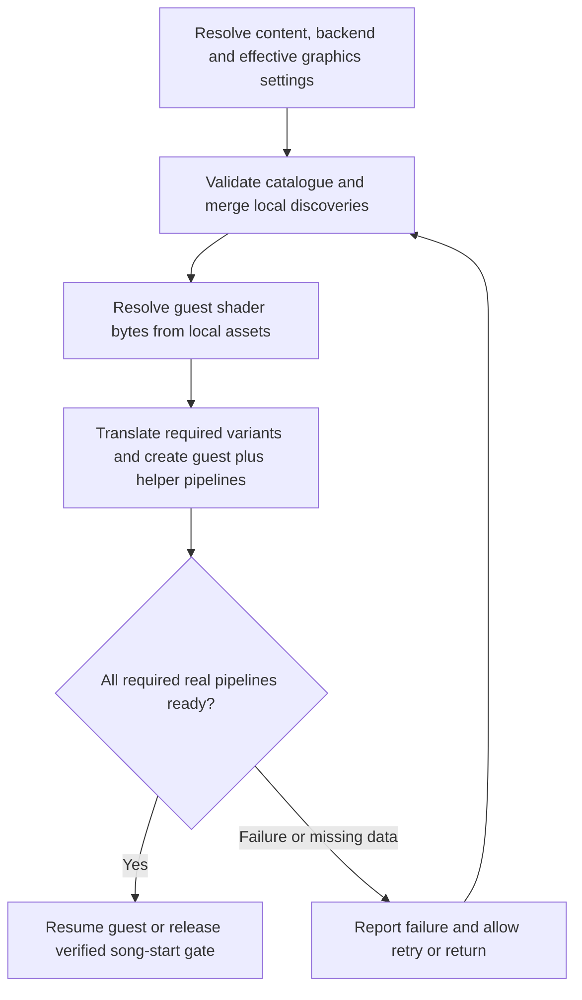

# Shader cache and gameplay stalls: findings and implementation plan

Date: 2026-10-10. Architecture review 2026-10-16; plan finalized 2026-10-17.
Scope: first-play freezes that become less frequent with further play and do not
recur at the same spot after restarting a song.
Status: read-only investigation completed; cause of individual freezes is not yet
measured. This document proposes follow-up work, not an implemented fix.

The [2026-10-16 implementation plan](#implementation-plan-2026-10-16) extends the
original investigation and defines the next work. It corrects the earlier assumption
that requesting blocking startup preload guarantees completion on D3D12. Historical
measurements below are retained; no new gameplay measurements were taken in this review.

## Assessment

**Shader caching is active. First-use shader translation and pipeline creation are
credible causes of the reported freezes.** The D3D12 renderer has a submission
path that waits for pipeline creation even with asynchronous compilation enabled.
However, improvement on replay also fits asset loading and other resource caches.
Do not treat the shader explanation as confirmed until a stall is correlated with
compilation or a pipeline wait.

The recommended direction is **a game-specific pipeline catalogue, preparation before
playback, and a verified completion barrier**. Repair the existing D3D12 preload
barrier first, then expand coverage to guest and renderer-helper pipelines. Generate
guest shader records locally from the user's installed assets; distribute compatible
pipeline recipes and hashes rather than the game's shader bytes. Add local native
pipeline caching later if preparation time warrants it. Keep investigating stalls
that remain with a warm cache.

## What the repository and local runs establish

| Finding | Evidence |
| --- | --- |
| Persistent shader storage defaults to enabled. | `store_shaders` in [graphics_system.cpp](../../../rexglue-sdk/src/graphics/graphics_system.cpp), including its `InitializeShaderStorage` implementation. |
| Startup requests blocking preparation before the main guest thread starts. | [rex_app.cpp](../../../rexglue-sdk/src/ui/rex_app.cpp):464 calls `InitializeShaderStorage(..., true)` before `main_thread->Resume()`. **Correction, 2026-10-16:** the D3D12 implementation can return with workers still busy; see finding F1 below. |
| The recent local runs use D3D12. | Their startup logs identify a DXGI NVIDIA GeForce GTX 970 adapter and D3D12 pipeline creation. This describes those runs, not every user's backend. |
| The cache actually loads, rather than merely being configured. | Historical `out/build/win-amd64-release/logs/rb_blitz_006.log`, lines 207–209: 186 shader translations in 9 ms, then a report of 356 graphics pipelines in 356 ms. **Correction, 2026-10-16:** D3D12's pipeline counter counts scheduled/attempted entries, not confirmed successful completions; F1 explains why this time is not a reliable readiness measurement. |
| The stored coverage grew through use. | `rb_blitz_002.log`: 171 shader translations and 324 pipelines; subsequent local logs: 186 and 356. These are preload counts, not measured stall counts or proof of completeness. |
| Async compilation defaults to enabled. | `async_shader_compilation` in [command_processor.cpp](../../../rexglue-sdk/src/graphics/command_processor.cpp); D3D12 creation threads default to automatic selection. |
| D3D12 still waits for compilation during submission. | `D3D12CommandProcessor::EndSubmission()` calls `PipelineCache::EndSubmission()`. The latter creates queued pipelines on the processor thread and waits for busy creation workers. |
| The development profile enables render-target readback. | `out/build/win-amd64-release/rb_blitz.toml`: `d3d12_readback_resolve = true`. Readback has GPU synchronization paths and is another profiling target. |
| Earlier pacing tests already recorded an unresolved long stall. | [Known issues](../../reference/known-issues.md) and the frame-pacing close-out in [bringup log](../../history/bringup-log.md): a 1174.9 ms guest `VdSwap` gap and 263.6 ms `XE_SWAP` gap in the vsync-on run. These do not identify the cause of the current report. |
| The installer does not currently ship a prepared shader-cache baseline. | [make_payload.ps1](../../../installer/tools/make_payload.ps1) packages the executable, launcher and runtime dependencies. |

The logs and developer profile above are local, ignored artifacts and may rotate
or be absent in another checkout. Preserve copies in an investigation evidence
folder before further sessions overwrite them. Startup times on this already-used
machine do not predict first-run compilation times on another machine.

### Storage and formats

[RbBlitzApp](../../../src/rb_blitz_app.h) defaults the cache root to
`<user_data_root>/cache`, normally under Windows Documents:

```text
Documents/Rock Band Blitz/cache/shaders/shareable/
    5841122D.xsh
    5841122D.rtv.d3d12.xpso
```

Both files were present during the investigation: 103,484 bytes of shader records
and 25,644 bytes of D3D12 pipeline records. Explicit path overrides can change
their location. This cache is separate from the DLC enumeration cache and player
saves.

- `.xsh` stores guest shader microcode and identifying metadata. It is not a
  collection of final GPU machine-code binaries.
- `.xpso` stores pipeline descriptions. The D3D12 path selects `rtv` or `rov`;
  Vulkan selects `fbo` or `fsi` and uses `.vk.xpso` instead of `.d3d12.xpso`.
- On startup, the renderer uses those records to translate shaders and create
  pipelines for the current host. A shader can have multiple translations and
  participate in multiple pipelines.
- The formats have version checks. Being shareable does not make them compatible
  with every renderer revision, setting or rendering path.

Sources: D3D12 [pipeline cache](../../../rexglue-sdk/src/graphics/d3d12/pipeline_cache.cpp)
and [format definitions](../../../rexglue-sdk/include/rex/graphics/d3d12/pipeline_cache.h);
Vulkan [pipeline cache](../../../rexglue-sdk/src/graphics/vulkan/pipeline_cache.cpp).

### Why static recompilation does not remove this work

The CPU code is statically recompiled, but Xbox 360 graphics commands still go
through ReXGlue's GPU implementation. Guest shaders need host translation, and the
host driver needs graphics pipelines combining shaders with rendering state.
Encountering a new combination during a song can therefore require new work.

The D3D12 async draw path can skip a draw whose pipeline is not ready, yet the
submission path subsequently waits for queued compilation. On Vulkan, shader
translation occurs before the async pipeline decision, placeholder pipeline creation
can be synchronous, and ordinary submissions also drain/wait for pipeline work.
Switching backend or enabling async is not by itself a guarantee of hitch-free gameplay.

## What you should do as the player

**Yes: play different visual situations and use different power-ups. You do not
need to begin by playing every song in the library.** The objective is to encounter
new effects and rendering combinations, not just increase the song count. Songs
can share graphics; two plays of the same song can expose different effects.

### First, provide a small repeatable example

1. Choose a song and power-up loadout where you noticed a freeze. Record the build,
   backend, graphics settings, retail/Ultimate mode and whether it is DLC/custom
   content. Keep these fixed for the comparison.
2. Play it and note approximately where the freeze happens. Note what appeared
   on screen, whether music continued, whether input still seemed responsive, and
   whether visuals disappeared or the whole displayed frame stopped updating.
3. Restart the song immediately with the same loadout and try to repeat the same
   actions. Record whether the freeze repeats at that event.
4. Exit normally, launch the game again and repeat once more. This separates reuse
   within one process from reuse across launches, although it still does not prove
   which cache helped.
5. Give the agent the observations and the corresponding logs. A short video is
   useful if convenient; a song-relative timestamp and event description are enough
   to start. Average FPS alone is not a useful record of a one-second freeze.

Keep your existing caches. Do not delete saves, shader caches or driver caches to
make a clean test; the agent should prepare isolated test runs when needed.

### Then, collect broader coverage with agent feedback

Once the agent can report newly observed pipelines, work through this checklist:

- [ ] Title screen, song library, loading transitions, pause/resume and results.
- [ ] Several songs with visibly different backgrounds, lighting or scenery.
- [ ] Every selectable power-up, actually activated during gameplay.
- [ ] Different power-up combinations where they produce overlapping effects.
- [ ] Track switching, sustained successful play, misses, and score/streak or
      checkpoint transitions that visibly change the scene.
- [ ] A complete song through the ending and results screen.
- [ ] Retail and Ultimate separately if both are supported release modes.
- [ ] Representative bundled, DLC and custom songs with unusual visual behavior.

The agent should maintain the coverage checklist and tell you which sessions added
pipelines. Stop repeating a route once it adds no new records, unless it is needed
to reproduce a remaining stall. Broaden to other scenes or effects instead.
Saturation on this checklist is evidence of useful coverage, not proof that every
possible pipeline has been discovered.

You should supply gameplay judgment and confirm that notes, effects, audio and
input remain correct. The agent should handle paths, logs, cache comparisons and
technical measurements. You should not need to inspect binary cache files or
guess which shader corresponds to a freeze.

## What an agent should do

The following is the original three-phase outline. The detailed plan below refines
its order and acceptance gates. Creating this document does not implement renderer
changes or perform controlled gameplay runs.

### Phase 1: establish the cause

1. Record the repository/SDK revisions, built binaries, backend, GPU/driver,
   effective settings, game/mod variant and resolved cache path. Check actual
   runtime values rather than assuming defaults or that the binaries match source.
2. Preserve the relevant logs and shader-cache snapshot. Prepare an isolated
   shader cache for controlled runs, leaving player progress and normal caches
   intact. Keep other game data and settings the same.
3. Add focused timing, if implementation is requested, for shader translation,
   pipeline misses/creation, D3D12 submission waits and GPU readback waits. Correlate
   these with frame gaps; include pipeline identity and whether work was preloaded
   or first encountered during gameplay. Avoid logging every draw to disk.
4. Compare the same route with an empty application shader cache, immediate replay,
   and full process restart with populated storage. An empty application cache does
   not imply an empty driver or OS file cache; report those limits explicitly.
5. If a long frame occurs without compilation or its associated wait, investigate
   resource upload/conversion, asset I/O/decompression and CPU/GPU synchronization.
   Do not label every first-use cost as shader compilation.
6. Report individual long-frame durations and correlated work, plus the worst
   frame and counts of frames exceeding useful thresholds such as 50/100/250 ms.
   Check that instrumentation does not itself create the observed freezes.

Deliverable: a short evidence table identifying confirmed causes, unresolved
stalls and the next change justified by the measurements.

### Phase 2: collect and validate portable coverage

1. Give the player a simple launch/capture workflow and the coverage checklist
   above. Preserve each session's configuration and records.
2. Provide a cache inspection tool/report that validates headers and hashes,
   counts unique records and reports additions per session. Preload log counts
   alone are insufficient to attribute new records to a particular gameplay event.
3. Track coverage by backend, rendering path and supported content/configuration.
   Do not assume D3D12 pipeline records also cover Vulkan.
4. Merge compatible records by identity with format validation; do not concatenate
   files or replace a richer user cache with a smaller baseline.
5. Replay the collected baseline on representative machines and verify preload
   success, remaining misses, startup cost and rendering correctness.

Deliverable: a candidate baseline plus a coverage report stating what was exercised
and what remains untested.

### Phase 3: implement preparation and distribution

1. Generate guest shader records from the user's game installation and package a
   versioned catalogue of compatible pipeline recipes. The `.xsh` format contains
   original game shader bytes. Decision D2 below selects local generation to follow
   the project's existing asset-distribution policy.
2. Seed/merge records into the resolved writable cache without discarding existing
   discoveries. Handle missing, incompatible and corrupt records predictably.
3. Repair and reuse the existing blocking startup preload. Add progress reporting and safe
   cancellation if its duration warrants it. Explore song-loading warmup only if
   pipeline requirements can be identified before the song begins.
4. Keep learning new combinations at runtime. Preserve provenance and invalidate
   records when relevant formats or translation assumptions change.
5. If profiling justifies it, improve the D3D12 submission wait behavior. Do not
   simply remove the wait: audit deferred commands, pending shader data, object
   lifetimes and rendering correctness first. Missing notes or incorrect effects
   are not an acceptable trade for a better frame-time graph.

Deliverable: a reviewable change with cold/warm measurements, installer coverage,
and player confirmation of correct gameplay visuals and timing.

## What can be prepared and shared

| Approach | Benefit | Limit or follow-up |
| --- | --- | --- |
| Ship guest shader records and pipeline descriptions. | Moves known first-use work to startup using infrastructure already present. | Requires coverage and compatible backend/path records; host compilation still happens. |
| Extract shaders and build a pipeline catalogue ahead of time. | Could improve coverage beyond manual captures. | Extracting every shader does not enumerate every rendering-state combination. Requires game/asset analysis. |
| Cache translated host shader bytecode. | Could avoid repeated translation work. | New cache design must account for translator revision and relevant host/settings variants. |
| Persist native driver pipeline results locally. | Can reduce repeated host pipeline creation cost. | Hardware/driver compatibility matters. This is not one universal release cache. |
| Compile in the background during startup/loading. | Moves work away from interactive song playback. | Needs early knowledge of requirements and a completion policy before gameplay. |
| Use fallback rendering while compilation finishes. | Can avoid waiting for some missing pipelines. | High correctness risk for notes and gameplay feedback; existing async paths already have limitations. |

D3D12 currently does not store native PSO blobs in this application's shader cache;
the source explicitly describes them as a possible future addition. Vulkan's
graphics pipeline creation currently passes `VK_NULL_HANDLE` for `VkPipelineCache`.
Neither observation rules out caching performed internally by the driver.

Microsoft documents native D3D12 cached PSOs as hardware-, driver- and
machine-specific: [D3D12_CACHED_PIPELINE_STATE](https://learn.microsoft.com/en-us/windows/win32/api/d3d12/ns-d3d12-d3d12_cached_pipeline_state).
Khronos describes native Vulkan pipeline caching and its potential to reduce
creation cost: [Pipeline Cache](https://docs.vulkan.org/guide/latest/pipeline_cache.html).

## Completion criteria

- A captured freeze has a measured cause, or is explicitly left unresolved.
- Known baseline pipelines finish preparation before song playback on tested
  configurations; any misses during the coverage route are reported.
- Immediate replay and full process restart are both tested.
- Startup costs and remaining long frames are reported, not hidden by average FPS.
- Player saves and previously learned cache records survive installation/updates.
- Missing/corrupt/incompatible baseline handling is checked, including fallback.
- The player confirms notes, effects, audio and input remain correct.
- Coverage and machine limits are written down; no claim of universal, complete
  pre-caching is made from a single machine or a handful of songs.

## Implementation plan (2026-10-16)

Status: **planned; implementation not started**. Source review used project `70eb041`
and SDK `c94f5eb`, including the checkout's existing SDK patches. Source line numbers
below refer to that working tree. External API references were checked on 2026-10-16.
No build, game launch, cache deletion, or performance experiment was performed.

### Requirements and recommended scope

During an active song, the supported rendering path should use already-created,
correct pipelines. Preparation may lengthen startup/loading, but must finish before
the song's audio/gameplay clock starts. Notes, hit feedback and render-to-texture
dependencies must remain correct. A smooth frame graph with missing draws fails.

Start with a **global catalogue for each supported content/rendering configuration**,
loaded at startup. This fits the existing preload architecture and avoids depending
on an unproven guest song-loading hook. The historical few-hundred-pipeline counts
make this a sensible first experiment, not a bound on the game's total pipeline set.
Add per-song preparation only if measurements show global preparation or residency
is too expensive, or new content requires additional pipelines.

This is achievable for a measured, bounded catalogue. Neither static CPU recompilation
nor a learned cache proves every future shader/state combination is covered. Unknown
custom content and untested settings remain outside that guarantee until validated.

### Source findings that change the implementation

| ID | Finding and evidence | Required consequence |
| --- | --- | --- |
| F1 | In D3D12 [pipeline_cache.cpp](../../../rexglue-sdk/src/graphics/d3d12/pipeline_cache.cpp):529–541, `creation_thread_needed_count` is computed, but the growth loop compares the current size with `creation_thread_original_count`, initialized to that same size. No temporary workers are added. At 653–684, the blocking worker wait is inside `size > original_count`, so the ordinary path skips it. `CreateQueuedPipelinesOnProcessorThread()` at 3246 only drains the queue; other workers may still be creating PSOs. | Fix worker-count logic **and** put the blocking completion barrier outside temporary-worker cleanup. Even fixing the loop alone leaves the no-growth case uncovered. Reproduce with a deliberately delayed worker; effect on reported song stalls is unmeasured. |
| F2 | D3D12 increments `pipelines_created` at 650 regardless of eventual worker success; `IsCreatingPipelines()` at 787 reports queue/busy state, not success. Vulkan [pipeline_cache.cpp](../../../rexglue-sdk/src/graphics/vulkan/pipeline_cache.cpp):624–687 actually joins preload workers and counts successes. However, at 3541–3549 a failed async real pipeline can leave a placeholder with `is_placeholder` cleared. | Define explicit successful/failed completion per required pipeline. Neither a log count, an empty queue, nor a cleared placeholder flag is a sufficient readiness test. |
| F3 | [ReXApp::LaunchModule](../../../rexglue-sdk/src/ui/rex_app.cpp):430–469 performs blocking storage initialization inside a deferred UI-thread callback. [GraphicsSystem::InitializeShaderStorage](../../../rexglue-sdk/src/graphics/graphics_system.cpp):342–364 either uses a paused command processor or dispatches to its thread and waits. | Keep the guest start barrier, but expose an asynchronous preparation operation and UI progress. Simply displaying a progress label before the existing call would still freeze event processing. |
| F4 | D3D12 [command_processor.cpp](../../../rexglue-sdk/src/graphics/d3d12/command_processor.cpp):2480–2482 skips an unready pipeline's draw; 3490 waits before deferred commands execute. Vulkan `ConfigurePipeline()` translates first at 1058, may create a placeholder synchronously at 1166, and its ordinary `EndSubmission()` drains/waits at 746–787. | Background compilation is not the playback guarantee on either backend. Preserve submission correctness while moving work before playback. |
| F5 | D3D12 storage obtains needed translation modifications from pipeline descriptions (246–318), then translates those variants (405–425). Its [PipelineDescription](../../../rexglue-sdk/include/rex/graphics/d3d12/pipeline_cache.h):183–222 includes shader hashes/modifications, depth, stencil, blend, topology and render-target state. | Loading every guest shader alone does not prepare all variants or PSOs. Catalogue actual normalized recipes, not a cartesian product of shader pairs. |
| F6 | [D3D12RenderTargetCache](../../../rexglue-sdk/src/graphics/d3d12/render_target_cache.cpp):1777 and 3734/3773 builds transfer shaders/pipelines lazily; `GetOrCreateDumpPipeline` and `GetOrCreateDirectResolvePipeline` are other lazy paths. [VulkanRenderTargetCache](../../../rexglue-sdk/src/graphics/vulkan/render_target_cache.cpp):4509/4531 also creates transfer pipelines. These are separate from guest `.xpso` records. | Inventory and prepare required helper variants too. Instrument the graphics/compute creation helpers as well as the guest pipeline cache. A full guest catalogue alone can still leave first-use compilation. |

F1 is a control-flow defect established by source inspection. Its frequency and
latency impact remain unmeasured. F6 identifies additional possible compilation
sites, not proof that every site executes during a song.

### Decisions

| ID | Decision | Reason |
| --- | --- | --- |
| D1 | Repair preload completion, then prepare a global catalogue before guest execution; keep required pipelines resident through playback. | Smallest useful change builds on the current renderer and protects the first song as well as replays. |
| D2 | Distribute versioned recipes, shader identities and coverage metadata; obtain guest shader bytes locally. | `.xsh` contains game data. [Distributable policy](../../guides/distributable.md) requires the user's game assets and excludes bundled retail/mod payloads. |
| D3 | Treat D3D12 and Vulkan recipes, rendering paths and capability variants independently. | `.d3d12.xpso` and `.vk.xpso` are different formats. A baseline must match the effective backend/path, not merely the requested setting. |
| D4 | Readiness means every required real pipeline succeeded for the current device/configuration generation. | Queue completion and placeholder availability do not establish rendering correctness. |
| D5 | Keep native driver caches local and optional; add them after coverage/readiness works. | They reduce repeated preparation cost, but cannot discover missing recipes or provide portable GPU binaries. |
| D6 | Do not use skipped draws, generic placeholders or mid-song compile waits as the advertised rhythm-safe solution. | All can disrupt playable visuals or timing. Unknown recipes remain a visible coverage failure in validation. |

### Proposed preparation flow



The runtime needs a reusable, bounded preparation API, separate from storage-file
initialization. Suggested operation shape: begin a catalogue/configuration generation,
query `{required, queued, running, succeeded, failed, missing}`, request cancellation,
and obtain a completion result. These are proposed fields, not existing APIs.

Each entry moves through `unresolved -> queued -> running -> ready/failed`; cancellation
is explicit. `ready` requires a successful real pipeline, its dependencies, and a
matching device/configuration generation. Do not publish a successful aggregate result
if any required entry was rejected, failed, or silently skipped for missing shader data.
An empty/missing baseline must not be reported as complete coverage just because its
required count is zero. Compiling known records and validating coverage are separate facts.

Retain shader data, binding layouts, root signatures/render passes and pipeline handles
until workers and in-flight GPU users finish. Keep storage/creation mutation on the
existing owner thread or an explicitly synchronized preparation context; the UI reads
snapshots and must not modify pipeline maps. Avoid waiting while holding a queue lock.
Cancellation stops enqueueing and joins in-flight work safely; a driver compilation
already in progress may not be cancellable. Never terminate its thread.

Keep the UI responsive with host-side preparation progress whose rendering does not
depend on guest command-processor work blocked by preparation. Do not busy-poll on the
UI thread. Show actual completed/required counts and failed entries, with retry/return
on failure. At startup, cancellation exits cleanly before guest execution; later
song-level cancellation requires a verified guest transition. Cap worker concurrency
and measure UI/audio contention instead of assuming more threads are always faster.

### Building the catalogue

1. **Capture exact recipes at their creation sites.** Record shader stage/hash and
   translation modification, the normalized backend pipeline description, and helper
   pipeline keys. Include effect/scene context where known and distinguish lookup misses
   from creation attempts, successful creation and first use. Existing D3D12
   `PROFILE_PIPELINE_CACHE_HIT/MISS` counters help, but omit timing and context and the
   current-pipeline fast path; do not interpret them as complete per-draw telemetry.
2. **Cover reachable visuals.** Exercise the checklist above: loading, notes and track
   switching, all power-ups and overlapping effects, streak/checkpoint changes, pause,
   endings/results, backgrounds, retail/Ultimate and representative DLC/custom content.
   Use a development replay/capture route with isolated saves if automated. Never make
   normal players complete scored songs merely to train the release baseline.
3. **Resolve shaders before rendering.** The game provides `xbox_shaders` and
   `xbox_preinit_shaders`; see [asset layout](../../guides/assets.md). Investigate their
   parser and map records to the renderer's exact microcode hashes. The names alone
   do not prove every runtime shader or permutation is present. Validate extracted
   bytes, stage and byte order against a runtime capture before trusting extraction.
4. **Merge without losing discoveries.** Deduplicate by complete normalized identity,
   compare contents on hash collisions, validate sizes/headers/versions/hashes, and
   keep baseline provenance distinct from user observations. Import from a read-only
   source into writable storage before the SDK opens its append streams. Current
   loaders can truncate invalid tails, so never point them at the only baseline copy.
5. **Improve coverage using guest material/state analysis.** Relate shader families to
   guest rendering-state construction and effects. Enumerate reachable combinations,
   including less common helper transfers. Captures seed this work; saturation across
   a few routes is not proof of completeness. Unknown or dynamically produced shaders
   need a verified discovery route before first playback.

For the first experiment, reuse the developer's existing local `.xsh/.xpso` records.
For a distributable first-run solution, local asset resolution plus the recipe catalogue
is required. If extraction does not cover an entry, mark it unresolved and investigate
guest material initialization or an isolated preparation scene. A recorded previous
song run cannot prepare an unseen first song by itself.

**Static extraction leads, inspected 2026-10-16:** the local archive manifest
`assets/game/360/_ark_main_xbox.json` lists `xbox_preinit_shaders` at 160,557 bytes and
`xbox_shaders` at 5,271,431 bytes. Both extracted files begin with bytes `58 4F 42 58`
(`XOBX`), rather than the SDK cache header. Strings in the existing decrypted image
`out/in-game-settings-research/retail.bin` point to `%s_shaders` at guest `0x8202A668`
and `%s_preinit_shaders` at `0x8202A674`. Generated functions `sub_8224D400` and
`sub_8224D4F0` reference them and dispatch through vtable offset `+88`;
`sub_8224D838` is a candidate stream-opening loader and `sub_8224DC70` a candidate
record parser. These are reverse-engineering leads, not established loader ABIs or
proof of complete coverage. Resolve functions by guest address after regeneration,
never by editing generated code. The files above are ignored local evidence and may
be absent elsewhere. The extraction spike must establish record boundaries, byte order,
stage/permutation identity and correspondence to runtime microcode hashes.

Catalogue metadata should identify title ID, supported game/mod shader-content digest,
schema and translator compatibility versions, backend, EDRAM path, relevant device
feature choices and effective translation/render settings. Carry immutable coverage
provenance and a catalogue checksum. Shader stage, bytecode and modification belong in
entry identity. Changes to AA, resolution/draw scale, binding model or render path must
be audited for pipeline impact; conservatively invalidate readiness until that impact
is known. Retail and Ultimate sharing a title ID is not enough to certify equal coverage.
Use the effective provider selected by [ultimate.cpp](../../../src/hooks/ultimate.cpp):284–311,
including separate versus merged content, rather than relying only on a requested mode.

### Startup first; song loading only at a verified boundary

The first delivery should preload the union of known required entries before
`main_thread->Resume()`. It does not need to know the selected song. Reuse this on every
launch because disk caches do not preserve live GPU objects between processes.

A later per-song stage would prepare the baseline plus dependencies selected by the
song, scene, power-ups and content. It must hold **every** route into active gameplay
before audio and scoring begin while allowing guest loading, UI events and GPU work to
continue. A host pipeline count reaching zero cannot replace the title's asset-load
completion condition. [Loading-cancel findings](../../engine/loading-cancel.md) and
the [Load Guard study](2026-10-13-load-guard-findings.md) are required context: a safe
loading/return transition cannot be assumed from a visible loading screen alone.

The inspected `loading_screen` has two start routes: `load_finished` either waits for
confirmation or calls `start_game` directly. Gate both, rather than only the A-button
handler. `sub_822C38F8`, called by `sub_822C45A8`, is a completion-analysis lead, not a
proven deferrable callback. Preserve exactly-once completion and verify object lifetimes.
For guest-side observation, share the existing `UIManager::Poll` hook
(`sub_824B2958`) in [native_menu.cpp](../../../src/input/native_menu.cpp); do not add
another strong hook or run guest transitions from compilation workers. Readiness must
not depend on mouse support or host window focus. `game_screen` also contains pause UI,
so its name alone is insufficient to identify active playback.

Do not implement this by suspending the guest arbitrarily, waiting inside a draw hook,
advancing a hidden scored song, or restarting shader storage each time a song is chosen.
Prove the exact completion/confirmation routes and clock ownership first. Until then,
global startup preparation is the supported integration point. Mid-session content or
graphics changes invalidate readiness; reprepare at a verified non-playback boundary
or use the existing restart mechanism where appropriate.

### Unexpected pipeline during a song

There is no general cheap way to render an unseen pipeline correctly without creating
it. A pre-song barrier cannot protect a combination it did not know about.

- In validation, any new translation, guest/helper pipeline creation, compile wait,
  skipped draw or placeholder use during active playback fails the covered route.
  Capture its identity and event, then extend the catalogue or explain the scope gap.
- During development and for unsupported content, preserve the renderer's existing
  recovery behavior and collect bounded miss diagnostics. Such a run is not certified
  free of compilation stalls or missing draws. Do not silently claim preparation
  succeeded for unsupported content.
- A strict product guarantee requires closing coverage, rejecting an unsupported
  configuration before song start, or implementing a proven correct fallback renderer.
  An automatic mid-song pause is itself a gameplay interruption and requires synchronized
  audio, simulation and scoring semantics; it is not part of the initial fix.

Do not remove `EndSubmission()` waits as the first patch. Deferred command handles,
resource lifetimes, translation metadata and failure paths require a separate audit.
With complete preparation these waits have no compilation to wait for; removing them
does not address an incomplete catalogue.

### Optional caches and alternative approaches

| Approach | Assessment for this game |
| --- | --- |
| Global recipe catalogue + verified preload | Recommended first delivery. Reuses the current architecture; costs startup time and resident pipeline memory. Coverage remains explicit. |
| Per-song dependency preparation | Useful if global scope grows too expensive. Requires exact guest start gates and predictive dependencies; waiting for a quiet queue alone is insufficient. |
| Persist translated DXBC/DXIL or SPIR-V | Saves translator work, not final PSO creation. Needs translator/modification/feature keys and all analysis/binding metadata used by the runtime. Historical 9 ms translation versus reported 356 ms pipeline work does not make this the first priority; remeasure after F1. |
| Local native pipeline caches | Reduce repeated driver work during preparation. Add D3D12 cached blobs or a supported pipeline library, and a Vulkan `VkPipelineCache`; neither creates missing recipes. |
| More async workers or backend switching | Both current backends retain synchronous work/waits. More workers may contend with audio and input. No correctness or latency guarantee. |
| Vulkan graphics pipeline libraries/dynamic state | Potential later reduction in pipeline permutations/creation cost. Requires feature detection, backend changes and measurements; does not replace coverage or prepare D3D12. |
| Universal interpreter/ubershader | A separate renderer project. An interpreter for the Xenos shader ISA plus compatible pipeline states would need substantial correctness/performance work; there is no ready fallback in this tree. Poor first choice for one game's bounded workload. |
| Replace the guest renderer with a native game renderer | Could give direct control over materials and dependencies, but needs extensive engine reverse engineering and visual parity validation. Much larger scope than fixing the existing renderer's preparation. |

For D3D12, prototype `GetCachedBlob`/`CachedPSO` around the finalized host description,
or feature-check `ID3D12PipelineLibrary` if shared pipeline data justifies it. Include
host descriptor, shaders, root signature, translator/settings and adapter/driver identity
in invalidation. Retry without a rejected blob during preparation, retaining portable
recipes. Microsoft documents hardware/driver/machine specificity and mismatch errors
for [cached PSOs](https://learn.microsoft.com/en-us/windows/win32/api/d3d12/ns-d3d12-d3d12_cached_pipeline_state).
A [pipeline library](https://learn.microsoft.com/en-us/windows/win32/api/d3d12/nf-d3d12-id3d12device1-createpipelinelibrary)
requires support detection, lifetime retention of its input buffer, and synchronization
of concurrent loads of the same PSO.

For Vulkan, provide a real cache to graphics/compute creation sites, serialize it outside
playback, and validate its header, vendor/device IDs and `pipelineCacheUUID`; also
namespace application translation/settings compatibility. Design cache access/merging
and serialization around the selected Vulkan synchronization rules, rather than sharing
a mutable blob between workers. See the [pipeline cache guide](https://docs.vulkan.org/guide/latest/pipeline_cache.html)
and [header definition](https://docs.vulkan.org/refpages/latest/refpages/source/VkPipelineCacheHeaderVersionOne.html).
Treat invalid/truncated native data as a local cache miss, never as missing game data.
Write atomically, bound disk usage and coordinate concurrent instances; keep artifacts
under the writable cache root, separate from portable recipes and saves.

Khronos' [graphics pipeline library example](https://docs.vulkan.org/samples/latest/samples/extensions/graphics_pipeline_library/README.html)
shows reuse of pipeline parts; linking/optimization can still cost time. Dolphin's
[ubershader account](https://dolphin-emu.org/blog/2017/07/30/ubershaders/) demonstrates
a correct fallback strategy for its GameCube/Wii pipeline. Applying that idea to this
Xenos renderer is an architectural inference, not evidence of an available solution.

### Work packages and completion gates

The packages below refine the original three phases; all are unstarted. Implement
S0–S4 before optional native-cache work. Ship D3D12 first if needed, but report Vulkan
as unvalidated until it passes the same criteria.

| ID | Work and likely files | Deliverable / exit gate |
| --- | --- | --- |
| S0 | Add bounded timing/events at translation, real/helper creation, submission wait, readback and frame/audio/input boundaries. Use existing [diagnostics](../../engine/diagnostics.md) and SDK perf infrastructure. | Preserved reproducible evidence correlates stalls with work; distinguish other stalls and confirm effective backend/settings. |
| S1 | Repair F1 in SDK D3D12 `pipeline_cache.cpp`; add explicit terminal states/results to both backend caches. | A delayed in-flight worker proves blocking preload cannot return early even when no extra worker is needed. A failed PSO or retained placeholder cannot report success. Test zero/one/multiple workers, duplicate requests and cancellation races. |
| S2 | Add catalogue inspector/capture/merge and local shader extraction; include render-target helper recipes. Suggested new project tooling lives under `tools/`; private captures remain under ignored `out/`. | Corrupt/truncated/incompatible records are rejected safely; merging preserves existing discoveries; every required shader resolves from installed content; coverage report identifies remaining gaps. |
| S3 | Add preparation lifecycle/progress to graphics APIs and `ReXApp::LaunchModule`; integrate content/configuration selection through [RbBlitzApp](../../../src/rb_blitz_app.h) and the existing settings service. | Guest execution remains suspended until preparation succeeds, UI stays responsive, cancellation cleans up, and catalogue/device/configuration changes invalidate readiness. Global scope avoids unverified song hooks. |
| S4 | Exercise the full visual matrix, inspect all misses and expand coverage. Add song-start gating only if needed and independently proven. | Zero compilation/placeholder/skipped-draw events during covered songs; audio, input, scoring and visuals remain correct. First-ever application-cache run is included. |
| S5 | Optional local native caches, then translated-bytecode caching only if profiling warrants it. | Reduced preparation time measured separately from gameplay; driver/GPU/SDK changes rebuild safely, with no lost portable records. |
| S6 | Package recipes/manifest via [make_payload.ps1](../../../installer/tools/make_payload.ps1); update payload manifest/audit and installer behavior for any new files. | Fresh install/update prepares from user assets, never ships `.xsh` game bytes, preserves learned entries/saves, and passes packaging plus gameplay validation. |

SDK changes must be reproducible through the project's [patch workflow](../../../patches/README.md),
not only edits inside the submodule. Run patch applicability checks, relevant renderer
builds, focused concurrency/cache-format tests and both backend smoke tests as each
package lands. Update this plan's status and the relevant settings/graphics/diagnostic
documentation when behavior changes. No new user-facing tuning switch is required
merely to expose implementation internals.

### Measurement protocol and acceptance

Use an isolated `--cache_root` under ignored `out/` and preserve the normal cache and
saves. Record binary/revision and SDK patch identity, backend/path, GPU/driver,
effective graphics settings, catalogue/content hashes, selected song/loadout and
audio configuration. Prepare independent runs with:

| Run | What it establishes |
| --- | --- |
| Empty application cache, no baseline | Existing behavior and a reproducible first-use comparison. Driver/OS caches may still be warm. |
| Empty application cache + local-asset catalogue preparation | Whether the first song is protected without any prior user playthrough. |
| Immediate replay, same process | In-memory reuse; insufficient by itself to prove persistence. |
| Full restart with portable records only | Correct preload completion and coverage independent of new native-cache features. |
| Full restart with native cache, if implemented | Additional preparation-time benefit, not a coverage test. |
| Graphics/backend/content change; driver/GPU change where available | Correct invalidation and rebuilding. State clearly which changes were simulated versus tested on hardware. |
| Corrupt/truncated cache, missing shader, failed compile, cancellation | Honest readiness/error handling; no partial success or save/cache loss. |

Measure startup/pre-song preparation time, live pipeline count/memory, runtime misses,
successful/failed creations, worker and command-processor wait durations, skipped draws,
placeholder uses, presented-frame intervals and guest `VdSwap`/host `XE_SWAP` gaps.
Include input-poll gaps and audio underrun/clock-drift evidence where instrumentation
can provide it; an input polling gap alone is not a measured input-to-display latency.
Buffer events and flush outside playback rather than logging every draw synchronously.

At a 60 Hz target the frame budget is about 16.67 ms. Report median, p95, p99, maximum
and counts over 33.3/50/100/250 ms, with causes for outliers and sample counts. These
are reporting thresholds, not permission to introduce a smaller rhythm-disrupting hitch.
The compilation acceptance target is **zero runtime translation, real/helper pipeline
creation, compile-related waits, skipped draws and placeholders during the supported
active-song routes** after preparation. Confirm that preparation's worker activity has
also stopped, not merely moved off the render thread.

Run full songs through their endings, repeat after process restart, and exercise the
power-up/visual matrix on representative NVIDIA/AMD/Intel hardware and each supported
backend/path as available. Record gaps instead of implying untested hardware passed.
Visually compare notes, lanes, feedback and effects; check audio/score timing with an
actual player. Investigate remaining long frames separately, especially render-target
readback, texture conversion/upload, asset loading and synchronization. This plan
removes compilation from tested playback paths; it does not establish that every
possible source of stutter has been eliminated.

### Open questions before implementation can claim full coverage

- What fraction of guest shaders and modifications can the two shader assets resolve,
  and are any shaders constructed or patched dynamically?
- Which helper pipeline keys are reachable for each supported EDRAM path, feature
  set, AA mode and draw scale, and what is their residency cost?
- Do different songs introduce new materials/shaders or mostly reuse common effects?
  Measure additions by route rather than assuming one cache per song or universal reuse.
- Where are all song-start/audio-start transitions, and which can safely defer
  completion? This blocks per-song gating, not startup preparation.
- How much of the user's stutter is compilation versus readback/resource work, and
  how much first-run preparation time is acceptable after the true barrier is fixed?

The first concrete fix to pursue is S1, supported by S0 instrumentation. A release
claim of protected first-song playback additionally needs S2–S4 coverage/readiness
and S6 packaging; a preload barrier alone cannot prepare previously unknown pipelines.
