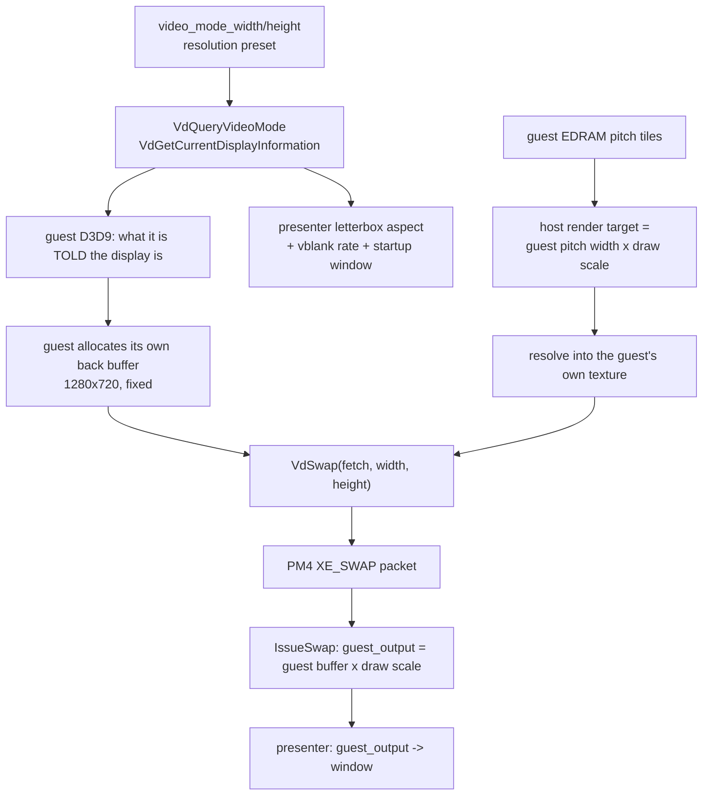

# In-game settings — resolution and graphics (P2, P4, ultrawide)

This file consolidates three records about the picture. Part 1 (P2) asks **what the title can actually render** — it is resolution-blind, offers two heights (720 and 540), and exact 1920x1080 is reached by pairing its 540 mode with the SDK's 2x draw scale (measured) or by changing one guest constant. Part 2 (P4) asks **what the graphics policy is** — which backends, resolutions, AA and filtering steps may be published, how a request is corrected without lying to the user, and what first run and failed-boot recovery do. Part 3 (ultrawide) asks **what non-16:9 costs** — three facts must change together (the frame, the layout space, the presenter), the HUD is still open, and a planner window bounds which sizes are offered at all. Evidence labels: **measured** = executed and read out of a log/capture; **source** = read from the repository; **static** = read from the recompiled guest, not observed to execute.

For shader preparation, startup reuse, failure recovery and measured limits,
see [shader-cache.md](../engine/shader-cache.md) part 9. The guest prepares known
recipes after the title A press. Dynamic combinations can still compile during
play; the catalogue is not a universal no-stutter guarantee.

## Sources

| Part | Original document | Package | Status |
| --- | --- | --- | --- |
| 1 | `docs/plans/in-game-settings-resolution-findings.md` | P2 | Complete — exact 1920x1080 reached and measured with the SDK unchanged; the two variants are documented, and the coordinator must approve/land one hook for the cleaner one |
| 2 | `docs/plans/in-game-settings-graphics-findings.md` | P4 | Complete as a host-tested lane with measured render-path evidence; the guest-side application of a 1080p guest size still needs one `[[midasm_hook]]` entry |
| 3 | `docs/plans/ultrawide-findings.md` | P2/P4 follow-on (2026-10-12) | The render path renders arbitrary aspects correctly (2560x1080 measured, no bars, no stretch); the in-game/HUD half, the black-bars menu mode, the Resolution submenu and the per-layer menu-background policy are open |

---

## Part 1 — Resolution: exact 1920x1080 (was `docs/plans/in-game-settings-resolution-findings.md`)

*Exact render resolution (1920x1080) — P2 findings*

Status: **P2 complete.** Exact 1920x1080 rendering is **reached and measured** (§1 and §5) with the SDK unchanged; no production cutover, no installer or Controller Settings change, and no user-visible setting is in this pass. What remains is choosing between the two 1080p variants documented below and having the coordinator approve the one shared file the cleaner variant needs.

Evidence labels: **measured** = executed in this pass and read out of a log; **source** = read from the repository; **static** = read from the recompiled guest, not observed to execute.

Read with: `plan.md` §7 (the requirement and the three candidate routes), `contracts.md` §7.1 (the frozen AA mapping) and §5.3 (the `CapabilitySnapshot` fields P4 must publish), `../plans/finished/2026-09-27-launcher-plan.md` D12's 2026-10-08 amendment (the earlier, now-confirmed conclusion).

### 1. Verdict

**Exact 1920x1080 is reachable today, with no SDK change, by combining the title's own half-resolution screen mode (960x540) with the SDK's existing 2x draw scale: 960 x 2 = 1920 and 540 x 2 = 1080.**

The title is resolution-blind in the sense that it ignores the video mode and has no 1080p path of its own — its screen-size decision offers exactly two heights, **720 and 540**, and derives the width as `height * 16 / 9`. But that is enough, because 960x540 is an exact 1/2 of 1920x1080, and the SDK's integer draw scale is exactly the mechanism the project already ships as "2x = 1440p" for the 720p guest (launcher-plan.md D12).

Measured, one boot (`out/_swap/p2/halfres2x.log`), title in its 540 mode and `resolution_scale = 2`:

```text
swapdims d3d12: guest_output=1920x1080 packet=960x540 packet_unscaled=960x540
                resolve_dest_scaled=1920x1080 draw_scale=2x2 source_is_scaled=true
rtdims   d3d12: host_extent=1920x2736 pitch_tiles_at_32bpp=12 msaa_samples=1 depth=0 ... draw_scale=2x2
```

The render target is **1920** px wide (2736 is EDRAM padding, which §7.1 of the plan explicitly allows), the resolve destination is 1920x1080, and the presented image is 1920x1080.

Two variants, both real, and the difference is what the *guest's own layout* is authored at:

| | A — 960x540 guest x 2x scale | B — 1920x1080 guest x 1x scale |
| --- | --- | --- |
| Render target | 1920x1080 (measured) | 1920x1080 |
| Presented image | 1920x1080 (measured) | 1920x1080 |
| SDK change | none | none |
| Guest change | take the title's own 540 mode | one instruction: its 720 constant becomes 1080 |
| Cost | the title's half-resolution mode, whose other effects are not established | none |
| Status | **measured working** | designed; needs one `[[midasm_hook]]` entry |

Variant A is what a hook can do today. Variant B is strictly better — the title lays its own UI, HUD and effects out at 1080p and the scale stays 1 — and it is one word of guest code: at guest `0x823F382C` the title loads `720`; with `1080` there, its own `height * 16 / 9` produces **1920**, and nothing else has to change. `config/functions.toml` is the coordinator's file (§9.1 of the contracts), so that entry is a request to the coordinator, not a worker edit.

The plan's two forbidden substitutes are still forbidden and still unnecessary: neither variant resizes a window, changes a reported video mode, supersamples-and-downscales, or moves a label.

### 2. What was measured, in one table

Three boots of the instrumented dev build (`out/build/win-amd64-release`), disposable config/save root, D3D12 backend, `--log_level=debug`. The evidence logs are `out/_swap/p2/*.log`.

| # | Run | Guest video mode | Draw scale | Guest output presented | Resolve destination | Render target (host extent) |
| --- | --- | --- | --- | --- | --- | --- |
| A | `baseline.log` | 1280x720 | 1x1 | **1280x720** | 1280x720 (unscaled) | 640x1024 (4xMSAA), 1280x2048 (1x) |
| B | `videomode1080.log` | **1920x1080** | 1x1 | **1280x720** | 1280x720 (unscaled) | unchanged from A |
| C | `scale2.log` (boot/splash present) | 1280x720 | 2x2 | 1280x720 | 1280x720 (unscaled) | 1280x2048 (4xMSAA), 2560x4096 (1x) |
| C | `scale2.log` (later present) | 1280x720 | 2x2 | **2560x1440** | 2560x1440 (scaled) | as above |

Verbatim, from `out/_swap/p2/videomode1080.log` (this is the decisive line):

```text
[debug] [core] swapdims d3d12: guest_output=1280x720 packet=1280x720 packet_unscaled=1280x720
        resolve_dest_scaled=1280x720 display=1920x1080 draw_scale=1x1 source_is_scaled=false
```

`display` is the video mode the SDK reports to the guest; `guest_output` is what the guest actually handed to `VdSwap` and what the presenter displays. **The guest was told 1920x1080 and presented 1280x720, and its render targets did not change at all.** That is run B and A differing in exactly one field.

And from `out/_swap/p2/scale2.log`, the two swap states of a single boot:

```text
[warning] [gpu] D3D12 draw resolution scaling is enabled, but the swap source is unscaled (1280x720).
                This title may be presenting from an unscaled resolve path.
[debug] [core] swapdims d3d12: guest_output=1280x720   ... draw_scale=2x2 source_is_scaled=false
[debug] [core] swapdims d3d12: guest_output=2560x1440  ... draw_scale=2x2 source_is_scaled=true
```

So the existing integer multiplier **is** truthful once the title's own resolve path is running (`2x` really presents 2560x1440 — the "1440p" Controller Settings' `choice_labels` promise), and the boot/splash present before it is the SDK's own known unscaled-resolve case. 1080p is not an integer multiple of 720p, so no value of this multiplier reaches it.

### 3. How a guest frame becomes host pixels

Two independent numbers, which is the whole reason the video mode does not help:



- **Presentation source.** `rexglue-sdk/src/graphics/d3d12/command_processor.cpp:1894` `IssueSwap` takes the front-buffer size out of the PM4 `XE_SWAP` packet, which `rexglue-sdk/src/kernel/xboxkrnl/xboxkrnl_video.cpp:441-533` `VdSwap_entry` writes from the *guest-supplied* `width`/`height` pointers, cross-checked against the guest's texture fetch header (`assert_true(*width == 1 + gpu_fetch.size_2d.width)`). [source]
- **Render target size.** `d3d12/render_target_cache.cpp` `CreateRenderTarget`: `Width = key.GetWidth() * draw_resolution_scale_x()`, `Height = GetRenderTargetHeight(key.pitch_tiles_at_32bpp, key.msaa_samples) * draw_resolution_scale_y()`. `key.GetWidth()` comes from the guest's own EDRAM pitch in `RB_SURFACE_INFO`. [source]
- **The video mode never enters either.** `video_mode_*` (defined in `rexglue-sdk/src/ui/window.cpp` — 1280x720 defaults) reaches only: `VdQueryVideoMode`/`VdGetCurrentDisplayInformation` (`xboxkrnl_video.cpp`), the guest vblank timer (`graphics_system.cpp:153-156`), two synthesized GPU registers (0x194C, 0x1961), the startup window size (`window_sdl.cpp:56-100`, patch 0014), and the presenter's letterbox aspect. It is never multiplied into a render target. [source]
- **The presenter then scales** the guest output to the window with `present_letterbox` and `present_safe_area`, using the *video-mode* aspect rather than the front buffer's (`rexglue-sdk/src/ui/presenter.cpp:900-963`). This is why run B *looks* different without the picture being any larger: the same 1280x720 image lands in a 1920x1080-shaped region.

### 4. Why the title is resolution-blind [static]

The three video-mode import thunks exist in the guest image — `VdSwap` at **0x827F6874**, `VdGetCurrentDisplayInformation` at **0x827F69A4**, `VdQueryVideoMode` at **0x827F69C4** (`generated/default/rb_blitz_init.cpp:38384-38405`) — but **no recompiled game code references any of them**: a search of `generated/default/rb_blitz_recomp.*.cpp` for `sub_827F69A4`, `sub_827F69C4`, `sub_827F6874` and for the bare literals finds only the thunk bodies themselves. The title does not ask what the display is; it decides 1280x720 for itself. (The swap call itself therefore goes through the XEX import descriptor rather than a statically visible branch — see §5.2.)

This is the same conclusion `launcher-plan.md` D12 reached on 2026-10-08 ("setting the guest's video mode never scaled the picture — only the window and the mode the title reports"), now confirmed with instrumentation instead of a visual comparison.

### 5. The route, as it is now

#### 5.0 Where the title's screen size is decided [static + measured]

The decision is **inside the guest function `sub_823F3698` (guest 0x823F3698)**, which writes a process-global at guest **0x8298ACA8**:

- `+68` = the height, `li r11,720` (0x823F382C) normally, `li r11,540` (0x823F3834) when bit 0 of `+796` is set at 0x823F3804;
- `+64` = the width, computed from that height as `height * 16 / 9` (0x823F3868) or `height * 4 / 3` (0x823F3860) — 1280x720, 960x540, or 960x720 for a 4:3 display.

Two measurements fix the behaviour:

- Pressing bit 0 of `+796` at function entry makes the title take its own 540 path, and the guest frame follows: `packet_unscaled` became **960x540** and the EDRAM pitch fell from 16 to 12 tiles (`out/_swap/p2/halfres2x.log`). Poking `+64`/`+68` **after** the call does *not* change the frame (measured in `out/_swap/p2/screen1080.log`), so the frame is built inside this function from the height it chose, not read back from the two fields.
- The frame size follows the height the title picks, which is exactly the lever Variant B uses.

Also measured: `video_mode_width/height` never reach this code — with the video mode at 1920x1080 the fields still said 1280x720 and the frame was unchanged (§3, run B).

#### 5.1 What follows

The two variants are the §1 table: A needs no guest change beyond forcing the title's 540 mode (the measured 1920x1080); B is the same function's `720` immediate changed to `1080`, after which the title computes `1080 * 16 / 9 = 1920` itself with the scale at 1. B is a one-line `[[midasm_hook]]` entry in the coordinator-owned `config/functions.toml`, or a C++ override of `sub_823F3698` that reproduces the two stores (what the P2 spike hook does today, minus the 1080 constant).

#### 5.2 What neither variant has proved yet

The plan's acceptance proof (§7.1) asks for, at 1280x720, **1920x1080**, 2560x1440 and 3840x2160: menus, a song, depth-of-field on/off, native AA and FXAA, aspect preservation, UI/mouse-coordinate mapping, DLC transitions, and restart — with render-target, viewport and resolve instrumentation, on both backends. Neither variant has been taken through that matrix; §1 is a boot-level measurement of the render target, resolve destination and presented image, which is the P2 bar (G2) rather than the P4 bar.

Both variants keep the guest's EDRAM pitch honest: the render width is the pitch in tiles at 32bpp (16 tiles = 1280 px at 720p, 12 tiles = 960 px in the 540 mode), and the height is EDRAM-padded (2048 px, or 2736 px with the 2x scale). That padding is allowed; the *active* image is what has to match.

#### 5.3 Ruled out by measurement

- **Do not tune the video mode.** Run B proves it changes nothing but `display`, the letterbox aspect and the window. It is not a lever for the picture — the title never reads it.
- **Do not poke the engine's two size fields after the fact.** `+64`/`+68` set post-call leave the frame at 1280x720 (`out/_swap/p2/screen1080.log`); the frame is built inside `sub_823F3698`.
- **There is no disabled 1080p path to re-enable.** The title's size decision offers 720 and 540 and nothing else; the route is arithmetic (`540 * 2 = 1080`, or `1080 * 16 / 9 = 1920`), not a flag.
- **No SDK work is needed for either variant.** §6 only matters if a size that is not `k/2^n` of 1280x720 has to be supported later.

### 6. Not needed for 1080p — the fractional-scale fallback, and what blocks it

Both variants reach 1920x1080 with the SDK untouched, so nothing in this section is on the critical path for the requested feature. It is what any size that is not `k/2^n` of 1280x720 would need (for example 2560x1440 from the 540 mode, or a non-16:9 render size), and a 1.5x step in the host render path is a model change rather than one `int`:

| Assumption | Where |
| --- | --- |
| Scale is a per-axis integer 1..7, clamped and reported | `rexglue-sdk/src/graphics/pipeline/texture/cache.cpp:236-247`, `kMaxDrawResolutionScaleAlongAxis` (`include/rex/graphics/pipeline/texture/cache.h:63`) |
| The scale is packed into **3 bits** of the resolve coordinate info | `include/rex/graphics/util/draw.h:375-376`, asserted at `src/graphics/util/draw.cpp:894-897` |
| Host render target extent = guest extent × scale | `d3d12/render_target_cache.cpp` `CreateRenderTarget`; `vulkan/render_target_cache.cpp:1871-1873` |
| Viewport/scissor extents are multiplied by the scale, with a truncating divide for unscaled bounds | `src/graphics/util/draw.cpp:332,376-385`; scissor at `d3d12/command_processor.cpp:2454-2458` |
| Resolve tiles are integer multiples of the scale | `vulkan/render_target_cache.cpp:2616-2617,5528-5535,4566-4572` |
| Resolve-copy shaders have scaled and unscaled variants only | `vulkan/render_target_cache.cpp:626-628,864-879`; `draw_util::ResolveCopyShaderIndex` |
| Half-pixel/NDC conversion divides by the unscaled extent | `src/graphics/util/draw.cpp:345-353` |
| Texture and scaled-resolve host extents fold in the same integers | `src/graphics/pipeline/texture/cache.cpp:779-784`; `vulkan/texture_cache.cpp:1040-1041` |

A float `draw_resolution_scale` would be exactly the substitute the plan forbids. A coherent design would be a separate "arbitrary-size render target" path with its own resolve shader, not a widened integer.

### 7. What was done, and what was not

**Done**

- Isolated investigation branch `p2-exact-1080p` (from `1e40765`).
- Instrumentation landed as a reviewable SDK patch: `patches/rexglue-sdk/0015-render-resolution-instrumentation.patch` (3 files, ~80 added lines, debug level, one line per *changed* dimension tuple, silent at the default log level). It adds no cvar, changes no behaviour, and `scripts/setup/apply_sdk_patches.ps1 -Check` accepts it (exit 0, all edited SDK files reported `patched`).
- Spike instruments in `src/diag/probe_points.cpp`, both gated by `Diagnostics` cvars that default off: `probe_screen_1080p` (presses the title's half-resolution flag at entry to `sub_823F3698` and reports what it chose) and `probe_dump_guest_swap` (dumps the guest present object once). With both off they are a pass-through call to the original plus one `REXCVAR_GET`.
- **Six boots measured**, including the exact 1920x1080 result in §1; evidence in `out/_swap/p2/*.log`.
- `ctest` 26/26 pass with the instrumented SDK (the tree also carries P1/P3's uncommitted work).
- Static map of the blocking assumptions in §6, and of the title's size decision in §5.0.

**Not done**

- **No GPU capture, and no per-draw viewport instrumentation.** The measured quantities are the guest's front-buffer size, the resolve destination size, the host render-target extent and the draw scale. The viewport is *derived* from the same scale by the code in §6 and was not logged per draw, so a GPU capture is still the independent confirmation P4 should take.
- **Vulkan is instrumented but unproven.** The Vulkan swap log was written and compiles, but every measurement here is D3D12 (the backend this machine uses). Vulkan's render-target cache was deliberately left uninstrumented.
- **No menu/song/AA/restart matrix** (§5.2) and no decision between Variant A and Variant B.
- No installer, Controller Settings, schema or user-visible change of any kind.
- Guest timing was not touched: every run used the build's own V-Sync and 60 Hz guest tick.

**Known noise in this work**

- The dev build tree `out/build/win-amd64-release` is **shared** with the concurrently running P1 and P3 lanes in this working tree; it is not the per-lane `out/build/win-amd64-release-p2` the contracts reserve. The instrumented SDK is therefore compiled into the binary every lane builds. Nothing in the instrumentation is reachable without debug logging, but the isolation rule was not honoured and a lane that needs a clean compare should use its own tree.
- A cvar defined inside the GPU plugin (`rexgpu-xenos.dll`) cannot be set from `rb_blitz.toml` or the command line: the config is applied before the plugin registers its cvars, and the boot reports `Config: unknown cvar '<name>'`. This is why the instrumentation is gated by log *level* instead of a cvar, and it is worth recording for P4 — `resolution_scale` is affected by the same ordering (the profile row for it is currently refused with "resolution_scale = 2 was refused by this build"). Setting it through the environment (`REX_RESOLUTION_SCALE=2`) does work, which is how run C was made.

### 8. Handoff to P4

- **Requirement:** exact 1920x1080 **render**, not output size — reached and measured (1920x1080 render target, resolve destination and presented image, §1). Variant A = title's own 960x540 mode + `resolution_scale = 2` (measured, no SDK change; caveat = the half-resolution mode's other effects are not established); Variant B = the `720` immediate at guest `0x823F382C` becomes `1080`, its own `* 16 / 9` yields 1920 at scale 1.
- **Coordinator action asked for:** approve and land that one `[[midasm_hook]]` entry in the coordinator-owned `config/functions.toml` (or an equivalent C++ override of `sub_823F3698`), then Variant B is testable the same way Variant A was.
- **P4's work:** the §7.1 matrix at 1920x1080 (menus, a song, DoF, AA/FXAA, aspect, UI/mouse mapping, DLC, restart) with per-draw viewport instrumentation and a GPU capture; then the offer/reconcile logic around the chosen variant.
- **Instrumentation:** `patches/rexglue-sdk/0015-render-resolution-instrumentation.patch`; enable with `--log_level=debug`, grep `swapdims` / `rtdims`. Spike hooks: `probe_screen_1080p`, `probe_dump_guest_swap`.
- **Backend coverage:** D3D12 measured; Vulkan instrumented at the swap only.
- **Facts P4 can rely on:** the video mode is not a render lever (measured); the guest never calls the video-mode thunks (static); the existing integer multiplier presents 2560x1440 at 2x once the title's resolve path runs, leaving the boot/splash present unscaled (measured).
- **Capability fields:** §5.3 of the contracts already asks P4 for `supported_resolutions`; this spike adds nothing to that shape, it only proves which sizes the current implementation can actually reach.

### 9. Reproduction

```powershell
# from the repository root, after the SDK patches are applied and the build is up to date
powershell -NoProfile -ExecutionPolicy Bypass -File out\_swap\p2\run-probe.ps1 -Label baseline -Seconds 150
powershell -NoProfile -ExecutionPolicy Bypass -File out\_swap\p2\run-probe.ps1 -Label videomode1080 -Seconds 170 -Extra "--video_mode_width=1920;--video_mode_height=1080"
$env:REX_RESOLUTION_SCALE='2'
powershell -NoProfile -ExecutionPolicy Bypass -File out\_swap\p2\run-probe.ps1 -Label scale2 -Seconds 170
Remove-Item Env:\REX_RESOLUTION_SCALE
```

`out/_swap/p2/run-probe.ps1` boots the dev build against a **disposable** config/save root (`out/_swap/p2/_scratch`, reused so the per-title shader cache stays warm — a cold one costs ~90 s before the guest's first present), drives it with `scripts/diagnostics/drive_ui.ps1`, kills it, and prints every `swapdims`/`rtdims` line. It never reads or writes the user's live profile, DLC library, save or song cache. The first present of a cold boot appears ~90 s in; the guest's window is up long before that. A boot also reports the unscaled-resolve case the SDK already knows about, which is useful as a self-check:

```text
[warning] [gpu] D3D12 draw resolution scaling is enabled, but the swap source is unscaled (1280x720).
```

### 10. Evidence index

- `out/_swap/p2/baseline.log` — Run A: guest output, resolve destination and render-target extents at 720p / 1x.
- `out/_swap/p2/videomode1080.log` — Run B: `display=1920x1080` with `guest_output=1280x720` and unchanged render targets.
- `out/_swap/p2/scale2.log` — Run C: `draw_scale=2x2`, scaled render targets, and the two present states of one boot (unscaled splash, 2560x1440 title).
- `out/_swap/p2/screen1080.log` — poking the engine's `+64`/`+68` after the fact does not move the frame (still 1280x720).
- `out/_swap/p2/after1080.log` — the choice is not persisted either: the next boot is 1280x720 again.
- `out/_swap/p2/halfres2x.log` — **the 1920x1080 result**: 540 mode x 2x scale, `packet_unscaled=960x540`, `host_extent=1920 px`, `resolve_dest_scaled=1920x1080`, `guest_output=1920x1080`.
- `out/_swap/p2/dumpswap.log` — the guest present path and the object it presents from (partial; the dump's object pointer is not yet the D3D one).
- `out/_swap/p2/run-probe.ps1` — the runner that produced every boot above (scratch, gitignored).
- `patches/rexglue-sdk/0015-render-resolution-instrumentation.patch` — the instrument itself.
- `src/diag/probe_points.cpp` (`probe_screen_1080p`, `probe_dump_guest_swap`) — the guest-side spike instruments, off by default.

---

## Part 2 — Graphics capabilities, exact modes and first-run policy (was `docs/plans/in-game-settings-graphics-findings.md`)

*In-game settings — P4 graphics capabilities, exact modes, first-run policy*

Status: **P4 complete as a host-tested lane, with measured runtime evidence for the render path and the per-draw extents.** The pure half (capabilities + reconciliation + first-run + recovery) is implemented and tested: 146 host checks in a new `settings_graphics` ctest test, 28/28 tests green. The render path's *decision* is implemented and tested (`PlanGuestScreen`); the guest-side *application* of a 1080p guest size still needs the coordinator's one `[[midasm_hook]]` entry, and that request is written out verbatim in §7. No cutover, no installer change, no Controller Settings change, no UI.

Read order: `contracts.md` (frozen names and the §5.3/§7.1 shapes P4 fills) → Part 1 (P2's measurements, which P4 extends) → `architecture.md` (the `Reconciler` seam P4 implements) → this file.

Evidence labels: **measured** = executed/observed in this pass; **source** = read from the repository; **frozen** = a P0 decision; **P4 addition** = a delta this pass had to make, recorded for coordinator review.

### 1. Verdict in one paragraph

P4's four asks — publish truthful capabilities, implement the graphics reconciliation, implement a measured first-run policy plus a bounded failure route, and finish P2's render path on the backends this build offers — are all done except the last step's *guest-side application*, blocked on one coordinator-owned line (§7). The capability compilation and the whole reconciliation policy are pure, tested host logic that never lies about a backend, never offers a step the device has not proved, never re-optimizes a valid manual choice, and never erases a request because a monitor was unplugged. The render path is proven at **1920x1080 with per-draw viewport and scissor instrumentation** — the gap P2 left open — on the one backend this build contains (D3D12; Vulkan is not compiled here, §9).

### 2. Baseline, build and test record (measured, 2026-10-11)

| Item | Value |
| --- | --- |
| Baseline | `1e40765`, branch `main` (tree shared with the P1/P2/P3 lanes, as recorded in P3's doc) |
| New files | `src/settings/capabilities.{h,cpp}`, `src/settings/graphics_policy.{h,cpp}` |
| New test | `tests/settings_graphics_tests.cpp` (ctest name `settings_graphics`, **146 checks**) |
| Shared file touched | root `CMakeLists.txt` — one `add_executable`/`add_test` block inside `BUILD_TESTING` only |
| SDK patch | `patches/rexglue-sdk/0015-render-resolution-instrumentation.patch` **extended** (P2's swap/RT totals + P4's per-draw viewport/scissor); it is the only patch that touches those three files |
| Tests | **28/28 pass** (`ctest --test-dir out/build/win-amd64-release --output-on-failure`, 11.3 s) |
| SDK audit | `scripts/setup/apply_sdk_patches.ps1 -Check` → exit 0, `38 patched, 0 UNEXPECTED, 0 untracked` |
| This machine | 4 logical processors; primary display **2560x1080**; **D3D12 built, Vulkan not built** (`REXGLUE_USE_D3D12=ON`, `REXGLUE_USE_VULKAN=OFF` in the build cache) — **amended 2026-10-13:** the Windows presets now configure `REXGLUE_USE_VULKAN=ON`, so this is the state the measurements below were taken in, not the tree today |

```powershell
# Repository root
cmake --preset win-amd64-release
cmake --build --preset win-amd64-release
ctest --test-dir out/build/win-amd64-release --output-on-failure     # 28/28
powershell -NoProfile -ExecutionPolicy Bypass -File scripts\setup\apply_sdk_patches.ps1 -Check
```

The two new modules are SDK-free and compile standalone (`clang++ -std=c++23 -Isrc`, same source set as `rb_blitz_settings_service_tests` plus the two new files).

### 3. What each new file is

| File | Contents |
| --- | --- |
| `capabilities.h/.cpp` | `RenderPathLimits`, `RenderPathSizes`, `RendererProbe`, `CapabilityInputs`, `SupportedResolutions`, `NormalizeDisplayModes`, `BuildCapabilitySnapshot`, `ActiveRenderer`, `FindRenderer`, `IsSupportedResolution`, `LargestSupportedFitting`, `SmallestSupported`, `DisplayModeToken`, `ParseDisplayModeToken`. |
| `graphics_policy.h/.cpp` | `IsGraphicsRow`, the correction/validation reason keys, `AntiAliasingTokens`, `FilteringTokens`, `PolicyRenderer`, `GuestScreenPlan`/`PlanGuestScreen`, `GraphicsReconciler` (P0's `Reconciler`), `GraphicsRecommendation`/`RecommendGraphics`, `GraphicsBootMarker`/`GraphicsFallbackWarranted`/`RecoverGraphics`. |

Both are P4-owned: they are new file names in `src/settings/`, not edits to P3's `{model,schema,store,migration,paths,service,cvars}.*`. `graphics_policy.cpp` includes `settings/service.h` for the `Reconciler` base and `settings/cvars.h` for the filtering value map; neither is modified.

### 4. The capability rules (frozen here, tested)

`BuildCapabilitySnapshot` enforces three "do not lie" rules. All three are the difference between a selector a user can trust and one that offers what the machine cannot do.

1. **A backend is usable only if it initialized.** `RendererProbe` carries `built`, `detected`, `usable` and `active` as four separate facts, and a renderer that is none of them is not published at all. A present Vulkan loader makes a renderer `detected`, never `usable` — the plan's "do not list an unusable backend just because its DLL or Vulkan loader is present". `ActiveRenderer` refuses to guess when two renderers are usable and neither is marked active.
2. **`supported_resolutions` is exact render dimensions, not output sizes.** It is `RenderPathSizes` (each guest base size x each offered draw scale, above the offer ceiling trimmed away, deduplicated, ordered by area then width) trimmed to the primary display. Measured consequence on this machine (2560x1080, bases 720p and 1080p, scales 1..3): the offer set is exactly **1920x1080 and 1280x720** — 2560x1440 does not fit the 1080-px-tall display.
3. **A failed enumeration is not evidence.** With no monitor query the producible set is published unchanged, and a display smaller than everything producible still gets the smallest producible size. A row's choice list is therefore never empty and never shrinks because a monitor was unplugged for one boot.

The list is deterministic (area desc, width desc, height desc), so the UI order is stable across boots.

### 5. The graphics policy (tested)

#### 5.1 Which rows, and against which renderer

The policy owns `kResolution`, `kRenderer`, `kAntiAliasing`, `kFiltering`. `Vsync` is a graphics-category row but not capability-dependent, so it keeps the default reconciler's kind/choice check.

AA and filtering are evaluated **for a named renderer**, defaulting to the active one (`PolicyRenderer`). That is what makes contracts §6.3's "a renderer change revalidates AA/filtering/resolution together" implementable: `ValidateForRenderer(id, …, renderer_token)` refuses an acceptance that was valid for the previous backend instead of clamping it by index.

#### 5.2 Choice sets come from the device, not the device's advertisement

| Row | Offered | Gate |
| --- | --- | --- |
| `anti_aliasing` | `none`, `fxaa`, `fxaa_extreme` | always, for any usable renderer |
| `anti_aliasing` | `+ native` | only when the renderer's `native_aa_label` is non-empty — an unproved native path does not ship (contracts §7.1) |
| `filtering` | `native`, `none` | always (ceiling 0 or more) |
| `filtering` | `+ 1x/2x/4x/8x/16x` | only up to the renderer's `filtering_ceiling`; a "16x" label is never written as 16 |

P5's menu should show exactly these lists rather than the static schema choices; no P3 schema change is needed for that (the functions return the tokens in presentation order).

#### 5.3 Correction is deterministic and never silent

| Case | Effective | Reason key |
| --- | --- | --- |
| Requested resolution not offered, and exceeds the primary display (4K on a monitor that is now 1080p) | the largest offered size that fits | `settings.graphics.for_display` |
| Requested resolution not producible at all (e.g. 1600x900) | the largest offered size that fits | `settings.graphics.unsupported` |
| Requested renderer gone (a backend stopped initializing) | the active renderer (or the only usable one) | `settings.graphics.renderer_unavailable` |
| `native` AA, device never verified it, FXAA offered | `fxaa` | `settings.graphics.aa_unavailable` |
| Filtering step above the ceiling | the highest offered step at or below both the request and the ceiling; `native` if none qualifies | `settings.graphics.filtering_ceiling` |

Two invariants the tests pin: **a valid manual choice is never re-optimized** (a 720p request on a 4K monitor stays 720p; a shorter filtering step is never raised), and **the request is never modified** — only `effective` changes, so the user's 4K survives a boot on a 1080p monitor (contracts §5.2). With no enumeration the same 4K request is left completely alone.

`Set` refusals carry their own keys (`…unsupported_resolution`, `…renderer_unavailable_choice`, `…aa_unavailable_choice`, `…filtering_unavailable_choice`); where the row's own choice list already excludes the value, the service's `settings.invalid_choice` stands.

#### 5.4 First run and failure recovery

`RecommendGraphics` uses measurements only:

* **Measured machine** → the primary display's largest renderable size (1920x1080 here, 3840x2160 on a 4K primary), the backend this boot actually uses, `native` AA **only** when the device verified its sample semantics, and `native` filtering. Filtering deliberately stays the title's own choice: the ceiling is a fact that bounds what the user may *pick*, not a preference to impose, and `anti_aliasing`'s `native` is the one field the measurement genuinely gates.
* **Unknown hardware** (no usable renderer, or no producible size) → the bounded conservative route: 1280x720, the only usable backend (d3d12 as the last resort), `none`, `native`, with `conservative = true` and `settings.graphics.recommended_conservative` so the UI can say why.

`GraphicsFallbackWarranted(marker)` is `attempted && !presented` — a first run or a boot that never reached presentation is not a graphics failure. `RecoverGraphics` returns the request untouched when no failure is recorded (no boot-time re-optimizing) and the safe floor when one is: **1280x720, the active backend, `none`, `native`** — the combination that presented on every machine this project measured — with `settings.graphics.recovered_from_failure`. The durable marker's shape is P4's (`GraphicsBootMarker`); *where* the boot writes and clears it is the coordinator's wiring, like P3's storage wiring.

**The journal's retry policy (measured 2026-10-15).** `GraphicsBootState` (`src/settings/graphics_boot.{h,cpp}`) is the durable half — a per-profile `<settings>.graphics-boot.toml` that never rewrites the preferences file, protected from a concurrent live boot by a process-lifetime lock. Its rules, after the installed copy exposed a latch that outlived its failure (the installed-copy review's P8):

* A boot that begins an attempt (`Begin`) and dies before the menu frame (`Presented`) leaves `pending`; the next boot at the **same request** recovers to last-known-good.
* That request is then **retried exactly once** on a later boot: a retry that presents clears the recovery (the request proved itself), a retry that dies keeps the recovery until the request changes. Bounded, not an endless retry — a preference that fails twice stays on last-known-good.
* A **clean close** before the menu frame (`Closed`) clears `pending` without spending the retry: quitting during a load is not a verdict on the request.
* The signature keys on what the player **chose** (`RequestedValue`; `'auto'` renders as its own token), never on what it resolves to — so changing Auto to the size it already resolves to earns a fresh attempt, while the *effective* values decide only whether recovering would be a no-op (then the safe floor is used instead).

Measured against the owner's real journal, copied verbatim into a disposable root (`out/_swap/gfx-journal/`, 2026-10-15): the latched request the old build silently downgraded to 1280x720 logs `settings_boot: the saved graphics request failed to present before; this boot retries it once` and boots the wide mode (guest 1280x540 x2, `video_mode 2560x1080`, presented); `resolution = 'auto'` boots wide through the same journal (a changed choice is a fresh attempt); and changing the row then answering **Restart now** boots the child into the new size (`restart2` leg: 960x540 x2 = 1920x1080). The same fixture measured the restart prompt's gate: `RestartPending()` compares each row's *current effective* value against the boot's baseline, so Auto → the size it already resolves to raises **no** prompt (`restart` leg: no restart requested, because nothing would change), while a change that alters the effective size does (`restart2`). The pre-fix boots and the poisoning journal itself are kept under `out/_swap/gfx-journal/owner/`. `settings_graphics` pins the state machine (recover → retry → heal; a second failure latches; a clean close keeps the retry; a changed choice re-attempts even on the same pixels).

**Not wired (open):** the *recovered* state is visible in the log only — the menu-facing "show `settings.graphics.recovered_from_failure` when `GraphicsFallback::needed`" item in the UI table is still undone, and the latched (second-failure) case keeps showing the requested value while the boot runs last-known-good.

### 6. The render path: the guest-size plan, and what was measured

#### 6.1 The planner (implemented, tested)

P2 established that the title picks a guest screen size and the SDK multiplies it by an integer draw scale. `PlanGuestScreen(limits, requested)` is the inverse and is the whole of the render path's decision:

| Requested render size | Guest size | Draw scale |
| --- | --- | --- |
| 1280x720 | 1280x720 | 1 |
| 1920x1080 | 1920x1080 | 1 |
| 2560x1440 | 1280x720 | 2 |
| 3840x2160 | **1920x1080** | **2** |

The largest guest size that divides the request by an offered scale wins, so 3840x2160 plans as 1080p x 2 (a crisp UI) rather than 720p x 3 (a blurry one), and both are exact. Every size in `RenderPathSizes` plans back to exactly itself — the two directions are tested against each other. Without the 1080p guest height, `PlanGuestScreen(1920x1080)` reports `supported = false`, so an unreachable 1080p is never offered as if it worked.

#### 6.2 Per-draw extent evidence (measured, the gap P2 left)

P2's instrumentation reported swap-time and render-target totals. P4 extends the same patch with the **per-draw host viewport and scissor** — the independent confirmation P2's handoff asked for — each tuple logged exactly once per boot at debug level.

Evidence: `out/_swap/p4/baseline720.log` (no flags) and `out/_swap/p4/halfres2x_1080p.log` (`REX_RESOLUTION_SCALE=2` + `--probe_screen_1080p=true`, i.e. P2's measured Variant A).

| | 720p baseline | 1920x1080 (Variant A) |
| --- | --- | --- |
| `guest_output` (presented) | 1280x720 | **1920x1080** |
| `packet_unscaled` (guest buffer) | 1280x720 | 960x540 |
| `resolve_dest_scaled` | 1280x720 | **1920x1080** |
| `draw_scale` | 1x1 | 2x2 |
| host render target width | 1280 px (16 tiles) | **1920 px** (12 tiles) |
| `msaa_samples` seen | 0 and 2 | 1 and 2 |
| per-draw **viewport** | `w=1280 h=720` scale 1x1 | **`w=1920 h=1080` scale 2x2** |
| per-draw **scissor** (main rect) | `r=1280 b=720` | **`r=1920 b=1080`** |

The 1920x1080 numbers are the same render-target/resolve facts P2 measured, now with the per-draw viewport and scissor that a GPU capture would show. The swap source is `source_is_scaled=true` once the title's own resolve path runs (the same self-check P2 documented). The distinct-tuple sets contain no other full-screen rectangle, i.e. nothing in the frame is being drawn at a different scale from the one the swap advertises.

A rendered frame at 1920x1080 is captured in `out/_swap/p4/menu1080p.png` (the title screen, in colour, with its scrolling-background shader and button prompt — a composed frame, not a loading stage).

#### 6.3 Which route this is, honestly

The table above is **Variant A** — the title's own half-resolution (960x540) mode times draw scale 2. It reaches exactly 1920x1080 and needs no guest change, which is why it could be measured today. It is *not* the product route: the guest lays its UI and HUD out at 960x540 and the host upscales them 2x, and P2 recorded that the half-resolution mode's other effects are not established. The product route is **Variant B** (§7) — the guest at a real 1920x1080 with the scale left at 1 — and P4's planner is written for it: `PlanGuestScreen` returns `{1920x1080, scale 1}` for the 1920x1080 request, which is exactly the Variant B combination, and the base-size list that makes it reachable is `{{1280,720},{1920,1080}}`.

### 7. The one thing P4 needs from the coordinator (exact request)

P2 asked for a single `[[midasm_hook]]` entry; P4 confirms the request and can now write it precisely. `sub_823F3698` loads the height into `r11` at guest **0x823F382C** (`li r11,720`; the 540 path at 0x823F3834 is selected by bit 0 of `+796`). Changing that immediate to **1080** makes the title compute `1080 * 16 / 9 = 1920` itself at scale 1.

`config/functions.toml` (coordinator-owned, §9.1 of the contracts) would gain:

```toml
# P4 Variant B: the title's own screen height (720) becomes 1080, so its own height*16/9
# yields 1920 and the draw scale stays 1. Guest 0x823F382C, `li r11,720`.
[[midasm_hook]]
address = "0x823F382C"
name = "RenderHeightHook"
registers = ["r11"]
after_instruction = true
```

and the project would define the handler next to the other guest hooks:

```cpp
// r11 is the register the generated call passes as ctx.r11, so the hook writes the height the
// title will use for the rest of its own size computation.
extern "C" void RenderHeightHook(PPCRegister& r11) {
  if (rb_blitz::settings::WantsGuestHeight1080()) {   // the resolution row's effective value
    r11.u32 = 1080;
  }
}
```

**Unverified, and labelled as such.** P4 did not test a midasm hook: the emitted call is `Hook(ctx.r11)` (codegen `BuilderContext::r()` returns the `PPCRegister` member, so a reference parameter binds to it), but whether the generated body reads the register back from `ctx` after the hook instead of from a cached local is a codegen property this pass did not exercise. Verification is one boot:

```powershell
$env:REX_RESOLUTION_SCALE='1'
powershell -NoProfile -ExecutionPolicy Bypass -File out\_swap\p4\run-probe.ps1 -Label variantb -Seconds 165
# expect: swapdims guest_output=1920x1080 packet_unscaled=1920x1080 draw_scale=1x1 source_is_scaled=true
#         viewport d3d12: w=1920 h=1080 draw_scale=1x1
```

If it comes back at 1280x720 the hook is not taking effect and the fallback is P2's Variant A (measured, §6.2) or a whole-function override of `sub_823F3698` — P2 ruled out poking `+64`/`+68` after the call.

### 8. Evidence index

- `tests/settings_graphics_tests.cpp` — 146 checks: every case the P4 prompt names (4K→1080p, CPU-count reduction, disappearing backend, AA/filter changes, renderer change inside an edit, missing enumeration, display removal/reconnection, unknown hardware, first-run, recovery) plus the service integration.
- `out/_swap/p4/baseline720.log` — 720p: viewport/scissor 1280x720 at scale 1x1, RT width 1280.
- `out/_swap/p4/halfres2x_1080p.log` — **1920x1080**: RT width 1920, resolve 1920x1080, viewport/scissor 1920x1080 at scale 2x2.
- `out/_swap/p4/menu1080p.png` — a composed, rendered frame at 1920x1080.
- `out/_swap/p4/report.ps1` — the summariser both logs above were read with (strips timestamps, groups by distinct tuple).
- `out/_swap/p4/run-probe.ps1` — the boot runner (disposable config/save root; reuses P2's warm shader cache).
- `out/_swap/p4/shot.ps1` — the screenshot boot.
- `patches/rexglue-sdk/0015-render-resolution-instrumentation.patch` — the instrument: `swapdims`, `rtdims`, `viewport d3d12` (`SetViewport`), `scissor d3d12` (`SetScissorRect`).

Grep inside a log: `Select-String -Path <log> -Pattern 'viewport d3d12|scissor d3d12|swapdims|rtdims'`.

### 9. Honest unknowns

* **Vulkan is not built on this machine** (`REXGLUE_USE_VULKAN=OFF`). "Finish P2's render path on every offered backend" therefore means D3D12 here, and this build offers exactly one renderer. The snapshot's `renderers` list would contain a single d3d12 entry with `usable`/`active` set, and the Renderer row would collapse to one choice — which is the truthful outcome, not a bug. A Vulkan-enabled build has not been exercised by P4; the instrumentation was written to compile for both backends (patch 0015 patches the Vulkan swap too) but the Vulkan path is unproven.
* **The midasm hook is unverified** (§7). The product route is designed and its planner is tested; the guest-side application of a 1080p guest height is one coordinator entry away and one boot from proof.
* **No host probe writes the snapshot yet.** P4 delivered the compilation (pure, tested) and the policy; the code that fills `CapabilityInputs` from the machine — `std::thread::hardware_concurrency()` for `logical_processors`, an SDL display query for `primary_display_size`/`display_modes`, and the plugin's build/detect/usable result for the renderers — is a small host step whose interface is frozen in `capabilities.h`. Its wiring (`src/settings/capabilities_probe.{h,cpp}` or a function in the existing diag code, plus the `RBBLITZ_SOURCES` entry) is the coordinator's, for the same reason P3's boot wiring is: the root `CMakeLists.txt` and `rb_blitz_app.h` belong to the coordinator. Until it lands, the runtime evidence above was produced with the render instrumentation and the P2 spike, not through the settings service.
* **The AA/FXAA visual matrix was not run.** Contracts §7.1 requires P2/P4 to prove the disabled native path meets the visible None/FXAA semantics before the labels ship. P4 gates the `native` label on a *verified* `native_aa_label` (so an unproved device does not offer it), but the visual A/B — DoF on/off, native AA vs FXAA at 1080p — is not in this pass. The instrumentation now in place (`viewport`/`scissor`/`rtdims` plus a capture) is what that A/B needs.
* **No song was played at 1080p.** The 1080p evidence is the title screen and the draw stream; a song's draw stream is the same viewport/scale (the per-draw records show no other full-screen rectangle), but a song and a restart at 1080p were not captured.
* **Restart/failure recovery is policy plus a marker shape, not a boot.** `RecoverGraphics` and `GraphicsBootMarker` are tested; no boot yet writes the marker or acts on it.

### 10. Handoff to P5

| Item | State |
| --- | --- |
| Capability schema | Frozen and filled: `CapabilitySnapshot` as contracts §5.3 defines it; `renderers[]` truthful per §4 above; `supported_resolutions` is the offer set; `primary_display_size`/`display_modes` formal. |
| Resolution choices | Use `caps.supported_resolutions` (P3's `BuildDescriptors` already fills the row from it). Show `DisplayModeToken(size)`. |
| Renderer choices | Use `caps.renderers` where `usable`; label from the token. A single usable renderer means the row has **nothing to choose, so it is not drawn at all** (owner decision, 2026-10-14 — this supersedes the table's original "keep the row, it is the honest state"). A one-entry list is a plugin built with one backend or a machine with no Vulkan loader; the row is omitted rather than shown as a single-choice select or as `Renderer: Unavailable`, and the boot names what was offered instead (`settings_menu: Renderer offers 1: D3D12 (the row is hidden: …)`, `src/hooks/settings_payload.cpp`). |
| AA choices | `AntiAliasingTokens(caps, renderer_token)` — do not use the static list; a device without a verified label must not show `native`. |
| Filtering choices | `FilteringTokens(caps, renderer_token)` — the label is the token; never write the label as a number. |
| Editing | Bind the "changed capabilities" refusal to `Service::Set`'s returned reason; call `ValidateForRenderer` for AA/filtering/resolution after a pending renderer change. |
| Overridden rows | `Service` already disables them; use `OverrideExplanation` for the text. |
| Restart prompt | `FieldState::restart_required` plus `CommitResult::restart_required`; P9 owns the mechanism. |
| Recommendation | Apply `RecommendGraphics` only to rows whose provenance is `default`/`automatic` (never over `manual`). |
| Recovery | Show `settings.graphics.recovered_from_failure` when `GraphicsFallback::needed`. |

### 11. Reproduction

```powershell
# host tests (fast, no boot)
cmake --build out/build/win-amd64-release --target rb_blitz_settings_graphics_tests
ctest --test-dir out/build/win-amd64-release -R settings_graphics --output-on-failure

# 720p baseline (per-draw viewport/scissor at scale 1x1)
powershell -NoProfile -ExecutionPolicy Bypass -File out\_swap\p4\run-probe.ps1 -Label baseline720 -Seconds 165
powershell -NoProfile -ExecutionPolicy Bypass -File out\_swap\p4\report.ps1 -Label baseline720

# 1920x1080 (Variant A: 960x540 x 2x), per-draw viewport/scissor at 1920x1080
$env:REX_RESOLUTION_SCALE='2'
powershell -NoProfile -ExecutionPolicy Bypass -File out\_swap\p4\run-probe.ps1 -Label halfres2x_1080p -Seconds 165 -Extra "--probe_screen_1080p=true"
powershell -NoProfile -ExecutionPolicy Bypass -File out\_swap\p4\report.ps1 -Label halfres2x_1080p
Remove-Item Env:\REX_RESOLUTION_SCALE
```

`REX_RESOLUTION_SCALE` is set through the environment on purpose: it is defined in the GPU plugin (`rexgpu-xenos.dll`), which registers its cvars after the config is applied, so neither `rb_blitz.toml` nor the command line can set it (P2 recorded the same ordering fact for `resolution_scale` — and it is why the resolution row's draw-scale half must be applied by the plugin's own cvar path in the coordinator's wiring, not by the settings config).

---

## Part 3 — Custom resolutions (ultrawide and taller-than-16:9) (was `docs/plans/ultrawide-findings.md`)

*Custom resolutions (ultrawide and taller-than-16:9) — findings*

**2026-10-24 update:** the HUD runtime now places anchors during WorldXfm; §9.2.7 supersedes the historical present-pass implementation and records the pending gameplay check.

Status: **the render path renders arbitrary aspect ratios correctly.** A 2560x1080 boot on this machine's own 21:9 primary monitor presents a true 2560x1080 image that fills the window — no black bars, no stretch — and the UI is laid out in the frame's own aspect. The in-game/HUD half now has a runtime seam that applies the owner's re-anchor rule (§9.2.3, §9.3) but **no boot capture has been taken with it on yet**; the optional black-bars menu mode, the `Resolution` submenu and its rows, and the per-layer menu-background policy are still open. Those are listed with their next step in §7.

Evidence labels: **measured** = executed in this pass and read out of a log or a capture; **source** = read from the repository; **static** = read from the recompiled guest, not observed to execute.

Read with: `plan.md` §7 (the resolution requirement), Part 1 (P2: the title is resolution-blind and derives its width from its height), Part 2 (P4's capability and policy shapes).

### 1. Verdict

Three separate facts had to be changed for one non-16:9 frame to render correctly. The first two were already known or already implemented; the third is what this pass found.

| # | What | Where | Before | After |
| --- | --- | --- | --- | --- |
| 1 | The frame the guest allocates | `sub_823F3698` chooses a height and derives the width as `height*16/9` | 1280x720 | **any WxH** (`RenderHeightHook` + `RenderFrameWidthHook`) |
| 2 | The space the UI is laid out in | two adjacent `9/16` floats in the image's literal pool, guest `0x8201E4CC` / `0x8201E4D0` | 0.5625 (16:9) | **1/aspect** (`WriteGuestLayoutAspect`) |
| 3 | How the guest image reaches the monitor | the presenter letterboxes with the *video mode* aspect | 1280x720 | the requested size (`video_mode_width/height`) |

Miss #2 and the frame is drawn *stretched* into a 16:9-shaped layout — which is exactly what the first attempt at a wider frame produced, and what the owner rejected. Miss #3 and the presenter squashes the (correct) guest image into a 16:9-shaped region.

Measured, one boot each, frame 1680x720 in a 2560x1080 window, the title screen's own green button disc used as the ruler (a disc is round only if the projection followed the frame's aspect):

| Arm | Frame | Layout aspect | Video mode | Capture | Green disc | Content box |
| --- | --- | --- | --- | --- | --- | --- |
| `control` | 1280x720 | 16:9 | 1280x720 | 2560x1080 | **44x42** (1.048) | 1920x1080 pillarboxed |
| `wide1b` | 1680x720 | 16:9 | 1680x720 | 2560x1080 | **58x42** (1.381) | 2520x1080 |
| `wide4` | 1280x720 | 16:9 | 1680x720 | 2560x1080 | 58x42 | 2520x1080 (presenter stretch) |
| `wide8` | 1680x720 | `0x82078CC8`=1/aspect | 1680x720 | 2560x1080 | 58x42 | 2520x1080 |
| `wide9` | 1680x720 | `0x8210DBF8`=1/aspect | 1680x720 | 2560x1080 | 58x42 | 2520x1080 |
| **`wide10`** | 1680x720 | **`0x8201E4CC/D0`=1/aspect** | 1680x720 | 2560x1080 | **44x42** (1.048) | 2520x1080 |
| **`uw-native`** | **1280x540 x2 = 2560x1080** | 1/2.370 | 2560x1080 | 2560x1080 | - | **2560x1080, no bars** |

`wide1b` against `control` is the defect quantified: **58/44 = 1.318**, while the frame grew by 1680/1280 = **1.3125**, with the height *unchanged* at 42. That is a pure horizontal stretch, not a zoom, not a crop — so the layout space, not the projection's scale, is what has to change.

The last row is the product path with no diagnostic flag: the planner chose guest 1280x540 at draw scale 2 from a requested 2560x1080, and the log reads

```text
settings_boot: guest render base 1280x540, draw scale 2 (before graphics setup)
swapdims d3d12: guest_output=2560x1080 packet=1280x540 packet_unscaled=1280x540
                resolve_dest_scaled=2560x1080 display=2560x1080 draw_scale=2x2 source_is_scaled=true
render: layout aspect 0x8201E4CC 0X3F100000 -> 0X3ED80000 (1/2.3703704 at 1280x540)
render: layout aspect 0x8201E4D0 0X3F100000 -> 0X3ED80000 (1/2.3703704 at 1280x540)
```

(`0x3ED80000` is 0.421875 = 1/2.3703704, the guest's own single-precision value. The two lines are verbatim from `out/_swap/ultrawide/final-uw.log`.)

### 2. Why the title can only ever be 16:9 (already measured by P2, restated here because everything below depends on it)

`sub_823F3698` (guest `0x823F3698`) decides the title's own screen: a height at `+68` (`li r11,720`, or `540` when bit 0 of its own `+796` is set) and a width at `+64` derived as `height * 16 / 9` (or `* 4 / 3` for a 4:3 display), with the frame's render targets built inside the function — hence poking `+64`/`+68` afterwards changes nothing (P2, `out/_swap/p2/screen1080.log`), and no game code reads the video mode (Part 1 §4). Full derivation: Part 1 §5.0.

Two levers were added to that one function, both as `[[midasm_hook]]` entries in `config/functions.toml`:

- `RenderHeightHook` at `0x823F382C` (`after_instruction`, `r11`) — already existed; P11a uses it for the 540 half-resolution mode. It can now carry any height, not just 540/720.
- **`RenderFrameWidthHook` at `0x823F3878`** (before the `stw r7,64(r30)`, registers `r7` and `r29`) — new. `r7` is the width field; `r29` is the same width carried into the two-rect table the function builds immediately after, so both have to agree or the frame and its viewport disagree. Setting both to an arbitrary width is what makes a non-16:9 frame exist at all: measured, the guest then reports `chose 1680x720` and the SDK allocates a 21-tile (1680 px) pitch render target.

`SetBootRenderFrame(width, height)` is the product seam; a width the title would have derived itself (zero, or exactly 16:9 of the height) is deliberately **not** applied, so every existing 16:9 boot — including the title's 4:3 branch — is untouched.

### 3. The layout space: the stretch, and what fixes it

#### 3.1 What was measured

The guest is told the frame is 1680x720 (the per-draw viewport log shows `viewport d3d12: x=0 y=0 w=1680 h=720`), and it draws the full frame — but it draws it *as if the screen were 1280x720*: a UI disc comes out 1.3125x wider than tall. So the engine maps a fixed 1280x720-shaped space onto the frame, and the width it maps is `height * 16/9`, computed *before* anything this project controls.

Three candidate mechanisms were tested and two were falsified:

| Hypothesis | Test | Result |
| --- | --- | --- |
| The guest derives its layout width from the height somewhere else | every `rlwinm ...4,0,27` (x16) followed by a `divw` in the recompiled image | **exactly one site in the image** — the frame width this project already hooks. The layout width is not arithmetic. |
| The engine's 16/9 literal in read-only data, guest `0x82078194` | wrote `2.3333333` there for one boot (`probe_aspect`) | no change (and the write is refused as a *guest* access violation until the page is opened — the image really is read-only) |
| The layout size is stored as a `1280x720` pair | scanned the loaded image for an int pair and a float pair, poking each per frame (`probe_screen_fields`) | **no such pair exists** |

The scan that *did* find it looked for the *inverse* aspect (`9/16 = 0.5625`) and found five sites; poking them all fixed the stretch, and narrowing to one address each identified the pair:

| Address | `wide10`-style result |
| --- | --- |
| `0x82078194` (16/9) | no effect (alone) |
| `0x82078CC8` | no effect (`wide8`) |
| `0x8210DBF8` | no effect (`wide9`) |
| **`0x8201E4CC` and `0x8201E4D0`** | **disc 44x42 - the stretch is gone (`wide10`)** |

The two are adjacent 4-byte-aligned `0.5625` floats, i.e. a literal pool entry used by two sites of the same code region, and they are the factor that maps a screen-space x into the 16:9 space. Writing `1/aspect` into both is the whole fix.

#### 3.2 Why this is the honest fix rather than a hack around the engine

The engine has exactly two aspect modes — widescreen (16/9) and 4/3 — and expresses the widescreen one as this constant, so it is the only place the aspect exists; writing the *user's real aspect* there is the same change as telling the engine what the display is. Nothing is scaled, cropped or resized, and the scene draws at its own proportions (measured: the disc is round, and the frame's content box is exactly the frame's own aspect).

### 4. Presentation: the video mode is not optional

The SDK's presenter builds its letterbox region from the **video mode** aspect, not from the guest frame's (Part 1 §3; confirmed again here: the `wide4` arm, whose guest frame was a correct 16:9 but whose video mode was 2.33, was squashed by the *presenter* into 58x42 — the same numbers `wide1b` produced for a different reason). So a boot that renders a non-16:9 frame must also set `video_mode_width/height` to that size. That is not "changing the reported mode to fake a resolution" — the title does not read it (Part 1 §4) — it is telling the presenter what shape its input is.

### 5. The planner: which requested sizes are offered, and which are refused

`RenderPathLimits` (source) now carries the window a *forced* guest size has to stay inside, and `PlanGuestScreen` (moved to `settings/capabilities.{h,cpp}` so the offer set and the boot answer "can this size be rendered?" with one rule) has two paths:

1. **The title's own sizes.** An exact `base x scale` match — the catalogue is `{960x540, 1280x720}` at scales `{1,2,3}`, so every shipped 16:9 size keeps the title's own layout and behaviour.
2. **A forced guest size.** Both dimensions must divide exactly by one offered scale (the render target *is* the frame times one integer multiplier — an approximate frame is the output-size substitute this project forbids), the guest height must be one the layout is measured at (**540..720**: 720 is the shipping size, 540 the title's own half-resolution mode; a height the title never lays out at is what corrupts its title-screen artwork — 1080 was measured), the guest width must be inside the measured EDRAM pitch class (**640..2048**; 21 tiles = 1680 px measured working), and the aspect must be inside **1.0:1 .. 3.2:1**.

Worked examples (the thresholds are deliberately conservative; each one below is arithmetic, only 2560x1080 and 1680x720 are measured in a boot):

| Requested | Plan | Why |
| --- | --- | --- |
| 2560x1080 (21:9) | guest 1280x540 x2 | **measured working** (`uw-native`) |
| 1680x720 | guest 1680x720 x1 | **measured working** (`wide10`) |
| 3440x1440 (21:9) | guest 1720x720 x2 | 1720 <= 2048, height 720 |
| 1920x1200 (16:10) | guest 960x600 x2 | height 600 inside the window |
| 3840x2160 | guest 1280x720 x3 | the catalogue's own match |
| 2560x1600 (16:10) | **refused** | needs guest 1280x800 (height above the measured window) or 853x533 (below it) |

`SupportedResolutions` now also offers a **display's own mode** when the planner can produce it, so a 21:9 primary gets its native 2560x1080 in the list — which is what made the `uw-native` arm work with no diagnostic flag at all. With no display enumeration the catalogue is published unchanged (the existing rule 3 is preserved).

### 6. What the menu background actually is (the owner's question)

**Measured/decoded:** the main menu is not a set of layered 2D images stacked by the UI system. It is a **3D scene** with several `RndDir`s that the shell renders through one camera:

| Scene | What it carries |
| --- | --- |
| `ui/background/gen/background_city.milo_xbox` (2.0 MB, 30k names) | the sky/gradient (`sky.tex`, `bg.mat`), the city meshes (`city.tex`, `graphic_city*.tex`), rays/vignette, and the moving `tracks_*` sub-scenes |
| `ui/background/gen/foreground_city.milo_xbox` (2.6 MB) | the foreground silhouettes |
| `ui/background/gen/tracks*.milo_xbox` (6 files) | the animated track/rail textures |
| `ui/anim_logo/gen/anim_logo.milo_xbox` (1.4 MB) | the logo |
| `ui/background/gen/background.dtb` | the `background_panel` script (headers, nav arrows, inbox) |

Consequences, all of them measured:

- **Nothing is scaled or zoomed by widening the frame.** With the layout aspect fixed, the camera's view simply covers more of the same scene: the gradient, the moving rails, the city and the logo all keep their own proportions and their own sizes on screen. That is why the disc measured round and the logo did not grow — the "expand the gradient and the animated texture, do not scale the elements" requirement is satisfied by *not* stretching, without any per-layer work.
- Wanting *more* of the gradient/moving texture than the widened camera reveals (a per-layer zoom or a stretched background quad) is a scene-level change: those objects are `RndMesh`/`RndMat` entries in the scenes above, delivered the same way P5b does (a project-owned record riding inside a retail DTB). It is **not** needed for a correct, unstretched ultrawide menu, and nothing in this pass did it.

### 7. What is done, and what is not

**Done (this pass)**

- `RenderFrameWidthHook` (`config/functions.toml` + `src/hooks/render_settings.cpp`): the frame's width is no longer the title's own to choose, for the first time.
- `SetBootRenderFrame()` writes both halves of the guest size; a 16:9 width is left alone, so no existing boot changes behaviour.
- `WriteGuestLayoutAspect()` writes `1/aspect` into the two measured layout constants, once per boot per value, and only when the frame is one the title would not have chosen.
- The planner is aspect-aware and the offer set now includes a display's own mode when the render path can produce it; the boot writes the frame + scale + video mode. Verified end to end at 2560x1080 with no diagnostic flag (`out/_swap/ultrawide/uw-native.log`, `shots-uw-native/`).
- Spike harness and instruments: `out/_swap/ultrawide/run.ps1` (arms, screenshots, log extraction), `measure.ps1` (content box + a UI disc's roundness — the measurement that distinguishes "expanded" from "stretched"), `scan_aspect.py` (constant hunt), and the gated diagnostics `probe_aspect` / `probe_screen_fields` / `probe_screen_fields_filter`.

**Not done — in the order I would pick them up**

1. **In-game 3D and the HUD.** Everything above is measured on the shell (title/menu). The gameplay camera uses the same engine space, so the aspect fix should already apply — but that is a hypothesis, not a measurement: it needs a song boot at 2560x1080 with the note highway and the HUD in frame. The HUD is the part the owner called out: with the layout space widened, a HUD element authored at the old 16:9 left edge now sits *inside* the frame, so those elements have to be moved to the new edges. Nothing in this pass touched HUD layout. **Superseded 2026-10-17:** the hook point was found in the transform message handler and `src/hooks/hud_layout_runtime.cpp` applies the rule (§9.2.3, §9.3); what is missing is the boot capture, not the address.
2. **The black-bars menu mode** (`Use black bars on menu`, default off). Not started. It needs the menu's own rendering to keep the 16:9 layout while gameplay uses the full frame — the natural implementation is the same two constants set to 16/9 for menu frames and 1/aspect for gameplay frames, which is a state machine over "which screen is up", not a new render path.
3. **The settings surface.** The owner's suggestion (`Resolution` submenu under Video, or a `Graphics` submenu) is the right shape, because Video would otherwise carry Resolution, V-Sync, Renderer, Anti-Aliasing, A. Filtering and Overscan. Rows needed: the resolution list itself (now including the display's ultrawide modes) and the black-bars boolean. That is `src/settings/schema.cpp` plus P5b's declarations in `src/ui/settings_screen.cpp` and the locale keys — a mechanical but non-trivial edit in the 78 KB / 13k-check file, which is why it is not in this pass.
4. **Thresholds worth measuring rather than guessing.** The planner's window (guest height 540..720, width 640..2048, aspect 1.0..3.2) is conservative by construction. A boot at a guest width of 1920 (24 tiles) and one at a guest height of 600 would say whether those bounds can move out.
5. **Coordinator items.** (a) The aspect write's guest-side call site is the `sub_823F3698` override in `src/diag/probe_points.cpp`, which is a *diagnostic* translation unit; the coordinator should either bless that as a hook home or move the two calls to a product hook (two overrides of one guest function cannot coexist, so it cannot be a second `REX_HOOK_RAW`). (b) The two layout constants are version-sensitive. A shape guard is in place — the field must read `0.5625` (`0x3F100000`) before the write, otherwise the write is refused with a warning naming the address and the value found (`render: 0x... holds ... not the measured ...`), and the latch is only set once both writes landed — but the *addresses* themselves still have to be re-measured if the supported retail image ever changes.
6. **Two pre-existing failures in the tree, not from this pass.** `src/settings/service.cpp` did not compile at HEAD (`ValueKind::kStringList`, `kAction` — fixed here to `kList` / `WidgetKind::kAction`), and ctest's `settings_screen` fails one check of 17,709 (`has_op(Op::kInvoke)`) which is unrelated to the render path. Both were in the checkout before this pass started.

### 8. Reproduction

#### 8.1 Making an arm fast: skip the content discovery

The title enumerates Xbox content **one item per presented frame**, so the developer's own library (1,402 packages = 2,804 items) is 47 s of frames at 720p and ~90 s at 2560x1080 — enough to swallow a driving route. Two launch flags make an arm hermetic and take the discovery down to seconds:

```text
--dlc_library=<empty dir>      # the flat library the mod presents to the title
--dlc_root=<empty dir>         # the root paths.toml names; a CLI value outranks that file
```

Both matter. `--dlc_library` alone only *adds* a root (`dlc: scanning 2 library root(s)`), because the DLC root comes from `paths.toml` next to the executable; only overriding `--dlc_root` as well removes the 1,402 packages. `run.ps1` creates `_scratch/emptydlc` and passes both, and an in-song arm then reaches a playing song in about three minutes.

#### 8.2 The two corner blocks, and why they were there

A 2560x1080 boot used to draw two ~120 px white blocks in the bottom corners of the window (x 0..128 and 2448..2560, y 960..1072 in the capture; crop `crops/corner-left.png`). They are **not** this project's debug markers — nothing in `src/` draws a rectangle, and the capture tool draws nothing either.

Measured, one scan per arm (`out/_swap/ultrawide/find_white_blocks.ps1`):

| Arm | Guest frame | Blocks |
| --- | --- | --- |
| `control` | 1280x720 | none |
| `wide10` | 1680x720 | none |
| `regress-1080` | 960x540 x2 | none |
| `song-720b` | 1280x720 | none |
| `uw-native`, `final-uw`, `song-uw2` | **1280x540 x2** | **two, at the bottom corners** |
| `nosd` (height forced, flag clear) | **1280x540 x2** | **none** |

The pair that separates the last two rows is `probe_halfres_flag`: every arm above reached 540 by pressing the title's own half-resolution flag (bit 0 of `+796`), which is what P2 measured and P11a shipped, and that flag's own SD path draws the blocks. Forcing the **height** alone — the `RenderHeightHook` sets `r11` and the flag stays clear — renders the same 2560x1080 frame with no blocks at all (`nosd.log`: `guest_output=2560x1080`, `resolve_dest_scaled=2560x1080`, layout aspect written). The height-only route is therefore the default now (`probe_halfres_flag` defaults to `false`; setting it true restores the P11a route for comparison), and every frame of the in-song ultrawide arm (`shots-song-uw3/`) scans clean.

#### 8.3 Arms

```powershell
# The real product path at this machine's own ultrawide mode (no diagnostic flags):
pwsh -File out\_swap\ultrawide\run.ps1 -Label uw-native -Request 2560x1080

# The defect and its fix, frame by frame (the disc is the ruler):
pwsh -File out\_swap\ultrawide\run.ps1 -Label wide1b -Request 1680x720 -Bases 1680x720
pwsh -File out\_swap\ultrawide\run.ps1 -Label wide10 -Request 1680x720 -Bases 1680x720 `
    -ScreenFields -ScreenFieldFilter "0x8201E4CC,0x8201E4D0"
pwsh -File out\_swap\ultrawide\measure.ps1 out\_swap\ultrawide\shots-wide10\wide10-01-title.png
```

`-Bases` is the *spike's* way of offering a guest size to the planner before the aspect-aware rule existed; the live planner (§5) needs no flag for a size a real display has.

Every arm boots against the disposable root `out\_swap\ultrawide\_scratch` with an empty legacy profile; it never reads or writes the owner's profile, save, DLC library or song cache. Each arm also clears `settings.toml.graphics-boot.toml`, because an arm killed before the menu leaves a *pending* graphics attempt behind and the next boot then deliberately (and correctly) falls back to the measured-safe floor — which silently masked two arms before that was understood.

### 9. The HUD: where the elements go when the frame is not 16:9

#### 9.1 The rule (owner's, 2026-10-12)

> * a truly centred element (the top-middle meter) stays where it is, whatever the frame;
> * every other element keeps the pixel distance it has to its **nearest** horizontal edge.

That needs no per-element table, because the layout space turns the two halves of the rule into one statement. The HUD is laid out in the same space §3 describes — x in [-aspect, +aspect], y in [-1, +1], one unit being half the frame **height** in pixels on both axes, which is why a UI disc stays round — so an element authored at `x` sits `aspect - |x|` units from its nearest edge, and widening the frame by `delta = aspect' - 16/9` moves that edge out by exactly `delta`. Keeping the distance therefore means moving the element out by `delta` too:

```text
x' = x + sign(x) * delta    so   |x'| = |x| + delta
                             and  distance' = (aspect + delta) - (|x| + delta) = aspect - |x|
```

Every off-centre element shifts by the **same** amount, so the composition translates outward instead of spreading — the owner's "all non edge elements follow the same logic". In pixels the shift is `delta * height / 2`, i.e. the extra width halved: **2560x1080 -> 0.5926 units -> 320 px**, so the multiplier goes 320 px further left and score/stars 320 px further right.

Why this shape matters: at 16:9 `delta` is exactly 0, so "no changes at 16:9" is arithmetic rather than a special case the hook has to remember.

#### 9.2 The hook point is NOT found yet — and here is what it is not

The rule was the easy half; *where to apply it* is the open piece. Ruled out, so nobody repeats the search:

| Hypothesis | How it was tested | Result |
| --- | --- | --- |
| a DTA instantiates or positions the elements | all 145 retail DTB records scanned for the element names | only the type registries (`track_objects.dtb :: star_board`, `ui_objects.dtb :: blitz_meter`) and the Ultimate scripts mention them |
| the element scene carries its own position | `score.milo_xbox` (2661 B, one chunk) parsed for object transforms | its four transforms are identity with `T = (0,0,0)`: the scene is authored at the origin |
| the HUD parent scene places them | all 19 chunks of `hud.milo_xbox` scanned for non-zero translations | only art-space values (14, ±5, 15, -4.72, -3.66, -0.5); no ±1.78-scale screen anchors anywhere |
| the element names are greppable in the guest image | `out/_swap/ultrawide/scan_strings.py` over the decrypted image | 0 hits — the names live in milos/DTBs, so the placement code cannot be found by name either |

So the placement is engine code and the missing piece is its address. Two routes, in order: (a) find the reader of the screen object's `+64` layout width and hook the function that computes screen-space element positions (the recompiler emits a `lis`/`addi` pair for any constant such a function reads, and the consumer comes with it); (b) instrument the scene/dir loader to log the element objects and their transforms at runtime, then offset them where they are built. A 16:9 in-song capture is the cheapest input to (a): the element's pixel offset, `/540`, is its layout `x`, and that constant is what a guest-memory scan turns into the address.

##### 9.2.1 The capture pair, and what it does and does not prove

`out/_swap/ultrawide/shots-hud169/` and `shots-hud219/` are the same song moment in both frames (`-InSong`, so the whole route is identical; `run.ps1 -Label hud169 -Request 1920x1080` and `-Label hud219 -Request 2560x1080 -Bases 1280x540`). Measured with `measure.ps1` and `ladder_probe.py`:

| Arm | Presented | Content box in the window | The left HUD block |
| --- | --- | --- | --- |
| 1920x1080 | guest 960x540 x2 | `320,0 1920x1080` (pillarboxed) | content x 250-330, y 393-670 |
| 2560x1080 | guest 1280x540 x2 | `0,0 2560x1080` | content x 620-660, y 393-670 |

Same y to the pixel, x moved ~+320 — the extra half-width. **The honest reading: this pair proves the *composition* defect the owner reported and gives the exact number a fix must undo, but it cannot by itself separate "a screen-space element with a constant position" from "the world": a wider frame shows more world at the same pixel density, so *both* slide +320 px inside the content box. What distinguishes them is that the world *should* slide and the HUD should not. The fix therefore has to move the HUD's own geometry, and the 16:9 arm is the reference its content x has to come back to (250-330, i.e. 0.75 of the half-width - see 9.2.2).

##### 9.2.2 Two new leads from this pass

* **The engine's own screen API is scriptable, and `game.dtb` shows it being used.** `assets/game/360/ui/gen/game.dtb` declares `GamePanel` with `(unload {if {== {rnd aspect} kRegularAspect} {rnd set_aspect kLetterboxAspect}})` and `GameScreen` reaching the HUD through `{{$this get_game} get_hud_dir}`. The DTA symbol table at guest `0x8201F7D8`-`0x8201F80C` names `screen_height`, `screen_width`, `aspect`, `set_aspect` (`out/_swap/ultrawide/strings_at.py`). So the title itself has a notion of `aspect`, a way to *change* it, and a handle on the HUD dir — all from a record we already know how to author and deliver (`src/ui/dtb_author.*`, the payload overlay). This is a second route to the same goal, and it needs no missing hook.
* **The HUD's positions look like fractions of a fixed 16:9 half-width.** ~~The left block's origin measures `-1.33` layout units, which is `0.75 x 16/9` — and `0.75` sits immediately beside the `9/16` pair this pass already writes (`0x8201E4C8 = 0.75`, `0x8201E4CC/D0 = 0.5625`, `0x8201E4D4 = 0.6`).~~ **Falsified 2026-10-17**: writing `0x8201E4C8` to `1.0` at boot leaves the ladder at the same pixel (`hud-const1.log`; `mid-left` centroid x 614.5 -> 614.0), so those constants scale UI art, not the element anchors — see §9.2.4.

#### 9.2.3 The applied seam: the transform message handler (found 2026-10-17)

The placement routine is the engine's own script handler, not a hidden layout function. `RndTransformable::Handle` (guest `0x821F44F8`) dispatches the object's transform messages; its `set_local_pos` arm calls `OnSetLocalPos` (`0x821F1678`), which evaluates the message's three floats and writes them to the object's local translation at **transformable + 56** (`v.x` = +56, `v.y` = +60, `v.z` = +64). The Ultimate payload already positions the four top-level HUD groups through exactly this message (`assets/game/360/ulti/gen/ulti_game_enter.dtb`): `star_board` x=+220, `score.lbl` x=+220, `band_meter_hud` x=-200.54, `dynamic_leaderboard` x=+295, each with y=25 except the first two at y=0. That is the first evidence of the HUD's own unit scale: a **360-unit-tall screen** (half-height 180), which puts +220 at about 3 px per unit on a 1080p frame and matches the 16:9 captures.

The handler is entered with the `Hmx::Object` subobject in `r4` — the object's name is `+32` (the field the native menu and help observer already read), its dir pointer is read at `+36` — and it passes `r4 - 196` to `OnSetLocalPos`, the measured transformable subobject for this image. Both offsets are read from the recompiled body; the dir field is inferred from the object layout and is what a probe boot has to confirm.

`src/hooks/hud_layout_runtime.cpp` overrides `RndTransformable::Handle`, lets the original write the authored position, and then moves the local `x` with the same `ShiftHudX` policy when the object's directory chain is the HUD scene (`hud`). A `hud_reanchor_probe` boot logs each distinct HUD `set_local_pos` (object, dir, x/y/z), which is the measurement the scale still owes.

**Status (measured 2026-10-17): the seam compiles and its policy tests pass, but it does not cover the stock HUD.** A 2560x1080 stock boot (`out/_swap/ultrawide/hud-propanim3.log`) logged 200 `RndTransformable::Handle` calls (`ui_enter`, `set`, `get`, `transition_complete`, ...) and **zero** `set_local_pos`: the title's own HUD is authored scene data, not a scripted position. A second attempt at the keyframe seam — `PropAnim::SetFrame` (`0x82237478`, vtable slot `0x820269EC`) installed in the indirect-call table — was also **never entered** (`hud-propanim2.log`, `hud-propanim3.log`). The Ultimate payload does use `set_local_pos` for its four top-level groups, but in this harness its boot crashes in the payload's first `set_local_pos`: the target object has no name and no dir (`hud-ulti2.log: hud_reanchor: set_local_pos target obj=… name='' dir=''`), and the same crash happens with `--hud_reanchor=false` (`hud-ulti-nohook.log`), so it is the payload route rather than this hook. No in-game capture of the applied shift exists yet. The HUD-unit half-height (180) is still inferred from the payload anchors and the 16:9 captures, not read from a camera constant; it is the cvar `hud_reanchor_hud_half_height` so that capture can correct it without a rebuild. `hud_reanchor_scan` is the read-only diagnostic that searches the guest heap for the loaded HUD `ObjectDir` and its objects; it found no element in the runs above because the harness never left the autosave screen, so the next attempt must first reach a real song frame.

#### 9.2.4 The per-present scene pass (implemented 2026-10-17)

Because the stock HUD is scene data, the script seam cannot reach it. `src/hooks/hud_layout_runtime.cpp` now also runs from the title's present (`sub_8251D580`, via `HudReanchorPresent`): after the HUD scene has loaded it finds the scene's top-level groups by exact object name — `star_board` / `star_board1`, `band_meter_hud` / `band_meter_hud1`, `dynamic_leaderboard` / `dynamic_leaderboard1`, `score.lbl` — validates each candidate as a real scene object (a code vtable at the transformable, a mapped `mDir`, and an x in HUD units rather than a string/DTA record), applies the same `ShiftHudX` policy, and calls the transformable's own dirty routine (`0x821F0300`, the call `OnSetLocalPos` makes after its write) so the renderer recomputes the world transform. The pass is idempotent: if x still equals the value it last wrote it does nothing, and if the game has written a new authored value it shifts that. It runs after the present, so the shift is visible on the next frame; on 16:9 `HudShiftUnits` is zero and it returns before any read or write.

The object finder requires the candidate's dir chain to reach the HUD scene (`InHudDir`), and the candidate itself to carry a code vtable at its own start, a mapped dir and a mapped `+0x74`. The dir check is load-bearing, not cosmetic: a lookalike `star_board1` with an unreadable dir (`dir=''`) passed every cheaper shape test, and the transformable's dirty routine (`0x821F0300`) walks the object's child list — on that false candidate it read `+0xBD` of a null-ish child and faulted the guest (`read of guest 0x000000BD`, `fix-hud-scan.log`).

**The scan only reads the scene's own heap window, never the heap.** A first implementation asked the heap API about every 4-byte word; one pass took minutes and blocked the present thread (the 2026-10-17 song-start freeze: the frame never advanced while the audio thread kept looping its buffer). The pass now resolves the live HUD scene dir once (`game_screen` +0x34 -> game panel, +0x34 -> the game `ObjectDir`, then the one field whose `+0x64`/`+0x6C` names `track/hud.milo`; the path fields sit on the *derived* pointer, not on its `Hmx::Object` subobject) and walks **±256 KiB** around it, cross-checking one 4 KiB page at a time against a page-state bitmap. It runs only while the live `game_screen` is up (`rb_blitz::input::GameScreenActive()` — the native menu already distinguishes a song from pause and every other screen), waits 90 frames between passes, and stops after 3 passes with a warning instead of retrying forever. The old whole-heap `ScanHudDir` was still being called from the message seam every few hundred messages and stalled a whole boot past the route (`hud-map1.log`: all seven captures byte-identical, never left the title); it is no longer called from anywhere and is kept only because the field map it printed is cited here.

**Status (measured 2026-10-17, live 2560x1080 songs): the scene and all four element records are found; the field the draw reads is still not identified.** `hud-map3.log` shows the scene dir (`43ECF580`, `track/hud.milo`) and one `found` line per authored name — `band_meter_hud` (vt `8201C784`), `dynamic_leaderboard` (vt `82018EA4`), `star_board` (vt `8201C784`), `score.lbl` (vt `8203A95C`) — all with `dir='PanelDir'`. Three measurements say where the shift cannot be applied:

1. **The record's `+0x74` looks exactly like the element's position and is not.** It reads `(-219.040, 67.407, 0)` for `band_meter_hud` and `(-37.237, 9.719, 0)` for `star_board` — and `-219.04` is within 1% of the left block's measured screen x, `-(640 - 615/2) / 1.5 = -221.7` HUD units (1 unit = 1.5 guest px at 540 lines, i.e. the 360-unit-tall space of §9.2.3). Writing it (`--hud_reanchor_apply=true`, `hud-shift2.log`) logs the shift (`-219.040 -> -325.707`, `-37.237 -> 69.430`) and changes nothing on screen: `hud_probe.py` gives `mid-left` bbox `(577,386)-(665,670)` against the baseline `(577,393)-(652,670)` — the left edge is identical. The field is cached or unused; the draw reads something else.
2. **These records are not transformables, so the dirty call must not touch them.** `ChildListSafe` (the sentinel at `+156` is the engine's own circular list, or its first node's child is mapped) is **false** for `band_meter_hud`, `star_board` and `score.lbl`, and true for `dynamic_leaderboard`. Calling `0x821F0300` on one of them is what faulted the first attempt (`read of guest 0x000240`, `hud-shift1.log`, 2.8 s after the find); the passes that skip the call play normally.
3. **The 16:9 layout constants are not the HUD's anchor scale either.** `0x8201E4C8 = 0.75` written to `1.0` at boot (`hud-const1.log`, `render: HUD half-width 0x8201E4C8 0X3F400000 -> 0X3F800000`) leaves the ladder at the same pixel (`mid-left` centroid x 614.5 vs 614.0). §9.2.2's lead is dead for the element anchors.

The `1` spellings (`star_board1`, `band_meter_hud1`, `dynamic_leaderboard1`, `score.lbl1`) never appear in the HUD scene — the live matches are flow dirs (`n4/checkpoint.flow/band_meter_hud/PanelDir`) — so they are optional targets: the pass stops as soon as the four authored records are found instead of spending its whole budget and warning.

#### 9.2.5 The placement, measured (2026-10-17): the left cluster re-anchors

A record's own `+0x74` is inert (§9.2.4), but the element's Transform is in the same **complete object**: the record the finder matches is the object's `Hmx::Object` subobject (name at +0x20, dir at +0x24), and the transformable sits before it, with the local translation at `transformable + 0x38` and the **cached world translation** copy at `transformable + 0x78` (0x40 bytes later). The `hud_reanchor_scan` diagnostic finds each transformable by the child-list sentinel at `transformable + 0x9C` (an empty list points at itself — the structure the dirty routine `0x821F0300` walks), which is what measured the per-class offsets:

| Element | vtable | transformable at | local x at | measured `(x, y, z)` |
| --- | --- | --- | --- | --- |
| `star_board` | `8201C784` (RndDir) | record − 0x114 | record − 0xDC | `(270, 0, 143.85)` |
| `band_meter_hud` | `8201C784` | record − 0x114 | record − 0xDC | `(-298.537, 0, 4.347)` |
| `letter_collect_hud` | `8201C784` | record − 0x114 | record − 0xDC | `(-294.108, …)` |
| `dynamic_leaderboard` | `82018EA4` (DynamicLeaderboard) | record − 0x1B4 | record − 0x17C | `(300, 0, 2.513)` |
| `score.lbl` | `8203A95C` (AppLabel) | record **+ 0x7C** | record + 0xA4 | `(270, …)` |
| `remedial_help.grp` | `82024C4C` (RndGroup) | record − 0x108 | record − 0xD0 | `(-289.338, …)` |

The last two rows were filled in on 2026-10-17 from the scene's own container dump (`hud-inv2.log`, `hud-inv3.log`), not from a search: `hud_reanchor_probe` walks the HUD `ObjectDir`'s hash entries once per scene and prints each element's authored x. `AppLabel`'s transformable sits **after** the object base (+0x7C — its constructor stores base vtables at +0, +0x44 and +0xC4, `generated/default/rb_blitz_recomp.83.cpp`), unlike the dirs, and the group layout is −0x108 with the transformable's own vtable reading `82024CA8`. The dump is also what settled the sides: `band_meter_hud` −298.537, `letter_collect_hud` −294.108 and `remedial_help.grp` −289.338 on the left; `star_board` and `score.lbl` +270 and `dynamic_leaderboard` +300 on the right; `hud.grp`, `score.grp`, `powerup_score.grp`, `blitz_meter.grp`, `jackpot.grp`, `countdown_meshes.grp` and every `.lbl` that carries 0 are centred and stay untouched.

Four measured facts decide how the write works:

1. **The HUD's unit is 1/240 of the frame half-height**, not the 180 the payload anchors suggested. The left block authors `x = -298.537` and its art sits 332.75 guest px left of centre at 540 lines, i.e. **1.125 px per unit**; 270 px (half of 540) is therefore **240 units**. `hud_reanchor_hud_half_height` is 240, so 2560x1080 shifts by `0.5926 × 240 = 142.222` units = **160 guest px = 320 px** on a 1080p frame.
2. **The draw reads the cached world copy** — three arms: writing both copies moved the left cluster exactly the intended 320 px (`hud-xfm1.log`), the local copy alone moved nothing (`hud-xfm2.log`), and the world copy alone moved it by the same 320 px (`hud-xfm3.log`), so the pass writes the world value and the local one too (a recompute then keeps the shift rather than undoing it).
3. **The dirty call has to go to the transformable, and it is required.** ~~No dirty pass is needed, and calling one is dangerous.~~ **Revised 2026-10-17:** a group's children keep their own cached world transforms, so moving a parent without invalidating them leaves its art where it was — that is why `star_board`'s x moved while the visible `0 ★` cluster did not. `0x821F0300` is exactly the routine `OnSetLocalPos` calls after its write, and it must be given the **transformable**, never the record: §9.2.4's fault (`read of guest 0x31005A2E`, `hud-xfm5.log`) was the record (a `PanelDir`) being passed where a transformable was expected. `ChildListSafe` still guards the call.
4. **A song loads the HUD scene more than once, and the instance list has to follow it.** The tutorial screen owns a copy before the track does, so a name maps to several records and every one has to be moved; stopping at the first hit placed the tutorial's copy and left the track's at the old position (`hud-xfm6.log`). Each target keeps up to four instances; the per-frame pass validates every instance against the two words recorded at match time (its vtable and its name pointer) and re-resolves when a scene change invalidates them.

**Measured end to end (2026-10-17):** `hud-xfm10.log`, `hud-final3.log` and shots `shots-hud-xfm10/`, `shots-hud-final3/`. The left cluster's white pixels move from `x 577-652` (16:9-anchored) to **`x 256-330`** — a 321 px shift, matching the intended 320 px — and it stays there across the last three captures of a song. `hud_probe.py`'s `mid-left` region and a plain column scan agree. No guest fault in the runs that only write the two verified elements.

**All six elements placed, measured 2026-10-17 (`hud-verify4.log`, shots `shots-hud-verify4/`, against the placement-disabled arm `hud-ab-off.log`, same song slot):**

| element | authored x | written | side |
| --- | --- | --- | --- |
| `band_meter_hud` | −298.537 | −440.759 | left |
| `letter_collect_hud` | −294.108 | −436.331 | left |
| `remedial_help.grp` | −289.338 | −431.560 | left |
| `score.lbl` | 270 | 412.222 | right |
| `star_board` | 270 | 412.222 | right |
| `dynamic_leaderboard` | 300 | 442.222 | right |

The capture agrees with the arithmetic to within the art's own extent: the HUD pivot to screen x is `1280 + x × 2.25` px (1.125 guest px per unit, `draw_scale` 2), so `star_board`'s authored 270 is 1887.5 px and its shifted 412.222 is 2207.5 px; the top-right white cluster measures `(1664,0)-(1922,233)` with placement off and `(1728,13)-(2244,229)` with it on — the outer edge moves **+322 px**, and the top-left cluster's bbox moves from `(149,103)-(895,236)` to `(247,69)-(677,189)`. `letter_collect_hud` and `remedial_help.grp` are the two elements the owner listed as missing from the reference picture: the collectible-letter row and the lane-switch prompt (`help_lane_switch.anim`, `help_arrow_l/r.mat`, `help_bg.mesh`) that animates while the player stays in one lane.


#### 9.2.6 The finder's cost (measured 2026-10-17)

**The finder is now a container lookup, not a sweep — and the per-frame cost had a second, larger cause than the sweep.** Both numbers are kept here because both were measured and both changed the implementation.

*(a) The sweep, superseded.* The first finder walked a window of the guest heap. Measured with a per-slice timer in `hud_layout_runtime.cpp`:

| Arm | Slice budget | Slices | Total | Worst slice |
| --- | --- | --- | --- | --- |
| `hud-sweep1.log` | 8 KiB | 1024 | **8021 ms** | **164 ms** |
| `hud-sweep2.log` | 64 KiB, vtable pre-filter | 128 | 3948 ms | 202 ms |
| `hud-sweep3.log` | 64 KiB, instrumented | 128 | 4078 ms | 208 ms |
| `hud-budget1.log` | 1 ms of wall time | 900 | 2097 ms | 48.6 ms |

`hud-sweep3.log` counts the work: **2,079,744 slots, 121,648 candidates, and only 3,369 heap-page queries**. Those two numbers together give the constant the whole design now turns on: **4.08 s / 3,369 = ~1.2 ms per heap-page query**, i.e. per `HostPtr` (`LookupHeap` + `QueryRegionInfo` + `TranslateVirtual` + `VirtualQuery`); the per-slot cost was small. That is why a byte budget could not fix it and why the time budget only bounded it to one 4 KiB page.

The replacement is the one this section used to call "the next pass": an `ObjectDir` lookup. `ObjectDir::FindObject` (guest `0x82402DE8`, `generated/default/rb_blitz_recomp.100.cpp:14795`) and `ObjectDir::FindEntry` (`0x824028C0`, `rb_blitz_recomp.69.cpp:14669`) show the layout — children in a hash table (`mEntries` at dir+0x08, `mSize` at +0x0C) of 8-byte `{name, object}` entries, child dirs in a vector at +0x50 (stride 0x14, child `ObjectDir*` at element+0x0C). `FindNamedInDir` walks that, matching a child dir by its own name, so the HUD elements are found from the scene dir itself: **6 hash walks per song, `hud-verify4.log`**. The sweep survives only as the opt-in `hud_reanchor_scan` diagnostic.

*(b) The per-frame path, 16 ms/frame with nothing written.* After the sweep was removed the owner could still have measured a stall, because the applier's guards used `Mapped()` — which **is** `HostPtr()`, i.e. the 1.2 ms `VirtualQuery`, twelve times a frame. Measured with a phase timer (`hud-phase1.log`, `hud-phase2.log`): **15.8 ms/frame with 0 writes and 0 dirty calls**, every placed element costing 2.5-2.9 ms of that, and the same in the arm where the sweep never ran. Every per-frame page test now goes through `PageCommitted`, which is a bitmap read after a page's first visit: **1.1-3.6 us/frame, 0 heap queries** (`hud-verify4.log`, `hud-cost3.log`).

The measurement is kept in the build: the present hook carries a `PresentTimer` that prints its window cost under `hud_reanchor_probe`, and also when the window cost crosses 200 us/frame so a regression shows up in an ordinary log. A live 2560x1080 boot of the shipped defaults (`hud-cost3.log`, `hud-verify4.log`) reports `1-4 us/frame`, worst frame < 100 us, `0 heap queries`.

**The one remaining spike is the scene's first resolve, and it is a dirty call, not the finder.** On the window where a song's HUD appears, `hud-ship3.log` reports `6 write(s), 6 dirty call(s), 6 lookup(s)`, mean 551 us/frame and a worst frame of **295 ms** — that is `0x821F0300` walking the child list of `band_meter_hud` and `remedial_help.grp` and re-deriving every descendant's world transform, plus the first touch of the pages it writes. It happens once per song, while the track is still loading, and no window after it crosses the 200 us threshold (`hud-ship3.log` has exactly one such line). Replacing `Mapped` with `PageCommitted` inside the finder (`ObjectShape`, `FindNamedInDir`, `AsNamedObject`) cut the same window from 327 ms to 295 ms, so the finder's share is small; splitting the six placements one per frame would turn one 295 ms frame into six ~50 ms frames if that ever matters.


#### 9.2.7 Visibility-independent placement during WorldXfm (2026-10-24)

**Current implementation; supersedes the present-pass and script/PropAnim seams in
§9.2.3–§9.2.6.** The 2026-10-17 captures and costs above describe the earlier build.
The owner reported that hiding Song Progress Bar left other HUD elements at the
16:9 anchors, with severe lag, occasional position flicker and visible movement
at startup. The exact last-run timing has not been measured here.

**Source findings:** `src/hooks/hud_layout_runtime.cpp` previously read the message
symbol through `HostPtr`/guest heap queries on every `RndTransformable::Handle`
call, including unrelated messages. That cost was outside `PresentTimer`. Missing
required targets retried `HudDirNow` every 20 presents, which repeatedly queried
the heap while walking candidates; there was no terminal absent-element state.
Placement happened after frame submission, and applied another delta whenever
the cached world x differed from the last write. Authored local x was changed
only when it happened to match world x. Engine recomputation could therefore
undo a placement, and the next present repaired it after rendering. These paths
explain how the implementation can stall and flicker; attribution of every
symptom in the owner's last run remains unproven.

The replacement hooks `RndTransformable::WorldXfm` (`0x821F13D0`). The generated
body in `generated/default/rb_blitz_recomp.45.cpp` clears the dirty flag, derives
a fresh world matrix from local data, recursively resolves dirty parents, and
returns `transformable + 72`. The wrapper keeps that original call and its
register results, then adjusts world x at `+0x78` before returning it to a child
or drawing code. The six measured class/offset/name/side rows in §9.2.5 remain
the acceptance table. The `+4` virtual-base table identifies the live object's
`Hmx::Object` header; its directory chain must still reach `track/hud.milo`.
Only live objects handed to WorldXfm are inspected, with no scene search,
visibility dependency, retained instance list, heap-query API or page bitmap.
The speculative file-path strings use a bounded `VirtualQuery` readability
check directly; there is no guest `QueryRegionInfo` call.

Authored local positions are left intact. Every recomputation gets one correction
of the fresh world result, so pause/resume, animation, missing optional elements
and allocator address reuse do not depend on the previous frame's value.
Children inherit the translated parent normally; a named anchor beneath another
anchor compensates for that inherited offset instead of shifting twice. No
additional dirty-tree walk was included in the first WorldXfm-only version;
the follow-up below corrects that omission for cached child matrices. The old
per-present, message and animation hooks are removed. `hud_reanchor_scan` remains accepted as an inert compatibility
flag; it can no longer start a heap sweep. `hud_reanchor_probe` logs at most eight
placements per measured anchor per thread. 16:9 and disabled placement return
before inspecting any object metadata.

`tests/hud_layout_runtime_tests.cpp` exercises the production wrapper with isolated
guest-memory fixtures and a stand-in for the original evaluator: all 64 subsets
of the six anchors, no progress-bar object, first resolution, 3,000 repeated
resolutions, changing authored positions, named and unnamed children, menu
objects, subdirectories, reused scene/object addresses, 4:3/16:9, disabled gates,
uncommitted path strings and original return-register preservation. This is host
regression coverage, **not a game capture**. A cold song entry, hidden/visible
Song Progress Bar, other HUD visibility combinations, pause/resume and a second
song still need a driven runtime check; current gameplay timing is unproven.

**Validation (2026-10-24):** `cmake --build --preset win-amd64-release`
succeeded. `ctest --test-dir out/build/win-amd64-release -R '^hud_layout' -V`
passed: 316 arithmetic checks and 13,723 runtime-wrapper checks. Evidence:
`out/_scratch/hud-worldxfm/hud-tests.log`. The 3,000-resolution synthetic meter
loop, including assertions, measured 1.634 us/call; this is not gameplay frame
time. The documentation checker reports the same 40 errors as HEAD, with no
new diagnostics (`out/_scratch/hud-worldxfm/docs-comparison.json`); they are
stale references to moved plans.

**Owner follow-up, 2026-10-24:** the new screenshot still showed the left
multiplier cluster at its 16:9 anchor; the right readout appeared farther out,
without a measured right-side comparison. The 13,723 wrapper checks above did
not cover an already clean parent/child cache drawn without a WorldXfm call.
The generated draw bodies explicitly bypass WorldXfm when dirty byte `+189`
is clear, so correcting only fresh resolutions cannot guarantee placement of
static HUD art. A changed parent world matrix also leaves previously clean
child caches unchanged unless they are invalidated.

**Source correction:** `src/hooks/hud_layout_runtime.cpp` now prepares each
live named anchor before the guest traverses its drawing children:
`RndDir::DrawShowing` (`0x821F65C8`, drawable view; transformable is +80) and
`RndGroup`'s child draw traversal (`0x82226CD8`, drawable view; transformable
is +64). These offsets are corroborated by constructors in the generated
`rb_blitz_recomp.71.cpp` and `.3.cpp`; acceptance still uses the measured
Hmx::Object class/offset/name table. The draw hooks resolve only the actual
anchor being drawn, including a clean cache populated before its directory
path was assigned. They perform no object search and retain no placement state.
A bounded normal-log line (`hud_reanchor: pre-draw`) reports the first actual
placement per anchor per thread for the next owner run.

WorldXfm snapshots the old world matrix, calls the original and places the
anchor. If any of its twelve meaningful matrix floats changed, the guest's
`0x821F0300` invalidates descendant caches. Padding bytes are ignored. The
already resolved parent's dirty byte is then cleared so a child cannot
needlessly resolve it again. An unchanged placement performs no dirty walk;
a hidden progress-bar child is neither discovered nor required.

**Validation:** release build and both HUD tests pass after the follow-up.
`tests/hud_layout_runtime_tests.cpp` now includes a fully cached left meter
and child loaded before HUD-path assignment, first-draw placement, 1,000
unchanged draws with no repeated dirty walk, clean-child invalidation, the
lane-switch group route and an already placed right anchor. There are 19,784
runtime checks plus 316 arithmetic checks. Evidence:
`out/_scratch/hud-worldxfm/hud-cached-draw-tests.log`. The owner will perform
the next in-game check; this follow-up has no new gameplay capture yet.

#### 9.2.8 Personal-best comparison submitted independently (2026-10-25)

**Owner report:** the score-comparison progress meter (`Your Best` / `You`) still
appeared at its 16:9 position. The preceding run's normal log has pre-draw
placements for the band meter, letter row and star board, but none for
`dynamic_leaderboard` (`out/build/win-amd64-release/logs/rb_blitz_336.log`).

**Source:** `assets/game/360/ulti/gen/ulti_game_enter.dtb` explicitly adds the
leaderboard's `draw.grp` directly to the main `hud.grp` in its offline personal-
best branch. That submits the art without entering the named leaderboard dir's
own draw. The previous pre-draw gate accepted only the named anchor itself,
so a clean leaderboard cache could bypass placement. A container's transform
parent and its owning ObjectDir are independent; its member art can inherit
the leaderboard position even when `draw.grp` itself has no transform parent.

`PrepareHudDraw` in `src/hooks/hud_layout_runtime.cpp` now visits the drawn
object's bounded live directory chain and transform-parent chain. Owning HUD
anchors and transform ancestors resolve from parent to child before the art
is consumed. Existing class/offset/name/HUD-path guards still determine which
objects move. No scene search or persistent instance cache was added, and
unchanged world matrices still avoid descendant invalidation. This also keeps
nested named anchors from applying the horizontal correction twice.

**Host regression:** the directly drawn comparison fixture reproduced the
missing correction before the change (`out/_scratch/hud-worldxfm/comparison-before.log`).
Coverage includes an already cached leaderboard, direct group submission,
repeated draws, reopening/child animation, independent group ownership and
nested named anchors. The synthetic fixture uses the production hooks with
a stand-in guest evaluator; it is not a gameplay capture. The owner's next
in-song comparison check remains pending.

**Validation (2026-10-25):** `cmake --build --preset win-amd64-release`
succeeded; both HUD tests pass, with 20,447 runtime checks plus 316 arithmetic
checks (`out/_scratch/hud-worldxfm/comparison-after.log`). Documentation checks
have the same 40 errors as HEAD and no added errors
(`out/_scratch/hud-worldxfm/docs-comparison-meter.json`).

#### 9.2.9 Gameplay regression from repeated pre-draw evaluation (2026-10-25)

The owner reported severe Vulkan gameplay stuttering after the 9.2.8 change,
with normal menu navigation. The preserved normal run (`rb_blitz_338.log` under
`out/_swap/vulkan-gameplay-regression/`) prepared all 423 pipelines in 856 ms,
with no subsequent guest pipeline creations logged during its song. This is
not evidence of a cold-cache miss burst; that run had no frame trace enabled.

The owner-driven comparison with `hud_reanchor=false` substantially improved
the same song at the original **2560x1080** resolution: 1,127 GPU frame intervals
averaged **29.95 ms**, worst **36.64 ms**, with no interval >=50 ms. Guest worst
was 37.12 ms. Guest compilation/placeholder/wait work was zero; one helper took
162 us. Evidence: `hud-off-r2.log` and `hud-off-r2-report.json` in that folder.
The first diagnostic run is **not a matched comparison**: missing-game-root
launch failures triggered safe graphics, so `hud-off.log` ran at 1280x720.
The next boot retried the saved 2560x1080 request automatically; preferences
were not edited or caches deleted.

Static inspection explains the new work: `sub_821F13D0` is an unconditional
world-matrix evaluator, including the class's virtual world-update call. It
does not return the cached matrix merely because the dirty byte is clear.
9.2.8's owner/parent traversal could therefore force the same anchor through
that path repeatedly as its descendants drew. Avoiding repeated descendant
invalidation alone did not prevent those evaluations.

`PrepareAnchorDraw` now retains up to sixteen content snapshots per guest
thread. Reuse requires the live anchor still passing the name/class/HUD guards,
unchanged local/world/parent/constraint state, the same correction, clean dirty
flags, and an unchanged parent world cache. No saved pointer is followed to
identify a future object. A changed or reloaded live object is compared against
its current bytes and prepared again; the address alone never establishes
reuse. This supersedes 9.2.8's statement that no instance state is retained.
The authored matrices and the guest's animation/dirty propagation stay intact.

Release build and both HUD suites pass. New runtime cases assert no further
guest evaluations over unchanged repeated draws and correct placement after
dirty animation, clean-but-changed local state, and replaced world caches at
reused addresses. The first rebuilt run with reanchoring enabled improved but
remained slower than the owner's disabled comparison: 1,196 GPU intervals
averaged 36.02 ms, worst 52.93 ms (one >=50 ms interval); guest worst 46.36 ms.
No guest compile work occurred. The owner confirmed the remaining difference.
Evidence: `hud-fixed.log` / `hud-fixed-report.json`; the full host suite passed
74/74.

The second correction removes broad ancestry searches as well. Draw hooks first
check the live object's class/name. The six named anchors retain parent-first
preparation. The authored comparison `draw.grp` checks its immediate named owner
and direct transform parent; unrelated scene groups, including unrelated
`draw.grp` objects, do not walk their enclosing scene directories. This replaces
9.2.8's generalized owner traversal with the measured entry routes. New host
coverage also checks that an unrelated group cannot force preparation merely
because it has a named owning directory.

**Owner verification, 2026-10-25:** the second correction is smooth with correct
HUD placement. At the same 2560x1080 settings, the measured segment contains
1,162 GPU frame intervals averaging **29.40 ms**, worst **36.22 ms**, none >=50 ms;
guest worst is 43.21 ms. Guest translation/pipeline/placeholder/wait counts are
zero; one helper creation took 121 us. This matches the disabled comparison's
29.95 ms mean / 36.64 ms worst within run variation. Evidence:
`hud-fixed-r2.log` / `hud-fixed-r2-report.json` in the same folder. The owner drove
all gameplay checks; no cache deletion or permanent disabling of anchoring is
part of the fix. This closes this reported performance regression on the tested
Vulkan route, not every hardware/content case or the unrelated song-start stalls.

Final host validation: release build, both HUD suites and full **74/74 CTest**
pass (`build-final.txt`, `ctest-final.txt` in the evidence folder). The installer
build/tests pass and the refreshed
`installer/out/dist/RockBandBlitzSetup-0.1.0.exe` is **24,665,999 bytes**, SHA-256
`2d565c71fa1d25fa4b1ecfa99d6243ad62d7d97390685a5ed23f32c9a676cb23`.
Documentation remains at the existing 40-error baseline; the distributable audit
passes **8/8, zero skips**, recorded in
`out/distributable-audit-hud-regression/`.

#### 9.3 The policy seam (done, tested)

**Runtime update 2026-10-24:** arithmetic is unchanged; §9.2.7 replaces the runtime seams described in the historical paragraph below.

`src/hooks/hud_layout.h` is the rule as pure arithmetic — `HudShiftUnits`,all six elements).** `src/hooks/hud_layout_runtime.cpp` is the caller of this policy. The script seam overrides `RndTransformable::Handle` (`0x821F44F8`), keeps the original `set_local_pos`, and moves the local x by `ShiftHudX(x, HudShiftUnits(width, height) * hud_reanchor_hud_half_height)` for objects in the HUD dir. The scene pass (§9.2.4–9.2.5) resolves the stock HUD's scene dir, finds the six anchored elements through the scene dir's own object hash, and writes their transform pair plus the transformable's dirty call. Two safeguards: `BootRenderWidth() == 0` — the title's own 16:9 frame, and every unforced boot — returns before any read, and `HudShiftUnits` is exactly 0 there anyway, so a 16:9 boot is the identity twice over. The cvars are `hud_reanchor` (default on; the whole feature), `hud_reanchor_apply` (default on; place the six measured elements — `HudTarget::place` gates each one), `hud_reanchor_hud_half_height` (240, measured), `hud_reanchor_probe` (off; scene inventory, resolutions, shifts and the present hook's cost) and `hud_reanchor_scan` (off; **diagnostic only** now — the heap sweep the lookup replaced, kept to map a scene whose containers have not been read). The stock route produces no `set_local_pos` calls (§9.2.3), which is why the scene pass exists; the Ultimate route reaches the script seam but crashes before the HUD is placed.

#### 9.4 Not started

* the **black bars on menu** option (default off): the rule is the one in the owner's ask - menu frames keep the 16/9 constants, gameplay frames get `1/aspect`;
* **portrait/mobile**, which needs *resize* as well as move. The per-element table this rule made unnecessary (anchor + scale per element) is exactly what that phase needs;
* a driven check that selecting a Resolution in the menu persists and boots into it.

**Closed 2026-10-17:** the per-element placement (six elements, verified against a capture — §9.2.5), the finder's cost (lookup instead of sweep, and the `Mapped`/`VirtualQuery` defect behind the reported lag — §9.2.6), and the off-screen "NEW PERSONAL BEST" case (pinned by `tests/hud_layout_tests.cpp`). Remaining risk: the element table is keyed by vtable, so a class the table does not know is skipped instead of moved — a probe boot prints its authored x (`hud_reanchor_probe`) and adding the offset is a one-line change
#### 9.4 Not started

* the **black bars on menu** option (default off): the rule is the one in the owner's ask - menu frames keep the 16/9 constants, gameplay frames get `1/aspect`;
* the **black bars on menu** option (default off): the rule is the one in the owner's ask - menu frames keep the 16/9 constants, gameplay frames get `1/aspect`;
* **the elements that are not placed yet**: the left cluster re-anchors (§9.2.5), but `star_board`'s transform moves without moving the visible `0 ★` cluster, `score.lbl`'s transformable is not located, and `dynamic_leaderboard` writes without an observed move. Each needs its own capture before `HudTarget::place` is turned on for it — a write that moves data but not the art is worse than no write. The owner's previous-run comparator (middle right) is not identified at all; the lane-switch icon (top left) moves with the left cluster. The composition and the off-screen "NEW PERSONAL BEST" case remain unproven in-game;
* **portrait/mobile**, which needs *resize* as well as move. The per-element table this rule made unnecessary (anchor + scale per element) is exactly what that phase needs;
* a driven check that selecting a Resolution in the menu persists and boots into it.

### 10. Evidence index

- `out/_swap/ultrawide/control.log`, `shots-control/` — the 16:9 reference: disc 44x42, 1920x1080 pillarboxed.
- `out/_swap/ultrawide/wide1b.log`, `shots-wide1b/` — frame 1680x720 with the layout left at 16:9: disc 58x42 - the stretch.
- `out/_swap/ultrawide/wide8.log`, `wide9.log` — the two falsified constants (no effect alone).
- `out/_swap/ultrawide/wide10.log`, `shots-wide10/` — **the fix**: `0x8201E4CC`/`0x8201E4D0` at `1/aspect`, disc 44x42.
- `out/_swap/ultrawide/uw-native.log`, `shots-uw-native/` — **the product path**: 2560x1080 rendered and presented, no bars, planner-chosen 1280x540 x2.
- `out/_swap/ultrawide/run.ps1`, `measure.ps1`, `scan_aspect.py` — the harness, the measuring instrument, the constant hunt.
- `out/_swap/ultrawide/find_white_blocks.ps1` — the corner-block scan (§8.2).
- `out/_swap/ultrawide/shots-song-uw3/`, `shots-song-720b/` — in-game at 2560x1080 vs 16:9: the 3D world expands on both sides and the HUD markers sit at the wide frame's own edges.
- `config/functions.toml`, `src/hooks/render_settings.{h,cpp}` — the three levers and their measured evidence.
- `src/settings/capabilities.{h,cpp}`, `src/settings/graphics_policy.cpp` — the aspect-aware planner and the offer-set rule.
- `src/hooks/hud_layout.h`, `tests/hud_layout_tests.cpp` — the HUD re-anchor rule (§9.1) and its 316 checks; `src/hooks/hud_layout_runtime.cpp` — the message-handler seam that applies it (§9.2.3).
- `out/_swap/ultrawide/scan_xfm.py` — the milo transform scanner that ruled out the scene files (§9.2).
- `out/_swap/ultrawide/scan_strings.py` — the guest-image string scan (0 hits for the HUD names).
- `out/_swap/ultrawide/shots-hud169/`, `shots-hud219/`, `hud169.log`, `hud219.log` — the gameplay capture pair, same song moment in 16:9 and 21:9 (9.2.1).
- `out/_swap/ultrawide/hud-propanim2.log`, `hud-propanim3.log` — the 2560x1080 stock boots that measured zero `set_local_pos` and zero `PropAnim::SetFrame` calls (9.2.3).
- `out/_swap/ultrawide/hud-ulti.log`, `hud-ulti2.log`, `hud-ulti-nohook.log` — the Ultimate-payload boots: the first `set_local_pos` target has no name/dir and the crash reproduces with `hud_reanchor=false` (9.2.3).
- `out/_swap/ultrawide/shots-hud-scan8/`, `shots-hud-scan9/`, `hud-scan8.log`, `hud-scan9.log` — the read-only HUD scan runs; both stopped on the autosave warning, which is why no HUD object was seen.
- `out/_swap/ultrawide/hud-final.log`, `hud-names.log` — true 2560x1080 runs (`guest_output=1280x540`, `draw_scale=2x2`) of the per-present scene pass; the route stopped on a solid blue screen, and the only name matches were string-table/DTA records rejected by the shape check (9.2.4).
- `out/_swap/ultrawide/hud_probe.py`, `ladder_probe.py` — the white-HUD region/column probes behind the table in 9.2.1.
- `out/_swap/ultrawide/hud-inv2.log`, `hud-inv3.log` — the HUD `ObjectDir` inventory under `hud_reanchor_probe`: every hash entry with its authored x, which is what filled in `score.lbl` (+0x7C), `letter_collect_hud` (−294.108), `remedial_help.grp` (−289.338) and the RndGroup layout (§9.2.5).
- `out/_swap/ultrawide/hud-lookup1.log`, `hud-all1.log`, `hud-verify4.log`, `shots-hud-verify4/` — the object-hash lookup replacing the sweep: one hash walk per element per song, all six elements written, no fault (§9.2.6).
- `out/_swap/ultrawide/hud-ab-off.log`, `shots-hud-ab-off/` — the placement-disabled arm on the same route, the reference the pixel comparison in §9.2.5 is against.
- `out/_swap/ultrawide/hud-phase1.log`, `hud-phase2.log` — the 15.8 ms/frame present hook **with 0 writes**, attributed to `Mapped()`/`VirtualQuery`; the number the lag complaint was, and the reason every per-frame page test is now `PageCommitted`.
- `out/_swap/ultrawide/hud-cost3.log` — the same route after the fix: 1-3 us/frame, 0 heap queries, 6 lookups per scene, no writes after the first placement.
- `out/_swap/ultrawide/hud_probe.py`, `ladder_probe.py`, `edges_probe.py`, `peak_ab.py` — the white-HUD region/column probes behind the tables in §9.2.1 and §9.2.5.
- `out/_swap/ultrawide/fix-hud-scan.log`, `shots-fix-hud-scan/` — the first live 2560x1080 song with the whole-heap walk: it **froze** the present thread at the song start (audio looped the same buffer) and then faulted the guest on a false `star_board1` (`read of guest 0x000000BD`); the frozen frames are byte-identical.
- `out/_swap/ultrawide/no-hud-reanchor.log`, `shots-no-hud-reanchor/` — the control arm (`--hud_reanchor=false`) on the same route: a normal song, advancing frames, no fault — the fault belongs to the re-anchor path, not the pre-existing MOGG-thread flake.
- `out/_swap/ultrawide/fix-hud-scan2.log`, `shots-fix-hud-scan2/` — the sliced scan with the HUD-dir requirement: a normal song with advancing frames, no fault; every name match rejected with `dir=''`, 12 passes exhausted.
- `out/_swap/ultrawide/fix-hud-scan3.log`, `shots-fix-hud-scan3/` — the shipped shape: the scan is gated on the live `game_screen`, completes its 4 bounded passes (~1 min) and warns; frames advance, no fault.
- `out/_swap/ultrawide/find_screen_refs.py` — the functions that address the screen object (`0x8298ACA8`), recovered from the `lis` + signed displacement pairs.
- `out/_swap/ultrawide/hud-shift1.log`, `hud-shift2.log` — the first two live songs with the found element records: `hud-shift1` faulted (`read of guest 0x000240`) because the dirty routine `0x821F0300` was called on a record whose `+156` is not a transformable child list; `hud-shift2` added the `ChildListSafe` gate and writes `+0x74` (logged `-219.040 -> -325.707`) with no crash and no visible movement.
- `out/_swap/ultrawide/hud-map2.log`, `hud-map3.log`, `shots-hud-map2/`, `shots-hud-map3/` — the bounded scene-window dumps: the live HUD scene dir and all four element records (§9.2.4), plus every transformable-looking record with its `+0x38`/`+0x70`/`+0xB0`/`+0xF0` fields.
- `out/_swap/ultrawide/hud-map1.log` — the boot where the old whole-heap `ScanHudDir` was still called from the message seam: all seven captures are byte-identical (114055 B) because the walk stalled the route inside the title.
- `out/_swap/ultrawide/hud-const1.log` — the `0x8201E4C8 = 0.75 -> 1.0` boot that falsified the layout-half-width lead (§9.2.4).
- `out/_swap/ultrawide/hud-final-smoke.log`, `shots-hud-final-smoke/` — the pre-placement default on a 2560x1080 song: three distinct frames, `mid-left` bbox `(577,393)-(653,680)` (the 16:9 anchor), no guest fault.
- `out/_swap/ultrawide/hud-xfm1.log` … `hud-xfm10.log`, `shots-hud-xfm10/` — the placement arms of §9.2.5: xfm1 both copies (320 px), xfm2 local only (nothing), xfm3 world only (320 px), xfm5 a false offset that faulted, xfm6 the tutorial-era instance, xfm9 the transformable map, xfm10 the two placed classes (the left cluster's white pixels at `x 256-330`).
- `out/_swap/ultrawide/hud-final3.log`, `shots-hud-final3/` — the shipped default: `band_meter_hud` placed, left cluster at `x 255-330`, no fault.
- `out/_swap/ultrawide/band10.py`, `band12.py` — the column scans behind those measurements.
- `out/_swap/ultrawide/hud-found5.log` — the probe boot whose field dumps produced the `+0x74` measurements (`-219.040`, `-37.237`, `-295.658`).
- `out/_swap/ultrawide/hud_milo_chunk0.bin`, `milo_probe.py` — `track/hud.milo`'s object list (the four subdirs and the `hud.grp`/`score.grp`/`blitz_meter.grp` art groups), and the search that showed the `+0x74` values are computed at runtime, not authored.
- `out/_swap/ultrawide/strings_at.py`, `scan_image_floats.py` — the DTA symbol windows (`screen_width`/`aspect`/`set_aspect`) and the constant hunt in the decrypted image.
- `assets/game/360/ui/gen/game.dtb` — the engine's own `{rnd aspect}` / `{rnd set_aspect}` / `{get_hud_dir}` usage (9.2.2).

### 11. The window: one size, the display's own aspect, and the presenter (P2, 2026-10-14)

Status: **done and measured in a boot** (D3D12, this machine's 21:9 primary at 2560x1080, 2026-10-14).
Part 3 §1's three facts are what makes a non-16:9 *frame* correct; two things were still the title's or
the SDK's own defaults — the **window's** size and the **presenter's** aspect — so a boot nobody had
configured never reached the ultrawide composition on its own.

**The defect, from the tree.** The boot wrote `resolution_scale` and the guest frame and nothing else:
`video_mode_width/height` stayed at their 1280x720 default, so the presenter (part 1 §3 — it
letterboxes with the *video mode* aspect, not the frame's) drew the 21:9 frame into a 16:9-shaped
region, and the window was created at the SDK's default 1280x720. `out/_swap/ultrawide/run.ps1`
reached the measured `display=2560x1080` by passing `--video_mode_width/height` **by hand**; the
product path never did.

**What the boot does now** (`SettingsBoot::ApplyWindowPolicy`, `src/settings/boot.cpp`, called from
`BeforeGraphicsSetup` — after the planner and the plugin, before the window exists):

| Cvar | Value | Why |
| --- | --- | --- |
| `video_mode_width`/`_height` | the effective render size | the presenter derives its output region's shape from this, and it is also the startup window's own default size |
| `window_width`/`window_height` | the fitted client size, **only when the decorated window would not fit the desktop** | the render size can equal the display mode (2560x1080 here), and the window's frame is then taller and wider than the usable area |
| `window_resizable` | `false` | the window is one size; a drag must not be able to leave a shape the picture cannot fill ([patch 0017](../../patches/rexglue-sdk/0017-fixed-size-window.patch)) |

Every write stands aside for a cvar another source already named (`rb_blitz.toml`, the environment,
the command line) and says so, and each value is read back before it is reported — `SetFlagFromConfig`
reports a *skipped* write as success, so "did it stand?" cannot be answered by its return value.

**The arithmetic is host-side, SDK-free and tested:** `src/settings/window_policy.{h,cpp}`
(`FitClientToDesktop`, `PhysicalToLogical`, `SameAspect`; `tests/window_policy_tests.cpp`, ctest
`window_policy`, 68 checks). The desktop it fits into is measured with Win32 the same way
`ProbeDisplay` asks for the display — `GetMonitorInfoW`'s work area,
`AdjustWindowRectExForDpi(WS_OVERLAPPEDWINDOW)` for the decorations, `GetDpiForSystem` for the scale.
`window_width`/`window_height` are *logical* pixels, so the fitted *physical* size is converted back
with `PhysicalToLogical` before it is written.

Measured, three boots with disposable user roots, `--fullscreen=false` (`out/_swap/p2/`):

| Arm | Effective resolution | Guest frame | `display=` (video mode) | Window (Win32: client / framed) | `WS_THICKFRAME` |
| --- | --- | --- | --- | --- | --- |
| `fresh` — **no `settings.toml` at all** | 2560x1080 (Auto → the display's own mode) | 1280x540 x2 | **2560x1080** | **2354x993** / 2370x1032 | **absent** |
| `manual-720` — `resolution = [1280, 720]` | 1280x720 | 1280x720 x1 | 1280x720 | **1280x720** / 1296x759 (nothing written) | absent |
| `control-pre` — window and video mode named on the command line | 2560x1080 | 1280x540 x2 | **1280x720** | 1280x720 (the policy stood aside) | absent |

The `fresh` arm *is* the requirement: a first run with nothing stored reaches the ultrawide
composition with no visit to Help & Options (`settings_boot: display 2560x1080, 4 exact render
sizes`, `settings_boot: guest render base 1280x540, draw scale 2`). Its window is 2354x993 rather than
2560x1080 because the work area is 2560x1032 (a 48 px taskbar) and the frame adds 16x39 — 2354/993 =
2.3706 against the frame's 2.3704, inside `SameAspect`'s tolerance. The 1280x720 arm shows the other
half: nothing is written for a size that fits, so a 16:9 boot keeps the exact size the video mode
gives it, with no unit round trip.

The picture, measured with the §8.2 ruler (the title screen's green button disc; the 16:9 reference in
`out/_swap/ultrawide/` reads 44x42 ≈ 1.048):

| Arm | content box | green disc | reading |
| --- | --- | --- | --- |
| `fresh` | 2370x1020 inside a 2370x1032 window | 42x38 (1.105) | expanded, no bars |
| `control-pre` | 1296x760 inside a 1296x759 window | **22x28 (0.786)** | **squashed by ~25 %** — the defect the policy removes |

`control-pre` is the honest control rather than a reproduction of the old binary: with `video_mode_*`
and `window_*` named on the command line the boot's writes are refused *by design*, the presenter is
told 16:9 while the guest renders 21:9, and the disc comes out taller than it is wide.

**An ordering fact worth keeping.** `xboxkrnl_video.cpp`'s `GetConfiguredVideoModeWidth` falls back to
`window_width` when `video_mode_width` holds its **default value** — `HasNonDefaultValue` compares
values, not sources. A boot whose render size is exactly 1280x720 therefore gets its video mode from
the *window* cvar if the window was written; harmless (the fit preserves the aspect) but it is why a
fourth arm that named only the video mode read `display=2354x993` while asking for 1280x720
(`out/_swap/p2/control-old/`).

**Unproven, and worth saying:**

- The fit is measured against the **system** DPI and against `WS_OVERLAPPEDWINDOW`'s metrics, not
  against the created window's own (`SDL_GetWindowBordersSize` needs the window to exist). No boot has
  been taken at 125/150/300 %, on a non-primary target monitor, or in borderless/fullscreen reached by
  switching from windowed **at runtime** rather than by restarting.
- A display whose own mode the planner cannot produce (an aspect outside 1.0..3.2 — a 32:9 panel is
  3.556) still falls back to a 16:9 size. That is unmeasured rather than stretched, and the offer set
  never names a size the render path cannot make.
- `window_resizable=false` is verified as "the window style carries no `WS_THICKFRAME` and no
  `WS_MAXIMIZEBOX`", not by driving a drag. The separate Controller Settings utility built its own SDL
  window (`controller-settings/main.cpp`) and never reads the cvar.
- The in-game **3D and HUD** half is unchanged by this section, and stays open at §9.4.

Evidence: `out/_swap/p2/run.ps1` (the harness: fresh/user-root legs, Win32 window metrics, a capture),
`fresh/` (`fresh.log`, `window.png`), `manual-720/`, `control-pre/` (`control-pre.log`, `window.png`),
`control-old/`, and the standalone `window_policy_tests.exe`.
